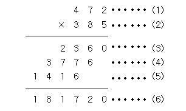

[문제 링크](https://www.acmicpc.net/problem/2588)

---

## 🔷 분류
사칙연산, 수학

## ✒️ 문제 설명
(세 자리 수) × (세 자리 수)는 다음과 같은 과정을 통하여 이루어진다.




(1)과 (2)위치에 들어갈 세 자리 자연수가 주어질 때 (3), (4), (5), (6)위치에 들어갈 값을 구하는 프로그램을 작성하시오.

## ⬅️ 입력
첫째 줄에 (1)의 위치에 들어갈 세 자리 자연수가, 둘째 줄에 (2)의 위치에 들어갈 세자리 자연수가 주어진다.

## ➡️ 출력
첫째 줄부터 넷째 줄까지 차례대로 (3), (4), (5), (6)에 들어갈 값을 출력한다.


## 💻 코드 (C++)

```cpp
#include <iostream>
using namespace std;

int main() {
	ios::sync_with_stdio(0);
	cin.tie(0);
	
	// 입력
	int a, b;
	cin >> a >> b;
	
	// 출력
	cout << a * (b%10) << "\n"; // (3)
	cout << a * ((b/10) - ((b/100)*10)) << "\n"; // (4)
	cout << a * (b/100) << "\n"; // (5)
	cout << a * b; // (6);
	
	return 0;
}
```

