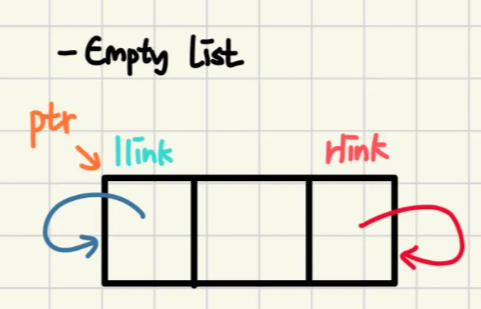
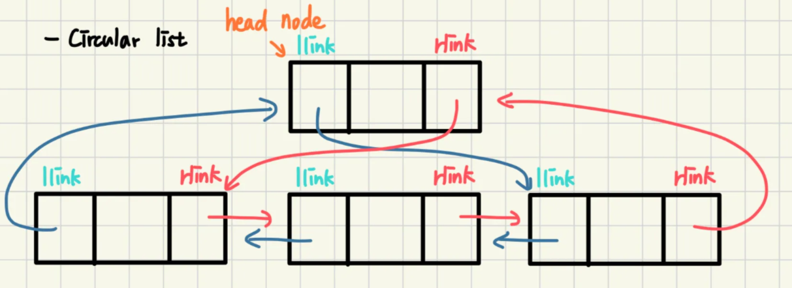
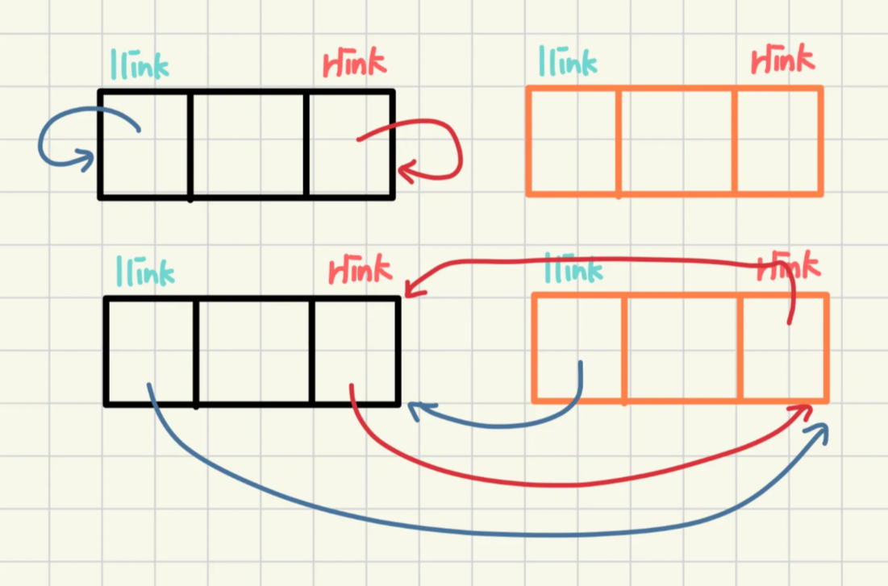
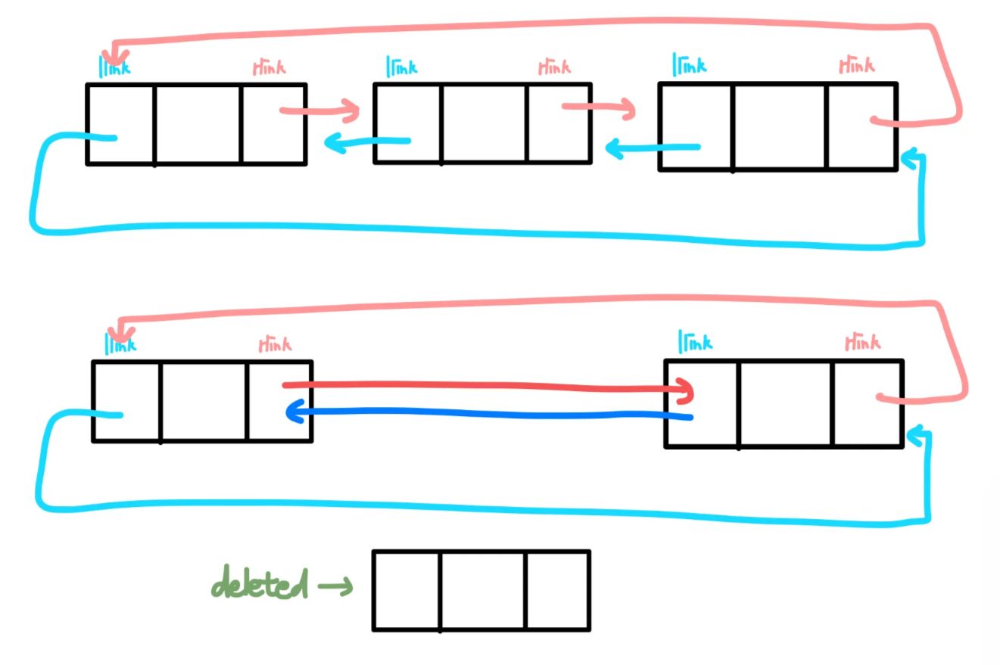

- Declarations
```c
typedef struct _node {
	struct _node *llink;
	element item;
	struct _node *rlink;
} node;
typedef node *node_pointer;
```




```c
ptr == ptr->llink->rlink == ptr->rlink->llink
```




### [Program 4.26] : Insertion to Doubly Linked Circular List

```c
void dinsert(node_pointer node, node_pointer newnode) {
	// node의 오른쪽에 newnode 추가
	newnode->llink = node;
	newnode->rlink = node->rlink;
	node->rlink->llink = newnode;
	node->rlink = newnode;
}
```




### [Program 4.27] : Deletion from Doubly Linked Circular List

```c
void ddelete(node_pointer node, node_pointer deleted) {
	// doubly linked list에서 deleted 삭제 
	if (node == deleted)
		printf("Deletion of head node not permitted.\n");
	else {
		deleted->llink->rlink = deleted->rlink;
		deleted->rlink->llink = deleted->llink;
		free(deleted);
	}
}
```




