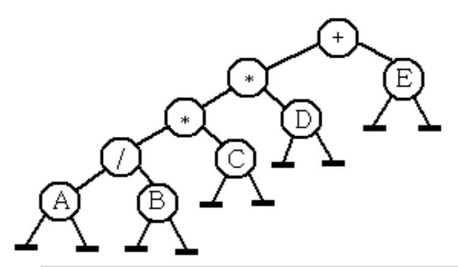
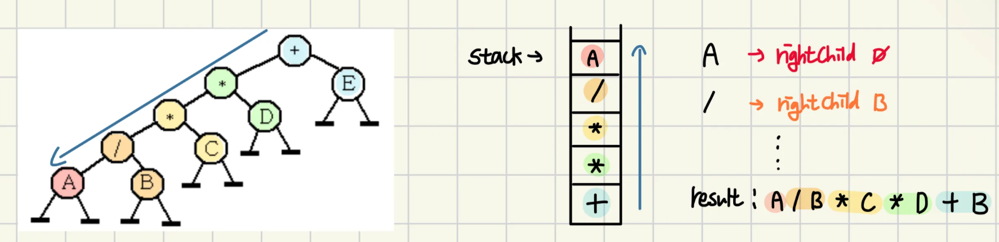
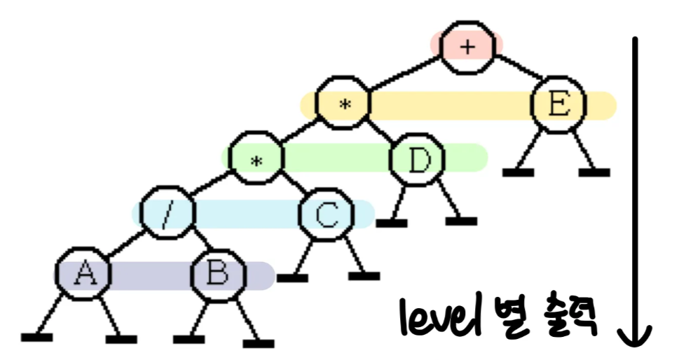
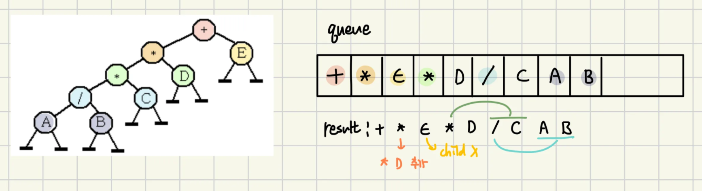

6가지 순회 방법 존재 

- LVR : inorder traversal → infix (4 + 3)
- LRV : postorder traversal → postfix (4 3 +)
- VLR : preorder traversal → prefix (+ 4 3)
(VRL, RVL, RLV)


### Inorder Traversal


- LVR


출력 : A / B * C * D + E 

```c
void inorder(treePointer ptr){
	// inorder traversal
	if (ptr) { // tree가 존재할 경우
		inorder(ptr->leftChild); // 왼쪽 자식으로 
		printf("%d", ptr->data); // 부모 data 출력
		inorder(ptr->rightChild); // 오른쪽 자식으로
	}
}
```


### Preorder Traversal


- VLR


출력 : + * * / A B C D E

```c
void preorder(treePointer ptr) {
	// preorder traversal
	if (ptr) { // tree 가 존재할 경우
		printf("%d", ptr->data); // 부모 데이터 출력
		preorder(ptr->leftChild); // 왼쪽 자식으로
		preorder(ptr->rightChild); // 오른쪽 자식으로
	}
}
```


### Postoreder Traversal


- LRV


출력 : A B / C * D * E +

```c
void postorder (treePointer ptr) {
	// postorder traversal
	if (ptr) { // tree 가 존재할 경우
		postorder(ptr->leftChild); // 왼쪽 자식으로
		postorder(ptr->rightChild); // 오른쪽 자식으로
		printf("%d", ptr->data); // 부모 데이터 출력
	}
}
```


### Iterative Inorder Traversal


- 재귀 : 코드가 쉬움. but 속도가 느려짐.
- [[stack|Stack]] 사용 : 속도가 빠름. but 코드가 복잡해짐.
```c
void iterInorder (treePointer node) {
	int top = -1; // stack 초기화
	treePointer stack[MAX_STACK_SIZE];
	for( ; ; ) {
		for ( ; node; node=node->leftChild) // node가 null이 될 때까지 왼쪽 자식 쌓기
			add(&top, node); // stack의 top에 node 추가 (추가 시 자동으로 top++)
		node = delete(&top); // stack의 top에서 node 꺼내기
		if(!node) 
			break; // 모든 node 출력까지 반복.
		printf("%d", node->data); // 꺼낸 node 데이터 출력
		node = node->rightChild;
	} // for 문 끝
}
```



[[트리|tree]] 한번 순회로 출력 가능.

- [[시간 복잡도]] : O(n)
- [[공간 복잡도]] : O(n), n은 depth


### Level Order Traversal


- [[queue|Queue]] 사용


```c
void levelOrder (treePointer ptr) {
	int front = rear = 0;
	treePointer queue[MAX_QUEUE_SIZE];
	if (!ptr) return; // tree가 존재하지 않으면.
	addq(front, &rear, ptr); // rear++
	for ( ; ; ) {
		ptr = deleteq(&front, rear); // front++
		if (ptr) { // ptr이 null 이 아니라면
			printf("%d", ptr->data);
			if(ptr->leftChild) // 왼쪽 자식이 존재하면
				addq(front, &rear, ptr->leftChild) // rear++
			if(ptr->rightChild) // 오른쪽 자식이 존재하면 
				addq(front, &rear, ptr->rightChild) // rear++
		} else break; // 다 출력했으면 끝.
	} // for 끝
}
```


