# ⭐Digital-to-Analog Conersion

## ✦ Data Communication Model

- Digital → Analog - 전송 - Analog → Digital
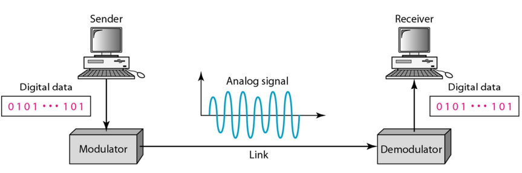

- bandpass (wireless, shared media) 로 전송하기 위해선 [[Analog Signal|analog signal]] 로 변환해야 함.

### ◆ Analog Signal

- 진폭 (Amplitude)
- 주파수 (Frequency)
- 위상 (Phase) 
사용해 인코딩 가능

### ◆ Analog 의 Data 와 Signal Element

- [[Data Element|Data element]] : bit
- [[Signal Element|Signal element]] : signal 의 가장 작은단위
  - signal element 에 몇 bit 표현할 것인가?
  - bit 1개 → 모양이 2개 / bit 8개 → 모양이 64개
- N : Data transmission rate ([[Data Transfer Rate|bit rate]])
- S : Signal transmission rate (baud rate)
S = N \times \frac{1}{r}

## ✦ Types of Digital-to-Analog Conversion

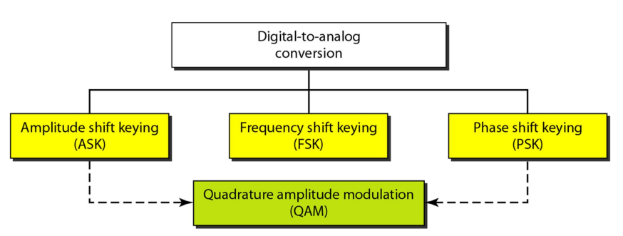

- [[Amplitude Shift Keying|Amplitude shift keying]] (ASK)
- Frequency shift keyins ([[FSK]])
- [[Phase Shift Keying|Phase shift keying]] (PSK)
- [[Quadrature Amplitude Modulation|Quadrature amplitude modulation]] (QAM) → 요즘 많이 사용

### ◆ Amplitude Shift Keying (ASK)

- Amplitude 를 바꿔 표현
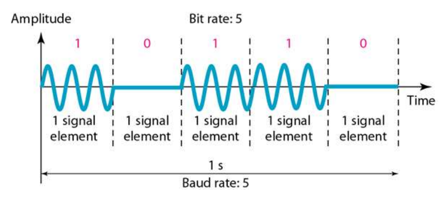

- Carrier signal : 신호를 보내는 signal
- Carrier frequency : 신호를 보내는 signal 의 frequency
  - central frequency : 중심 주파수
- Oscillator 사용
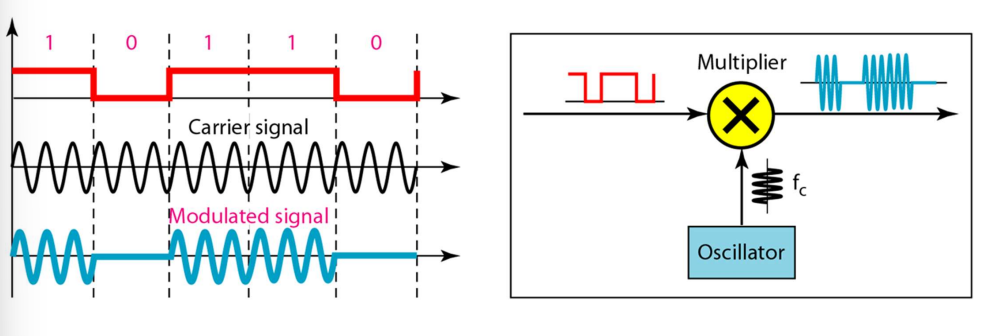

### ◆ Frequency Shift Keying (FSK)

- Frequency 를 바꿔 표현
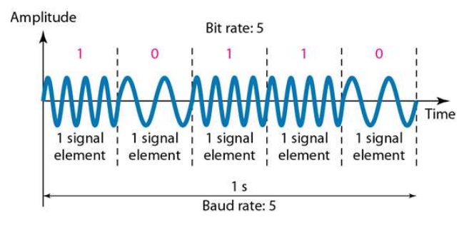

  - 그러나 주파수는 귀하기 때문에 잘 사용하지 않음
- Voltage-controlled oscillator
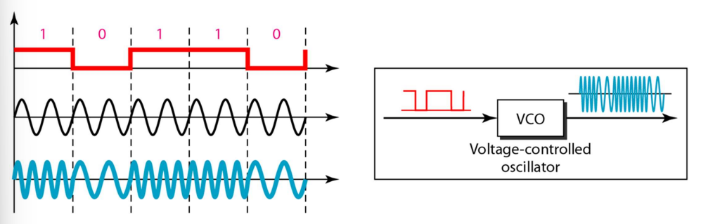

### ◆ Phase Shift Keying (PSK)

- Phase 를 바꿔 표현
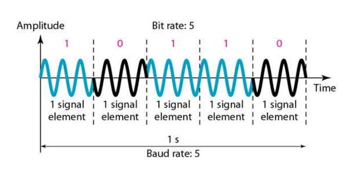

- BPSK (Binary PSK) : 2개 위상으로 0 or 1 표현
  - 0˚, 180˚
- QPSK (Quadrature PSK) : BPSK 보다 2배 빠름
  - 4개 위상으로 00, 01, 10, 11 사용
  - 45˚, 135˚, -45˚, -135˚
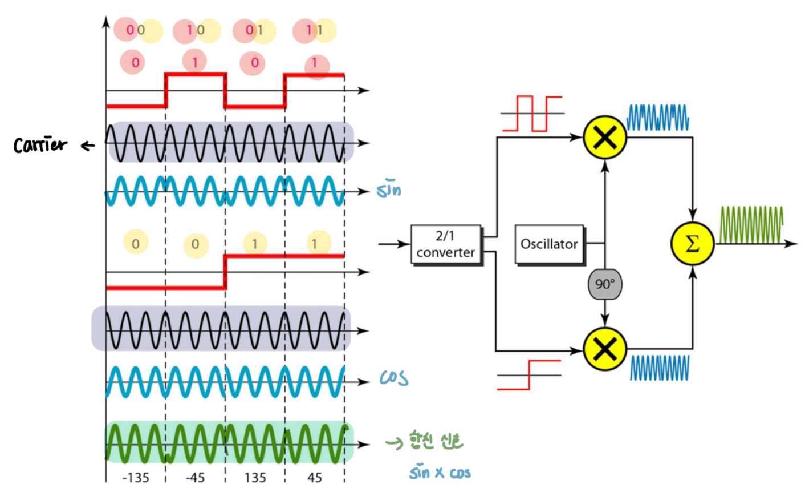

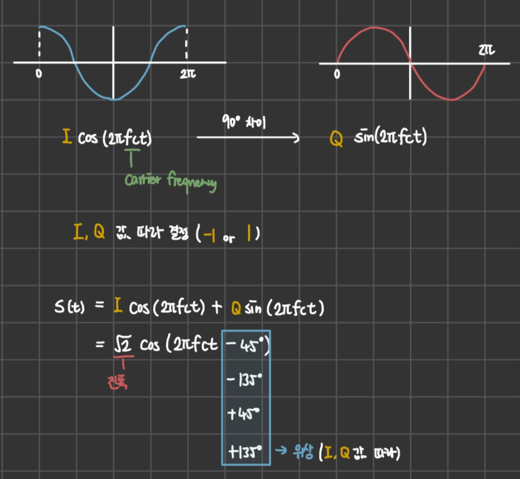

## ✦ Constellation Diagram

- amplitude 와 phase 를 나타내는 diagram
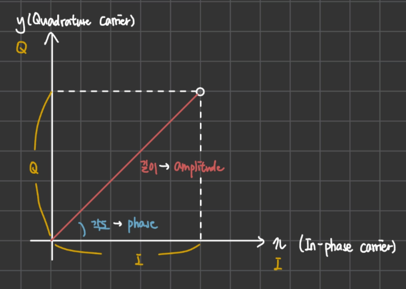

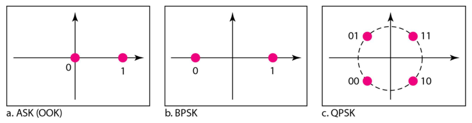

- ASK : ON-OFF K (OOK) 
  - 저에너지 필요 시 사용
- 점이 많을 수록 속도 ↑ 
  - QAM (Quadrature Amplitude [[Modulation]])
    - n-QAM : [[Constellation Diagram|constellation diagram]] 에 n 개의 점 사용, \log_2n 개의 bit 사용
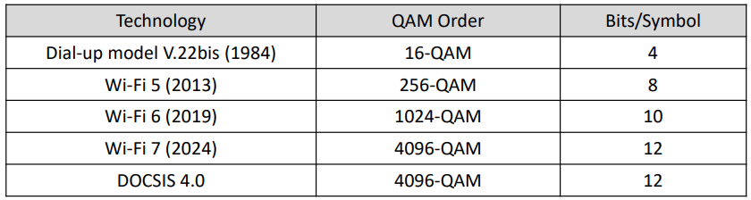

# ⭐Analog-to-Analog Conversion

- [[Carrier Signal|carrier frequency]] 사용해 analog data 전송
- Example : FM Radio

## ✦ Amplitude Modulation

- Carrier frequency 의 진폭을 바꾸기
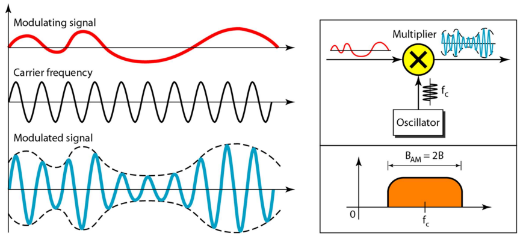

→ AM Radio 에서 사용

## ✦ Frequency Modulation

- Carrier frequency 의 주파수를 바꾸기
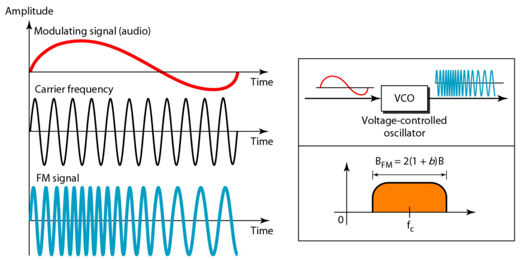

→ FM Radio 에서 사용

Frequency 사이 gap 필요

## ✦ Phase Modulation

- Carrier frequency 의 위상을 바꾸기
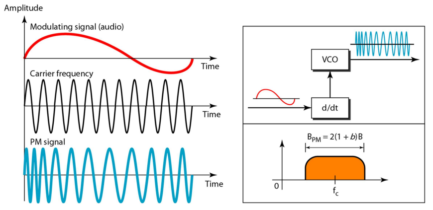
