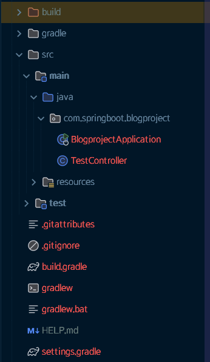
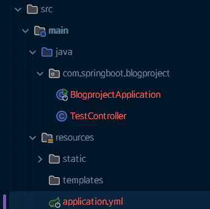
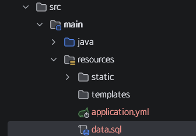
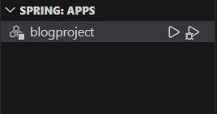
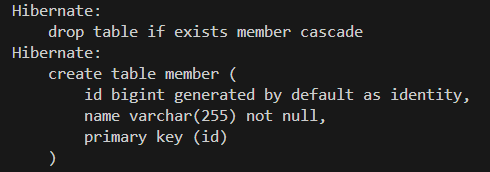
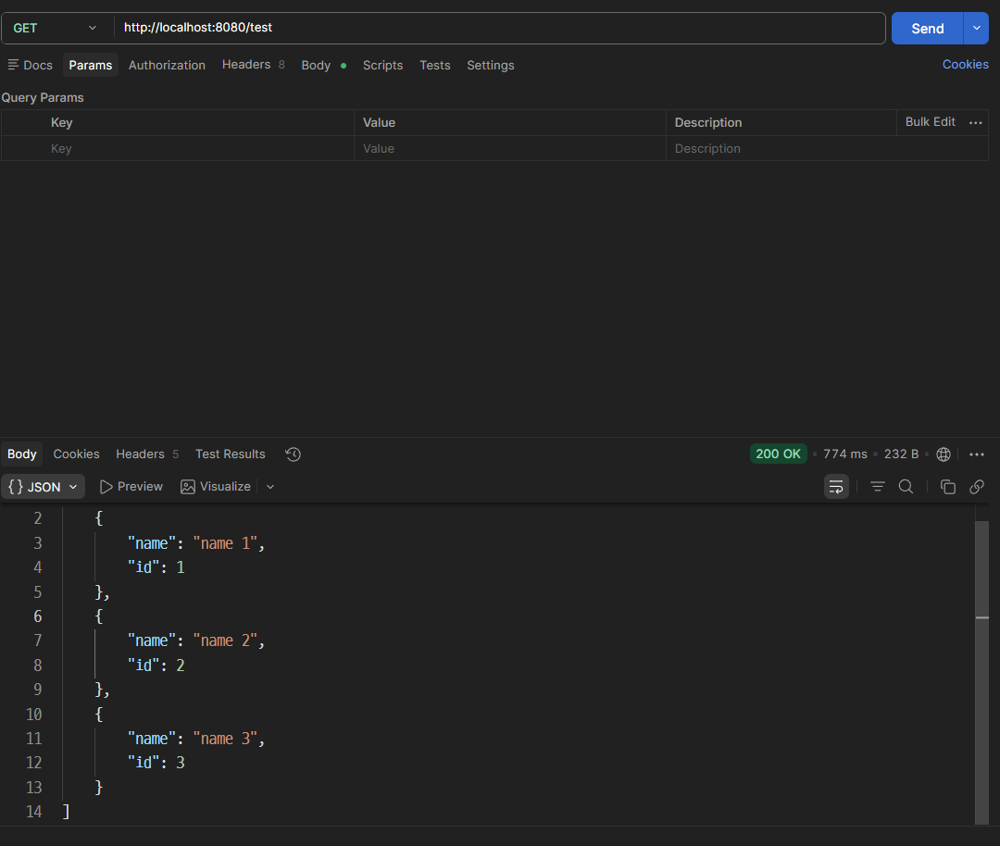
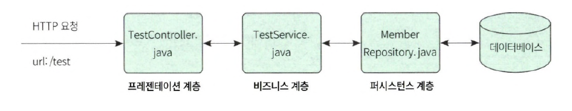
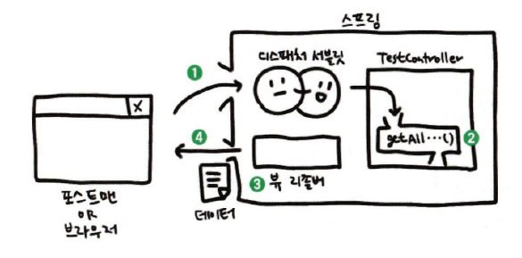

## ✦ 스프링 부트 4 구조 살펴보기

### ◆ 계층 이해하기

#### 프레젠테이션 계층

- HTTL 요청을 받고 비즈니스 계층으로 전송
- `@Controller` 역할 → [[Spring|스프링]] 부트 내 여러 개 존재

#### 비즈니스 계층

- 모든 비즈니스 로직 처리
    - 비즈니스 로직 : 서비스를 만들이 위한 로직
    - ex) 데이터 처리, [[Exception Handling|예외 처리]], 프로세스 구현 위한 로직
- `@Service` 역할

#### 퍼시스턴스 계층

- 모든 [[데이터베이스|DB]] 관련 로직 처리
- DB에 접근하는 DAO 객체 사용 가능
    - DAO 객체 : DB 계층과 상호작용하기 위한 객체
- `@Repository` 역할

### ◆ 스프링 부트 디렉터리 구성



- main : 실제 코드 작성 공간. 프로젝트 실행에 필요한 소스 코드 & 리소스 파일 위치
- test : 프로젝트 소스 코드 테스트할 목적의 코드 & 리소스 파일 위치
- build.gradle : 빌드 설정 파일. 의존성 & 플러그인 설정 등
- settings.gradle : 빌드할 프로젝트 정보 설정

### ◆ main 디렉터리 구성



- static : [[JavaScript|JS]], [[CSS]], 이미지 같은 정적 파일 위치
- template : HTML 같은 뷰 관련 파일 위치
- application.yml : 스프링 부트 설정
    - DB 설정 정보, 로깅 설정 정보 등
    - `application.properties` 대신 `application.yml` 사용

## ✦ 스프링 부트 4 프로젝트 발전시키기

### ◆ `build.gradle` 에 의존성 추가하기

```java
dependencies {
	implementation 'org.springframework.boot:spring-boot-starter-web' 
	implementation 'org.springframework.boot:spring-boot-starter'
	testImplementation 'org.springframework.boot:spring-boot-starter-test'
	testRuntimeOnly 'org.junit.platform:junit-platform-launcher'
	// 추가
	implementation 'org.springframework.boot:spring-boot-starter-data-jpa' // JPA
	runtimeOnly 'com.h2database:h2' // 인메모리 데이터베이스
	compileOnly 'org.projectlombok:lombok' //롬복
	annotationProcessor 'org.projectlombok:lombok'
}
```

- implelmentation : [[컴파일]] & 런타임 때 모두 필요
- tiestImplementation : 테스트 코드엣만 상
- runtimeOnly : 런타임에만 필요
- compileOnly : 컴파일에만 필요
- annotationProcessor : 컴파일 시 [[어노테이션]] 처리할 때 사용

### ◆ 계층 만들기

- 프레젠테이션 계층 → 컨트롤러

```java
package com.springboot.blogproject;

import org.springframework.web.bind.annotation.RestController;
import org.springframework.web.bind.annotation.GetMapping;

import java.lang.reflect.Member;

@RestController
public class TestController {
    @Autowired // TestService 빈 주입
    TestService testService;

    @GetMapping("/test")
    public List<Member> getAllMembers() {
        List<Member> members = testService.getAllMembers();
        return members;
    }
}
```

- 비즈니스 계층 → 서비스

```java
package com.springboot;

import org.springframework.stereotype.Service;

@Service
public class TestService {

    @Autowired
    private MemberRepository memberRepository; // 빈 주입

    public List<Member> getAllMembers() {
        return memberRepository.findAll(); // 멤버 목록 얻기
    } 
}
```

- 퍼시스턴트 계층 → Member DAO

```java
package com.springboot.blogproject;

import jakarta.persistence.Entity;
import jakarta.persistence.Id;
import jakarta.persistence.GeneratedValue;
import jakarta.persistence.GenerationType;
import jakarta.persistence.Column;
import lombok.Getter;
import lombok.NoArgsConstructor;
import lombok.AccessLevel;

@Getter
@Entity
@NoArgsConstructor(access = AccessLevel.PROTECTED)
public class Member {
    @Id
    @GeneratedValue(strategy = GenerationType.IDENTITY)
    @Column(name = "id", updatable = false)
    private Long id; // DB table 의 'id' 컬럼과 매칭

    @Column(name = "name", nullable = false)
    private String name; // DB table 의 'name' 컬럼과 매칭

    public Member(String name) {
        this.name = name;
    }
}
```

- 매핑 작업을 위한 [[인터페이스]]

```java
package com.springboot.blogproject;

@Repository
public interface MemberRepository extends JpaRepository<Member, Long> {
}

```

→ `Shift + Alt + O` 로 자동 import 정리 가능!

### ◆ 작동 확인하기

1. 더미 데이터 넣을 [[SQL]] 파일 생성 
    
    
    
    ```sql
    INSERT INTO member (id, name) VALUES (1, 'name 1')
    INSERT INTO member (id, name) VALUES (2, 'name 2')
    INSERT INTO member (id, name) VALUES (3, 'name 3')
    ```
    
2. `application.yml` 파일 변경

```sql
spring:
  jpa:
    # 전송 쿼리 확인
    show-sql: true
    properties:
      hibernate:
        format_sql: true

    # 테이블 생성 후에 data.sql 실행
    defer-datasource-initialization: true
```

1. [[서버]] 실행하기
    - [[Spring Boot]] Dashboard Extension
    
    
    
2. 테이블 만들어졌는지 확인
    - `Ctrl + F` 에서 `create table` 검색
    
    
    
3. 포스트맨으로 [[HTTP 요청]] 하기
    - `GET` 으로 [http://localhost:8080/test](http://localhost:8080/test) 입력
    
    
    
    - 데이터 확인 과정
    
    
    

## ✦ 스프링 부트 요청-응답 과정 이해하기



1. Postman 에서 Tomcat 에 /test `GET` 요청 보냄 
→ 스프링 부트 내로 이동. 디스패처 서블릿이 URL 분석 & 요청 처리 가능 Controller 찾기
→ `TestController` 가 가능하므로 /test `GET` 요청 전달
2. /test `GET` 요청 처리 가능 `getAllMembers()` [[메소드]]와 요청 매치
→ 메소드가 비즈니스 계층 & 퍼시스턴스 계층 통하며 필요 데이터 가져옴
3. 뷰 리졸버는 템플린 엔진을 사용해 HTML 문서 or [[JSON]], [[XML]] 등 데이터 생성 
4. 그 결과 `members` return → Postman 에서 볼 수 있음

---

- 자주 사용하는 특수 문자
    
    ∞ ⊂ ⊃ ∪ ∩ ∴ ∵ ⇒ ⇔ ⁿ ¹ ² ³ ⁴ · ↑ ↓ … × ₁ ₂ ₃ ₄ ∅
    ex) Example
