## ✦ 테스트 코드 개념 익히기

### ◆ 테스트 코드

- 작성한 코드가 의도대로 잘 동작하고 예상치 못한 문제가 없는지 확인하기 위해 작성
    - 다양한 패턴 존재
- `test` 디렉터리에서 작업

### ◆ given-when-then 패턴

1. given : 테스트 실행 준비
2. when : 테스트 진행
3. then : 테스트 결과 검증
- Example
    
    ```java
    @DisplayName("새로운 메뉴를 저장한다.")
    @Test
    public void saveMenuTest() {
    	// given : 메뉴 저장 준비 과정
    	final String name = "아메리카노";
    	final int price = 2000;
    	final Menu americano = new Menu(name, price);
    	
    	// when : 실제로 메뉴 저장
    	final long saveId = menuService.save(americano);
    	
    	// then : 메뉴가 잘 추가되었는지 검증
    	final Menu savedMenu = menuService.findById(savedId).get();
    	assertThat(savedMenu.getName()).isEqualTo(name);
    	assertThat(savedMenu.getPrice()).isEqualTo(price);
    }
    ```
    

## ✦ 스프링 부트 4와 테스트

- `spring-boot-starter-test` : 테스트 도구 집합 의존성
- [[Spring|스프링]] 부트 스타터 테스트 목록
    - JUnit : [[Java|자바]] 프로그래밍 언어용 [[단위 테스트]] [[프레임워크]]
    - Spring Test & [[Spring Boot]] Test : 스프링 부트 애플리케이션을 위한 [[통합 테스트]] 지원
    - AssertJ : 검증문인 어설션 작성에 사용
    - Hamcrest : 표현식 이해 쉽게 만드는 Mactcher 라이브러리
    - Mockito : 테스트용 목 객체 생성 & 관리 & 검증 쉽게 지원하는 테스트 프레임워크
    - JSONassert : [[JSON]] 용 어셜션 라이브러리
    - JsonPath : JSON 에서 특정 데이터 선택 & 검색 위한 라이브러리

### ◆ JUnit

- 자바 언어를 위한 단위 테스트 프레임워크
- 단위 테스트 : 작성한 코드가 의도대로 작동하는지 작은 단위로 검증
    - 단위 : [[메소드]]
- 테스트 방식 구분 [[어노테이션]] 제공
- `@Test` 어노테이션으로 메소드 호출마다 새 인스턴스 생성. 독립 테스트 가능
- 예상 결과 검증하는 어설션 메소드 제공
- 사용 방법 단순 & 테스트 코드 작성 시간 적음
- 자동 실행 & 자체 결과 확인 후 즉각적 피드백 제공

#### 사용 방법

1. JUnitTest 파일 만들기
    
    ```java
    import org.junit.jupiter.api.Assertions;
    import org.junit.jupiter.api.DisplayName;
    import org.junit.jupiter.api.Test;
    
    public class JUnitTest {
        @DisplayName("1 + 2 는 3이다.") // 테스트 이름 
        @Test
        public void junitTest() {
            int a = 1;
            int b = 2;
    
            int sum = 3;
    
            Assertions.assertEquals(sum, a + b); // 값이 같은지 확인
        }
    }
    ```
    
    - `@DisplayName` : 테스트 이름 명시
    - `@Test` : 테스트를 수행하는 메소드
        - 테스트끼리 영향 주지 않도록 각 테스트 실행마다 실행 객체 상성 & 살제
    - `assertEquals()`
        - 첫 번째 인수 : 기대값
        - 두 번째 인수 : 실제로 검증할 값
2. 실제 테스트 코드 동작 확인 

    
    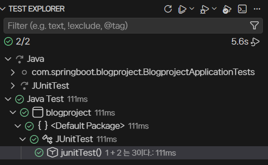
    
    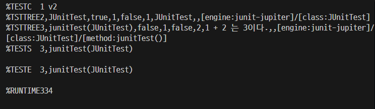
    
3. 테스트를 실패한다면?
    
    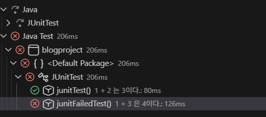
    
    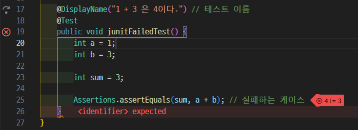
    
    → 전체 [[테스트 케이스]] 중 하나라도 실패하면 전체 테스트 실패!
    

### ◆ 자주 사용하는 JUnit 어노테이션

```java
import org.junit.jupiter.api.*;

public class JUnitCycleTest {
    @BeforeAll // 전체 테스트를 시작하기 전에 1회 실행하므로 메소드를 static 으로 선언
    static void beforeAll() {
        System.out.println("@BeforeAll");
    }

    @BeforeEach // 테스트 케이스를 시작하기 전마다 실행
    public void beforeEach() {
        System.out.println("@BeforeEach");
    }

    @Test
    public void test1() {
        System.out.println("test1");
    }

    @Test
    public void test2() {
        System.out.println("test2");
    }

    @Test
    public void test3() {
        System.out.println("test3");
    }

    @AfterAll // 전체 테스트가 끝난 후 1회 실행하므로 메소드를 static 으로 선언
    static void afterAll() {
        System.out.println("@AfterAll");
    }

    @AfterEach // 테스트 케이스를 종료하기 전마다 실행
    public void afterEach() {
        System.out.println("@AfterEach");
    }
}

```

- `@BeforeAll`
    - 전체 테스트 시작 전 처음으로 1번 실행
    - 전체 테스트 실행 주기에서 한 번만 호출 → `static` 으로 선언
    - ex) [[데이터베이스|DB]] 연결, 테스트 환경 초기화
- `@BeforeEach`
    - 각 테스트 케이스 시작 전 매번 실행
    - 각 인스턴스에 대해 호출해야하므로 `static`이 아니어야 함
    - ex) 테스트 메소드 사용 객체 초기화, 테스트에 필요한 값 넣기
- `@AfterAll`
    - 전체 테스트 끝내고 종료 전 한 번만 실행
    - 전체 테스트 실행 주기에서 한 번만 호출 → `static` 으로 선언
    - ex) DB 연결 종료, 공통 사용 자원 해제
- `@AfterEach`
    - 각 테스트 케이스 종료 전 매번 실행
    - 각 인스턴스에 대해 호출해야하므로 `static`이 아니어야 함
    - ex) 테스트 이후 특정 데이터 삭제
    
    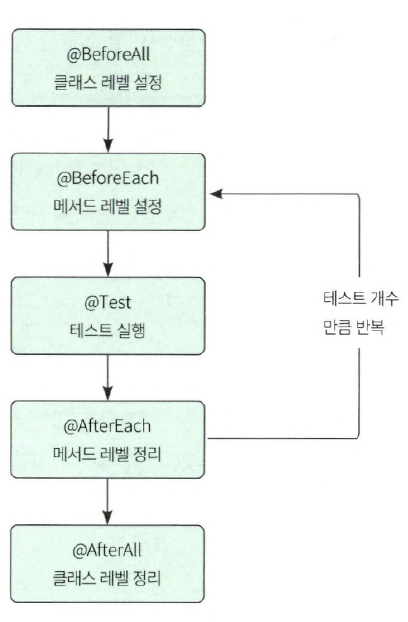
    
- 출력 결과
    
    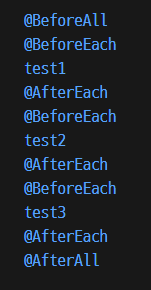
    

### ◆ AssertJ

- JUnit 과 함께 사용해 검증문의 [[Readability|가독성]] 높이기

```java
Assertions.assertEquals(sum, a + b); // 기댓값 & 비교값 구분 어려움
```

→ AssertJ 적용 시

```java
assertThat(a + b).isEqualTo(sum);
```

#### 메소드 목록

| 메소드 이름 | 설명 |
| --- | --- |
| `isEqualTo(A)` | A 값과 같은지 검증 |
| `isNotEqualTo(A)` | A 값과 다른지 검증 |
| `contains(A)` | A 값을 포함하는지 검증 |
| `doesNotContain(A)` | A 값을 포함하지 않는지 검증 |
| `startsWith(A)` | 접두사가 A 인지 검증 |
| `endsWith(A)` | 접미사가 A 인지 검증 |
| `isEmpty()` | 비어있는 값인지 검증 |
| `isNotEmpty()` | 비어있지 않은 값인지 검증 |
| `isPositive()` | 양수인지 검증 |
| `isNegative()` | 음수인지 검증 |
| `isGreaterThan(1)` | 1보다 큰 값인지 검증 |
| `isLessThan(1)` | 1보다 작은 값인지 검증 |

### ◆ 테스트 코드 작성 연습 문제 풀어보기

#### 문제 1

`JUnitQuiz.java` 파일 생성

```java
import static org.assertj.core.api.Assertions.assertThat;
import org.junit.jupiter.api.Test;

public class JUnitQuiz {
    @Test
    public void junitTest() {
        String name1 = "홍길동";
        String name2 = "홍길동";
        String name3 = "홍길은";

        // 1. 모든 변수가 null 이 아닌지 확인
        // 2. name1 과 name2 가 같은지 확인
        // 3. name1 과 name3 가 다른지 확인
    }
}

```

- 정답 코드
    
    ```java
    import static org.assertj.core.api.Assertions.assertThat;
    import org.junit.jupiter.api.Test;
    
    public class JUnitQuiz {
        @Test
        public void junitTest() {
            String name1 = "홍길동";
            String name2 = "홍길동";
            String name3 = "홍길은";
    
            // 1. 모든 변수가 null 이 아닌지 확인
            assertThat(name1).isNotNull();
            assertThat(name2).isNotNull();
            assertThat(name3).isNotNull();
    
            // 2. name1 과 name2 가 같은지 확인
            assertThat(name1).isEqualTo(name2);
    
            // 3. name1 과 name3 가 다른지 확인
            assertThat(name1).isNotEqualTo(name3);
        }
    }
    ```
    

#### 문제 2

```java
@Test
public void junitTest2() {
    int number1 = 15;
    int number2 = 0;
    int number3 = -5;
    
    // 1. number1 은 양수인지 확인
    // 2. number2 는 0인지 확인
    // 3. number3 은 음수인지 확인
    // 4. number1 은 number2 보다 큰지 확인
    // 5. number3 은 number2 보다 작은지 확인
}
```

- 정답 코드
    
    ```java
    @Test
    public void junitTest2() {
        int number1 = 15;
        int number2 = 0;
        int number3 = -5;
        
        // 1. number1 은 양수인지 확인
        assertThat(number1).isPositive();
    
        // 2. number2 는 0인지 확인
        assertThat(number2).isZero();
    
        // 3. number3 은 음수인지 확인
        assertThat(number3).isNegative();
    
        // 4. number1 은 number2 보다 큰지 확인
        assertThat(number1).isGreaterThan(number2);
    
        // 5. number3 은 number2 보다 작은지 확인
        assertThat(number3).isLessThan(number2);
    }
    ```
    
- 테스트 결과
    
    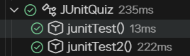
    

#### 문제 3

`JUnitCycleQuiz.java` 파일 생성

```java
import org.junit.jupiter.api.Test;

public class JUnitCycleQuiz {
    @Test
    public void junitQuiz3() {
        System.out.println("This is first test");
    }

    @Test
    public void junitQuiz4() {
        System.out.println("This is second test");
    }

    // 출력이 아래와 같으려면?
    /*
        Hello!
        This is first test
        Hello!
        This is second test
        Bye!
    */
}
```

- 정답 코드
    
    ```java
    import org.junit.jupiter.api.AfterAll;
    import org.junit.jupiter.api.BeforeEach;
    import org.junit.jupiter.api.Test;
    
    public class JUnitCycleQuiz {
        @BeforeEach
        public void beforeEach() {
            System.out.println("Hello!");
        }
    
        @Test
        public void junitQuiz3() {
            System.out.println("This is first test");
        }
    
        @Test
        public void junitQuiz4() {
            System.out.println("This is second test");
        }
    
        @AfterAll
        public static void afterAll() {  // static 붙이기!
            System.out.println("Bye");
        }
    }
    
    ```
    
    - 실행 결과
        
        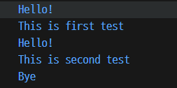
        

## ✦ 제대로 테스트 코드 작성해보기

### ◆ `TestController` 만들어보기

1. `build.gradle` 파일에 의존성 추가
    
    ```xml
    dependencies {
    	...
    	testImplementation 'org.springframework.boot:spring-boot-starter-webmvc-test'
    }
    ```
    
2. VS Code 에서 테스트 만들기
    
    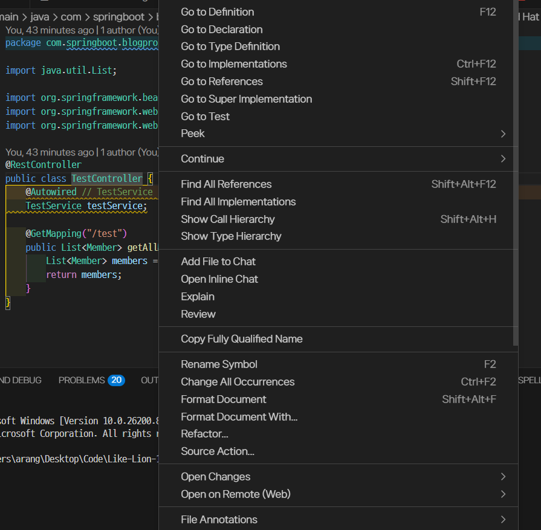
    
    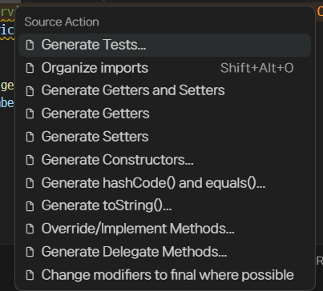
    
    
    
    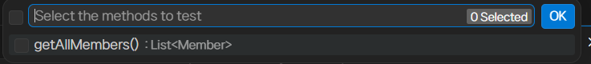
    
    - 파일 안에서 우클릭 > Source Action > Generate Test > class 이름 입력 > 테스트 할 메소드 선택
3. 생성된 파일 작성
    
    ```java
    @SpringBootTest  // 테스트용 애플리케이션 컨텍스트 생성
    @AutoConfigureMockMvc // MockMvc 생성 및 자동 구성
    public class TestControllerTest {
        
        @Autowired
        protected MockMvc mockMvc; 
    
        @Autowired
        private WebApplicationContext context;
    
        @Autowired
        private MemberRepository memberRepository;
    
        @BeforeEach // 테스트 실행 전 메소드
        public void mockMvcSetUp() { 
            this.mockMvc = MockMvcBuilders.webAppContextSetup(context).build();
        }
    
        @AfterEach // 테스트 실행 후 메소드
        public void cleanUp() {
            memberRepository.deleteAll();
        }
    }
    ```
    
    - `@SpringBootTest` : 메인 애플리케이션의 `@SpringBootApplication` [[클래스]] & 포함된 빈 찾고 테스트용 애플리케이션 컨텍스트 만듬
    - `@AutoConfigureMockMvc` : MockMvc 를 생성 & 자동 구성
        - MockMvc : 테스트용 MVC 환경 만들어 요청 & 전송 & 응답 기능 제공 유틸리티 클래스
    - `@BeforeEach` : 테스트 실행 전 각 메소드에 적용. `MockMvcSetUp()` 으로 MockMvc 설정
    - `@AfterEach` : 테스트 실행 후 각 메소드에 적용. `cleanUp()` 으로 member 테이블 데이터 삭제
4. `TestController` 로직 테스트 코드 작성
    
    ```java
    @SpringBootTest  // 테스트용 애플리케이션 컨텍스트 생성
    @AutoConfigureMockMvc // MockMvc 생성 및 자동 구성
    public class TestControllerTest {
        
        @Autowired
        protected MockMvc mockMvc; 
    
        @Autowired
        private WebApplicationContext context;
    
        @Autowired
        private MemberRepository memberRepository;
    
        @BeforeEach
        public void mockMvcSetUp() {
            this.mockMvc = MockMvcBuilders.webAppContextSetup(context).build();
        }
    
        @AfterEach
        public void cleanUp() {
            memberRepository.deleteAll();
        }
    
        @DisplayName("getAllMembers: 아티클 조회에 성공한다.")
        @Test
        public void getAllMembers() throws Exception {
            // given
            final String url = "/test";
            Member savedMember = memberRepository.save(new Member("홍길동"));
            
            // when
            final ResultActions result = mockMvc.perform(get(url)
                    .accept(MediaType.APPLICATION_JSON));
    
            // then
            result
                    .andExpect(status().isOk())
                    .andExpect(jsonPath("$[0].id").value(savedMember.getId()))
                    .andExpect(jsonPath("$[0].name").value(savedMember.getName()));
        }
    }
    ```
    
    - IntelliJ 에서 lombok 추가하기 : 설정 > 플러그인 > 마켓플레이스 에서 lombok 설치
    - Given - When - Then 패턴 적용
        
        
        | Given | 멤버를 저장 |
        | --- | --- |
        | When | 멤버 리스트를 조회하는 API 호출 |
        | Then | 응답 코드가 200 OK이고, 받환받은 값 중에 0번째 요소의 id 와 name 이 저장된 값과 같은지 확인 |
    1. `perform()` 
        - do : 요청 전송
        - return : `ResultsActions` 객체 (`andExpect()` 메소드 제공)
    2. `accept()`
        - do : 요청 전송 시 무슨 타입으로 응답 받을지 결정 → `JSON` 받음
    3. `andExpect()`
        - do : 응답 검증
        - `status().isOk()` → 응답 코드가 OK(200) 인가?
    4. `jsonPath("$[0].${필드명}")`
        - do : JSON 응답값의 값을 가져옴 → `value` 값과 비교
    - HTTP 주요 응답 검증 코드
        
        
        | 코드 | 매핑 메소드 |
        | --- | --- |
        | 200 OK | `isOK()` |
        | 201 Created | `isCreated()` |
        | 400 Bad Request | `isBadRequest()` |
        | 403 Forbidden | `isForbidden()` |
        | 404 Not Found | `isNotFound()` |
        | 400번대 응답 코드 | `is4xxClientError()` |
        | 500 Internal Server Error | `isInternalServerError()` |
        | 500번대 응답 코드 | `is5xxServerError()` |

4. 테스트 동작 확인

- `Test` 에서 동작 확인
    
    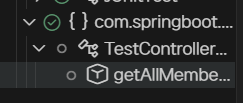
    
- 엥 오류가 나는데요?
    
    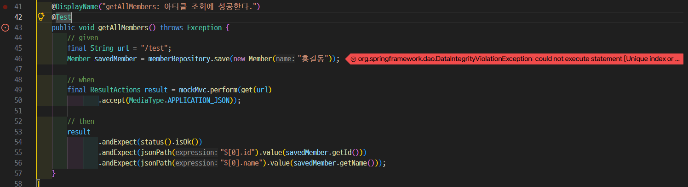
    
    ## 무슨 일이 벌어지고 있나
    
    에러는 TestControllerTest.java:48의 `memberRepository.save(...)`에서 터지는 `DataIntegrityViolationException`(H2 [[기본키|PK]] 제약 위반)입니다.
    
    흐름은 이렇습니다:
    
    1. `@SpringBootTest`가 컨텍스트를 띄우면서 data.sql을 실행 → `id = 1, 2, 3` 행이 **명시적 id로** 삽입됩니다.
    2. 그런데 Member.java:17은 `GenerationType.IDENTITY`입니다. 명시적으로 id를 넣어도 H2의 IDENTITY 카운터는 **1에서 그대로** 있습니다.
    3. 테스트가 `save(new Member("홍길동"))`을 하면 H2가 `id = 1`을 자동 생성 → 이미 있는 1번과 충돌 → **PK 위반**.
    
    여기에 더해 **숨은 두 번째 문제**도 있습니다. 설령 충돌을 넘겨도, data.sql이 3건을 미리 넣어놨으니 `$[0]`은 `'name 1'`이지 `'홍길동'`이 아니라서 line 57-58의 `jsonPath` 검증도 실패합니다.
    
    즉 이 테스트는 **DB가 비어있다**는 전제인데, `data.sql`이 그 전제를 깨고 있습니다.
    
    → 어떻게 해결하지?
    
    - `application.yml` 파일에 아래 코드 추가!
    
    ```yaml
      # 테스트에서는 data.sql 시드 데이터를 넣지 않는다 (빈 테이블 전제)
      sql:
        init:
          mode: never
    ```
    
    해결 !
    
    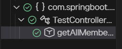
    

### ◆ 테스트 코드 패턴 연습하기

1. 연습을 위해 컨트롤러 추가!
    - `QuizController.java` 추가
    
    ```java
    package com.springboot.blogproject;
    
    import org.springframework.http.ResponseEntity;
    import org.springframework.web.bind.annotation.GetMapping;
    import org.springframework.web.bind.annotation.PostMapping;
    import org.springframework.web.bind.annotation.RequestBody;
    import org.springframework.web.bind.annotation.RequestParam;
    import org.springframework.web.bind.annotation.RestController;
    
    @RestController
    public class QuizController {
        
        @GetMapping("/quiz")
        public ResponseEntity<String> quiz(@RequestParam("code") int code) {
            switch (code) {
                case 1:
                    return ResponseEntity.created(null).body("Created!");
                case 2:
                    return ResponseEntity.badRequest().body("Bad Request!");
                default:
                    return ResponseEntity.ok().body("OK!");
            }
        }
    
        @PostMapping("/quiz")
        public ResponseEntity<String> quiz2(@RequestBody Code code) {
    
            switch (code.value()) {
                case 1:
                    return ResponseEntity.status(403).body("Forbidden!");
                default:
                    return ResponseEntity.ok().body("OK!");
            }
        }
    }
    
    record Code(int value) {}
    ```
    
    1. `/quiz` 로 `GET` 요청이 오면 `quiz()` 메소드에서 요청 처리
        - do : 요청 파라미터의 키가 “code” 이면 int 자료형의 code [[변수]]와 매핑 
        → 매핑 따라 다른 응답 전송
        
        | code 값 | 응답 코드 | 응답 본문 |
        | --- | --- | --- |
        | 1 | 201 | Created! |
        | 2 | 400 | Bad Request! |
        | 그 외 | 200 | OK! |
    2. `/quiz` 로 `POST` 요청이 오면 `quiz2()` 메소드에서 요청 처리
        - do : 요청 값을 `Code` 라는 객체로 매칭 → value 값 따라 다른 응답 전송
        
        | code 값 | 응답 코드 | 응답 본문 |
        | --- | --- | --- |
        | 1 | 403 | Forbidden! |
        | 그 외 | 200 | OK! |
    3. b에서 매칭할 객체로 사용하기 위해 선언한 레코드
        - 레코드
            - 데이터 전달 목적 객체를 빠르고 간편하게 만들기 위한 기능
            - [[필드]], [[생성자]], getter, `equals()`, `hashCode()`, `toString()` 메소드 자동 생성
2. `QuizController` 로 test 파일 만들기
    - VS Code : 파일 안에서 우클릭 > Source Action > Generate Test > class 이름 입력 > 테스트 할 메소드 선택
    - IntelliJ : `Alt + Enter`
    
    ```java
    package com.springboot.blogproject;
    
    import org.junit.jupiter.api.BeforeEach;
    import org.springframework.beans.factory.annotation.Autowired;
    import org.springframework.boot.test.context.SpringBootTest;
    import org.springframework.boot.webmvc.test.autoconfigure.AutoConfigureMockMvc;
    import org.springframework.test.web.servlet.MockMvc;
    import org.springframework.test.web.servlet.setup.MockMvcBuilders;
    import org.springframework.web.context.WebApplicationContext;
    
    import tools.jackson.databind.ObjectMapper;
    
    @SpringBootTest
    @AutoConfigureMockMvc
    public class QuizControllerTest {
    
        @Autowired
        protected MockMvc mockMvc;
        
        @Autowired
        private WebApplicationContext context;
    
        @Autowired
        private ObjectMapper objectMapper;
    
        @BeforeEach
        public void mockMvcSetUp() {
            this.mockMvc = MockMvcBuilders.webAppContextSetup(context)
                    .build();
        }
    }
    ```
    
    - `ObjectMapper` : 객체 ↔ JSON 간의 변환 처리 → 객체 직렬화
        - ex)
        
        ```java
        Code code = new Code(13)
        objectMapper.writeValueAsString(code)
        
        // {'value': 13}
        ```
        

### ◆ 테스트 코드 연습문제 풀어보기

#### 문제 1

`GET` 요청을 보내 응답 코드마다 예상하는 응답을 반환하는지 검증하는 테스트 작성

```java
    @DisplayName("quiz(): GET /quiz?code=1 이면 응답 코드는 201, 응답 본문은 'Created!'를 리턴")
    @Test
    public void getQuiz1() throws Exception {
        // 채우기
    }

    @DisplayName("quiz(): GET /quiz?code=2 이면 응답 코드는 400, 응답 본문은 'Bad Request!'를 리턴")
    @Test
    public void getQuiz2() throws Exception { 
				// 채우기
    }
```

- 정답
    
    ```java
        @DisplayName("quiz(): GET /quiz?code=1 이면 응답 코드는 201, 응답 본문은 'Created!'를 리턴")
        @Test
        public void getQuiz1() throws Exception {
            // given
            final String url = "/quiz?code=1";
    
            // when
            final ResultActions result = mockMvc.perform(get(url)
                    .param("code", "1")
            );  
    
            // then
            result
                    .andExpect(status().isCreated())
                    .andExpect(content().string("Created!"));
        }
    
        @DisplayName("quiz(): GET /quiz?code=2 이면 응답 코드는 400, 응답 본문은 'Bad Request!'를 리턴")
        @Test
        public void getQuiz2() throws Exception { 
            
            // given
            final String url = "/quiz?code=2";
    
            // when
            final ResultActions result = mockMvc.perform(get(url)
                    .param("code", "2")
            );
    
            // then
            result
                    .andExpect(status().isBadRequest())
                    .andExpect(content().string("Bad Request!"));
        }
    ```
    

#### 문제 2

`POST` 요청을 보내 응답 코드마다 예상하는 응답을 반환하는지 검증하는 테스트 작성

```java
    @DisplayName("quiz(): POST /quiz?code=1 이면 응답 코드는 403, 응답 본문은 'Forbidden!'를 리턴")
    @Test
    public void postQuiz1() throws Exception {

    }

    @DisplayName("quiz(): POST /quiz?code=13 이면 응답 코드는 200, 응답 본문은 'OK!'를 리턴")
    @Test
    public void postQuiz13() throws Exception {
        
    }
```

- 정답
    
    ```java
    		@DisplayName("quiz(): POST /quiz?code=1 이면 응답 코드는 403, 응답 본문은 'Forbidden!'를 리턴")
        @Test
        public void postQuiz1() throws Exception {
            // given
            final String url = "/quiz";
    
            // when
            final ResultActions result = mockMvc.perform(post(url)
                    .contentType(MediaType.APPLICATION_JSON)
                    .content(objectMapper.writeValueAsString(new Code(1)))
            );
    
            // then
            result
                    .andExpect(status().isForbidden())
                    .andExpect(content().string("Forbidden!"));
        }
    
        @DisplayName("quiz(): POST /quiz?code=13 이면 응답 코드는 200, 응답 본문은 'OK!'를 리턴")
        @Test
        public void postQuiz13() throws Exception {
            // given
            final String url = "/quiz";
    
            // when
            final ResultActions result = mockMvc.perform(post(url)
                    .contentType(MediaType.APPLICATION_JSON)
                    .content(objectMapper.writeValueAsString(new Code(13)))
            );
    
            // then
            result
                    .andExpect(status().isOk())
                    .andExpect(content().string("OK!"));
        }
    ```
    

---

- 자주 사용하는 특수 문자
    
    ∞ ⊂ ⊃ ∪ ∩ ∴ ∵ ⇒ ⇔ ⁿ ¹ ² ³ ⁴ · ↑ ↓ … × ₁ ₂ ₃ ₄ ∅
    ex) Example
