## ✦ 데이터베이스란

- 데이터를 효율적으로 보관 & 꺼내볼 수 있는 곳
- 데이터 안전 저장 + 관리를 많은 사람들이 가능

### ◆ 데이터베이스 관리자, DBMS

- DBMS (DataBase Management System) : 데이터베이스 관리 위한 소프트웨어
    - 동시 접근 가능해야 함
    - ex) MySQL, 오라클 등

#### 관계형 DBSM

- Relational DBMS = RDBMS
- 관계형 모델 기반
- 테이블 형태로 이루어진 데이터 저장소
- ex) H2, MySQL
    - H2
        - Java 로 작성되어 있는 RDBMS
        - 스프링 부트가 지원하는 인메모리 관계형 데이터베이스
        - 애플리케이션 자체 내부에 데이터 저장 → 재실행 시 초기화 (테시트용)
    - MySQL
        - 실제 서비스 시 사용

#### 데이터베이스 용어

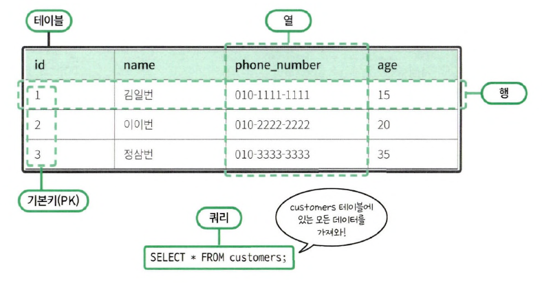

- 테이블 table
    - DB 에서 데이터를 구성하기 위한 가장 기본적 단위
    - 행 & 열로 구성.
- 행 row = 레코드 record
    - 테이블에서 가로로 배열된 데이터의 집합
    - 여러 속성으로 구성
    - 반드시 고유한 식별자인 **기본키**를 가짐
- 열 column
    - 테이블에서 세로로 배열된 각 요소의 속성
    - 행에 저장되는 유형의 데이터
    - 데이터에 대한 무결성 보장 (다른 타입 데이터 저장 불가능)
- 기본키 primary key
    - 행을 구분할 수 있는 식별자
    - 테이블에서 유일해야 함. 중복값 X, NULL 이 될 수 없음, 수정 불가
    - 데이터 접근 & 다른 테이블과 관계 맺을 시 사용
- 쿼리 query
    - DB 에서 데이터 조회, 삭세, 생성, 수정을 위해 사용하는 명령문
    - 데이터베이스 전용 언어인 SQL 사용

### ◆ SQL 문으로 데이터베이스 조작하는 연습하기

#### `SELETE` 문 : 데이터 조회

- 개발 시 가장 많이 사용

```sql
SELECT <무엇을?>
FROM <어디에서?>
WHERE <무슨?>;
```

- id 가 2인 손님의 이름을 가져오기
    
    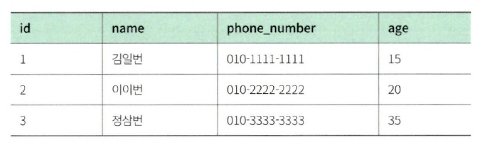
    
    ```sql
    SELECT name
    FROM customers
    WHERE id = 2;
    ```
    
- 조건 없으면 `WHERE` 생략 가능
- 데이터 모두 가져오기 `SELECT *`
- 연습 문제
    1. customers 테이블에서 id 가 1번인 손님의 데이터 가져오기
    - Answer
        
        ```sql
        SELECT *
        FROM customers
        WHERE id = 1
        ```
        
    1. customers 테이블에서 핸드폰 번호가 ‘010-2222-2222’인 손님의 id 와 이름 가져오기
    - Answer
        
        ```sql
        SELECT id, name
        FROM customers
        WHERE phone_number = '010-2222-2222'
        ```
        

#### `WHERE` 절 : 조건 추가

| 명령어 | 설명 | 예시 |
| --- | --- | --- |
| `=` | 특정 값과 동일한 값을 가진 행 조회 | `age = 10` |
| `!=`  or `<>` | 특정 값과 동일하지 않은 행 조회 | `age != 10` |
| `<`, `>`, `<=`, `>=` | 특정 값과 대소 비교하여 조회 | `age > 10` / `age <= 10` |
| `BETWEEN` a `AND` b | 지정된 값 사이 값을 조회 | `age BETWEEN 10 AND 20` |
| `LIKE` | 패턴 매칭을 위해 사용 /  `%` 와일드카드 | `name LIKE '김%'` |
| `AND` | 두 조건 모두 참이면 조회 | `name LIKE '김%' AND '이%'` |
| `OR` | 두 조건 중 하나라도 참이면 조회 | `name LIKE '김%' OR '이%'` |
| `IS NULL`, `IS NOT NULL` | `NULL` 값의 존재 여부 검사 | `name IS NULL` |
- 연습 문제
    1. 나이가 20살 이상인 손님 조회
    - Answer
        
        ```sql
        WHERE age >= 20
        ```
        
    1. 나이가 10살 이상, 30살 이하인 손님 조회
    - Answer
        
        ```sql
        WHERE age BETWEEN 10 AND 30
        ```
        
    1. 성이 ‘김’ 이거나 ‘이’ 로 시작하는 손님 조회
    - Answer
        
        ```sql
        WHERE name LIKE '김%' OR '이%'
        ```
        

#### `INSERT` 문 : 데이터 추가

- 테이블에 새로운 행 추가

```sql
INSERT INTO <무슨 컬럼을?>
VALUES <어떤 값으로?>;
```

- ex) customers 테이블에 이름 ‘박사번’, 전화번호 ‘010-4444-4444’, 나이 40살 행 추가

```sql
INSERT INTO customers (name, phone_number, age)
VALUES('박사번', '010-4444-4444', 40);
```

- 새 레코드 추가시 `id` 가 자동으로 +1 씩 증가
    
    ```sql
    INSERT INTO customers (name, phone_number, age)
    VALUES('최오번', '010-5555-5555', 51);
    ```
    
    → 추가한다면?
    
    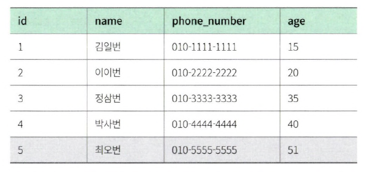
    

#### `DELETE` 문 : 데이터 삭제

```sql
DELETE FROM <어디에서> WHERE <어떤 조건으로?>;
```

- ex) id 가 5인 레코드 삭제

```sql
DELETE FROM customers WHERE id = 5;
```

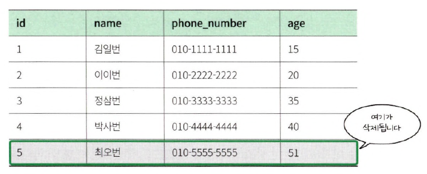

#### `UPDATE` 문 : 데이터 수정

- 특정 레코드의 값 변경

```sql
UPDATE <어디의?>
SET <어떤 column 을? = 어떤 값으로?>
WHERE <어떤 조건인 row 만?>;
```

- ex) name = 김일번인 레코드의 age 를 11로 수정

```sql
UPDATE customers
SET age = 11
WHERE name = '김일번';
```

- `WHERE` 절 생략 시 테이블의 모든 레코드 수정됨
- 연습 문제
    1. customers 테이블에서 id 가 1번인 손님의 이름을 ‘김일’로 바꾸기
    - Answer
        
        ```sql
        UPDATE customers
        SET name = '김일'
        WHERE id = 1;
        ```
        
    1. customers 테이블의 모든 전화번호를 공백으로 바꾸기
    - Answer
        
        ```sql
        UPDATE customers
        SET phone_number = '';
        ```
        

## ✦ ORM이란?

- ORM (Object-Relational Mapping) : 자바의 객체 - 데이터베이스 연결 프로그래밍 기법
    - 데이터베이스 의 값을 마치 객체처럼 사용 가능
    - 자바 언어로만 데이터베이스에 접근 가능
    - 장점
        - SQL 직접 작성 X, 사용하는 언어로 DB 접근 가능
        - 객체지향적으로 코드 작성 가능 → 비즈니스 로직만 집중 가능
        - DBMS 가 추상화되어 있어 종속성 감소
        - 매핑 정보가 명확하므로 ERD 의존도 감소, 유지보수 유리
    - 단점
        - 프로젝트의 복잡성 커질수록 난이도 상승
        - 복잡하고 무거운 쿼리는 ORM 으로 해결 불가능한 경우 있음

## ✦ JPA 와 하이버네이트?

- JPA (Java Persistance API) : 자바에서의 ORM 표준
    - 관계형 데이터베이스 사용 방식 정의 인터페이스
    - 자바 객체 - DB 연결해 데이터 관리
- 하이버네이트 (hibernate) : 자바용 ORM 프레임워크
    - JPA 인터페이스 구현한 구현체
    - 내부적으로 JDBC API 사용
    - 자바 객체를 통해 DB 종류에 상관없이 자유자재로 사용
    
    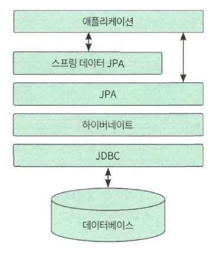
    

### ◆ 엔티티 매니저란?

- 엔티티 (Entity)
    - DB의 테이블과 매핑되는 객체
    - 본질적으론 자바 객체, 그러나 DB의 테이블과 직접 연결
    → 쿼리 실행 객체
- 엔티티 매니저 (Entity Manager)
    - 엔티티를 관리해 DB - App 사이에서 객체 생성 & 수정 & 삭제 역할
    - 엔티티 매니저 팩토리 (Entity Manager Factory) 에서 만들어짐
        
        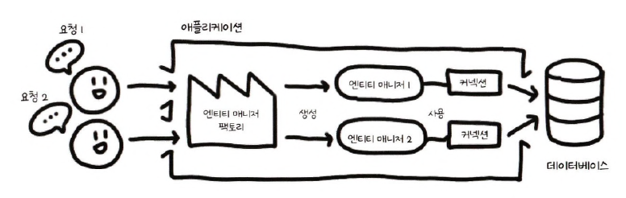
        
- 스프링 부트가 엔티티 매니저를 사용하는 방법
    - 엔티티 매니저 팩토리 : 내부에서 하나만 생성해서 관리
    - 엔티티 매니저 : `@PersistenceContext` , `@Autowired` 어노테이션으로 사용
        - 기본적으로 빈은 1개만 생성 → 동시성 문제 발생 가능!
        - 실제 엔티티 매니저와 연결하는 프록시(가짜) 엔티티 매니저 사용
    
    ```java
    @PersistenceContext
    EntityManger em; // 프록시 엔티티 매니저. 필요 시 진짜 엔티티 매니저 호출
    ```
    

### ◆ 영속성 컨텍스트란?

- 영속성 컨텍스트 : 엔티티를 관리하는 가상의 공간
    - 엔티티 매니저가 엔티티를 저장하는 곳
    - DB 에서 데이터 가져오기 & 엔티티 사용 편하게 함
- 특징 : DB 접근 최소화해 성능 향상
    - 1차 캐시
        - 이전에 사용한 데이터에 대해서 캐시 → 빠른 접근 가능
        - 캐시의 키 : `@Id` 어노테이션이 달린 기본키 역할 식별자
        - 캐시의 값 : 엔티티
        - 데이터 조회 시 1차 캐시 조회
            - 있으면 반환
            - 없으면 DB 에서 조회해 1차 캐시에 저장 후 반환
    - 쓰기 지연 (Trasactional Write-Behind)
        - 트랙잭션 커밋 전까지 쿼리 모았다가 트랜잭션 커밋하면 모았던 쿼리 한번에 실행
        - 적당한 묶음으로 쿼리 요청 가능 → DB 시스템 부담 감소
    - 변경 감지
        - 트랜잭션 커밋 시 1차 캐시 엔티티 값 vs 현재 엔티티 값 비교해 변경 사항 있을 시 DB 자동 반영
        - 적당한 묶음으로 쿼리 요청 가능 → DB 시스템 부담 감소
    - 지연 로딩 (Lazy Loading)
        - 쿼리로 요청한 데이터를 App 에 바로 로딩 X 필요할 때 쿼리 날려 데이터 조회

### ◆ 엔티티의 상태

1. 분리 (Detached) : 영속성 컨텍스트가 관리 X
2. 관리 (Managed) : 영속성 컨텍스트가 관리
3. 비영속 (Transient) : 영속성 컨텍스트와 전혀 관계 X
4. 삭제 (Removed) : 삭제된 상태

→ 메소드 호출 통해 변경 가능

```java
public class EntityManagerTest {
		@Autowired
		EntityManager em;
		
		public void example() {
				// 비영속
				Member member = new Member(1L, "홍길동");
				
				// 관리
				em.persist(member); 
				// 분리
				em.detach(member);
				// 삭제
				em.remove(member);
		}
}
```

## ✦ 스프링 데이터와 스프링 데이터 JPA

### ◆ 스프링 데이터 JPA

- 스프링 데이터 (Spring data)
    - 데이터베이스 사용 기능을 클래스 레벨에서 추상화
    - 스프링 데이터 제공 인터페이스로 스프링 데이터 사용가능
        - CRUD 포함 여러 메소드
        - 자동 쿼리 생성, 메소드 이름으로 자동으로 쿼리 빌딩 기능
        - 페이징 처리 기능
    - 비즈니스 로직에 집중 가능
- 스프링 데이터 JPA
    - 스프링 데이터 공통적 기능 + JPA 기술
    - `Repository` 역할 인터페이스 통해 DB 의 테이블 조회, 수정, 생성, 삭제 작업 가능
    
    ```java
    public interface MemberRepository extends JpaRepository<Member, Long> {
    }
    ```
    
    - `JpaRepository` 인터페이스 상속
    - 제네릭에 <엔티티 이름, 엔티티 기본키 타입> 입력
        
        → 기본 CRUD 메소드 사용 가능
        

### ◆ 스프링 데이터 JPA 에서 제공하는 메소드 사용해보기

1. `build.gradle` 에 의존성 추가
    
    ```xml
    dependencies {
    	testImplementation 'org.springframework.boot:spring-boot-starter-data-jpa-test'
    }
    ```
    
2. `MemberRepository.java` 의 Test 생성
    - 학습 테스트 : 라이브러리, 프레임워크에서 지원하는 기능 검증하며 어떻게 동작하는지 파악하는테스트
    - 테스트용 데이터 추가
        - resource 폴더에 `insert-members.sql` 파일 생성
        
        ```sql
        INSERT INTO member (id, name) VALUES (1, 'A')
        INSERT INTO member (id, name) VALUES (2, 'B')
        INSERT INTO member (id, name) VALUES (3, 'C')
        ```
        
    - `application.yml` 수정
        
        ```yaml
          # 테스트에서는 data.sql 시드 데이터를 넣지 않는다 (빈 테이블 전제)
          spring:
        	  sql:
        	    init:
        	      mode: never
        ```
        

#### 조회 메소드

- 테이블에 있는 모든 데이터 가져오기 : `findAll()`

```java
package com.springboot.blogproject;

import java.util.List;

import org.junit.jupiter.api.Test;
import org.springframework.beans.factory.annotation.Autowired;
import org.springframework.boot.data.jpa.test.autoconfigure.DataJpaTest;
import org.springframework.test.context.jdbc.Sql;
import static org.assertj.core.api.Assertions.assertThat;

@DataJpaTest
public class MemberRepositoryTest {
    @Autowired
    MemberRepository memberRepository;

    @Sql(scripts = "/insert-members.sql")
    @Test
    void getAllMembers() {
        // given
        // insert-members.sql 에서 3개의 멤버를 미리 저장

        // when
        List<Member> members = memberRepository.findAll();

        // then
        assertThat(members.size()).isEqualTo(3);
    }
}
```

- `@Sql` : 테스트 실행 전에 SQL 스크립트 실행 가능
- 테스트 실행
    
    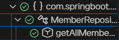
    
- 메소드 우클릭 해 디버그 모드 실행
    
    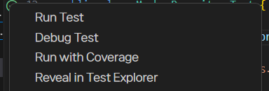
    
    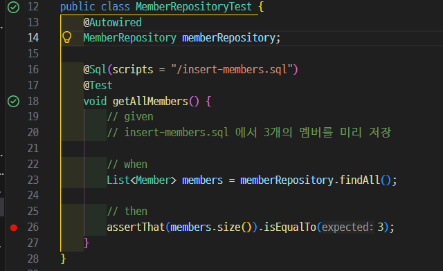
    
    - breakpoint 설정하고 Debug 하면
    
    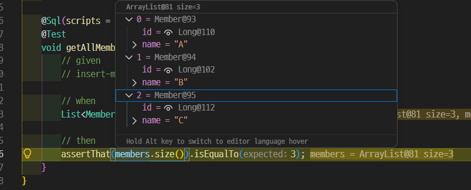
    
    - A, B, C 멤버의 정보 확인 가능
- id 로 멤버 찾기
    - ex) id 가 2 인 멤버 찾기
    
    ```java
    @DataJpaTest
    public class MemberRepositoryTest {
        @Autowired
        MemberRepository memberRepository;
    
        @Sql(scripts = "/insert-members.sql")
        @Test
        void getAllMembers() {
            // given
            // insert-members.sql 에서 3개의 멤버를 미리 저장
    
            // when
            Member member = memberRepository.findById(2L).get();
    
            // then
            assertThat(member.getName()).isEqualTo("B");
        }
    }
    ```
    

#### 쿼리 메소드

- id 는 기본키이므로 찾을 수 있음
- name 은 값이 있거나 없을 수 있음 → 기본 메소드 지원 X
- ex) name 이 값이 ‘C’인 멤버를 찾기
    - `MemberRepository.java` 파일에서 `findByName()` 메소드 추가
    
    ```java
    @Repository
    public interface MemberRepository extends JpaRepository<Member, Long> {
        Optional<Member> findByName(String name);
    }
    ```
    
    - `MemberRepositoryTest.java` 파일에서 메소드 교체
    
    ```java
    @DataJpaTest
    public class MemberRepositoryTest {
        @Autowired
        MemberRepository memberRepository;
    
        @Sql(scripts = "/insert-members.sql")
        @Test
        void getAllMembers() {
            // given
            // insert-members.sql 에서 3개의 멤버를 미리 저장
    
            // when
            Member member = memberRepository.findByName("C").get();
    
            // then
            assertThat(member.getId()).isEqualTo(3);
        }
        
    }
    ```
    
    - 잘 동작하는걸 볼 수 있다!
        
        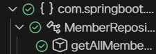
        
- `@Query` 메소드
    - JPA 로 표현 복잡 or 성능 문제로 SQL 쿼리를 직접 사용해야할 때
    
    ```java
    @Query("select m from Member m where m.name = ?1")
    Optional<Member> findByNameQuery(String name);
    ```
    
- 정리
    - 전체 조회 → `findAll()` 메소드
    - 아이디로 조회 → `findById()` 메소드
    - 특정 컬럼으로 조회 → 쿼리 메소드 명명 규칙에 맞게 정의 후 사용

#### 추가, 삭제 메소드

- 추가 → `save()`
    
    ```java
        @Test
        void saveMember() {
            // given
            Member member = new Member("D");
    
            // when
            Member savedMember = memberRepository.save(member);
    
            // then
            assertThat(memberRepository.findById(savedMember.getId()).get().getName()).isEqualTo("D");
        }
    ```
    
- 여러 개 한 번에 추가 → `saveAll()`
    
    ```java
        @Test
        void saveMembers() {
            // given
            List<Member> members = List.of(
                    new Member("E"),
                    new Member("F")
            );
    
            // when
            memberRepository.flush();
            memberRepository.saveAll(members);  
    
            // then
            assertThat(memberRepository.findAll().size()).isEqualTo(2);
        }
    ```
    
    - 추가 할 데이터 `List` 에 넣고 한 번에 `saveAll()`
    - `flush()` : 비우기
- 삭제 → `deleteById()`
    
    ```java
        @Sql("/insert-members.sql")
        @Test
        void deleteMemberById() {
            // when
            memberRepository.deleteById(5L);
    
            // then
            assertThat(memberRepository.findById(5L).isEmpty()).isTrue();
        }
    ```
    
    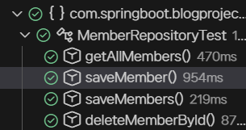
    
- 모든 데이터 삭제 → deleteAll()
    - 실제 서비스 코드에서는 거의 사용 X
    - 테스트 간의 격리 보장 위해 사용
    - 일반적 형태
    
    ```java
        @DataJpaTest
        class MemberRepositoryTest1 {
            @Autowired
            MemberRepository memberRepository;
    
            @AfterEach
            public void cleanUp() {
                memberRepository.deleteAll();
            }
        }
    ```
    

#### 수정 메소드

- 트랜잭션 내에서 데이터 수정해야함 → `@Transactional` 어노테이션 추가해야함
- `Member.java` 에 다음 메소드 추가
    
    ```java
        public void changeName(String name) {
            this.name = name;
        }
    ```
    
- `MemberRepositoryTest.java` 에 다음 코드 추가
    
    ```java
        @Sql(scripts = "/insert-members.sql")
        @Test
        void update() {
            // given
            Member member = memberRepository.findById(2L).get();
    
            // when
            member.changeName("BC");
    
            // then
            assertThat(memberRepository.findById(2L).get().getName()).isEqualTo("BC");
        }
    ```
    
    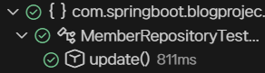
    
    → 테스트 통과!
    
    근데 `@Transactional` 어노테이션은? → `@DataJpaTest` 어노테이션에 포함!
    

## ✦ 에제 코드 살펴보기

### ◆ `Member.java`

```java
@Getter
@Entity  // 1
@NoArgsConstructor(access = AccessLevel.PROTECTED) // 2
public class Member {
    @Id // 3
    @GeneratedValue(strategy = GenerationType.IDENTITY) // 4
    @Column(name = "id", updatable = false)
    private Long id; 

    @Column(name = "name", nullable = false) // 5
    private String name; 

    public Member(String name) {
        this.name = name;
    }

    public void changeName(String name) {
        this.name = name;
    }
}
```

1. `@Entity`
    - Member 객체를 JPA 가 관리하는 엔티티로 지정
    - Member 클래스 - 실제 DB 테이블 매칭
    - 테이블 이름 지정 안했으므로 member 테이블과 매핑
    - 이름을 지정하는 법?
        
        ```java
        @Entity(name = "member_list")
        public class Article {
        
        }
        ```
        
2. `@NoArgsConstructor(access = AccessLevel.PROTECTED)`
    - protected 기본 생성자
    - public or protected 여야 함 → protected 가 더 안전하므로!

```java
		@Id // 3
    @GeneratedValue(strategy = GenerationType.IDENTITY) // 4
    @Column(name = "id", updatable = false)
    private Long id; 
```

1. `@Id` : Long 타입의 id 필드를 테이블의 기본키로 지정
2.  `@GeneratedValue(strategy = GenerationType.IDENTITY)` 
    - 기본키 생성 방식 결정
    - 자동으로 기본키 증가
    - 자동키 생성 설정 방식?
        - `AUTO` : 선택한 DB 방언 따라 자동 생성 (기본값)
        - `IDENETITY` : 기본키 생성을 DB에 위임 (= `AUTO_INCREMENT`)
        - `SEQUENCE` : DB 시퀀스 사용해 기본키 할당. 오라클에서 주로 사용
        - `TABLE` : 키 생성 테이블 사용

```java
    @Column(name = "name", nullable = false) // 5
    private String name; 
```

1. `@Column(name = "name", nullable = false)` 
    - DB 의 컬럼과 필드 매핑
    - `@Column` 어노테이션 속성
        - `name` : 필드와 매핑할 컬럼 이름. 설정 X 시 필드 이름 지정
        - `nullable` : 컬럼의 null 허용 여부. default 는 true
        - `unique` : 컬럼의 유일값 여부. default 는 false
        - `columnDefinition` : 컬럼 정보 설정. default 값 줄 수 있음

### ◆ `MemberRepository.java`

```java
@Repository
public interface MemberRepository extends JpaRepository<Member, Long> {
    Optional<Member> findByName(String name);
}
```

- `@Repository` : 엔티티에 있는 데이터 조회, 저장, 변경, 삭제 시 사용하는 인터페이스
    - `JpaRepository` 클래스 상속
    - 상속 받을 때 엔티티 `Member` & 엔티티 기본키 타입 `Long` 을 인수로 넣음
        
        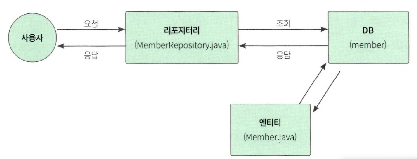
        

---

- 자주 사용하는 특수 문자
    
    ∞ ⊂ ⊃ ∪ ∩ ∴ ∵ ⇒ ⇔ ⁿ ¹ ² ³ ⁴ · ↑ ↓ … × ₁ ₂ ₃ ₄ ∅
    ex) Example
