## ✦ API 와 REST API

### ◆ API

- API : 프로그램 간에 상호작용하기 위한 매개체
    - 클라이언트 요청 → 서버 전달
    - 서버 결과물 → 클라이언트에게 응답

### ◆ REST API

- REST : REpresentational State Transfer
    - 자원을 이름으로 구분해 자원의 상태를 주고받는 API 방식
    - 명확하고 이해하기 쉬운 API
    - URL 의 설계 방식
- 특징
    - 서버/클라이언트 구조
    - 무상태
    - 캐시 처리 가능
    - 계층화
    - 인터페이스 일관성
- 장점
    - URL 만 보고 무슨 행동을 하는 API 인지 파악 가능
    - 상태가 없어 클라이언트 - 서버 역할 명확히 분리
    - HTTP 표준 사용 모든 플랫폼에서 사용 가능
- 단점
    - HTTP 메소드 (GET, POST) 방식의 개수에 제한 존재
    - 설계 위한 공식 제공 표준 규약 X

#### 사용법

1. URL 에는 동사를 쓰지 말고, 자원을 표시해야 한다
    - ex) 학생 중 id 가 1 인 학생의 정보 가져오는 URL
        
        ```
        /students/1
        ```
        
    
    | 예문 | 적합성 | 설명 |
    | --- | --- | --- |
    | /articles/1 | 적합 | 동사 X, 1번 글 가져온다는 의미 명확 |
    | /articles/show/1
    /show/arcitles/1 | 부적합 | show 라는 동사 존재 |
2. 동사는 HTTP 메소드로
    
    
    | 설명 | 적합 HTTP 메소드 & URL | CRUD |
    | --- | --- | --- |
    | 블로그 글 추가 API | `POST`/articles | Create |
    | id 가 1인 블로그 글 조회 API | `GET`/articles/1 | Read |
    | 블로그 글 수정 API | `PUT`/articles/1 | Update |
    | 블로그 글 삭제 API | `DELETE`/articles/1 | Delete |
    - `/` : 계층 관계 표현

## ✦ 블로그 개발을 위한 엔티티 구성하기

### ◆ 프로젝트 준비하기

- New Project 만들기
    - `application.yml`
        
        ```yaml
        spring:
          jpa:
            # 전송 쿼리 확인
            show-sql: true
            properties:
              hibernate:
                format_sql: true
        
            # 테이블 생성 후에 data.sql 실행
            defer-datasource-initialization: true
          
          # 테스트에서는 data.sql 시드 데이터를 넣지 않는다 (빈 테이블 전제)
          sql:
            init:
              mode: never
        ```
        
    - `build.gradle` dependencies
        
        ```java
        dependencies {
        	implementation 'org.springframework.boot:spring-boot-h2console'
        	implementation 'org.springframework.boot:spring-boot-starter-data-jpa'
        	implementation 'org.springframework.boot:spring-boot-starter-webmvc'
        	implementation 'org.springframework.boot:spring-boot-starter'
        	implementation 'org.springframework.boot:spring-boot-starter-web'
        	compileOnly 'org.projectlombok:lombok'
        	runtimeOnly 'com.h2database:h2'
        	annotationProcessor 'org.projectlombok:lombok'
        	testImplementation 'org.springframework.boot:spring-boot-starter-data-jpa-test'
        	testImplementation 'org.springframework.boot:spring-boot-starter-test'
        	testImplementation 'org.springframework.boot:spring-boot-starter-webmvc-test'
        	testCompileOnly 'org.projectlombok:lombok'
        	testRuntimeOnly 'org.junit.platform:junit-platform-launcher'
        	testAnnotationProcessor 'org.projectlombok:lombok'
        }
        ```
        
- 디렉터리 분리하기 : 계층별
    - 프레젠테이션 계층 : controller
    - 비즈니스 계층 : service
    - 퍼시스턴스 계층 : repository
    - 데이터베이스와 연결되는 DAO : domain

### ◆ 엔티티 구성하기

| 컬럼명 | 자료형 | null 허용 | 키 | 설명 |
| --- | --- | --- | --- | --- |
| id | BIGINT | N | 기본키 | 일련번호, 기본키 |
| title | VARCHAR(255) | N |  | 게시물 제목 |
| content | VARCHAR(255) | N |  | 내용 |
1. 아래 같은 경로에 `Article.java` 파일 만들기
    
    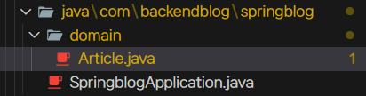
    
    ```java
    import jakarta.persistence.Id;
    import jakarta.persistence.Column;
    import jakarta.persistence.Entity;
    import jakarta.persistence.GeneratedValue;
    import jakarta.persistence.GenerationType;
    import lombok.Builder;
    
    @Entity
    public class Article {
        @Id  // id 필드를 기본키로 지정
        @GeneratedValue(strategy = GenerationType.IDENTITY)  // 기본키를 자동으로 +1
        @Column(name = "id", updatable = false)
        private Long id;
    
        @Column(name = "title", nullable = false) // 'title' 이라는 not null 컬럼과 매핑
        private String title;
    
        @Column(name = "content", nullable = false) 
        private String content;
    
        @Builder // 빌더 패턴으로 객체 생성
        public Article(String title, String content) {
            this.title = title;
            this.content = content;
        }
    
        protected Article() {} // 기본 생성자
    
        // Getter
        public Long getId() {
            return id;
        }
    
        public String getTitle() {
            return title;
        }
    
        public String getContent() {
            return content;
        }
    }
    
    ```
    
    - `@Builder`
        - Lombok 에서 지원하는 어노테이션
        - 생성자 위에 입력하면 빌더 패턴 방식으로 객체 생성 가능
        - 어떤 필드에 어떤 값이 들어가는지 명시적으로 파악 가능
2. 롬복으로 코드 깔끔하게 바꾸기
    - Getter 메소드들 → `@Getter` 어노테이션으로 대치
    - 생성자 → `@NoArgsConstructor` 어노테이션으로 대치
    - 전 vs 후
        
        전
        
        ```java
        import org.springframework.data.annotation.Id;
        
        import jakarta.persistence.Column;
        import jakarta.persistence.Entity;
        import jakarta.persistence.GeneratedValue;
        import jakarta.persistence.GenerationType;
        import lombok.Builder;
        
        @Entity
        public class Article {
            @Id  // id 필드를 기본키로 지정
            @GeneratedValue(strategy = GenerationType.IDENTITY)  // 기본키를 자동으로 +1
            @Column(name = "id", updatable = false)
            private Long id;
        
            @Column(name = "title", nullable = false) // 'title' 이라는 not null 컬럼과 매핑
            private String title;
        
            @Column(name = "content", nullable = false) 
            private String content;
        
            @Builder // 빌더 패턴으로 객체 생성
            public Article(String title, String content) {
                this.title = title;
                this.content = content;
            }
        
            protected Article() {} // 기본 생성자
        
            // Getter
            public Long getId() {
                return id;
            }
        
            public String getTitle() {
                return title;
            }
        
            public String getContent() {
                return content;
            }
        }
        
        ```
        
        후
        
        ```java
        package com.backendblog.springblog.domain;
        
        import org.springframework.data.annotation.Id;
        
        import jakarta.persistence.Column;
        import jakarta.persistence.Entity;
        import jakarta.persistence.GeneratedValue;
        import jakarta.persistence.GenerationType;
        import lombok.Builder;
        import lombok.Getter;
        import lombok.NoArgsConstructor;
        
        @Entity // 엔티티로 지정
        @Getter
        @NoArgsConstructor
        public class Article {
            @Id  // id 필드를 기본키로 지정
            @GeneratedValue(strategy = GenerationType.IDENTITY)  // 기본키를 자동으로 +1
            @Column(name = "id", updatable = false)
            private Long id;
        
            @Column(name = "title", nullable = false) // 'title' 이라는 not null 컬럼과 매핑
            private String title;
        
            @Column(name = "content", nullable = false) 
            private String content;
        
            @Builder // 빌더 패턴으로 객체 생성
            public Article(String title, String content) {
                this.title = title;
                this.content = content;
            }
        }
        
        ```
        
        → 확실히 짧아졌다!
        		
        

### ◆ 리포지터리 만들기

- 아래 같은 경로에 `BlogRepository.java` 파일 만들기
    
    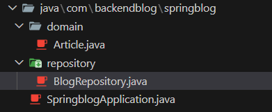
    
    ```java
    import org.springframework.data.jpa.repository.JpaRepository;
    import com.backendblog.springblog.domain.Article;
    
    public interface BlogRepository extends JpaRepository<Article, Long> {
    }
    ```
    
    - `JpaRepository` 의 메소드 사용 가능
    - 상속 구조
        
        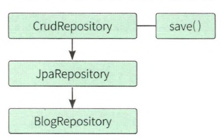
        

## ✦ 블로그 글 작성을 위한 API 구현하기

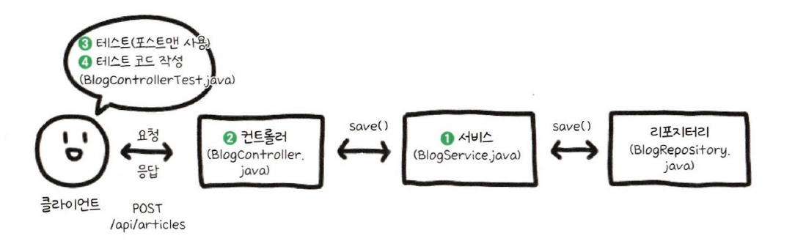

### ◆ 서비스 메소드 코드 작성하기

- 블로그에 글 추가하기
    - `AddArticleRequest` : 서비스 계층에서 요청 받을 객체
    - `BlogService` : 블로그 글 추가 메소드 `save()` 가 있는 클래스

1

1. dto (data transfer object) 패키지에 `AddArtivleRequest.java` 파일 생성
    
    ```java
    import com.backendblog.springblog.domain.Article;
    
    import lombok.AllArgsConstructor;
    import lombok.Getter;
    import lombok.NoArgsConstructor;
    
    @Getter
    @NoArgsConstructor  // 기본 생성자 추가
    @AllArgsConstructor // 모든 필드 값을 파라미터로 받은 생성자 추가
    public class AddArticleRequest {
        
        private String title;
        private String content;
    
        public Article toEntity() {
            return Article.builder()
                    .title(title)
                    .content(content)
                    .build();
        }
    }
    
    ```

2

1. service 패키지에 `BlogService.java` 생성
    
    ```java
    import org.springframework.stereotype.Service;
    
    import com.backendblog.springblog.domain.Article;
    import com.backendblog.springblog.dto.AddArticleRequest;
    import com.backendblog.springblog.repository.BlogRepository;
    
    import lombok.RequiredArgsConstructor;
    
    @RequiredArgsConstructor // final 이 붙거나 @NotNull 이 붙은 필드의 생성자를 자동으로 생성
    @Service // 빈으로 등록
    public class BlogService {
        
        private final BlogRepository blogRepository; 
    
        // 블로그 글 추가 메소드
        public Article save(AddArticleRequest request) {
            return blogRepository.save(request.toEntity());
        }
    }
    
    ```
    
    - `@RequiredArgsConstructor`
        - 빈을 생성자로 생성하는 롬복에서 지원
        - final 키워드나 `@NotNull` 이 붙은 필드로 생성자 만듬
    - `@Service` : 해당 클래스를 빈으로 서블릿 컨테이너에 등록
    - `save()`
        - `JpaRepository` 에서 지원하는 저장 메소드 `save()`
        - `AddArticleRequest` 클래스에 저장된 값 → `article` 데이터베이스에 저장
		

- 추가 후 파일 구조
    
    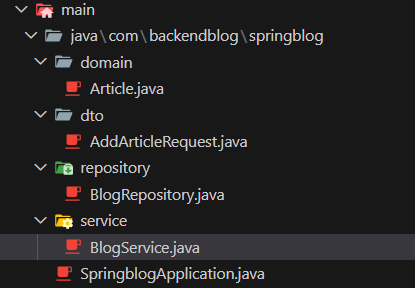
    

### ◆ 컨트롤러 메소드 코드 작성하기

- URK 매핑 어노테이션 `@GetMapping`, `@PostMapping`, `@PutMapping`, `@DeleteMapping` 등 사용 가능
    - 각 HTTP 메소드에 대응
- `addArticle()`
    1. `/api/articles` 에 `POST` 요청이 오면 `@PostMapping` 이용해 요청 매핑
    2. 블로그 글을 생성하는 BlogService 의 `save()` 메소드 호출
    3. 생성된 블로그 글 반환 
- controller 패키지에 `BlogApiController.java` 파일 생성
    
    ```java
    package com.backendblog.springblog.controller;
    
    import org.springframework.http.HttpStatus;
    import org.springframework.http.ResponseEntity;
    import org.springframework.web.bind.annotation.PostMapping;
    import org.springframework.web.bind.annotation.RequestBody;
    import org.springframework.web.bind.annotation.RestController;
    
    import com.backendblog.springblog.domain.Article;
    import com.backendblog.springblog.dto.AddArticleRequest;
    import com.backendblog.springblog.service.BlogService;
    
    import lombok.RequiredArgsConstructor;
    
    @RestController // HTTP Response Body 에 객체 데이터를 JSON 형식으로 반환
    @RequiredArgsConstructor
    public class BlogApiController {
        
        private final BlogService blogService;
    
        // HTTP 메소드가 POST 일때 전달받은 URL과 동일하면 메소드로 매칭
        @PostMapping("/api/articles")
        // @RequestBody : HTTP 요청 Body에 담긴 JSON 데이터를 Java 객체로 변환
        public ResponseEntity<Article> addArticle(@RequestBody AddArticleRequest request) {
            Article savedArticle = blogService.save(request);
    
            // 요청한 자원이 성공적으로 생성되었으며 저장된 블로그 글 정보를 응답 객체에 담아 전송
            return ResponseEntity.status(HttpStatus.CREATED)
                    .body(savedArticle);
        }
    }
    
    ```
    
    - `RestController` : HTTP 응답으로 객체 데이터를 JSON 형식으로 반환
    - `@PostMapping()` : HTTP 메소드가 `POST` 일 때, 요청받은 URL 과 동일한 메소드와 매핑
        - `addArticle()` 메소드에 매핑
    - `@RequestBody` : HTTP 를 요청할 때 응답에 해당하는 값을 어노테이션 붙은 대상 객체에 매핑
        - `AddArticleRequest` 에 매핑
    - `ResponseEntity.status().body()` : 응답 코드 & 객체 반환
        - 201 → Created 응답
        - 테이블에 저장된 `savedArticle`  반환
- 응답 코드
    - 200 OK : 요청이 성공적으로 수행됨
    - 201 Created : 요청이 성공적으로 수행 + 새로운 리소스 생성됨
    - 400 Bad Request : 요청 값 잘못되어 요청 실패
    - 403 Forbidden : 권한 없어 요청 실패
    - 404 Not Found : 요청 값으로 찾은 리소스가 없어 요청 실패
    - 500 Internal Server Error : 서버 상에 문제 있어 요청 실패

### ◆ API 실행 테스트

1단계

`build.gradle` 파일에 의존성 추가

```java
dependencies {
	implementation 'org.springframework.boot:spring-boot-h2console'
}
```

- 새로고침해서 의존성 다운로드 받기

2단계

resource 폴더에 `application.yml` 파일 아래에 추가

```yaml
  datasource:  # 데이터베이스 정보 추가
    url: jdbc:h2:mem:testdb
    username: sa
  h2:          # H2 콘솔 활성화
    console:
      enabled: true
```

3단계

서버 요청 확인

- 스프링 부트 서버 실행
- 포스트맨 실행
    - 아래와 같이 설정하고 전송!
    
    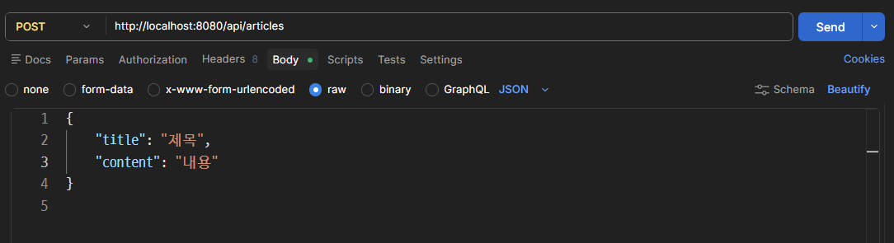
    
    - 응답
    
    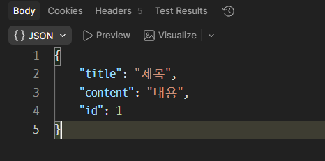

4단계

H2 데이터베이스 저장 확인 

- [http://localhost:8080/h2-console](http://localhost:8080/h2-console) 접속
- JDBC URL : `jdbc:h2:mem:testdb` 로 수정하고 Connect
    
    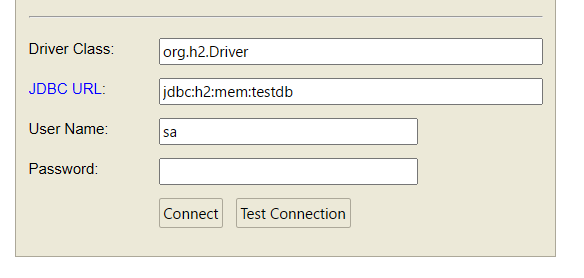

5단계

입력 창에 아래 코드 입력

```sql
SELECT * FROM ARTICLE
```

→ 결과

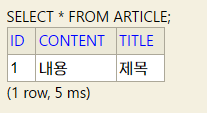

→ 새로 만들어진 `ARTICLE` 테이블

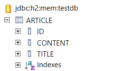

- 자동으로 테이블 생성 + 데이터 저장
		

### ◆ 반복 작업 줄여 줄 테스트 코드 작성

1단계

`BlogApiController` 테스트 생성

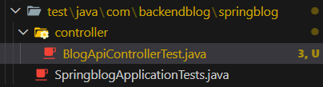

```java
@SpringBootTest // 테스트용 애플리케이션 컨텍스트
@AutoConfigureMockMvc // MockMvc를 자동으로 설정
class BlogApiControllerTest {

    @Autowired
    private MockMvc mockMvc; 

    @Autowired
    protected ObjectMapper objectMapper; // JSON 직렬화, 역직렬화에 사용

    @Autowired
    private WebApplicationContext context;

    @Autowired
    BlogRepository blogRepository;

    @BeforeEach // 테스트 실행 전 실행 메소드
    public void mockMvcSetUp() {
        this.mockMvc = MockMvcBuilders.webAppContextSetup(context)
                .build();
        blogRepository.deleteAll();
    }
}
```

- `ObjectMapper` : 객체 ↔ JSON 데이터 변환
- 직렬화 & 역직렬화
    - 직렬화 : 자바 내부 객체 → JSON 으로 변환해 외부에서 사용 가능
    - 역직렬화 : 외부 JSON 데이터 → 자바 객체 형태로 변환
    
    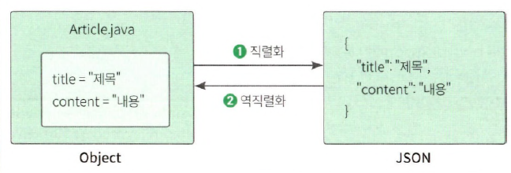

2단계

블로그 글 생성 API 테스트 코드 작성

| Given | 블로그 글 추가에 필요한 요청 객체 만들기 |
| --- | --- |
| When | 블로그 글 추가 API 에 요청 전송. given 절에서 미리 만든 객체를 함께 전송
요청 타입 : JSON |
| Then | 응답 코드 : 201 Created
크기 : 1 (Blog 전체 조회)
실제 저장된 데이터 vs. 요청 값  |

```java
    @DisplayName("addArticle: 블로그 글 추가에 성공한다.")
    @Test
    public void addArticle() throws Exception {
        // given
        final String url = "/api/articles";
        final String title = "title";
        final String content = "content";
        final AddArticleRequest userRequest = new AddArticleRequest(title, content);

        // 객체 -> JSON 직렬화
        final String requestBody = objectMapper.writeValueAsString(userRequest);

        // when
        // 설정 내용 바탕 요청 전송
        ResultActions result = mockMvc.perform(post(url)
                .contentType(MediaType.APPLICATION_JSON_VALUE)
                .content(requestBody));

        // then
        result.andExpect(status().isCreated());

        List<Article> articles = blogRepository.findAll();

        assertThat(articles.size()).isEqualTo(1); // 크기 1인지 검증
        assertThat(articles.get(0).getTitle()).isEqualTo(title); 
        assertThat(articles.get(0).getContent()).isEqualTo(content);
    }
```

3단계

테스트 코드 실행해 코드가 잘 동작하는지 확인

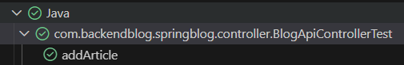

→ 잘 동작함!
		

## ✦ 블로그 글 목록 조회를 위한 API 구현하기

### ◆ 서비스 메소드 코드 작성하기

`BlogService`  파일에 `findAll()` 메소드 추가

```java
    // 블로그 글 조회 메소드
    public List<Article> findAll() {
        return blogRepository.findAll();
    }
```

- JPA 메소드인 `findAll()` 호출해 article 테이블의 모든 데이터 조회
- 전체 코드
    
    ```java
    package com.backendblog.springblog.service;
    
    import java.util.List;
    
    import org.springframework.stereotype.Service;
    
    import com.backendblog.springblog.domain.Article;
    import com.backendblog.springblog.dto.AddArticleRequest;
    import com.backendblog.springblog.repository.BlogRepository;
    
    import lombok.RequiredArgsConstructor;
    
    @RequiredArgsConstructor // final 이 붙거나 @NotNull 이 붙은 필드의 생성자를 자동으로 생성
    @Service // 빈으로 등록
    public class BlogService {
        
        private final BlogRepository blogRepository; 
    
        // 블로그 글 추가 메소드
        public Article save(AddArticleRequest request) {
            return blogRepository.save(request.toEntity());
        }
    
    		// --------- 추가 부분 --------- //
        // 블로그 글 조회 메소드
        public List<Article> findAll() {
            return blogRepository.findAll();
        }
    }
    
    ```
    

### ◆ 컨트롤러 메소드 코드 작성하기

1단계

dto 패키지에 `ArticleResponse.java` 파일 생성

```java
package com.backendblog.springblog.dto;

import com.backendblog.springblog.domain.Article;

import lombok.Getter;

@Getter
public class ArticleResponse {
    
    private final String title;
    private final String content;

    public ArticleResponse(Article article) {
        this.title = article.getTitle();
        this.content = article.getContent();
    }
}

```

2단계

`BlockApiController` 파일에 `findAllArticles()` 메소드 추가

```java
    @GetMapping("/api/articles")
    public ResponseEntity<List<ArticleResponse>> findAllArticles() {
        List<ArticleResponse> articles = blogService.findAll()
                .stream()
                .map(ArticleResponse::new)
                .toList();

        return ResponseEntity.ok()
                .body(articles);
    }
```

- `/api/articles` 로 `GET` 요청
    - 글 전체 조회 `findAll()` 메소드 호출
    - 응답용 객체인 `ArticleResponse` 로 파싱
    - body 에 답아 클라이언트에 전송
- 전체 코드
    
    ```java
    import java.util.List;
    
    import org.springframework.http.HttpStatus;
    import org.springframework.http.ResponseEntity;
    import org.springframework.web.bind.annotation.GetMapping;
    import org.springframework.web.bind.annotation.PostMapping;
    import org.springframework.web.bind.annotation.RequestBody;
    import org.springframework.web.bind.annotation.RestController;
    
    import com.backendblog.springblog.domain.Article;
    import com.backendblog.springblog.dto.AddArticleRequest;
    import com.backendblog.springblog.dto.ArticleResponse;
    import com.backendblog.springblog.service.BlogService;
    
    import lombok.RequiredArgsConstructor;
    
    @RestController // HTTP Response Body 에 객체 데이터를 JSON 형식으로 반환
    @RequiredArgsConstructor
    public class BlogApiController {
        
        private final BlogService blogService;
    
        // HTTP 메소드가 POST 일때 전달받은 URL과 동일하면 메소드로 매칭
        @PostMapping("/api/articles")
        // @RequestBody : HTTP 요청 Body에 담긴 JSON 데이터를 Java 객체로 변환
        public ResponseEntity<Article> addArticle(@RequestBody AddArticleRequest request) {
            Article savedArticle = blogService.save(request);
    
            // 요청한 자원이 성공적으로 생성되었으며 저장된 블로그 글 정보를 응답 객체에 담아 전송
            return ResponseEntity.status(HttpStatus.CREATED)
                    .body(savedArticle);
        }
    
        @GetMapping("/api/articles")
        public ResponseEntity<List<ArticleResponse>> findAllArticles() {
            List<ArticleResponse> articles = blogService.findAll()
                    .stream()
                    .map(ArticleResponse::new)
                    .toList();
    
            return ResponseEntity.ok()
                    .body(articles);
        }
    }
    
    ```
		

### ◆ 실행 테스트하기

1단계

`import.sql` 파일 생성

- 위치

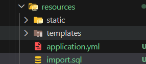

- 내용

```sql
INSERT INTO article (title, content) VALUES ('제목 1', '내용 1');
INSERT INTO article (title, content) VALUES ('제목 2', '내용 2');
INSERT INTO article (title, content) VALUES ('제목 3', '내용 3');

```

2단계

서버 실행 후, 포스트맨에서 `GET` , `Param` 설정하고 Send!

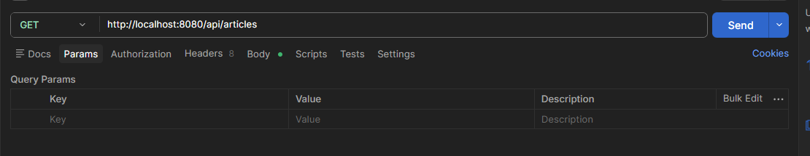

- 아래와 같은 결과가 나오면 성공!

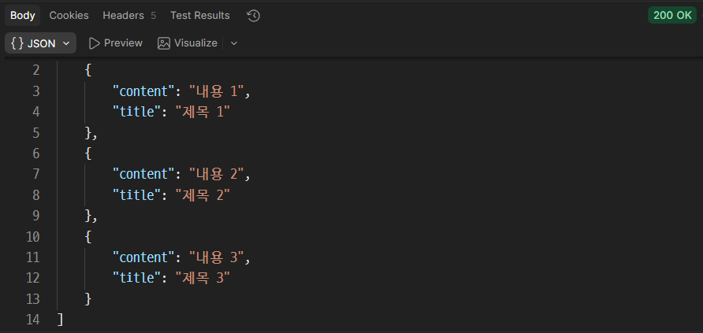
		

### ◆ 테스트 코드 작성하기

1단계

`BlogApiControllerTest` 에 테스트 코드 작성

| Given | 블로그 글 저장 |
| --- | --- |
| When | 목록 조회 API 호출 |
| Then | 응답 코드 : 200 OK
반환값 0번째 요소 content & title vs. 저장된 값 |

```java
    @DisplayName("findAllArticles: 블로그 글 조회에 성공한다.")
    @Test
    public void findAllArticles() throws Exception {
        // given
        final String url = "/api/articles";
        final String title = "title";
        final String content = "content";

        blogRepository.save(Article.builder()
                .title(title)
                .content(content)
                .build());

        // when
        final ResultActions resultActions = mockMvc.perform(get(url)
                .accept(MediaType.APPLICATION_JSON));

        // then
        resultActions
                .andExpect(status().isOk())
                .andExpect(jsonPath("$[0].title").value(title))
                .andExpect(jsonPath("$[0].content").value(content));
    }
```

- 전체 코드
    
    ```java
    package com.backendblog.springblog.controller;
    
    import static org.assertj.core.api.Assertions.assertThat;
    import static org.springframework.test.web.servlet.request.MockMvcRequestBuilders.get;
    import static org.springframework.test.web.servlet.request.MockMvcRequestBuilders.post;
    import static org.springframework.test.web.servlet.result.MockMvcResultMatchers.jsonPath;
    import static org.springframework.test.web.servlet.result.MockMvcResultMatchers.status;
    
    import java.util.List;
    
    import org.junit.jupiter.api.BeforeEach;
    import org.junit.jupiter.api.DisplayName;
    import org.junit.jupiter.api.Test;
    import org.springframework.beans.factory.annotation.Autowired;
    import org.springframework.boot.test.context.SpringBootTest;
    import org.springframework.boot.webmvc.test.autoconfigure.AutoConfigureMockMvc;
    import org.springframework.http.MediaType;
    import org.springframework.test.web.servlet.MockMvc;
    import org.springframework.test.web.servlet.ResultActions;
    import org.springframework.test.web.servlet.setup.MockMvcBuilders;
    import org.springframework.web.context.WebApplicationContext;
    
    import com.backendblog.springblog.domain.Article;
    import com.backendblog.springblog.dto.AddArticleRequest;
    import com.backendblog.springblog.repository.BlogRepository;
    
    import tools.jackson.databind.ObjectMapper;
    
    @SpringBootTest // 테스트용 애플리케이션 컨텍스트
    @AutoConfigureMockMvc // MockMvc를 자동으로 설정
    class BlogApiControllerTest {
    
        @Autowired
        private MockMvc mockMvc; 
    
        @Autowired
        protected ObjectMapper objectMapper; // JSON 직렬화, 역직렬화에 사용
    
        @Autowired
        private WebApplicationContext context;
    
        @Autowired
        BlogRepository blogRepository;
    
        @BeforeEach // 테스트 실행 전 실행 메소드
        public void mockMvcSetUp() {
            this.mockMvc = MockMvcBuilders.webAppContextSetup(context)
                    .build();
            blogRepository.deleteAll();
        }
    
        @DisplayName("addArticle: 블로그 글 추가에 성공한다.")
        @Test
        public void addArticle() throws Exception {
            // given
            final String url = "/api/articles";
            final String title = "title";
            final String content = "content";
            final AddArticleRequest userRequest = new AddArticleRequest(title, content);
    
            // 객체 -> JSON 직렬화
            final String requestBody = objectMapper.writeValueAsString(userRequest);
    
            // when
            // 설정 내용 바탕 요청 전송
            ResultActions result = mockMvc.perform(post(url)
                    .contentType(MediaType.APPLICATION_JSON_VALUE)
                    .content(requestBody));
    
            // then
            result.andExpect(status().isCreated());
    
            List<Article> articles = blogRepository.findAll();
    
            assertThat(articles.size()).isEqualTo(1); // 크기 1인지 검증
            assertThat(articles.get(0).getTitle()).isEqualTo(title); 
            assertThat(articles.get(0).getContent()).isEqualTo(content);
        }
    
        @DisplayName("findAllArticles: 블로그 글 조회에 성공한다.")
        @Test
        public void findAllArticles() throws Exception {
            // given
            final String url = "/api/articles";
            final String title = "title";
            final String content = "content";
    
            blogRepository.save(Article.builder()
                    .title(title)
                    .content(content)
                    .build());
    
            // when
            final ResultActions resultActions = mockMvc.perform(get(url)
                    .accept(MediaType.APPLICATION_JSON));
    
            // then
            resultActions
                    .andExpect(status().isOk())
                    .andExpect(jsonPath("$[0].title").value(title))
                    .andExpect(jsonPath("$[0].content").value(content));
        }
    }
    
    ```

2단계

테스트 코드 동작 확인

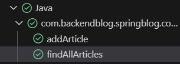

→ 잘 동작하는걸 볼 수 있다!

탭 3
		

## ✦ 블로그 글 조회 API 구현하기

### ◆ 서비스 메소드 코드 작성하기

- `BlogService` 파일에 `findById()` 메소드 추가
    - `findById()` : 블로그 글 하나 조회

```java
    // 블로그 글 단건 조회 메소드
    public Article findById(long id) {
        return blogRepository.findById(id)
                .orElseThrow(() -> new IllegalArgumentException("not found: " + id));
    }
```

- `findById()` : JPA 에서 제공
    - ID 받아 엔티티 조회
    - 없으면 `IllegalArgumentException` 예이 발생

### ◆ 컨트롤러 메소드 코드 작성하기

- `BlockApiController` 파일에 `findArticle()` 추가
    - `findArticle()` : `/api/articles/{id}` 에 `GET` 요청 오면 블로그 글 조회

```java
    @GetMapping("/api/articles/{id}")
    public ResponseEntity<ArticleResponse> findArticleById(@PathVariable long id) {
        Article article = blogService.findById(id);

        return ResponseEntity.ok()
                .body(new ArticleResponse(article));
    }
```

- `@PathVariable` : URL 에서 값 가져오기

### ◆ 테스트 코드 작성하기

1단계

테스트 코드 작성하기

| Given | 블로그 글 저장 |
| --- | --- |
| When | 저장된 블로그 글의 id 값으로 API 호출 |
| Then | 응답 코드 : 200 OK
반환 받은 content & title vs. 저장된 값 |

```java
    @DisplayName("findArticleById: 블로그 글 조회에 성공한다.")
    @Test
    public void findArticleById() throws Exception {
        // given
        final String url = "/api/articles/{id}";
        final String title = "title";
        final String content = "content";

        Article savedArticle = blogRepository.save(Article.builder()
                .title(title)
                .content(content)
                .build());

        // when
        final ResultActions resultActions = mockMvc.perform(get(url, savedArticle.getId()));

        // then
        resultActions
                .andExpect(status().isOk())
                .andExpect(jsonPath("$.title").value(title))
                .andExpect(jsonPath("$.content").value(content));
    }
```

2단계

테스트 코드 동작 확인

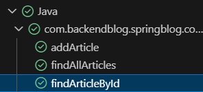

→ 잘 동작하는 걸 볼 수 있다!
		

## ✦ 블로그 글 삭제 API 구현하기

### ◆ 서비스 메소드 코드 작성하기

- `BlogService` 파일에 `delete()` 메소드 추가
    - `delete()` : 블로그의 ID 받아 JPA 제공 `deleteById()` 메소드 이용해 DB 에서 제거

```java
    // 블로그 글 삭제 메소드
    public void deleteById(long id) {
        blogRepository.deleteById(id);
    }
```

### ◆ 컨트롤러 메소드 코드 작성하기

- `BlogApiController` 파일에 `deleteArticles()` 메소드 추가
    - `deleteArticles()` : `/api/articles/{id}` 에 `DELETE` 요청 오면 글 삭제

```java
    @DeleteMapping("/api/articles/{id}")
    public ResponseEntity<Void> deleteArticleById(@PathVariable long id) {
        blogService.deleteById(id);

        return ResponseEntity.ok()
                .build();
    }
```

### ◆ 실행 테스트 하기

- 포스트맨에서 `DELETE` 로 설정 후 id 가 1인 post 삭제

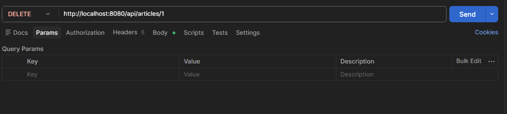

- 삭제한 상태에서 `GET` 을 하면?

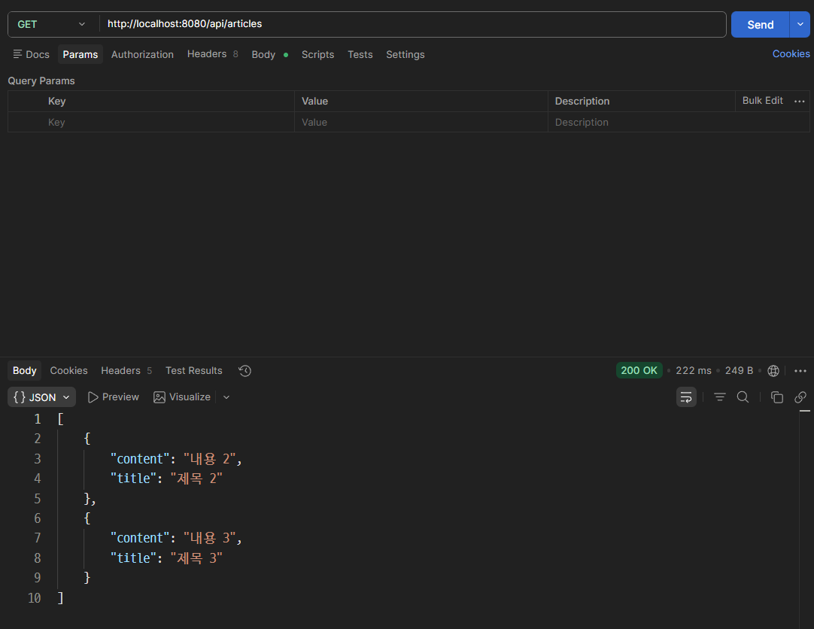

→ 1은 사라지고 2, 3 만 남음!

### ◆ 테스트 코드 작성하기

1단계

테스트 코드 작성하기

| Given | 블로그 글 저장 |
| --- | --- |
| When | 저장한 블로그 글의 id 값으로 삭제 API 호출 |
| Then | 응답 코드 : 200 OK
블로그 전체 글 배열 크기 : 0 |

```java
    @DisplayName("deleteArticleById: 블로그 글 삭제에 성공한다.")
    @Test
    public void deleteArticleById() throws Exception {
        // given
        final String url = "/api/articles/{id}";
        final String title = "title";
        final String content = "content";

        Article savedArticle = blogRepository.save(Article.builder()
                .title(title)
                .content(content)
                .build());

        // when
        mockMvc.perform(delete(url, savedArticle.getId()))
                .andExpect(status().isOk()); 
                

        // then
        List<Article> articles = blogRepository.findAll();
        assertThat(articles).isEmpty(); 
    }
```

2단계

테스트 코드 동작 확인

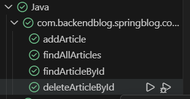

→ 잘 동작하는 걸 볼 수 있다!
		

## ✦ 블로그 글 수정 API 구현하기

### ◆ 서비스 메소드 코드 작성하기

1단계

`Article` 에 `update()` 메소드 작성

- `update()` : 특정 아이디의 글 수정

```java
    public void update(String title, String content) {
        this.title = title;
        this.content = content;
    }
```

2단계

블로그 글 수정 요청 받을 DTO 작성

dto 패키지에 `UpdateArticleRequest.java` 파일 생성

```java
@NoArgsConstructor
@AllArgsConstructor
@Getter
public class UpdateArticleRequest {
    private String title;
    private String content;
}
```

3단계

`BlogService` 파일에 `update()` 메소드 추가

- `update()` : 리포지터리 사용해 글 수정

```java
    // 블로그 글 수정 메소드
    @Transactional
    public Article update(long id, UpdateArticleRequest request) {
        Article article = blogRepository.findById(id)
                .orElseThrow(() -> new IllegalArgumentException("not found: " + id));

        article.update(request.getTitle(), request.getContent());

        return article;
    }
```

- `@Transactional` : 매칭한 메소드를 하나의 트랜잭션으로 묶음
    - 엔티티 필드 값 바뀌면 중간에 에러 발생해도 제대로 된 값 수정 보장
- 트랜잭션
    - 데이터베이스의 데이터를 바꾸기 위해 묶은 작업의 단위
		

### ◆ 컨트롤러 메소드 코드 작성하기

- `BlogApiController` 파일에서 `updateArticle()` 메소드 작성
    - `updateArticle()` : `/api/articels/{id}` 에 `PUT` 요청 오면 글 수정

```java
    @PutMapping("/api/articles/{id}")
    public ResponseEntity<ArticleResponse> updateArticle(@PathVariable long id, @RequestBody UpdateArticleRequest request) {
        Article updatedArticle = blogService.update(id, request);

        return ResponseEntity.ok()
                .body(new ArticleResponse(updatedArticle));
    }
```

### ◆ 실행 테스트하기

1단계

포스트맨에서 HTTP 메소드를 `PUT` 으로 설정하고 title & content 입력 후 setn

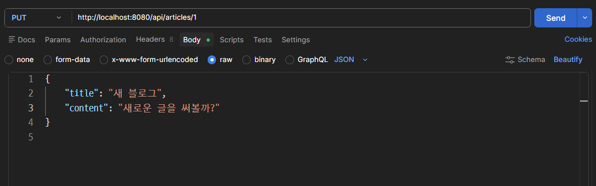

2단계

전체 조회 API 로 확인

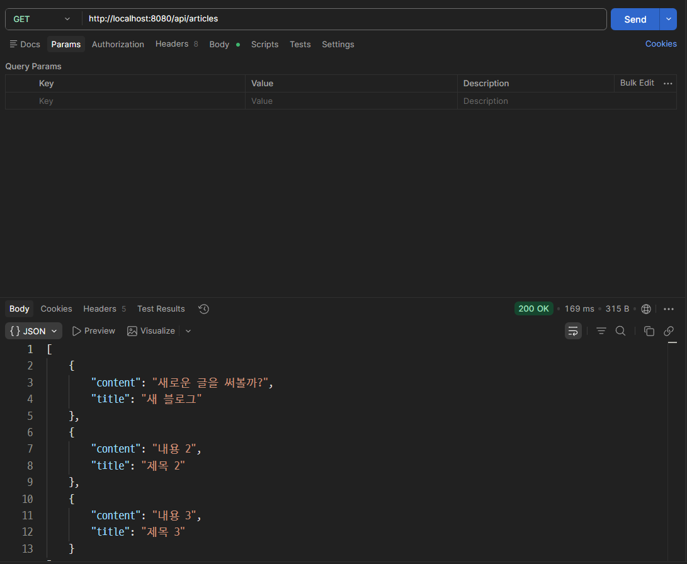

- Update 된 값 확인 가능!

탭 3
		

### ◆ 테스트 코드 작성하기

1단계

테스트 코드 작성

| Given | 블로그로 글 저장, 블로그 글 수정에 필요한 요청 객체 생성 |
| --- | --- |
| When | UPDATE API 로 수정 요청 전송. given 절에서 미리 만든 객체를 함께 전송
요청 타입 : JSON |
| Then | 응답 코드 : 200OK
블로그 글 id 로 조회 후 값 수정 확인 |

```java
    @DisplayName("updateArticle: 블로그 글 수정에 성공한다.")
    @Test
    public void updateArticle() throws Exception {
        // given
        final String url = "/api/articles/{id}";
        final String title = "title";
        final String content = "content";

        Article savedArticle = blogRepository.save(Article.builder()
                .title(title)
                .content(content)
                .build());

        final String newTitle = "new title";
        final String newContent = "new content";

        UpdateArticleRequest request = new UpdateArticleRequest(newTitle, newContent);

        // when
        ResultActions results = mockMvc.perform(put(url, savedArticle.getId())
                .contentType(MediaType.APPLICATION_JSON_VALUE)
                .content(objectMapper.writeValueAsString(request)));

        // then
        results.andExpect(status().isOk());

        Article article = blogRepository.findById(savedArticle.getId()).get();

        assertThat(article.getTitle()).isEqualTo(newTitle);
        assertThat(article.getContent()).isEqualTo(newContent);
    }
```

2단계

테스트 코드 동작 확인

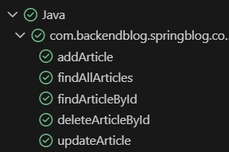

→ 잘 동작한다!
		

---

- 자주 사용하는 특수 문자
    
    ∞ ⊂ ⊃ ∪ ∩ ∴ ∵ ⇒ ⇔ ⁿ ¹ ² ³ ⁴ · ↑ ↓ … × ₁ ₂ ₃ ₄ ∅
    ex) Example
