## ✦ 타임리프

### ◆ 템플릿 엔진 개념 잡기

- 템플릿 엔진 : [[Spring|스프링]] [[서버]]에서 데이터를 받아 HTML 에 데이터 넣어 보여주는 도구
- 템플릿 문법
    - HTML 과 유사
    
    ```html
    <h1 text=${이름}>
    <p text=${나이}>
    ```
    
    - 서버 데이터
    
    ```json
    {
    	이름: "홍길동"
    	나이: 11
    }
    ```
    

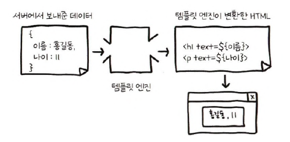

- 템플릿 엔진 마다 문법 다름
    - ex) JSP, 타임리프, 프리마커
        
        → 스프링에선 타임리프 사용!
        

### ◆ 타임리프 표현식과 문법

- 타임리프 표현식
    
    
    | 표현식 | 설명 |
    | --- | --- |
    | `${...}` | 변수 값 표현 |
    | `#{...}` | 속성 파일 값 표현 |
    | `@{...}` | URL 표현 |
    | `*{...}` | 선택한 변수 표현. `th:object` 에서 선택한 객체에 접근 |
- 타임리프 문법
    
    
    | 표현식 | 설명 | 예제 |
    | --- | --- | --- |
    | `th:text` | 텍스트 표현 시 사용 | `th:text=${person.name}` |
    | `th:each` | 컬렉션 반복 시 사용 | `th:each="person: ${persons}"` |
    | `th:if` | 조건이 true 일 때만 표시 | `th:if="${person.age}>=20"` |
    | `th:unless` | 조건이 false 일 때만 표시  | `th:unless="${person.age}>=20"` |
    | `th:href` | 이동 경로 | `th:href="@{/persons(id=${person.id})}"` |
    | `th:with` | 변수값으로 지정 | `th:with="name=${person.name}"`  |
    | `th:object` | 선택한 객체로 지정 | `th:object="${person}"` |
- 타임리프 사용을 위한 의존성 추가하기

```yaml
	dependencies {
		...
		implementation 'org.springframework.boot:spring-boot-starter-thymeleaf'
	}
```

### ◆ 타임리프 문법 익히기용 컨트롤러 작성하기

1단계

- controller [[패키지]]에 `ExampleController.java` 파일 생성

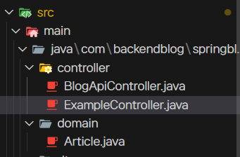

2단계

- 코드 작성

```java
package com.backendblog.springblog.controller;

import java.time.LocalDate;
import java.util.List;

import org.springframework.stereotype.Controller;
import org.springframework.ui.Model;
import org.springframework.web.bind.annotation.GetMapping;

import lombok.Getter;
import lombok.Setter;

@Controller
public class ExampleController {
    
    @Setter
    @Getter
    class Person {
        private Long id;
        private String name;
        private int age;
        private List<String> hobbies;
    }

    @GetMapping("/thymeleaf/example")
    public String thymeleafExample(Model model) { // 뷰로 데이터 넘겨주는 모델 개체
        Person examplePerson = new Person();

        examplePerson.setId(1L);
        examplePerson.setName("홍길동");
        examplePerson.setAge(11);
        examplePerson.setHobbies(List.of("운동", "독서"));

        model.addAttribute("person", examplePerson); // Person 객체 저장
        model.addAttribute("today", LocalDate.now()); // 날짜 정보 저장

        return "example"; // example.html 라는 뷰 조회
    }
}

```
		

- `Model` 객체
    - 뷰 (HTML) 쪽으로 값 넘기는 객체
        - 인자로 선언하면 스프링이 알아서 만들어줌.
        - `addAttribute()` [[메소드]]로 모델에 값 저장
- 반환값 `"example"`  → 뷰의 이름 반환
    - 반환하는 값의 이름을 가진 뷰 파일 찾기!
    - resource/templates 디렉터리에서 `example.html` 찾고 템플릿 이용해서 HTML 보여주기

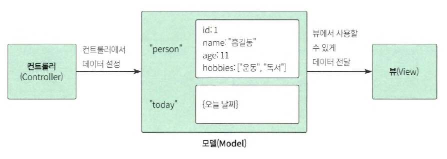

### ◆ 뷰 작성하기

1단계

- resources/templates 아래에 `example.html` 파일 생성

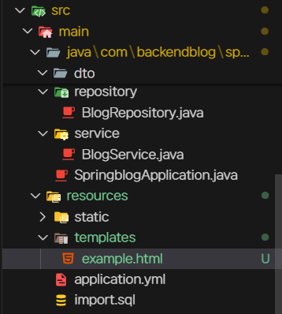

2단계

- 코드 작성

```html
<!DOCTYPE html>
<html xmlns:th="http://www.thymeleaf.org">
<head>
  <meta charset="UTF-8">
  <meta name="viewport" content="width=device-width, initial-scale=1.0">
  <title>Title</title>
</head>
<body>
  <h1>타임리프 익히기</h1>
  <!-- LocalDate 를 yyyy-MM-dd 형식으로 표시 -->
  <p th:text="${#temporals.format(today, 'yyyy-MM-dd')}"></p>
  <div th:object="${person}"> <!-- person 을 선택한 객체로 지정 -->
    <p th:text="|이름 : *{name}"></p>
    <p th:text="|나이 : *{age}"></p>
    <p th:text="|취미 : *{hobbies}"></p> 
    <ul th:each="hobby : *{hobbies}"> <!-- person 의 hobbies 를 반복 -->
      <li th:text="${hobby}"></li>
      <span th:if="${hobby == '운동'}">(대표 취미)</span>
    </ul>
  </div>
  <!-- 1번 블로그 글을 보러 이동 -->
  <a th:href="@{/api/articles/{id}(id=${person.id})}">글 보기</a>
</body>
</html>
```

- `#temporals.format()` [[함수]]로 `LocalDate` 타입 날짜 → `String` 으로 포매팅
- `th:object` : `person` 키 가진 객체 데이터 하위 태그에 지정
    - `*{...}` 사용해 부모 태그 내부 객체 값 접근 가능
		

### ◆ 뷰 테스트하기

- 서버 실행 후 [http://localhost:8080/thymeleaf/example](http://localhost:8080/thymeleaf/example) 접속해보기!
    
    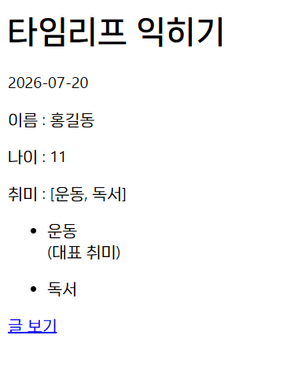
    
    → 이런식으로 글이 나온다
    

## ✦ 블로그 글 목록 뷰 구현하기

### ◆ 컨트롤러 메소드 작성하기

- 뷰를 보여주기 → 뷰 컨트롤러 필요
- dto 패키지에 `ArticleListViewResponse.java` 파일 생성
    
    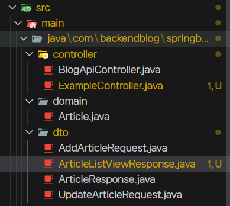
    
    - 코드 작성
    
    ```java
    package com.backendblog.springblog.dto;
    
    import com.backendblog.springblog.domain.Article;
    import lombok.Getter;
    
    @Getter
    public class ArticleListViewResponse {
    
        private final Long id;
        private final String title;
        private final String content;
    
        public ArticleListViewResponse(Article article) {
            this.id = article.getId();
            this.title = article.getTitle();
            this.content = article.getContent();
        }
    }
    ```
    
- controller 패키지에 `BlogViewController.java` 파일 생성
    - 블로그 글 전체 리스트 담은 뷰 반환
    
    ```java
    package com.backendblog.springblog.controller;
    
    import java.util.List;
    
    import org.springframework.stereotype.Controller;
    import org.springframework.ui.Model;
    import org.springframework.web.bind.annotation.GetMapping;
    
    import com.backendblog.springblog.dto.ArticleListViewResponse;
    import com.backendblog.springblog.service.BlogService;
    
    import lombok.RequiredArgsConstructor;
    
    @RequiredArgsConstructor
    @Controller
    public class BlogViewController {
        
        private final BlogService blogService;
    
        @GetMapping("/articles")
        public String articles(Model model) {
            List<ArticleListViewResponse> articles = blogService.findAll().stream()
                    .map(ArticleListViewResponse::new)
                    .toList();
            model.addAttribute("articles", articles); // 블로그 글 리스트 저장
    
            return "articleList"; // articleList.html 라는 뷰 조회
        }
    }
    ```
    

### ◆ HTML 뷰 만들고 테스트하기

- resource/templates 에 `articleList.html` 작성
    - 모델에 전달한 블로그 글 리스트 갯수만큼 반복해 글 정보 보여주기
    
    ```html
    <!DOCTYPE html>
    <html lang="en" xmlns:th="http://www.thymeleaf.org">
    <head>
      <meta charset="UTF-8">
      <meta name="viewport" content="width=device-width, initial-scale=1.0">
      <title>블로그 글 목록</title>
      <link rel="stylesheet" href="https://stackpath.bootstrapcdn.com/">
    </head>
    <body>
      <div class="p-5 mb-5 text-center</> bg-light">
        <h1 class="mb-3">My Blog</h1>
        <h4 class="mb-3">블로그에 오신 것을 환영합니다.</h4>
      </div>
    
      <div class="container">
        <div class="row-6" th:each="article : ${articles}"> <!-- article 갯수만큼 반복-->
          <div class="card">
            <div class="card-header" th:text="${item.id}"></div> <!-- item 의 id 출력-->
            <div class="card-body">
              <h5 class="card-title" th:text="${item.title}"></h5>
              <p class="card-text" th:text="${item.content}"></p>
              <a href="#" class="btn btn-primary">보러 가기</a>
            </div>
          </div>
        </div>
      </div>
    </body>
    </html>
    ```
    
    → 서버를 실행하면? ([http://localhost:8080/articles](http://localhost:8080/articles))
    
    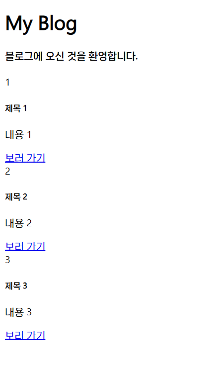
    
    → 이런 화면이 나온다!
    

## ✦ 블로그 글 뷰 구현하기

### ◆ 엔티티에 생성, 수정 시간 추가하기

1단계

`Article.java` 파일 수정

```java
package com.backendblog.springblog.domain;

import java.time.LocalDateTime;

import org.springframework.data.annotation.CreatedDate;
import org.springframework.data.annotation.LastModifiedDate;
import org.springframework.data.jpa.domain.support.AuditingEntityListener;

import jakarta.persistence.Column;
import jakarta.persistence.Entity;
import jakarta.persistence.EntityListeners;
import jakarta.persistence.GeneratedValue;
import jakarta.persistence.GenerationType;
import jakarta.persistence.Id;
import lombok.Builder;
import lombok.Getter;
import lombok.NoArgsConstructor;

// 추가
@EntityListeners(AuditingEntityListener.class) 
// ----
@Entity // 엔티티로 지정
@Getter
@NoArgsConstructor
public class Article {
    @Id  // id 필드를 기본키로 지정
    @GeneratedValue(strategy = GenerationType.IDENTITY)  // 기본키를 자동으로 +1
    @Column(name = "id", updatable = false)
    private Long id;

    @Column(name = "title", nullable = false) // 'title' 이라는 not null 컬럼과 매핑
    private String title;

    @Column(name = "content", nullable = false) 
    private String content;

		// 추가 
    @CreatedDate // 엔티티가 생성되어 저장될 때 시간이 자동 저장
    @Column(name = "created_at")
    private LocalDateTime createdAt;

    @LastModifiedDate // 조회한 Entity의 값을 변경할 때 시간이 자동 저장
    @Column(name = "updated_at")
    private LocalDateTime updatedAt;
		// ----

    @Builder // 빌더 패턴으로 객체 생성
    public Article(String title, String content) {
        this.title = title;
        this.content = content;
    }

    public void update(String title, String content) {
        this.title = title;
        this.content = content;
    }
}
```

- `@CreatedDate` : 엔티티 생성 시간 저장
- `@LastModifiedDate` : 엔티티 수정 시간 저장
- `@EntityListners(AuditingEntityListener.class)` : 생성 & 수정 시간 자동 감시, 기록

2단계

`import.sql` 파일 수정

```sql
INSERT INTO article (title, content, created_at, updated_at) VALUES ('제목 1', '내용 1', NOW(), NOW());
INSERT INTO article (title, content, created_at, updated_at) VALUES ('제목 2', '내용 2', NOW(), NOW());
INSERT INTO article (title, content, created_at, updated_at) VALUES ('제목 3', '내용 3', NOW(), NOW());
```

3단계

`SpringblogApplication.java` 파일에 엔티티 시간 자동 업데이트 위한 [[어노테이션]] 추가

```java
package com.backendblog.springblog;

import org.springframework.boot.SpringApplication;
import org.springframework.boot.autoconfigure.SpringBootApplication;
import org.springframework.data.jpa.repository.config.EnableJpaAuditing;

@EnableJpaAuditing // createdAt, updatedAt 자동 업데이트
@SpringBootApplication
public class SpringblogApplication {

	public static void main(String[] args) {
		SpringApplication.run(SpringblogApplication.class, args);
	}
}

```
		

### ◆ 컨트롤러 메소드 작성하기

- dto 디렉터리에 `ArticleViewResponse.java` 생성
    - 뷰에서 사용할 DTO 만들기
    
    ```java
    package com.backendblog.springblog.dto;
    
    import java.time.LocalDateTime;
    import com.backendblog.springblog.domain.Article;
    
    import lombok.Getter;
    import lombok.NoArgsConstructor;
    
    @NoArgsConstructor
    @Getter
    public class ArticleViewResponse {
        
        private Long id;
        private String title;
        private String content;
        private LocalDateTime createdAt;
    
        public ArticleViewResponse(Article article) {
            this.id = article.getId();
            this.title = article.getTitle();
            this.content = article.getContent();
            this.createdAt = article.getCreatedAt();
        }
    }
    ```
    
- `BlogViewController.java` 에 `getArticle()` 메소드 추가
    
    ```java
        @GetMapping("/articles/{id}")
        public String getArticle(@PathVariable Long id, Model model) {
            ArticleViewResponse article = blogService.findById(id);
            model.addAttribute("article", new ArticleViewResponse(article)); 
    
            return "article"; 
        }
    ```
    
    - 인자 id 에 URL 로 넘어온 값 받아 `findById()` 메소드로 넘겨 글 조회, 화면에서 사용할 모델에 데이터 저장, 보여줄 화면의 템플릿 이름 반환

### ◆ HTML 뷰 만들기

- `resource/templates` 에 `article.html` 작성
    
    ```html
    <!DOCTYPE html>
    <html lang="en" xmlns:th="http://www.thymeleaf.org">
    <head>
      <meta charset="UTF-8">
      <meta name="viewport" content="width=device-width, initial-scale=1.0">
      <title>블로그 글</title>
      <link rel="stylesheet" href="https://stackpath.bootstrapcdn.com/bootstrap/4.5.2/css/bootstrap.min.css">
    </head>
    <body>
      <div class="p-5 mb-5 text-center</> bg-light">
        <h1 class="mb-3">My Blog</h1>
        <h4 class="mb-3">블로그에 오신 것을 환영합니다.</h4>
      </div>
    
      <div class="container mt-5">
        <div class="row">
          <div class="col-lg-8">
            <article>
              <header class="mb-4">
                <h1 class="fw-bolder mb-1" th:text="${article.title}"></h1>
                <div class="text-muted fst-italic mb-2" th:text="|Posted on ${#temporals.format(article.createdAt, 'yyyy-MM-dd')}|"></div>
              </header>
              <section class="mb-5">
                <p class="fs-5 mb-4" th:text="${article.content}"></p>
              </section>
              <button type="button" class="btn btn-primary btn-sm">수정</button>
              <button type="button" class="btn btn-secondary btn-sm">삭제</button>
            </article>
          </div>
        </div>
      </div>
    </body>
    </html>
    ```
    
- `articleList.html` 수정하기
    
    ```html
    <!DOCTYPE html>
    <html lang="en" xmlns:th="http://www.thymeleaf.org">
    <head>
      <meta charset="UTF-8">
      <meta name="viewport" content="width=device-width, initial-scale=1.0">
      <title>블로그 글 목록</title>
      <link rel="stylesheet" href="https://stackpath.bootstrapcdn.com/">
    </head>
    <body>
      <div class="p-5 mb-5 text-center</> bg-light">
        <h1 class="mb-3">My Blog</h1>
        <h4 class="mb-3">블로그에 오신 것을 환영합니다.</h4>
      </div>
    
      <div class="container">
        <div class="row-6" th:each="item : ${articles}"> <!-- article 갯수만큼 반복-->
          <div class="card">
            <div class="card-header" th:text="${item.id}"></div> <!-- item 의 id 출력-->
            <div class="card-body">
              <h5 class="card-title" th:text="${item.title}"></h5>
              <p class="card-text" th:text="${item.content}"></p>
              <!-- 이부분 변경! -->
              <a th:href="@{/articles/{id}(id=${item.id})}" class="btn btn-primary">보러 가기</a>
            </div>
          </div>
        </div>
      </div>
    </body>
    </html>
    ```
    
- 서버 접속 후 글 1 보러가기를 누르면?
    
    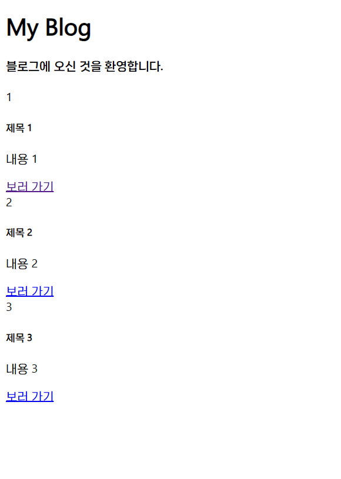
    
    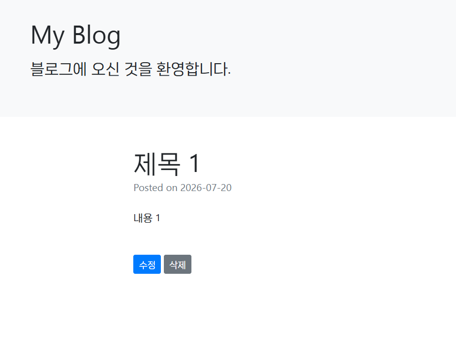
    
    → 이런 화면이 나온다! 
    

## ✦ 삭제 기능 추가하기

- 자바스크립트로 작성

1단계

src/main/resources/static 에 `article.js` 파일 생성

```jsx
const deleteButton = document.getElementById('delete-btn');

if (deleteButton) {
  deleteButton.addEventListener('click', event => {
    let id = document.getElementById('article-id').value;
    fetch(`/api/articles/${id}`, {
      method: 'DELETE',
    })
    .then(() => {
      alert('삭제가 완료되었습니다.');
      location.replace('/articles');
    })
  });
} 
```

- id 가 `delete-btn` 인 요소 찾아서 `click` 이벤트 발생시 지정 URL 에 DELETE 요청 전송
- `alert()` : 브라우저에 삭제 완료 팝업 띄우기
- `location.replace()` : 실행 시 사용자의 화면을 주소 기반으로 옮기기

2단계

`article.html` 수정하기

```html
<!DOCTYPE html>
<html lang="en" xmlns:th="http://www.thymeleaf.org">
<head>
  <meta charset="UTF-8">
  <meta name="viewport" content="width=device-width, initial-scale=1.0">
  <title>블로그 글</title>
  <link rel="stylesheet" href="https://stackpath.bootstrapcdn.com/bootstrap/4.5.2/css/bootstrap.min.css">
  <!-- js 파일 추가 -->
  <script src="/js/article.js"></script>
</head>
<body>
  <div class="p-5 mb-5 text-center</> bg-light">
    <h1 class="mb-3">My Blog</h1>
    <h4 class="mb-3">블로그에 오신 것을 환영합니다.</h4>
  </div>

  <div class="container mt-5">
    <div class="row">
      <div class="col-lg-8">
        <article>
          <!-- 블로그 글 id 추가 -->
          <input type="hidden" th:value="${article.id}" id="article-id" />
          <header class="mb-4">
            <h1 class="fw-bolder mb-1" th:text="${article.title}"></h1>
            <div class="text-muted fst-italic mb-2" th:text="|Posted on ${#temporals.format(article.createdAt, 'yyyy-MM-dd')}|"></div>
          </header>
          <section class="mb-5">
            <p class="fs-5 mb-4" th:text="${article.content}"></p>
          </section>
          <button type="button" class="btn btn-primary btn-sm">수정</button>
          <!-- [삭제] 버튼에 id 추가 -->
          <button type="button" class="btn btn-secondary btn-sm" id="delete-btn">삭제</button>
        </article>
      </div>
    </div>
  </div>
</body>
</html>
```

3단계

`articleList.html` 파일 수정하기

```html
<!DOCTYPE html>
<html lang="en" xmlns:th="http://www.thymeleaf.org">
<head>
  <meta charset="UTF-8">
  <meta name="viewport" content="width=device-width, initial-scale=1.0">
  <title>블로그 글 목록</title>
  <link rel="stylesheet" href="https://stackpath.bootstrapcdn.com/bootstrap/4.5.2/css/bootstrap.min.css">
  <!-- js 파일 추가 -->
  <script src="/js/articleList.js"></script>
</head>
<body>
  <div class="p-5 mb-5 text-center</> bg-light">
    <h1 class="mb-3">My Blog</h1>
    <h4 class="mb-3">블로그에 오신 것을 환영합니다.</h4>
  </div>

  <div class="container">
    <div class="row-6" th:each="item : ${articles}"> <!-- article 갯수만큼 반복-->
      <div class="card">
        <div class="card-header" th:text="${item.id}"></div> <!-- item 의 id 출력-->
        <div class="card-body">
          <h5 class="card-title" th:text="${item.title}"></h5>
          <p class="card-text" th:text="${item.content}"></p>
          <a th:href="@{/articles/{id}(id=${item.id})}" class="btn btn-primary">보러 가기</a>
        </div>
      </div>
    </div>
  </div>
</body>
</html>
```
		

- 블로그에서 글 1 삭제 버튼을 누르면?
    
    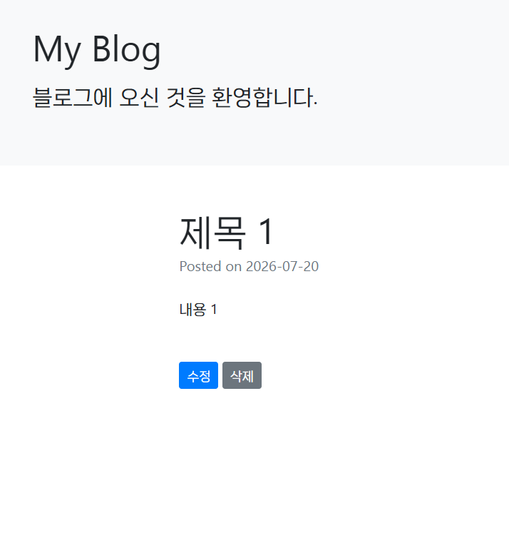
    
    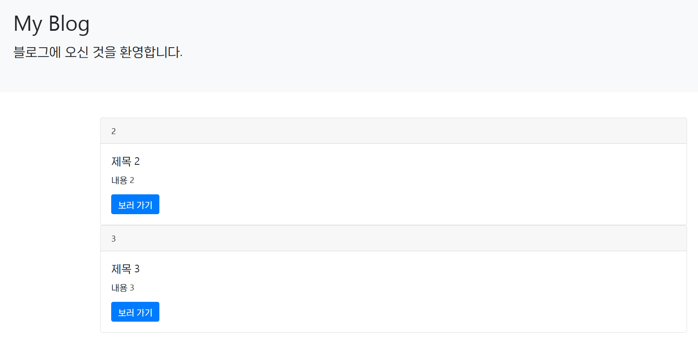
    
    → 삭제된 모습을 볼 수 있다! 
    

## ✦ 수정/생성 기능 추가하기

### ◆ 수정/생성 뷰 컨트롤러 작성하기

- 생성/수정 → 같은 화면에서 실행
    - 쿼리 파라미터 id 여부 따라 설정
- `BlogViewController.java` 파일에 `newArticle()` 메소드 추가
    
    ```java
    
        @GetMapping("/new-article")
        // id 키를 가진 쿼리 파라티머의 값을 id 변수에 매칭 (id는 없을 수도 있음)
        public String newArticle(@RequestParam(required = false) Long id, Model model) {
            if (id == null) { // id가 없으면 생성
                model.addAttribute("article", new ArticleViewResponse());
            } else { // id가 있으면 수정
                Article article = blogService.findById(id);
                model.addAttribute("article", new ArticleViewResponse(article));
            }
    
            return "newArticle"; 
        }
    ```
    
    - 쿼리 파라미터 id 값 → `newArticle()` 의 Long 타입 id 에 매핑
    - id 없으면 기본 [[생성자]]로 빈 `ArticleViewResponse` 객체 만들기
    - id 있으면 기존 값 가져오는 `findById()` 메소드 호출

### ◆ 수정/생성 뷰 만들기

1단계

- resource/templates 에 `newArticle.html` 파일 생성

```html
<!DOCTYPE html>
<html lang="en" xmlns:th="http://www.thymeleaf.org">
<head>
  <meta charset="UTF-8">
  <meta name="viewport" content="width=device-width, initial-scale=1.0">
  <title>블로그 글</title>
  <link rel="stylesheet" href="https://cdn.jsdelivr.net/npm/bootstrap@5.3.0/dist/css/bootstrap.min.css">
  <script src="/js/article.js"></script>
</head>
<body>
  <div class="p-5 mb-5 text-center</> bg-light">
    <h1 class="mb-3">My Blog</h1>
    <h4 class="mb-3">블로그에 오신 것을 환영합니다.</h4>
  </div>

  <div class="container mt-5">
    <div class="row">
      <div class="col-lg-8">
        <article>
          <!-- 아이디 정보 저장 -->
          <input type="hidden" th:value="${article.id}" id="articleId">

          <header class="mb-4">
            <input type="text" class="form-control" th:value="${article.title}" id="title" placeholder="제목">
          </header>
          <section class="mb-5">
            <textarea class="form-control h-25" rows="10" th:text="${article.content}" id="content" placeholder="내용"></textarea>
          </section>
          <!-- id 가 있을 때는 [수정] 버튼, 없을 때는 [등록] 버튼 -->
          <button type="button" class="btn btn-primary btn-sm" th:if="${article.id != null}" id="modify-btn">수정</button>
          <button type="button" class="btn btn-primary btn-sm" th:if="${article.id == null}" id="create-btn">등록</button>
        </article>
      </div>
    </div>
  </div>
</body>
</html>
```

2단계

- static 의 `article.js` 파일에 코드 추가

```jsx
// 수정 기능
// id 가 modify-btn 인 요소 조회
const modifyButton = document.getElementById('modify-btn');

if(modifyButton) {
  modifyButton.addEventListener('click', event => {
    let params = new URLSearchParams(location.search);
    let id = params.get('id');

    fetch(`/api/articles/${id}`, {
      method: 'PUT',
      headers: {
        'Content-Type': 'application/json',
    },
      body: JSON.stringify({
        title: document.getElementById('title').value,
        content: document.getElementById('content').value,
      })
    })
    .then(() => {
      alert('수정이 완료되었습니다.');
      location.replace(`/articles/${id}`);
    });
  });
}
```

- 클릭 이벤트 추가
    - URL 에서 id 를 통해 title, content 값으로 수정 `PUT` 요청 보내기

3단계

- `article.html` 파일에 id, 클릭 이벤트 추가
    - 수정 버튼만 바꿔주기!

```html
<button type="button" class="btn btn-primary btn-sm" id="modify-btn" 
th:onclick="|location.href='@{/new-article(id=${article.id})}'|">수정</button>
```
		

- 수정을 해보자! ([http://localhost:8080/articles/1](http://localhost:8080/articles/1))

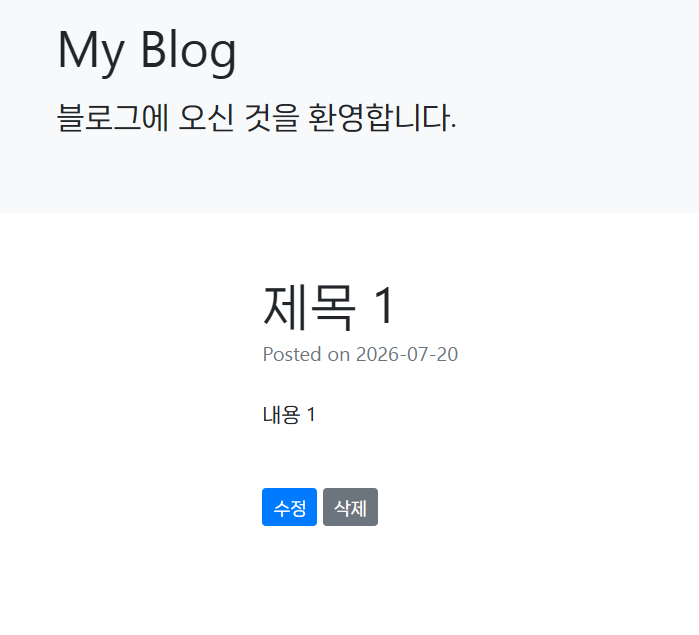

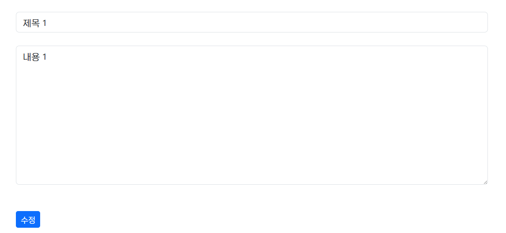

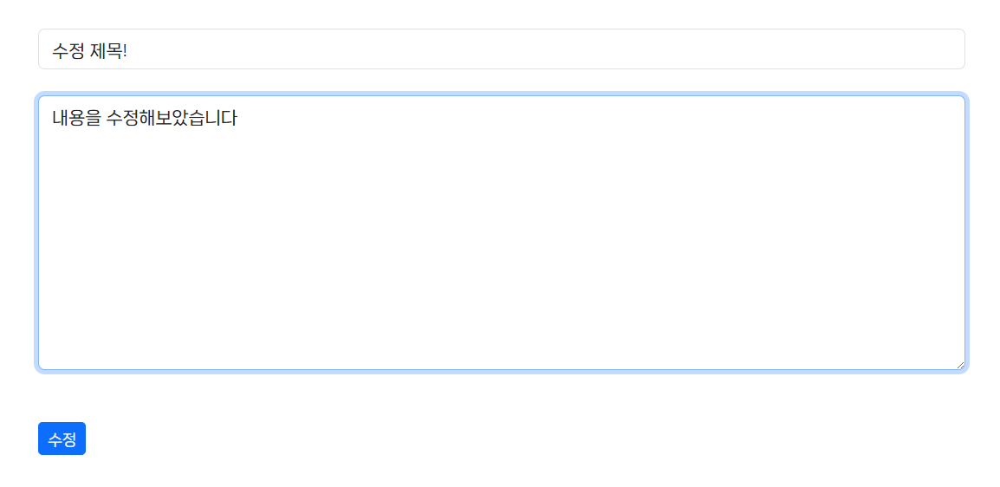

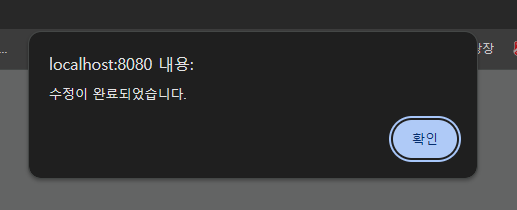

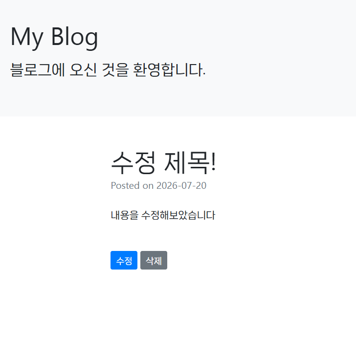

→ 수정이 완료되었다는 알림이 뜨고 수정된 것을 잘 볼 수 있다!

## ✦ 생성 기능 마무리하기

### ◆ 생성 기능 작성하기

1단계

- `article.js` 에 게시글 생성 [[API]] 추가

```jsx
// 등록 기능
// id 가 create-btn 인 요소 조회
const createButton = document.getElementById('create-btn');

if (createButton) {

  // 클릭 이벤트 감지 시 생성 API 호출
  createButton.addEventListener('click', event => {
    fetch('/api/articles', {
      method: 'POST',
      headers: {
        'Content-Type': 'application/json',
      },
      body: JSON.stringify({
        title: document.getElementById('title').value,
        content: document.getElementById('content').value,
      }),
    })
    .then(() => {
      alert('등록이 완료되었습니다.');
      location.replace('/articles');
    });
  });
}
```

2단계

- `articleList.html` 파일 수정
    - 글 등록 버튼 추가
    
    ```html
        <button type="button" id="create-btn" 
        th:onclick="|location.href='@{/new-article}'|" 
        class="btn btn-secondary btn-sm mb-3">글 등록</button>
    ```
		

- 글 등록을 해보자!

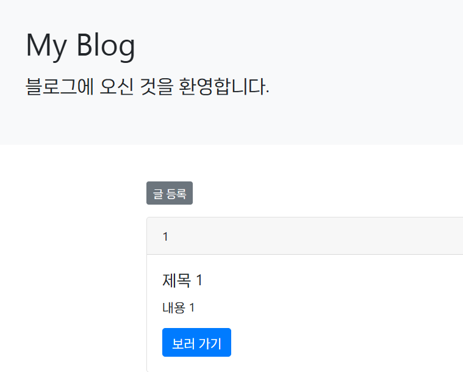

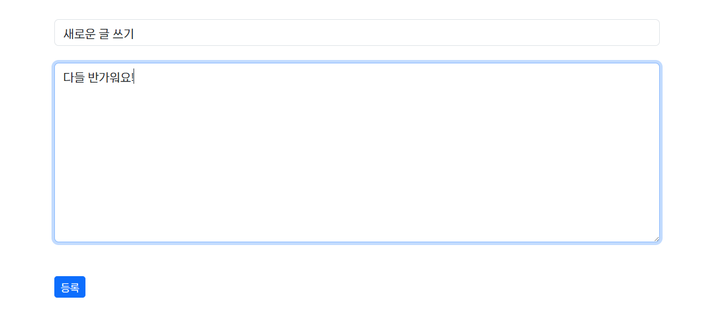

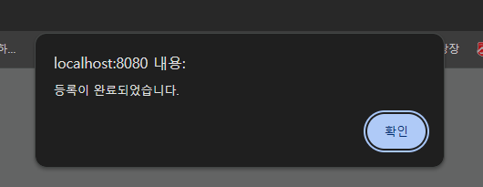

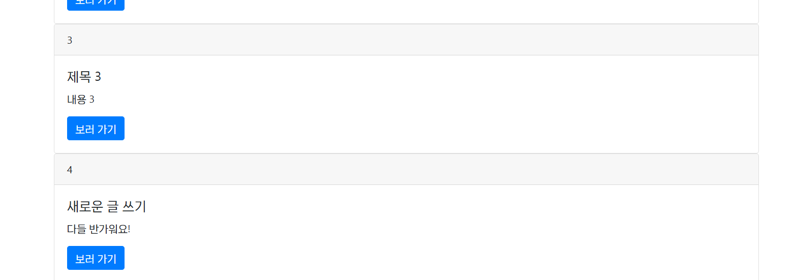

→ 잘 추가된 걸 볼 수 있다!

---

- 자주 사용하는 특수 문자
    
    ∞ ⊂ ⊃ ∪ ∩ ∴ ∵ ⇒ ⇔ ⁿ ¹ ² ³ ⁴ · ↑ ↓ … × ₁ ₂ ₃ ₄ ∅
    ex) Example
