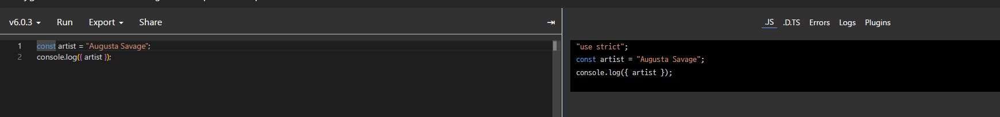
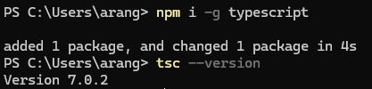

## ✦ 바닐라 자바스크립트의 함정

- 바닐라 (Vanilla) : 언어 확장, 프레임워크 없이 자바스크입트 사용

### ◆ 값 비싼 자유

- 코드 구성 방법 제한 X
    - 동적 타입 언어 → 충돌 가능성 체크 X

### ◆ 부족한 문서

- 표준화 내용 X
- 블록 주석으로 함수 & 변수 설명하는 JSDoc 표준 채택
    - 설명이 코드가 잘못되는 걸 막을 수 없음
    - 코드 리펙터링 중에 내용이 바뀔 수 있음
    - 복잡한 객체 설명하려면 주석이 길어짐

### ◆ 부족한 개발자 도구

- 클래스 멤버 이름 변경, 인수 타입 선언된 곳으로 바로 이동하는 기능 없음.

## ✦ 타입스크립트

- 마이크로소프트 내부 → 오픈소스화!
- 타입스크립트
    - 프로그래밍 언어 : JS 의 모든 구문 & 타입 정의하고 사용
    - 타입 검사기 : JS, TS 로 쓰인 파일에서 생성된 모든 구성 요소 이해, 잘못 구성된 부분 알려줌
    - 컴파일러 : 타입 검사기 실행 → 문제 보고 → 대응 JS 코드 생성
    - 언어 서비스 : VS Code 에서 개발자에게 유용한 유틸리티 제공

## ✦ 타입스크립트 플레이그라운드에서 시작하기

- [https://www.typescriptlang.org/ko/play/](https://www.typescriptlang.org/ko/play/)
    - 이 URL 에서 사용해볼 수 있다!



- TS → JS로 컴파일된 코드 볼 수 있다!

## ✦ 로컬에서 시작하기

- 컴퓨터에 설치하기
    
    ```bash
    npm i -g typescript
    ```
    
    
    
    → 요렇게 나오면 성공!
    

### ◆ 로컬에서 실행하기

- 아무 폴더 만들고 `tsc --init` 으로 config 파일 생성
- `index.ts` 파일에
    
    ```tsx
    console.blub("Nothing is worth more than laughter");
    ```
    
    이렇게 쓰고 실행하면 오류가 생기긴하지만 JS 가 생성되긴 함
    
    ```tsx
    console.log("Nothing is worth more than laughter");
    ```
    
    → 제대로 바꿔주자!
    

### ◆ 편집기 기능

- `tsconfig.json` 파일 만들면 이 폴더는 타입스크립트 프로젝트로 인식!

## ✦ 타입스크립트에 대한 오해

### ◆ 잘못된 코드 해결책

- JS 코드 구조화에는 좋음! 근데 구조 강요는 안 함.
- 특정 프레임워크 (리액트라거나..) 랑도 연관 X

### ◆ 자바스크립트로의 확장

- JS 작동 방식 변경 X!
- 자바스크립트랑 안 충돌하게 열심히 노력 중

### ◆ 자바스크립트보다 느림

- 오래된 런타임 환경일 때만 그럼! 대부분은 타입스크립트 컴파일러 사용 X
- 코드 빌드 시간이 조금 더 걸리기는 함
    - JS 로 컴파일하는 시간..
    - 근데 성능 저하 무시하게 설정되므로 큰 문제 없음

### ◆ 진화가 끝남

- 웹은 계속 진화 중..
- JS & TS 도 계속 버그 수정 & 기능 추가 중
- 책은 4.7.2 기준. 내껀 7.0.2

---

- 자주 사용하는 특수 문자
    
    ∞ ⊂ ⊃ ∪ ∩ ∴ ∵ ⇒ ⇔ ⁿ ¹ ² ³ ⁴ · ↑ ↓ … × ₁ ₂ ₃ ₄ ∅
    ex) Example
