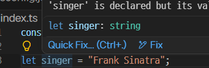
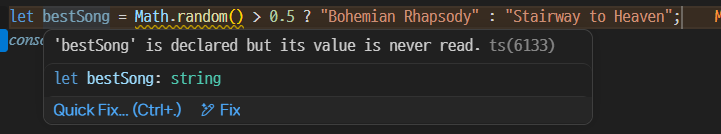

## ✦ 타입의 종류

- 7가지 기본 [[원시 타입]] (primitive type)
    - null
    - undefined
    - boolean
    - [[String|string]]
    - number
    - bigint
    - symbol
- let 으로 [[변수]] 선언하고 마우스 갖다대면 무슨 타입인지 보임
    
    
    
    → `singer` 는 string 타입!
    
    
    
    → 엥 얘는 삼항 연산자인데?
    true / false 모두 string 결과이므로 string 이라고 예측!
    

### ◆ 타입 시스템

- 프로그래밍 언어가 프로그램에서 가질 수 있는 타입 이해 방법 규칙 집합
    1. 코드를 읽고 존재하는 모든 타입과 값 이해
    2. 각 값이 초기 선언에서 가질 수 있는 타입 확인
    3. 각 값이 추후 코드에서 어떻게 사용될 수 있는지 모든 방법 확인
    4. 값의 사용법이 타입과 일치하지 않으면 오류 표시

### ◆ 오류 종류

- 구문 오류 : TS 가 [[JavaScript|JS]] 로 변환되는 것을 차단한 경우
    - 코드로 이해할 수 없는 잘못된 구문 감지 시
    
    ```tsx
    let let wat; 
    ```
    
    → TS : 에엣.. let 이 두 개!
    
    ```tsx
    let let, wat;
    ```
    
    → JS로 이렇게 [[컴파일]].. 된다고 하는데 아예 안되는 듯?
    
- 타입 오류 : 타입 검사기에 따라 일치하지 않는 것이 감지된 경우
    - 타입 검사기가 프로그램의 타입에서 오류 감지했을 때 발생
    - 타입 오류 있어도 JS 코드 출력 가능하긴한데 잘 안 될 걸? 이라는 의미..
    - 근데 굳이 모든 타입 오류를 수정 안함.. (나중에 13장에서 다룰 예정)

## ✦ 할당 가능성

- 같은 타입, 다른 값 할당 → Ok!
- 다른 타입 할당 → 안댐!
- 할당 가능성 : [[함수]] 호출이나 변수에 값을 제공할 수 있는지 여부 확인하기
    - 전달된 값이 예상된 타입으로 할당 가능?

### ◆ 할당 가능성 오류 이해하기

- `Type ... is not assignable to type ...`
    - 첫 번째 type : 코드에서 변수에 할당하려고 시도하는 값
    - 두 번째 type : 값이 할당되는 변수

## ✦ 타입 어노테이션

- 변수에 타입스크립트가 읽어야 할 추깃값이 없는 경우?
    - 기본적으로 변수는 암묵적 any 타입으로 간주 (아무거나 될 수 있음)
- 초기 타입 유추 불가 → 진화하는 any
    - 새로운 값 할당하마 변수 타입 이해 발전
    
    ```tsx
    let rocker; // 타입 : any
    rocker = "Joan Jett"; // 타입 : string
    rocker.toUpperCase(); // Ok
    
    rocker = 19.58; // 타입 : number
    rocker.toPrecision(1); // Ok
    
    rocker.toUpperCase(); // 오류 발생 
    ```
    
    - any 타입 값 → [[타입 검사]] 기능 잘 작동 안함
- 타입 [[어노테이션]] (type annotation)
    - 초깃값 할당하지 않고도 변수 타입 선언 가능
    
    ```tsx
    let 변수명: 타입 이름;
    
    let rocker: string;
    rocker = "Joan Jett";
    ```
    
    - TS 에만 존재 → 런타임 영향 X (JS 컴파일 시 사라짐)
    - 타입 어노테이션으로 정의된 값 외 할당 → 타입 오류 발생
    - 초깃값 존재 시 굳이 사용 X

## ✦ 타입 형태

- 코드에서 변수의 속성에 접근 → 접근 속성이 존재하나? 확인
- `string` 타입으로 변수 선언 → `string` 타입에서 작동하는지 알 수 없는 작업 허용 X
- 비슷하게 객체에서 없는 속성 사용시 오류 표시
    
    ```tsx
    let cher = {
    	firstName: "Cherilyn",
    	lastName: "Sarkisian",
    };
    
    cher.middleName; // 오류 발생
    ```
    

### ◆ 모듈

- 서로 다른 파일에 작성된 코드 공유

```tsx
import { value } from "./values";

export const doubled = value * 2;
```

- [[모듈]] : `export` 또는 `import` 가 있는 파일
    - 한 모듈에서 다른 파일에 선언된 변수와 동일한 이름으로 선언된 변수
        - 다른 파일 변수 안가져오면 충돌 X
        - 가져왔는데 동일한 이름이면 충돌!
- 스크립트 : 모듈이 아닌 모듈 파일
    - 스크립트 → 전역 [[Scope|scope]] 간주
    - 스크립트 파일 선언 변수는 다른 스크립트 파일 변수와 동일한 이름 X

---

- 자주 사용하는 특수 문자
    
    ∞ ⊂ ⊃ ∪ ∩ ∴ ∵ ⇒ ⇔ ⁿ ¹ ² ³ ⁴ · ↑ ↓ … × ₁ ₂ ₃ ₄ ∅
    ex) Example
