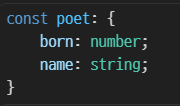

## ✦ 객체 타입

- `{...}` 로 객체 리터럴 생성 →  TS 해당 속성 기반 new 객체 타입 or 타입 형태 고려
    - 객체 타입 → 객체의 값과 동일한 속성명 & 원시 타입
    - `value.멤버`, `value['멤버']` 구문 사용
    
    ```tsx
    const poet = {
      born: 1935,
      name: "Mary Oliver",
    }
    
    poet['born'] = 1935 // number
    poet.name; // string
    
    poet.end; // error
    ```
    
    
    
    - 없는 속성 접근하면 오류 발생

### ◆ 객체 타입 선언

- 객체 타입 → 객체 리터럴과 유사, but 필드 값 대신 타입 이용해 설명

```tsx
let poetLater: {
  born: number;
  name: string; // , 가 아닌 ; 사용
};

// Ok
poetLater = { 
  born: 1935, 
  name: "Mary Oliver"
};

poetLater = "Sappho"; // Error
```

### ◆ 별칭 객체 타입

- 각 객체 타입에 타입 별칭 할당해 사용

```tsx
type Poet = {
  born: number;
  name: string;
};

let poetLater: Poet;

// Ok
poetLater = {
  born: 1809,
  name: "Emily Dickinson",
}; 

poetLater = "Emily Dickinson"; // Error
```

→ 마치 `class` 처럼 사용! ⇒ 나중에 인터페이스 키워드 이용

### ◆ 구조적 타이핑

- 구조적 타입화 (Structurally typed)
    - 타입을 충족하는 모든 값을 해당 타입의 값으로 사용 가능
    - 매개변수 or 변수가 특정 객체 타입으로 선언 → 어떤 객체 사용하든 해당 속성 필요

```tsx
type WithFirstName = {
  firstName: string;
}

type WithLastName = {
  lastName: string;
}

const hasBoth = {
  firstName: 'John',
  lastName: 'Doe',
};

let withFirstName: WithFirstName = hasBoth; // Ok
let withLastName: WithLastName = hasBoth; // Ok
```

- `WithFirstName` 이랑 `WithLastName` 은 `string` 단일 타입 멤버만 선언
- `hasBoth` 두 개의 별칭 객체 타입 가짐 (like 상속,,) : 두 변수 모두 제공 가능
- 덕 타이핑 (ducktyping) 이랑 다름
    - JS 에서 사용
    - 런타임에서 사용될 때까지 객체 타입 검사 X

---

- 자주 사용하는 특수 문자
    
    ∞ ⊂ ⊃ ∪ ∩ ∴ ∵ ⇒ ⇔ ⁿ ¹ ² ³ ⁴ · ↑ ↓ … × ₁ ₂ ₃ ₄ ∅
    ex) Example
