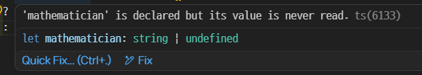
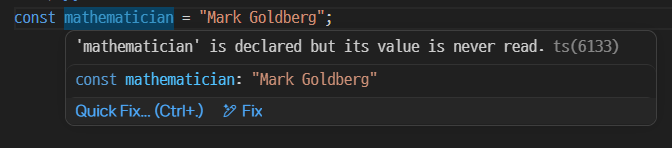

## ✦ 유니언 타입

### ◆ 유니언

- 유니언 (union) : 값에 허용된 타입을 두 개 이상 타입으로 확장
    - 정확히는 모르지만 두 개 이상의 옵션 중 하나라는 것은 앎
    - `|` 사용해 표시

```tsx
let mathematician = Math.random() > 0.5
	? undefined
	: "Mark Goldberg";
```

→ 어떤 타입? 

`undefined` / `string` → 이거 혹은 저거 



이런식으로 | 로 나뉘어서 표시

### ◆ 유니언 타입 선언

- 변수의 초깃값 있어도 명시정 타입 어노테이션 제공하는게 유용할 때
    - 다른 타입으로 바뀔 수 있는 변수일 경우!
    
    ```tsx
    let thinker: string | null = null
    
    if (Math.random() > 0.5) {
      thinker = "Mark Goldberg"; // Ok
    }
    ```
    
    - 타입 어노테이션으로 타입 정의하는 모든 곳에서 사용 가능
    - 순서 중요 X

### ◆ 유니언 속성

- 유니언으로 선언한 타입에 존재하는 멤버 속성에만 접근 가능
    - 그 외는 오류 발생!

```tsx
let physicist = Math.random() > 0.5
	? "Marie Curie"
	: 84;

physicist.toString(); // Ok (두 타입 모두 존재)
physicist.toUpperCase(); // error (number에 없음)
physicist.toFixed(); // error (string에 없음)
```

## ✦ 내로잉

- 내로잉 (narrowing) : 값에 허용된 타입이 하나 이상의 가능한 타입이 되지 않도록 좁히는 것

### ◆ 값 할당을 통한 내로잉

- 변수에 값 직접 할당 → 유니언에서 특정 타입으로 확정! (내로잉)

```tsx
let admiral: number | string;

admiral = "Grace Hopper";
admiral.toUpperCase(); // Ok: string
admiral.toFixed(); // Error: number 함수
```

### ◆ 조건 검사를 통한 내로잉

- 변수가 알려진 값과 같은지 확인하는 if문 → 특정 타입으로 확정!

```tsx
// scientist : number | string 의 타입
let scientist = Math.random() > 0.5
  ? "Rosalind Franklin"
  : 51;

if (scientist === "Rosalind Franklin") {
  scientist.toUpperCase(); // Ok: string
}

scientist.toUpperCase(); // Error: 확정 X
```

### ◆ typeof 검사를 통한 내로잉

- typeof 로 if 체크해도 내로잉 가능
- 삼항 연산자로도 작성 가능

```tsx
let researcher = Math.random() > 0.5
  ? "Rosalind Franklin"
  : 51;

typeof researcher === "string"
  ? researcher.toUpperCase() // Ok: string
  : researcher.toFixed(); // Ok: number
```

## ✦ 리터럴 타입

- 리터럴 타입 (literal type) : 구체적인 원시 타입
- `const` 로 선언 후 직접 리터럴 값 할당!

```tsx
const mathmatician = "Mark Goldberg";
```



- 아예 정확한 변수 표시!
- 유니언 타입 어노테이션 → 리터럴 / 원시 타입 섞어 사용 가능

```tsx
let lifespan: number | "ongoing" | "uncertain";

lifespan = 89; // Ok
lifespan = "ongoing"; // Ok

lifespan = true; // Error
```

### ◆ 리터럴 할당 가능성

- 동일인 원시 타입이라도 서로 다른 리터럴 타입은 할당 불가
    - `"ongoing"` , `"uncertain"` 이외의 string 할당 시 오류 발생
    - 근데 얘네를 원시 타입에 할당하는 건 가능!

## ✦ 엄격한 null 검사

- 엄격한 null 검사 (strict null checking)

### ◆ 십억 달러의 실수

- 다른 타입이 필요한 위치에서 null 값을 사용하도록 하는 많은 타입 시스템
- 컴파일러 옵션 : `strictNullChecks` 엄격한 null 검사 활성화할 것인가?
    - 비활성 : 모든 타입에 `| null | undefined`  추가해야 할당 가능
    - 보통 활성화 한다~

### ◆ 참 검사를 통한 내로잉

- 잠재적인 값 중 truthy 로 확인된 일부로만 변수 타입 좁힐 수 있음

```tsx
// string | undefined
let geneticist = Math.random() > 0.5 
  ? "Barbara McClintock" 
  : undefined; 

if (geneticist) { // truthy 라고 판단
  geneticist.toUpperCase(); // Ok: string
}

geneticist.toUpperCase(); // Error

geneticist && geneticist.toUpperCase(); // Ok
geneticist?.toUpperCase(); // Ok
```

```tsx
let biologist = Math.random() > 0.5 && "Rachel Carson"; // string | false

if (biologist) { // truthy 라고 판단
  biologist; // string
} else {
  biologist; // false | string
}
```

### ◆ 초기값이 없는 변수

- JS → 초기값 없으면 기본적으로 undefined
- TS → 값이 할당되기 전에 속성 중 하나 접근처럼 사용하려고 하면 오류 발생

```tsx
let mathematician: string;

mathematician?.length; // Error

mathematician = "Euclid";
mathematician.length; // Ok
```

- 근데 변수 타입에 `undefined` 포함되어 있으면 오류 발생 X

```tsx
let mathematician: string | undefined;

mathematician?.length; // Ok

mathematician = "Euclid";
mathematician.length; // Ok
```

## ✦ 타입 별칭

- 타입이 여러 개 가능한 유니언 타입
    
    ```tsx
    let data: boolean | number | string | null | undefined;
    ```
    
    → 길다!
    
- 타입 별칭 (type alias) : 재사용하는 타입에 더 쉬운 이름 할당
    - PascalCase 사용
    
    ```tsx
    type 새로운 이름 = 타입
    
    type RawData = boolean | number | string | null | undefined;
    
    let dataFirst: RawData;
    let dataSecond: RawData;
    ```
    
    → 타입 복잡해질 때 사용할 수 있음!
    

### ◆ 타입 별칭은 자바스크립트가 아닙니다

- 타입 어노테이션 → JS 컴파일 O
- 타입 별칭 → JS 컴파일 X
    - 개발 시에만 존재

### ◆ 타입 별칭 결합

- 타입 별칭 → 다른 타입 별칭 참조 가능

```tsx
type Id = number | string;

type IdMaybe = Id | undefined | null; // 총 4개의 type 가능
```

- 사용 순서 지킬 필요 X
    - 먼저 사용 후 후 선언 가능
    
    ```tsx
    type IdMaybe = Id | undefined | null; // Ok
    type Id = number | string;
    
    ```
    

---

- 자주 사용하는 특수 문자
    
    ∞ ⊂ ⊃ ∪ ∩ ∴ ∵ ⇒ ⇔ ⁿ ¹ ² ³ ⁴ · ↑ ↓ … × ₁ ₂ ₃ ₄ ∅
    ex) Example
