## ✦ 사전지식 : AI

- LLM (Large Language Model) : 대규모 텍스트 데이터를 학습한 언어 모델
    - ChatGPT, Claude, Gemini 등
- Spring AI : 다양한 LLM 제공자를 스프링 방식으로 쉽게 사용할 수 있도록 도와주는 라이브러리
    - 빈, DI, 템플릿, 클라이언트 패턴 활용 AI 기능 구현

## ✦ AI 토큰 발급 받기

- ChatGPT, Claude 는 유료,,
- 하지만 Gemini 는 무료이다!
    
    [Google AI Studio](https://aistudio.google.com/)
    
    - 요 사이트에서 무료로 API 발급 가능!
    
    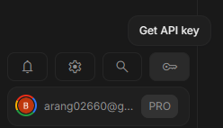
    
    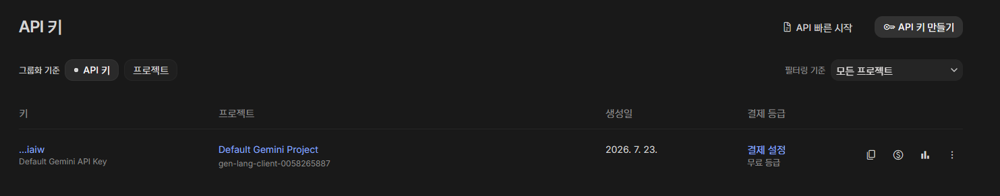
    
    ```yaml
    spring:
      jpa:
        # 전송 쿼리 확인
        show-sql: true
        properties:
          hibernate:
            format_sql: true
    
        # 테이블 생성 후에 data.sql 실행
        defer-datasource-initialization: true
      ai:
        google:
          genai:
            api-key: ${GOOGLE_AI_API_KEY:<여기에 입력>}
            chat:
              options:
                model: gemini-flash-latest
    ```
    

## ✦ 블로그 글 작성 도우미 기능 추가하기

### ◆ 의존성 추가하기

```yaml
repositories {
	mavenCentral()
	maven { url "https://repo.spring.io/milestone" }
}

dependencies {
	...
	# 제미나이용!
	implementation platform('org.springframework.ai:spring-ai-bom:2.0.0')
	implementation 'org.springframework.ai:spring-ai-starter-model-google-genai'
}
```

### ◆ 글 작성 도우미 기능 추가하기

1단계

요청용 레코드 & AI 가 생성한 답 저장 레코드

- dto 패키지에 `WritingSuggestionRequest.java` , `WritingSuggestionResponse.java` 파일 생성
- `WritingSuggestionRequest.java`

```java
package com.backendblog.springblog.dto;

import java.util.Map;

public record WritingSuggestionRequest(
    String title,
    String content,
    String question
) {
    public Map<String, Object> toMap(String format) {
        return Map.of(
            "title", title,
            "content", content,
            "question", question,
            "format", format
        );
    }
}

```

- `WritingSuggestionResponse.java`

```java
package com.backendblog.springblog.dto;

import java.util.List;

public record WritingSuggestionResponse(List<String> suggestions) {
}
```

2단계

기능 구현 위한 프롬프트 작성

- resource 패키지 아래 prompts 패키지 생성 → `writing-assistant.st` 파일 생성

```
당신은 블로그 글쓰기를 도와주는 전문 작가입니다.

제목: {title}
현재 작성된 내용: {content}
질문: {question}

위 질문에 대해 3개의 구체적이고 실용적인 제안을 해주세요.

{format}
```

3단계

DTO & 프롬프트 사용해 응답 생성 기능 구현

- service 패키지 하위에 `WritingAssistantService.java` 파일 생성

```java
package com.backendblog.springblog.service;

import org.springframework.beans.factory.annotation.Value;
import org.springframework.core.io.Resource;
import org.springframework.stereotype.Service;
import org.springframework.ai.chat.client.ChatClient;
import org.springframework.ai.chat.prompt.PromptTemplate;
import org.springframework.ai.converter.BeanOutputConverter;

import com.backendblog.springblog.dto.WritingSuggestionRequest;
import com.backendblog.springblog.dto.WritingSuggestionResponse;

@Service
public class WritingAssistantService {

    private final ChatClient chatClient;
    private final PromptTemplate template;

    // LLM 의 JSON 응답을 WritingSuggestion DTO 로 변환하기 위한 컨버터
    private final BeanOutputConverter<WritingSuggestionResponse> outputConverter = new BeanOutputConverter<>(
            WritingSuggestionResponse.class);

    public WritingAssistantService(
            ChatClient.Builder chatClientBuilder,
            @Value("classpath:/prompts/writing-assistant.st") Resource promptResource) {
        this.chatClient = chatClientBuilder.build();
        this.template = new PromptTemplate(promptResource);
    }

    public WritingSuggestionResponse getWritingAssist(WritingSuggestionRequest request) {
        // 프롬프트 템플릿에 파라미터 채워넣어 최종 프롬프트 생성
        String prompt = template.create(request.toMap(outputConverter.getFormat())).getContents();

        // LLM 에 프롬프트 전송 및 수신
        String response = chatClient.prompt().user(prompt).call().content();

        // 응답을 DTO 로 변환
        return outputConverter.convert(response);
    }
}
```

- `getWritingAssist()`
    - 사용자가 입력한 제목, 본문, 질문을 프롬프트 템플릿에 주입해 최종 프롬프트 생성
    - `ChatClient` 통해 LLM 호출
    - 모델이 반환한 JSON 형식의 응답 → `WritingSuggestions` 객채로 변환
    - 글쓰기 제안 목록만 추출해 최종 결과로 반환

4단계

- `BlogApiController.java` 파일에서 `getWritingAssist()` 메소드 작성

```java
    private final WritingAssistantService writingAssistantService;
    
    @PostMapping("/api/ai-suggestions")
    public ResponseEntity<WritingSuggestionResponse> writingAssist(@RequestBody WritingSuggestionRequest request) {
        WritingSuggestionResponse response = writingAssistantService.getWritingAssist(request);

        return ResponseEntity.ok()
                .body(response);
    }
```
		

### ◆ 실행 테스트하기

- 서버 열고, 포스트맨에서

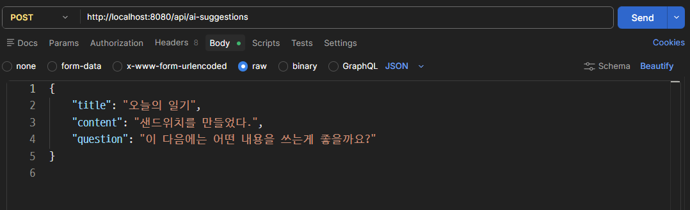

→ 요런 식으로 `POST` 요청을 보내면

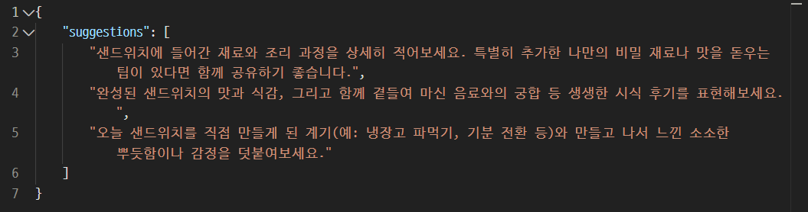

- AI 가 이런 답변을 보내준다!

### ◆ 글 생성 뷰 수정하기

1단계

resource/templates 안의 `newArticle.html` 파일에 [AI 도움 받기] 버튼 추가

```html
<!DOCTYPE html>
<html lang="en" xmlns:th="http://www.thymeleaf.org">
...

          <section class="mb-5">
            <textarea class="form-control h-25" rows="10" th:text="${article.content}" id="content" placeholder="내용"></textarea>
          </section>
          <!-- AI 도움 버튼 추가-->
          <button type="button" class="btn btn-info btn-sm" id="ai-assist-btn">AI 도움 받기</button>
          <!-- id 가 있을 때는 [수정] 버튼, 없을 때는 [등록] 버튼 -->
          <button type="button" class="btn btn-primary btn-sm" th:if="${article.id != null}" id="modify-btn">수정</button>
          <button type="button" class="btn btn-primary btn-sm" th:if="${article.id == null}" id="create-btn">등록</button>
...

</html>
```

2단계

마찬가지로 `newArticl.html` 에 모달 코드 작성

```html

...
  <div class="modal fade" id="aiAssistModal" tabindex="-1" role="dialog" aria-labelledby="aiAssistModalLabel" aria-hidden="true">
    <div class="modal-dialog modal-lg" role="document">
      <div class="modal-content">
        <div class="modal-header">
          <h5 class="modal-title" id="aiAssistModalLabel">AI 글쓰기 도우미</h5>
          <button type="button" class="close" data-dismiss="modal" aria-label="Close">
              <span aria-hidden="true">&times;</span>
          </button>
        </div>
        <div class="modal-body">
          <div class="form-group">
              <label for="ai-question">어떤 부분이 고민되시나요?</label>
              <textarea class="form-control" id="ai-question" rows="3" placeholder="예: 이 다음에 어떤 내용을 써야 할까요?"></textarea>
          </div>
          <button type="button" id="get-suggestions-btn" class="btn btn-primary">제안 받기</button>
          <div id="ai-loading" class="mt-3" style="display: none;">
            <div class="spinner-border text-primary" role="status">
                <span class="sr-only">Loading...</span>
              </div>
            <span class="ml-2">AI가 생각하고 있습니다...</span>
          </div>
          <div id="ai-suggestion" class="mt-3" style="display: none;">
            <h6>AI 제안:</h6>
            <div id="ai-suggestions-content"></div>
          </div>
        </div>
        <div class="modal-footer">
          <button type="button" class="btn btn-secondary" data-dismiss="modal">닫기</button>
        </div>
      </div>
    </div>
  </div>

  <script src="https://code.jquery.com/jquery-3.3.1.slim.min.js"></script>
  <script src="https://cdnjs.cloudflare.com/ajax/libs/popper.js/1.14.3/umd/popper.min.js"></script>
  <script src="https://stackpath.bootstrapcdn.com/bootstrap/4.1.3/js/bootstrap.min.js"></script>
</html>
```

3단계

`article.js` 파일에 [AI 도움받기] 버튼 누르면

→ 입력칸에 있는 데이터로 API 호출 → AI 제안 받기 코드 작성

```jsx
// 생성하기
// 1. id 가 ai-assist-btn 인 요소 조회
const aiAssistButton = document.getElementById('ai-assist-btn');

if (aiAssistButton) {
  // 2. 클릭 이벤트 감지 -> modal 띄우고 이전 제안 숨기기
  aiAssistButton.addEventListener('click', event => {
    $('#aiAssistModal').modal('show');
    document.getElementById('ai-suggestions').style.display = 'none';
    document.getElementById('ai-question').style.display = 'block';
  });
}

// 3. id 가 get-suggestions-btn 인 요소 조회 (modal 에 있는 버튼)
const getSuggestionsButton = document.getElementById('get-suggestions-btn');

if (getSuggestionsButton) {
  // 4. 클릭 이벤트 감지 -> AI 제안 가져오기
  getSuggestionsButton.addEventListener('click', event => {
    const title = document.getElementById('title').value;
    const content = document.getElementById('content').value;
    const question = document.getElementById('ai-question').value;

    if (!question.trim()) {
      alert('고민되는 내용을 입력해주세요.');
      return;
    }

    document.getElementById('ai-loading').style.display = 'block';
    document.getElementById('ai-suggestions').style.display = 'none';

    const body = JSON.stringify({
      title: title,
      content: content,
      question: question,
    });

    fetch('/api/ai-suggestions', {
      method: 'POST',
      headers: {
        'Content-Type': 'application/json',
      },
      body: body
    })
    .then(response => response.json())
    .then(data => {
      document.getElementById('ai-loading').style.display = 'none';
      const suggestionContent = document.getElementById('ai-suggestion-content');

      // 5. 응답이 오면 제안 뷰 표시
      let html = '';
      if (data.suggestions && data.suggestions.length > 0) {
        html += '<ul class="list-group">';
        data.suggestions.forEach((suggestion, index) => {
          html += `<li class="list-group-item suggestion-item" style="cursor: pointer;" data-suggestion="${suggestion.replace(/"/g, '&quot;')}"
          title="클릭하면 본문에 추가됩니다"> ${suggestion}
          <small class="text-muted float-right">클릭하여 추가</small>
          </li>`; ;
        });
        html += '</ul>';
      }
      suggestionContent.innerHTML = html;
      document.getElementById('ai-suggestions').style.display = 'block';
    })
  });
}

// 6. 제안 선택을 누르면 현재 내용 끝에 제안을 추가
const suggestionContent = document.getElementById('ai-suggestion-content');
if (suggestionContent) {
  suggestionContent.addEventListener('click', function(e) {
    if (suggestionItem) {
      const suggestion = suggestionItem.getAttribute('data-suggestion');
      const contentTextarea = document.getElementById('content');

      const currentContent = contentTextarea.value;
      const separator = currentContent && !currentContent.endsWith('\n') ? '\n\n' : '';

      contentTextarea.value = currentContent + separator + suggestion;

      $('#aiAssistModal').modal('hide');
      contentTextarea.focus();
    }
  });
}
```
		

### ◆ 실행 테스트하기

- 서버를 열고, [http://localhost:8080/new-article](http://localhost:8080/new-article) 요기에 접속해서 제목, 내용 채우고 [AI 도움 받기] 버튼 클릭
    
    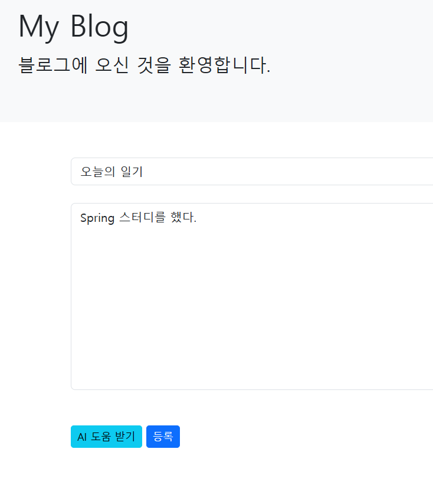
    
    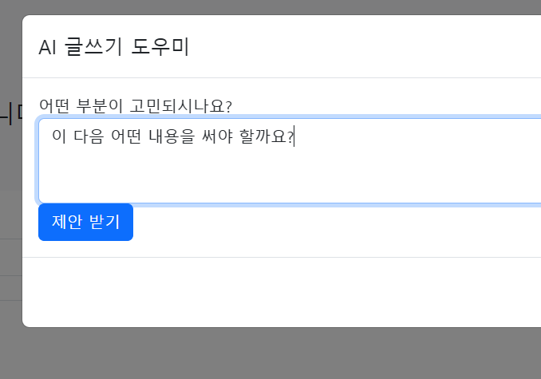
    

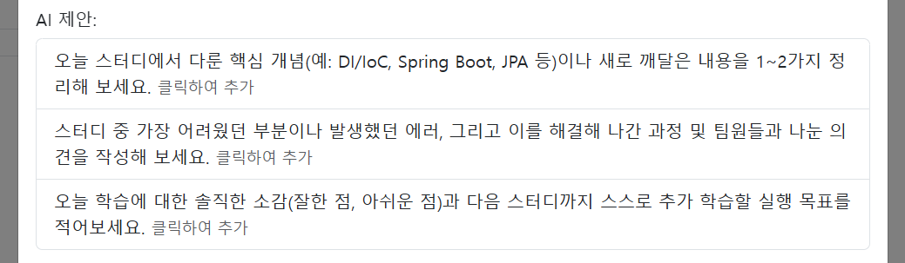

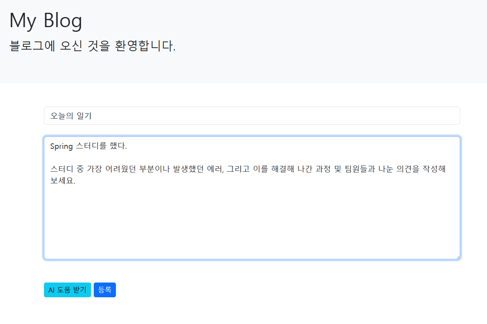

→ 잘 추가되는 모습을 볼 수 있다!

## ✦ 섬네일 자동 생성 기능 추가하기

### ◆ 이미지 업로드 기능 추가하기

1단계

domain 에서 `Article.java` 파일 수정

```java
    @Column(name = "image_url")
    private String imageUrl;

    @Builder // 빌더 패턴으로 객체 생성
    public Article(String title, String content, String imageUrl) {
        this.title = title;
        this.content = content;
        this.imageUrl = imageUrl
    }

    public void update(String title, String content, String imageUrl) {
        this.title = title;
        this.content = content;
        this.imageUrl = imageUrl;
    }
```

- `imageUrl` 추가!

2단계

dto 디렉터리 아래 Article 관련 파일에도 이미지 경로 파라미터 추가

- `AddArticleRequest.java`
    
    ```java
    @Getter
    @NoArgsConstructor  // 기본 생성자 추가
    @AllArgsConstructor // 모든 필드 값을 파라미터로 받은 생성자 추가
    public class AddArticleRequest {
        
        private String title;
        private String content;
        private String imageUrl;
    
        public AddArticleRequest(String title, String content) {
            this.title = title;
            this.content = content;
        }
    
        public Article toEntity() {
            return Article.builder()
                    .title(title)
                    .content(content)
                    .imageUrl(imageUrl)
                    .build();
        }
    }
    ```
    
- `UpdateArticleRequest.java`
    
    ```java
    @NoArgsConstructor
    @AllArgsConstructor
    @Getter
    public class UpdateArticleRequest {
        private String title;
        private String content;
        private String imageUrl;
    
        public UpdateArticleRequest(String title, String content) {
            this.title = title;
            this.content = content;
        }
    }
    ```
    
- `ArticleResponse.java`
    
    ```java
    @Getter
    public class ArticleResponse {
        
        private final String title;
        private final String content;
        private final String imageUrl;
    
        public ArticleResponse(Article article) {
            this.title = article.getTitle();
            this.content = article.getContent();
            this.imageUrl = article.getImageUrl();
        }
    }
    ```
    
- `ArticleViewResponse.java`
    
    ```java
    @NoArgsConstructor
    @Getter
    public class ArticleViewResponse {
        
        private Long id;
        private String title;
        private String content;
        private LocalDateTime createdAt;
        private String imageUrl;
    
        public ArticleViewResponse(Article article) {
            this.id = article.getId();
            this.title = article.getTitle();
            this.content = article.getContent();
            this.imageUrl = article.getImageUrl();
            this.createdAt = article.getCreatedAt();
        }
    }
    ```
    
- `ArticleListViewResponse.java`
    
    ```java
    @Getter
    public class ArticleListViewResponse {
    
        private final Long id;
        private final String title;
        private final String content;
        private final String imageUrl;
    
        public ArticleListViewResponse(Article article) {
            this.id = article.getId();
            this.title = article.getTitle();
            this.content = article.getContent();
            this.imageUrl = article.getImageUrl();
        }
    }
    ```

3단계

resource 의 `import.sql` 파일 수정

```sql
INSERT INTO article (title, content, image_url, created_at, updated_at) VALUES ('제목 1', '내용 1', NULL, NOW(), NOW());
INSERT INTO article (title, content, image_url, created_at, updated_at) VALUES ('제목 2', '내용 2', NULL, NOW(), NOW());
INSERT INTO article (title, content, image_url, created_at, updated_at) VALUES ('제목 3', '내용 3', NULL, NOW(), NOW());
```

4단계

service 에서 `BlogService.java` 에 이미지 경로 넘기도록 수정

```java
    // 블로그 글 수정 메소드
    @Transactional
    public Article update(long id, UpdateArticleRequest request) {
        Article article = blogRepository.findById(id)
                .orElseThrow(() -> new IllegalArgumentException("not found: " + id));

        article.update(request.getTitle(), request.getContent(), request.getImageUrl());
        
        return article;
    }
```

5단계

업로드 로직 작성

dto 디렉터리 하위에 `UploadResponse.java` 레코드 파일 생성

```java
public record UploadResponse(
    String imageUrl
) {

}
```

6단계

service 하위에 `FileStorageService.java` 인터페이스 추가

```java
public interface FileStorageService {
    UploadResponse storeFile(byte[] bytes, String filename);
}
```

→ 왜 인터페이스로 분리하는가? 

- 의존성 역전 원칙 (DIP) 적용 위해!
    - 상위 계층이 구체적 구현이 아닌 추상화에 의존하도록 설계
    - 시스템의 결합도 ↓, 변경에 유연하게 대응
    - 파일 저장 방식을 변경해도 구현 방식 변화 X!
    
    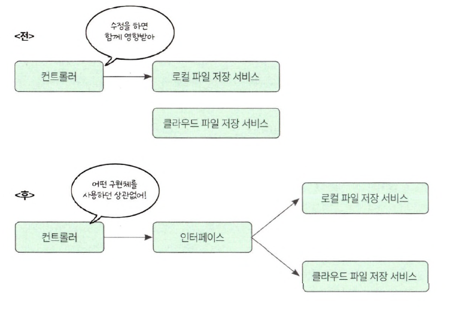

7단계

`FileStorageService` 구현할 클래스 → `LocalFileStorageService.java` 파일 생성

```java
@Service
public class LocalFileStorageService implements FileStorageService {

    private final Path uploadDir;

    public LocalFileStorageService(@Value("${file.upload-dir:uploads}") String uploadDir) {
        this.uploadDir = Paths.get(uploadDir).toAbsolutePath().normalize();
    }

    @Override
    public UploadResponse storeFile(byte[] bytes, String filename) {
        try {
            Files.createDirectories(uploadDir);

            String ext = filename.contains(".")
            ? filename.substring(filename.lastIndexOf("."))
            : ".png";

            String saved = UUID.randomUUID() + ext;

            Files.write(uploadDir.resolve(saved), bytes); // 업로드 디렉터리에 파일 저장

            return new UploadResponse("/uploads/" + saved);
        } catch (IOException e) {
            throw new RuntimeException();
        }
    }
}
```

- `store()` 메소드
    - 업로드 디렉터리 존재 X → 디렉터리 생성
    - 컨트롤러부터 전달받은 파일 & 원본 파일면 UUID 이용 고유 파일명 생성
    - 파일 스트림을 로컬 파일 시스템에 복사해 저장

8단계

controller 하위에 `UploadController.java` vkdlf todtjd

- `uploadFile()` : /api/upload `POST` 요청이 오면 파일 업로드 해줌

```java
@RestController
public class UploadController {

    private final FileStorageService fileStorageService;

    public UploadController(FileStorageService fileStorageService) {
        this.fileStorageService = fileStorageService;
    }

    @PostMapping("/api/upload")
    public ResponseEntity<UploadResponse> uploadFile(@RequestParam("file") MultipartFile file) throws IOException {
        return ResponseEntity.status(HttpStatus.CREATED)
                .body(fileStorageService.storeFile(
                    file.getBytes(), 
                    file.getOriginalFilename()
                ));
    }
}

```
		

### ◆ 실행 테스트하기

- 서버 실행 후 포스트맨 열기

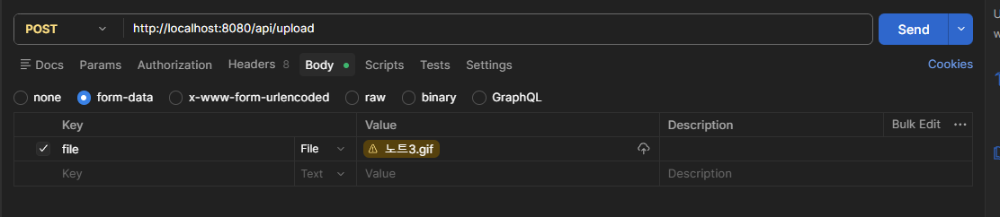

- 아무 사진이나 첨부하고 API 전송

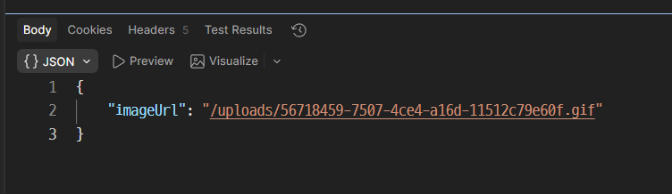

→ 이런 결과가 나온다!

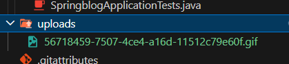

- uploads 에도 잘 저장되어 있다!

### ◆ 글 생성 뷰 수정하기

1단계

resources/template 에서 `newArticle.html` 파일에서 이미지 업로드 영역 추가

```html
<section class="mb-4">
  <label for="image-upload" class="form-label">이미지 업로드</label>
  <div class="input-group mb-2">
    <input type="file" class="form-control" id="image-upload" accept="image/*">
  </div>
  <input type="hidden" id="image-url" th:value="${article.imageUrl}">
  <div id="image-preview" class="mt-3" style="display:none;">
    
    <br>
    <button type="button" id="remove-image-btn" class="btn btn-sm btn-danger mt-2">이미지 제거</button>
  </div>
</section>
```

2단계

`article.js` 파일 수정

```jsx
// 1. 페이지 로드 시 기존 이미지 표시
window.addEventListener('DOMContentLoaded', () => {
  const imageUrl = document.getElementById('image-url')?.value;
  if (imageUrl) {
    displayImagePreview(imageUrl);
  }
});

// 이미지 업로드 버튼
// 2. id 가 image-upload 인 요소
const imageUpload = document.getElementById('image-upload');
if (imageUpload) {
	// 3. 클릭 이벤트 감지 시 이미지 업로드 요청 처리
  imageUpload.addEventListener('change', async (event) => {
    const file = event.target.files[0];
    if (!file) return;

		// 4. 이미지 파일 검증
    if (!file.type.startsWith('image/')) {
      alert('이미지 파일만 업로드 가능합니다.');
      return;
    }

		// 5. 이미지 업로드 요청
    const formData = new FormData();
    formData.append('file', file);

    fetch('/api/upload', {
      method: 'POST',
      body: formData
    }).then((response) => {
      if (!response.ok) {
        alert('이미지 업로드에 실패했습니다.');
        throw new Error();
      }
      return response.json();
    })
      .then((data) => {
        document.getElementById('image-url').value = data.imageUrl;
        displayImagePreview(data.imageUrl);
      })
      .catch((e) => console.error(e));
  });
}

// 6. 이미지 미리보기를 위한 함수
function displayImagePreview(imageUrl) {
  const preview = document.getElementById('image-preview');
  const previewImg = document.getElementById('preview-img');

  if (preview && previewImg && imageUrl) {
    previewImg.src = imageUrl;
    preview.style.display = 'block';
  }
}

// 이미지 제거 버튼
// 7. id 가 remove-image-btn 인 요소
const removeImageButton = document.getElementById('remove-image-btn');
if (removeImageButton) {
	// 8. 클릭 이벤트가 감지되면 이미지 제거 처리
  removeImageButton.addEventListener('click', () => {
    document.getElementById('image-url').value = '';
    document.getElementById('image-upload').value = '';
    document.getElementById('image-preview').style.display = 'none';
  });
}
```

3단계

`article.js` 에서 `createButton`  수정

```jsx
const createButton = document.getElementById('create-btn');

if (createButton) {

  // 클릭 이벤트 감지 시 생성 API 호출
  createButton.addEventListener('click', event => {
    fetch('/api/articles', {
      method: 'POST',
      headers: {
        'Content-Type': 'application/json',
      },
      body: JSON.stringify({
        title: document.getElementById('title').value,
        content: document.getElementById('content').value,
        // 추기
        imageUrl: document.getElementById('image-url').value,
      }),
    })
    .then(() => {
      alert('등록이 완료되었습니다.');
      location.replace('/articles');
    });
  });
}
```

4단계

resources/templates 에서 `article.html` 파일에서 코드 추가

```html
<section class="mb-4" th:if="${article.imageUrl != null and article.imageUrl != ''}">
  
</section>
```

5단계

resources/templates 에서 `articleList.html` 파일에서 코드 추가

```html
        
```

6단계

config 디텍더리에 `WebMvcConfig.java` 파일 생성

```java
@Configuration
public class WebMvcConfig implements WebMvcConfigurer {

    @Override
    public void addResourceHandlers(ResourceHandlerRegistry registry) {
        // /uploads/** 경로로 요청이 오면 uploads/ 디렉터리의 파일을 제공
        registry.addResourceHandler("/uploads/**")
                .addResourceLocations("file:uploads/");
    }
}
```
		

### ◆ 실행 테스트하기

- 서버를 켜고 [http://localhost:8080/new-article](http://localhost:8080/new-article) 요기에 접속하면

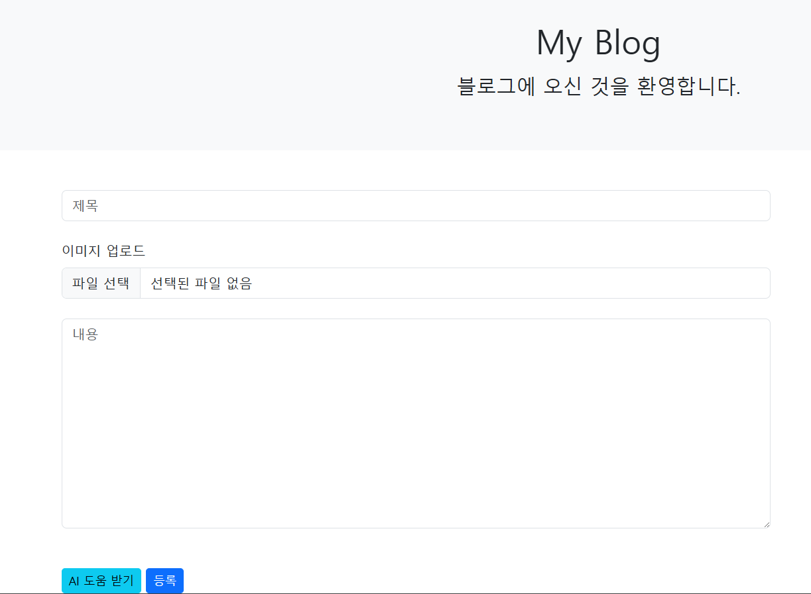

- 이런 화면이 나옴!

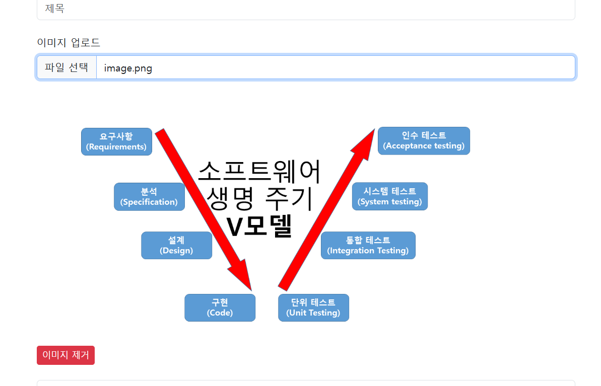

- 파일이 잘 올라가는 모습을 볼 수 있다

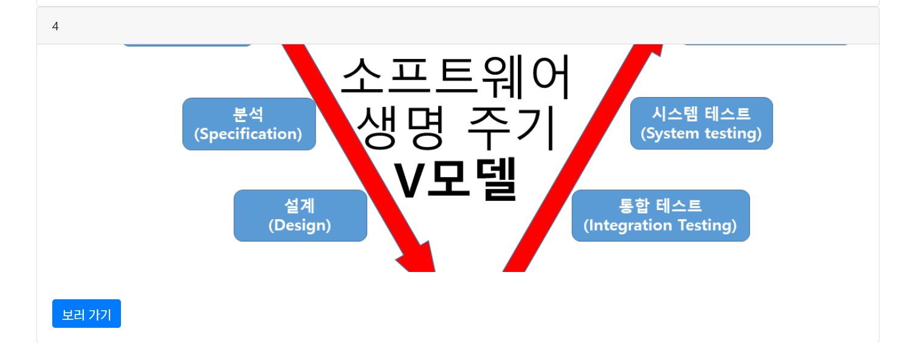

- 등록 후에도 잘 보인다!

### ◆ 섬네일 자동 생성 기능 추가하기

1단계

dto 패키지 아래에 `GeneratorThumbnailRequest.java` / `GeneratorThumnbailResponse.java` 파일을 생성

- `GeneratorThumbnailRequest.java` → 요청에 사용

```java
public record GeneratorThumnailRequest(
    String title,
    String content
) {
    public Map<String, Object> toMap() {
        return Map.of(
            "title", title,
            "content", content
        );
    }
}
```

- `GeneratorThumbnailResponse.java` → 응답에 사용

```java
public record GeneratorThumbnailResponse(String imageUrl) {}
```

2단계

resources/prompts 하위에 `thumbnail-generator.st` 파일 생성

```
다음 글을 위한 전문적인 블로그 섬네일 이미지를 제작해주세요.
이미지는 반드시 콘텐츠와 관련성이 있어야 합니다.

제목: {title}
내용: {content}
```

3단계

service 패키지 하위에 `ThumbnailGeneratorService.java` 파일 생성

```java
@Service
public class ThumbnailGeneratorService {

    private final ImageModel imageModel;
    private final PromptTemplate template;
    private final FileStorageService fileStorageService;
    private final RestClient restClient = RestClient.create();

    public ThumbnailGeneratorService(
            ImageModel imageModel, 
            FileStorageService fileStorageService,  
            @Value("classpath:prompts/thumbnail-generator.st") Resource promptResource
        ) {
        this.imageModel = imageModel;
        this.fileStorageService = fileStorageService;
        this.template = new PromptTemplate(promptResource);
    }

    public GeneratorThumbnailResponse generateThumbnail(GeneratorThumbnailRequest request) {
        String prompt = template.create(request.toMap()).getContents();

        ImageResponse response = imageModel.call(new ImagePrompt(prompt));
        Image image = response.getResult().getOutput(); // 생성된 이미지 정보 가져오기

        byte[] bytes = restClient.get() // 이미지 URL 로부터 바이트 배열 가져오기
                .uri(URI.create(image.getUrl()))
                .retrieve()
                .body(byte[].class);

        // 로컬에 이미지 저장
        UploadResponse saved = fileStorageService.storeFile(bytes, "thumbnail.png"); 
        return new GeneratorThumbnailResponse(saved.imageUrl());
    }
}
```

- `generateThumbnail()` 메서드
    - 요청(제목, 본문) 을 템플릿에 주입해 최종 프롬프트 생성
    - `ImageModel` 통해 이미지 생성 모델 호출
    - 반환된 `ImageResponse` 에서 이미지 정보 꺼내서 이미지 다운로드
    - 저장된 바이트를 `FileStorageService` 에 전달에 로컬에 저장
    - 저장 결과로 반환된 이미지 접근 경로 (URL) 를 최종 결과로 반환

4단계

`BlogApiController.java` 에 `thumbnailGenerator()` 메서드 작성

- `thumbnailGenerator()`
    - /api/ai-thumnails `POST` 요청이 오면 AI 활용해 섬네일 생성

```java
    private final ThumbnailGeneratorService thumbnailGeneratorService;
    
    ...
    
    @PostMapping("/api/ai-thumbnails")
    public ResponseEntity<GeneratorThumbnailResponse> thumbnailGenerator(@RequestBody GeneratorThumbnailRequest request) {
        GeneratorThumbnailResponse response = thumbnailGeneratorService.generateThumbnail(request);

        return ResponseEntity.ok()
                .body(response);
    }
```
		

### ◆ 실행 테스트하기

- 서버 열고 실행..
    - 어? 빌드가 안되네!
        
        우리가 작성한 코드는 OpenAI 용!
        
        `ThumbnailGeneratorService.java`  수정
        
        ```java
        package com.backendblog.springblog.service;
        
        import org.springframework.ai.chat.prompt.PromptTemplate;
        import org.springframework.beans.factory.annotation.Value;
        import org.springframework.core.io.Resource;
        import org.springframework.stereotype.Service;
        
        import com.backendblog.springblog.dto.GeneratorThumbnailRequest;
        import com.backendblog.springblog.dto.GeneratorThumbnailResponse;
        import com.backendblog.springblog.dto.UploadResponse;
        import com.google.genai.Client;
        import com.google.genai.types.GenerateImagesConfig;
        import com.google.genai.types.GenerateImagesResponse;
        import com.google.genai.types.Image;
        
        @Service
        public class ThumbnailGeneratorService {
        
            private final Client client;
            private final PromptTemplate template;
            private final FileStorageService fileStorageService;
            private final String model;
        
            public ThumbnailGeneratorService(
                    Client client,
                    FileStorageService fileStorageService,
                    @Value("classpath:prompts/thumbnail-generator.st") Resource promptResource,
                    @Value("${spring.ai.google.genai.image.model:imagen-3.0-generate-002}") String model) {
                this.client = client;
                this.fileStorageService = fileStorageService;
                this.template = new PromptTemplate(promptResource);
                this.model = model;
            }
        
            public GeneratorThumbnailResponse generateThumbnail(GeneratorThumbnailRequest request) {
                String prompt = template.create(request.toMap()).getContents();
        
                GenerateImagesConfig config = GenerateImagesConfig.builder()
                        .numberOfImages(1)
                        .build();
        
                GenerateImagesResponse response = client.models.generateImages(model, prompt, config);
        
                Image image = response.images().stream().findFirst()
                        .orElseThrow(() -> new IllegalStateException("이미지 생성에 실패했습니다."));
                byte[] bytes = image.imageBytes()
                        .orElseThrow(() -> new IllegalStateException("생성된 이미지에 데이터가 없습니다."));
        
                // 로컬에 이미지 저장
                UploadResponse saved = fileStorageService.storeFile(bytes, "thumbnail.png");
                return new GeneratorThumbnailResponse(saved.imageUrl());
            }
        }
        ```
        
        - 근데 제미나이도 이미지 생성은 토큰 필요.. 그냥 넘어가자
        

### ◆ 글 생성 뷰 수정하기

1단계

resource/templates 에서 `newArticle.html` 파일

- [AI 섬네일 만들기] & 로딩 시간 동안 보여줄 뷰 추가

```html
<div class="input-group mb-2">
  <input type="file" class="form-control" id="image-upload" accept="image/*">
  <button type="button" id="ai-thumbnail-btn" class="btn btn-outline-secondary">AI 섬네일 생성</button>
</div>
<input type="hidden" id="image-url" th:value="${article.imageUrl}">
<div id="ai-thumbnail-loading" class="mt-2" style="display: none;">
  <div class="spinner-border spinner-border-sm text-primary" role="status">
    <span class="sr-only">Loading...</span>
  </div>
  <span class="ml-2">AI가 섬네일을 생성하고 있습니다... (30초 정도 소요됩니다.)</span>
</div>
```

2단계

`article.js` 파일에 [AI 도움받기] 누르면 API 호출해 AI 제안 받는 JS 코드 추가

```jsx
// AI 썸네일 생성 버튼
// 1. id 가 ai-thumbnail-btn 인 요소 조회
const aiThumbnailButton = document.getElementById('ai-thumbnail-btn');
if (aiThumbnailButton) {
  aiThumbnailButton.addEventListener('click', async () => {
    const title = document.getElementById('title').value;
    const content = document.getElementById('content').value;

    // 2. 제목, 내용이 비어있으면 경고창 띄우기
    if (!title.trim() && !content.trim()) {
      alert('제목이나 내용을 먼저 입력해주세요.');
      return;
    }

    // 3. 로딩 모달 표시
    const loadingDiv = document.getElementById('ai-thumbnail-loading');
    loadingDiv.style.display = 'block';
    aiThumbnailButton.disabled = true;

    // 4. AI 섬네일 생성 API 호출
    fetch('/api/ai-thumbnails', {
      method: 'POST',
      body: JSON.stringify({
        title: title,
        content: content
      }),
      headers: {
        'Content-Type': 'application/json',
      },
    }).then((response) => {
      if (!response.ok) {
        alert('썸네일 생성에 실패했습니다.');
        throw new Error();
      }
      return response.json();
    }).then((data) => {
      // 5. 이미지 URL 을 이미지 URL 입력란에 설정하고 미리보기 표시
      document.getElementById('image-url').value = data.imageUrl;
      displayImagePreview(data.imageUrl);
    }).finally(() => {
      loadingDiv.style.display = 'none';
      aiThumbnailButton.disabled = false;
    });
  });
}
```

탭 3
		

---

- 자주 사용하는 특수 문자
    
    ∞ ⊂ ⊃ ∪ ∩ ∴ ∵ ⇒ ⇔ ⁿ ¹ ² ³ ⁴ · ↑ ↓ … × ₁ ₂ ₃ ₄ ∅
    ex) Example
