> [!note] 💡
> 
> 한눈에 보는 구조
> 
> 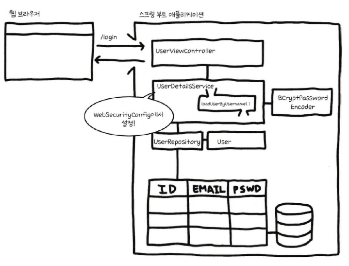
> 
> `/login` 요청이 들어오면 
> → `UserViewController` 가 분기 처리! & `WebSecurityConfig` 에 설정한 보안 관련 내용 실행
> 
> 분기 → `UserDetailsService` 실행
> 
> - `UserDetailsServive` : `loadUserByUsername()` [[메소드]]로 이메일로 유저 찾기
> - `User` 정보 → `UserRepository` 안에 있음
> 
> 요청 성공 → `defaultSuccessUrl` 로 설정한 /articles 로 리다이렉트 or csrf disable 등.
> 
> 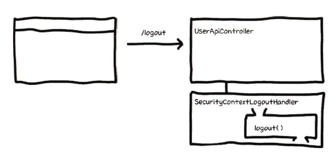
> 
> `/logout` 요청 오면 → `UserApiController` [[클래스]]에서 로그아웃 로직 실행
> 
> - 로그아웃 로직 : `SecurityContextLogoutHandler` 에서 제공하는 `logout()` 메소드 실행

## ✦ 스프링 시큐리티

### ◆ 인증과 인가

- 인증 ([[인증|Authentication]]) : 사용자의 신원을 입증하는 과정
    - 사이트에 로그인 할 때 누구인지 확인하는 과정
- 인가 (Authorization) : 사이트의 특정 부분에 접근할 수 있는지 권한 확인
    - 관리자 페이지 → 일반 계정 X, 관리자 계정 O

→ 관련 코드 작성? by [[Spring|스프링]] 시큐리티!

### ◆ 스프링 시큐리티

- 스프링 시큐리티 : 스프링 기반 애플리케이션의 보안 담당
    - 보안 관련 옵션 제공
    - [[어노테이션]]으로 설정 쉬움
- CSRF 공격, 세션 고정 (session fixation) 공격 방어
- 요청 헤더 보안 처리
- 필터 기반으로 동작

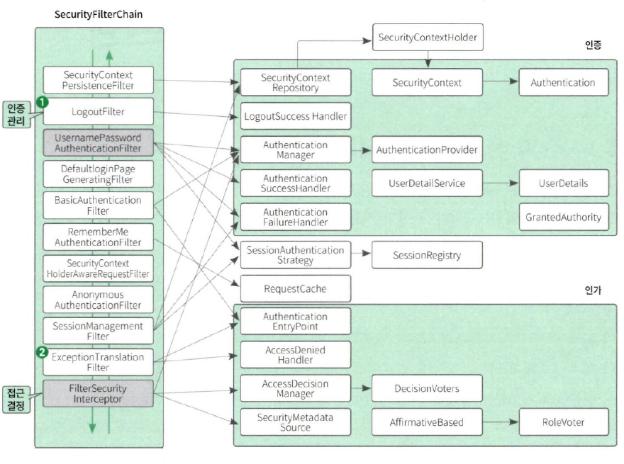

→ 헉 너무 복잡해보여요

- 각 필터에서 인증, 인가 관련 작업 처리
- ↓ 아래 방향으로 내려가면서 순서대로 필터 거치기.. 필터 실행 시에는 오른쪽 클래스 → 이 방향으로 거치면서 실행.
- 특정 필터 제거 or 필터 뒤 커스텀 필터 삽입 가능!
- `UsernamePasswordAuthenticationFilter` : 아이디 & 패스워드 넘어오면 인증 요청 위임
    - 인증 관리자!
- `FilterSecurityInterceptor` : 권한 부여 처리 위임. 접근 제어 결정 쉽게 함
    - 접근 결정 관리자! (인가 관리자)

| 필터명 | 설명 |
| --- | --- |
| `SecurityContextPersistenceFilter` | `SecurityContextRepository`에서 `SecurityContext`를 가져오거나 저장 |
| `LogoutFilter` | 로그아웃 URL 요청 확인해 로그아웃 처리 |
| `UsernamePasswordAuthenticationFilter` | 폼 로그인 시 아이디/패스워드를 파싱해 인증을 위임
성공 → `AuthenticationSuccessHandler`
실패 → `AuthenticationFailureHandler` |
| `DefaultLoginPageGeneratingFilter` | 로그인 페이지 미지정 시 기본 로그인 페이지 생성 |
| `BasicAuthenticationFilter` | 요청 헤더의 아이디/패스워드를 파싱해 인증 위임
성공 → `AuthenticationSuccessHandler`
실패 → `AuthenticationFailureHandler` |
| `RequestCacheAwareFilter` | 로그인 성공 후 캐시된 요청을 확인해 처리.
인증 전 방문 페이지를 기억했다가 로그인 후 이동 |
| `SecurityContextHolderAwareRequestFilter` | `HttpServletRequest`를 감싸 이후 필터에 부가 정보를 제공 |
| `AnonymousAuthenticationFilter` | 미인증 상태 → 익명 사용자 객체를 생성 `SecurityContext` 에 넣기 |
| `SessionManagementFilter` | 인증된 사용자의 세션 관리.
 세션 변조 방지, 유효성 검증, 생성 전략 등 |
| `ExceptionTranslationFilter` | 요청 처리 중 발생하는 예외 위임 or 전달 |
| `FilterSecurityInterceptor` | `AccessDecisionManager`로 접근 제어를 위임
이미 인증된 시점 → 인가 설정 처리 |

### ◆ 아이디와 패스워드 기반 폼 로그인

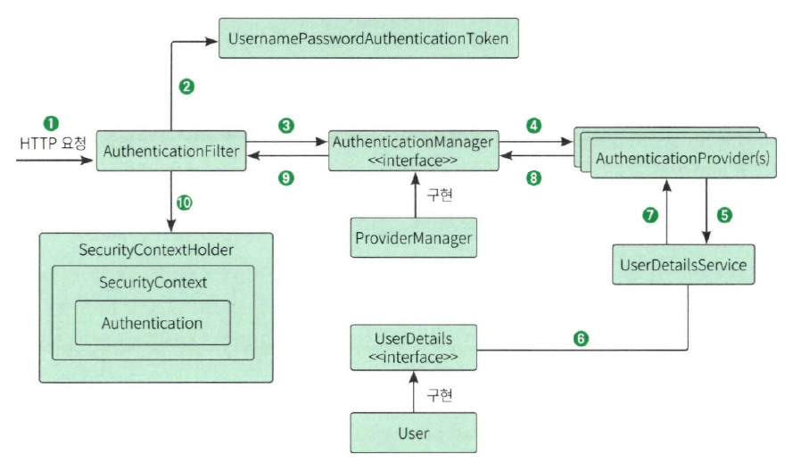

1. 폼에 아이디, 패스워트 입력하면 `HTTPServletRequest` 에 아이디 & 비밀번호 정보 전달.
이때 `AuthenticationFilter` 가 넘어온 아이디 & 비밀번호 유효성 검사
2. 유효성 검사 끝나면 실제 구현체 `UsernamePasswordAuthenticationToken` 만들어 넘김
3. 전달 받은 인증용 객체 `UsernamePasswordAuthenticationToken` 를 `AuthenticationManager` 에게 보냄
4. `UsernamePasswordAuthenticationToken` 을 `AuthenticationProvider` 에게 보냄
5. 사용자의 아이디를 `UserDetailService` 로 보냄
사용자 아이디로 찾은 정보를 `UserDetails` 객체로 만들어서 `AuthenticationProvider` 에 전달
6. [[데이터베이스|DB]] 에 있는 사용자 정보 가져옴
7. 입력 정보 vs `UserDetails` 정보 비교해 인증 처리
8. 9.   10. 까지 인증이 완료되면 `SecurityContextHolder` 에 `Authentication` 저장
인증 성공 → `AuthenticationSuccessHandler`
인증 실패 → `AuthenticationFailureHandler` 

## ✦ 회원 도메인 만들기

### ◆ 의존성 추가하기

- `build.gradle`  파일에 의존성 추가

```json
dependencies {
	// 스프링 시큐리티 스타터
	implementation 'org.springframework.boot:spring-boot-starter-security'
	// 타임리프에서 스프링 시큐리티 사용 위한 의존성
	implementation 'org.thymeleaf.extras:thymeleaf-extras-springsecurity6'
	// 스프링 시큐리티 테스트 위한 의존성
	testImplementation 'org.springframework.security:spring-security-test'
}
```

### ◆ 엔티티 만들기

- 회원 엔티티

| 컬럼명 | 자료형 | null 허용 | 키 | 설명 |
| --- | --- | --- | --- | --- |
| id | BIGINT | N | 기본키 | 일련번호, 기본키 |
| email | VARCHAR(255) | N |  | 이메일 |
| password | VARCHAR(255) | N |  | 패스워드 (암호화 해 저장) |
| created_at | DATETIME | N |  | 생성 일자 |
| updated_at | DATETIME | N |  | 수정 일자 |
- domain [[패키지]]에 `User.java`  파일 생성 → `UserDetails` 상속하도록 작성
- Code
    
    ```java
    import java.util.Collection;
    import java.util.List;
    
    import org.springframework.security.core.GrantedAuthority;
    import org.springframework.security.core.authority.SimpleGrantedAuthority;
    import org.springframework.security.core.userdetails.UserDetails;
    
    import jakarta.persistence.Column;
    import jakarta.persistence.Entity;
    import jakarta.persistence.GeneratedValue;
    import jakarta.persistence.GenerationType;
    import jakarta.persistence.Id;
    import jakarta.persistence.Table;
    import lombok.AccessLevel;
    import lombok.Builder;
    import lombok.Getter;
    import lombok.NoArgsConstructor;
    
    @Table(name = "users")
    @NoArgsConstructor(access = AccessLevel.PROTECTED)
    @Getter
    @Entity
    public class User implements UserDetails { // UserDetails 를 상속받아 인증 객체로 사용
    
        @Id
        @GeneratedValue(strategy = GenerationType.IDENTITY)
        @Column(name = "id", updatable = false)
        private Long id;
    
        @Column(name = "email", nullable = false, unique = true)
        private String email;
    
        @Column(name = "password")
        private String password;
    
        @Builder
        public User(String email, String password, String auth) {
            this.email = email;
            this.password = password;
        }
    
        @Override // 권한 반환
        public Collection<? extends GrantedAuthority> getAuthorities() {
            return List.of(new SimpleGrantedAuthority("user"));
        }
    
        // 사용자의 id 반환 (고유값)
        @Override
        public String getUsername() {
            return email;
        }
    
        // 사용자의 패스워드 반환
        @Override
        public String getPassword() {
            return password;
        }
    
        // 계정 만료 여부 반환
        @Override
        public boolean isAccountNonExpired() {
            // 만료되었는지 확인하는 로직
            return true; // true -> 만료 X
        }
    
        // 계정 잠금 여부 반환
        @Override
        public boolean isAccountNonLocked() {
            // 잠금되었는지 확인하는 로직
            return true; // true -> 잠금 X
        }
    
        // 패스워드 만료 여부 반환
        @Override
        public boolean isCredentialsNonExpired() {
            // 패스워드 만료되었는지 확인하는 로직
            return true; // true -> 만료 X
        }
    
        // 계정 사용 가능 여부 반환
        @Override
        public boolean isEnabled() {
            // 계정 사용 가능 여부 확인하는 로직
            return true; // true -> 사용 가능
        }
    }
    
    ```
    

| 메소드 | 반환 타입 | 설명 |
| --- | --- | --- |
| `getAuthorities()` | Collection<? extends GrantedAuthority> | 사용자가 지닌 권한 목록 반환
예제 코드에선 사용자 이외 권한 X → `user` 권한만.. |
| `getUsername()` | String | 사용자 식별 가능한 이름 반환
반드시 고유해야 함! → `email` 반환 |
| `getPassword()` | String | 사용자 비밀번호 반환 → 암호화 해 저장해야함 |
| `isAccountNonExpired()` | boolean | 계정 만료 확인 메소드 |
| `isAccountNonLocked()` | boolean | 계정 잠금 확인 메소드 |
| `isCredentialNonExpired()` | boolean | 비밀번호 만료 확인 메소드 |
| `isEnabled()` | boolean | 계정 사용 가능 확인 메소드 |

### ◆ 리포지터리 만들기

- repository 패키지에 `UserRepository.java` 파일 생성

```java
import java.util.Optional;
import org.springframework.data.jpa.repository.JpaRepository;
import com.backendblog.springblog.domain.User;

public interface UserRepository extends JpaRepository<User, Long> {
    Optional<User> findByEmail(String email); // email 로 사용자 정보 가져옴
}
```

- 자주 사용하는 쿼리 메소드 명명 규칙

| 코드 | 설명 | 쿼리 |
| --- | --- | --- |
| `findByName()` | `name` 파라미터 값과 같은 값 반환 | `... WHERE name = ?1` |
| `findByNameAndAge()` | `name` && `age`  파라미터로 공통 조회한 값 반환 | `... WHERE name = ?1 AND age =?2` |
| `findByNameOrAge()`  | `name` 또는 `age` 파라미터로 조회한 값 반환 | `...WHERE name = ?1 OR age =?2` |
| `findByAgeLessThan()` | `age` 파라미터 보다 작은 데이터 반환 | `... WHERE age <? 1` |
| `findByAgeGreaterThan()` | `age` 파라미터 보다 큰 데이터 반환 | `... WHERE age >? 1` |
| `findByNameNull()` | `name` 컬럼 중 null 인 데이터 반환 | `... WHERE name IS NULL` |

### ◆ 서비스 메소드 코드 작성하기

service 패키지에 `UserDetailService.java` 파일 생성하기

```java
import lombok.RequiredArgsConstructor;
import org.springframework.security.core.userdetails.UserDetails;
import org.springframework.security.core.userdetails.UserDetailsService;
import org.springframework.stereotype.Service;
import com.backendblog.springblog.repository.UserRepository;

@RequiredArgsConstructor
@Service
public class UserDetailService implements UserDetailsService {

    private final UserRepository userRepository;

		// 사용자 이름 (email) 으로 사용자 정보 가져오기
    @Override
    public UserDetails loadUserByUsername(String email) {
        return userRepository.findByEmail(email)
                .orElseThrow(() -> new IllegalArgumentException((email)));
    }
}
```

- 사용자 정보 가저오는 `UserDetailsService` [[인터페이스 구현 (소프트웨어 개발)|인터페이스 구현]]
- `lloadUserByUsername()` 메소드 [[오버라이딩]] → 사용자 정보 가져오기

## ✦ 시큐리티 설정하기

- config 패키지 아래에 `WebSecurityConfig.java` 생성

```java
@Configuration
@EnableWebSecurity
@RequiredArgsConstructor
public class WebSecurityConfig {

    // 1. 스프링 시큐리티 기능 비활성화
    @Bean
    public WebSecurityCustomizer configure() {
        return (web) -> web.ignoring()
                .requestMatchers(toH2Console())
                .requestMatchers("/static/**");
    }

    // 2. 특정 HTTP 요청에 대한 웹 기반 보안 구성
    @Bean
    public SecurityFilterChain filterChain(HttpSecurity http) throws Exception {
        return http
                .authorizeHttpRequests(auth -> auth // 3. 인증, 인가 설정
                        .requestMatchers(
                                "/login",
                                "/signup",
                                "/user")
                        .permitAll()
                        .anyRequest().authenticated())
                .formLogin(formLogin -> formLogin // 4. 폼 기반 로그인 설정
                        .loginPage("/login")
                        .defaultSuccessUrl("/articles"))
                .logout(logout -> logout // 5. 로그아웃 설정
                        .logoutSuccessUrl("/login")
                        .invalidateHttpSession(true))
                .csrf(AbstractHttpConfigurer::disable) // 6. CSRF 비활성화
                .build();
    }

    // 7. 패스워드 인코더로 사용할 빈 등록
    @Bean
    public PasswordEncoder passwordEncoder() {
        return new BCryptPasswordEncoder();
    }
}
```

1. 스프링 시큐리티의 모든 기능 사용하지 않도록 설정 
    - 일반적으로 정적 리소스 (이미지, HTML 파일) 에 설정
    - `static` 하위 경로 & h2-console 하위 URL 만 적용
2. 특정 [[HTTP 요청]]에 대해 웹 기한 보안 구성
3. 특정 경로에 대한 액세스 설정
    - `requestMatchers()` : 특정 요청과 일치하는 url 에 대한 액세스 설정
    - `permitAll()` : 누구나 접근 가능하게 설정
    - `anyRequest()` : 위에서 설정한 url 이외의 요청에 대해 설정
    - `authenticated()` : 별도 인가 필요 X, 단 인증은 성공 상태여야 접근 가능
4. 폼 기반 로그인 설정
    - `loginPage()` : 로그인 페이지 경로 설정
    - `defaultSuccessUrl()` : 로그인이 완료되었을 때 이동할 경로 설정
5. 로그아웃 설정
    - `logoutSuccessUrl()` : 로그아웃 완료 시 이동 경로 설정
    - `invalidateHttpSession()` : 로그아웃 이후 세션 전체 삭제 여부 설정
6. CSRF 설정 비활성화 
    - 실습용 비활성화!
7. 패스워드 인코더를 빈으로 등록

## ✦ 회원 가입 구현하기

### ◆ 서비스 메소드 코드 작성하기

1단계

dto 패키지에 `AddUserRequest.java` 파일 추가

```java
import lombok.Getter;
import lombok.Setter;

@Getter
@Setter
public class AddUserRequest {
    private String email;
    private String password;
}
```

2단계

service 패키지에 `UserService.java` 파일 생성

- `AddUserRequest` 객체를 인수로 받는 회원 정보 추가 메소드

```java
@RequiredArgsConstructor
@Service
public class UserService {
    private final UserRepository userRepository;
    private final PasswordEncoder passwordEncoder;

    public Long save(AddUserRequest dto) {
        return userRepository.save(User.builder()
                .email(dto.getEmail())
                // 패스워드 암호화
                .password(passwordEncoder.encode(dto.getPassword()))
                .build()).getId();
    }
}

```

- 패스워드 저장시 시큐리티 설정 + 패스워드 인코딩용 등록 빈 사용해 암호화 후 저장
		

### ◆ 컨트롤러 작성하기

- `signup()` : 회원 가입 요청 받으면 서비스 메소드로 사용자 저장 → 로그인 페이지로 이동
- controller 패키지에 `UserApiController.java` 파일 생성

```java
@RequiredArgsConstructor
@Controller
public class UserApiController {

    private final UserService userService;

    @PostMapping("/user")
    public String signup(AddUserRequest request) {
        userService.save(request); // 회원 가입 메소드 호출
        return "redirect:/login";  // 회원 가입 완료 이후 로그인 페이지 이동
    }
}
```

- `redirect:` : 회원 가입 처리 이후 로그인 페이지 이동

## ✦ 회원 가입, 로그인 뷰 작성

### ◆ 뷰 컨트롤러 작성

- controller 패키지에 `UserViewController.java` 파일 생성

```java
@Controller
public class UserViewController {
    @GetMapping("/login")
    public String login() {
        return "login"; 
    }

    @GetMapping("/signup")
    public String signup() {
        return "signup"; 
    }
}
```

### ◆ 뷰 작성하기

- templates 디렉터리 아래에 `login.html` , `signup.html` 작성
→ 깃허브에서 그대로 사용!
- `login.html`
    
    ```html
    <!DOCTYPE html>
    <html xmlns:th="http://www.thymeleaf.org">
    <head>
        <meta charset="UTF-8">
        <title>로그인</title>
        <link rel="stylesheet" href="https://cdn.jsdelivr.net/npm/bootstrap@4.6.1/dist/css/bootstrap.min.css">
    
        <style>
            .gradient-custom {
              background: linear-gradient(to right, rgba(106, 17, 203, 1), rgba(37, 117, 252, 1))
            }
        </style>
    </head>
    <body class="gradient-custom">
        <section class="d-flex vh-100">
            <div class="container-fluid row justify-content-center align-content-center">
                <div class="card bg-dark" style="border-radius: 1rem;">
                    <div class="card-body p-5 text-center">
                        <h2 class="text-white">LOGIN</h2>
                        <p class="text-white-50 mt-2 mb-5">서비스를 사용하려면 로그인을 해주세요!</p>
    
                        <div class = "mb-2">
                            <form action="/login" method="POST">
                                <input type="hidden" th:name="${_csrf?.parameterName}" th:value="${_csrf?.token}" />
                                <div class="mb-3">
                                    <label class="form-label text-white">Email address</label>
                                    <input type="email" class="form-control" name="username">
                                </div>
                                <div class="mb-3">
                                    <label class="form-label text-white">Password</label>
                                    <input type="password" class="form-control" name="password">
                                </div>
                                <button type="submit" class="btn btn-primary">Submit</button>
                            </form>
    
                            <button type="button" class="btn btn-secondary mt-3" onclick="location.href='/signup'">회원가입</button>
                        </div>
                    </div>
                </div>
            </div>
        </section>
    </body>
    </html>
    ```
    
- `signup.html`
    
    ```html
    <!DOCTYPE html>
    <html xmlns:th="http://www.thymeleaf.org">
    <head>
        <meta charset="UTF-8">
        <title>회원 가입</title>
        <link rel="stylesheet" href="https://cdn.jsdelivr.net/npm/bootstrap@4.6.1/dist/css/bootstrap.min.css">
    
        <style>
            .gradient-custom {
              background: linear-gradient(to right, rgba(254, 238, 229, 1), rgba(229, 193, 197, 1))
            }
        </style>
    </head>
    <body class="gradient-custom">
    <section class="d-flex vh-100">
        <div class="container-fluid row justify-content-center align-content-center">
            <div class="card bg-dark" style="border-radius: 1rem;">
                <div class="card-body p-5 text-center">
                    <h2 class="text-white">SIGN UP</h2>
                    <p class="text-white-50 mt-2 mb-5">서비스 사용을 위한 회원 가입</p>
    
                    <div class = "mb-2">
                        <form th:action="@{/user}" method="POST">
                            <div class="mb-3">
                                <label class="form-label text-white">Email address</label>
                                <input type="email" class="form-control" name="email">
                            </div>
                            <div class="mb-3">
                                <label class="form-label text-white">Password</label>
                                <input type="password" class="form-control" name="password">
                            </div>
    
                            <button type="submit" class="btn btn-primary">Submit</button>
                        </form>
                    </div>
                </div>
            </div>
        </div>
    </section>
    </body>
    </html>
    ```
    

## ✦ 로그아웃 구현하기

### ◆ 로그아웃 메소드 추가하기

- `UserApiController.java` 에 `logout()` 메소드 추가

```java
    @GetMapping("/logout")
    public String logout(HttpServletRequest request, HttpServletResponse response) {
        new SecurityContextLogoutHandler().logout(request, response, 
            SecurityContextHolder.getContext().getAuthentication());
        return "redirect:/login"; 
    }
```

- /logout 에 `GET` 요청 시 로그아웃 담당 핸들러 `SecurityContextLogoutHandler` 의 `logout()` 메소드 호출

### ◆ 로그아웃 뷰 추가하기

- `articleList.html` 파일에 [로그아웃] 버튼 추가

```html
    <button type="button" class="btn btn-secondary" onclick="location.href='/logout'">로그아웃</button>
```

## ✦ 실행 테스트 하기

### ◆ 로그인, 회원 가입 실행 테스트 하기

1단계

- [[서버]] 실행하고 [http://localhost:8080/login](http://localhost:8080/login) 접속하기
    - 빌드가 안됨..
        - `application.properties` 수정
        
        ```yaml
        # H2 콘솔 활성화 (WebSecurityConfig 의 toH2Console() 매처가 이 설정을 필요로 함)
        spring.h2.console.enabled=true
        ```
        
    
    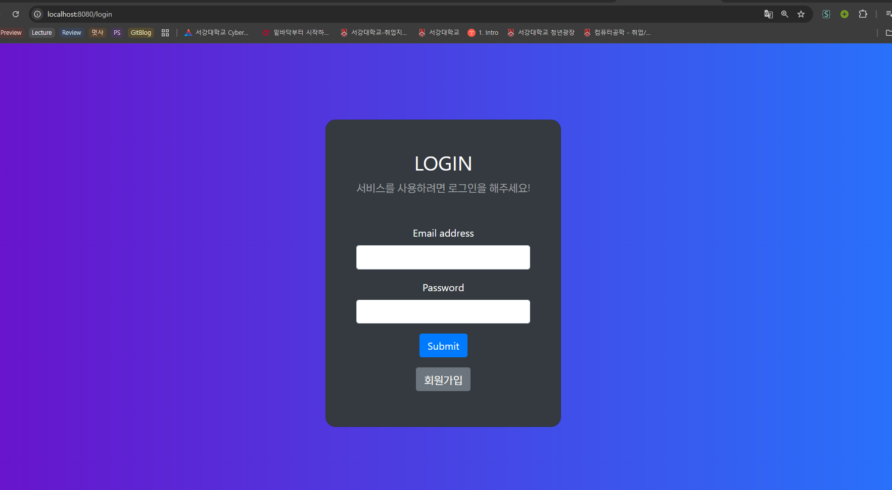
    
    - 이런 화면이 뜬다! (/articles 는 인증 필요해서 /login 으로 리다이렉트)

2단계

- 회원 가입 버튼 누르면
    
    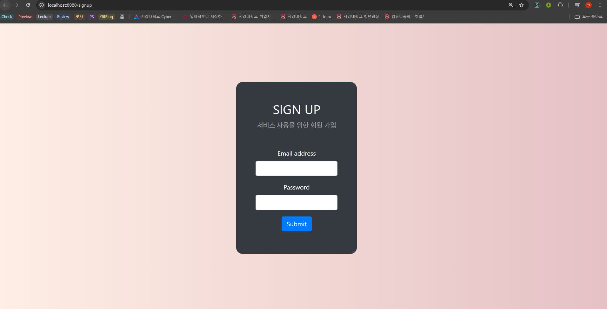
    
    - 요론 화면이 뜬다!
    - 회원 가입 진행
        
        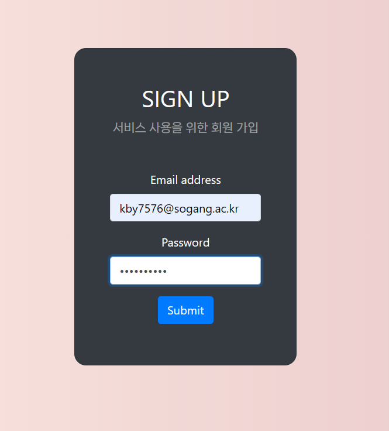

3단계

- 로그인 페이지에서 회원 가입한 이메일 & 비밀번호로 로그인
    
    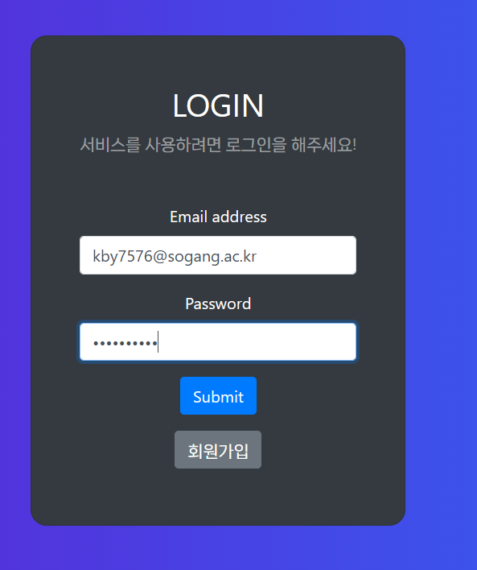
    
- 성공하면 /artices 로 이동된다!
    
    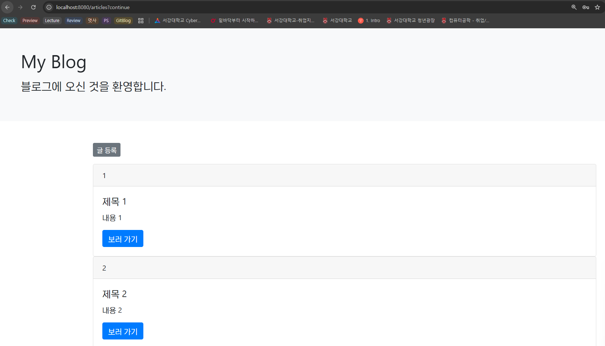

4단계

- DB 에 저장된 걸 확인하자!
- [http://localhost:8080/h2-console/](http://localhost:8080/h2-console/) 에서 DB 접속!
    
    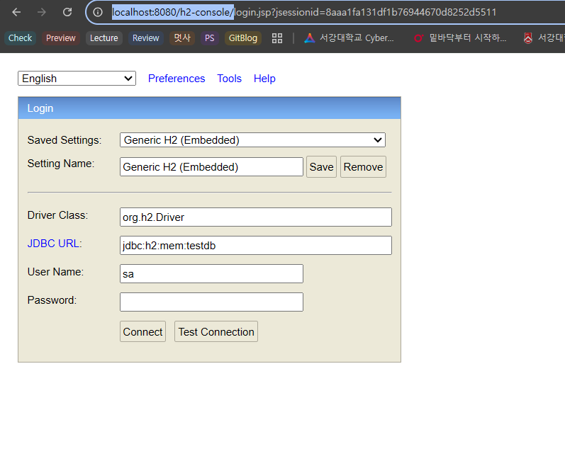
    
    - 접속이 안돼요..
        - `application.properties` 수정
        
        ```yaml
        # 인메모리 DB 이름을 고정 (지정하지 않으면 매 기동마다 임의 이름이 생성되어
        # H2 콘솔의 jdbc:h2:mem:testdb 로 접속할 수 없다)
        spring.datasource.url=jdbc:h2:mem:testdb
        spring.datasource.driver-class-name=org.h2.Driver
        spring.datasource.username=sa
        spring.datasource.password=
        ```
        
    - 쿼리 입력 후 실행하면
        
        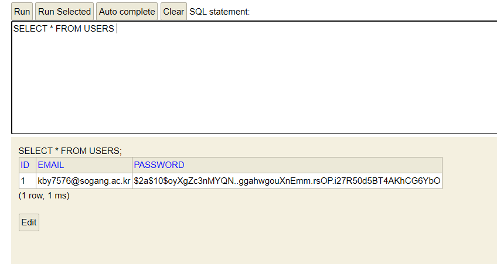
        
    - 조회된 사용자 정보 & 비밀번호 확인 가능!
		

### ◆ 로그아웃 실행 테스트하기

- /articles 에서 [로그아웃] 버튼 누르기!
    
    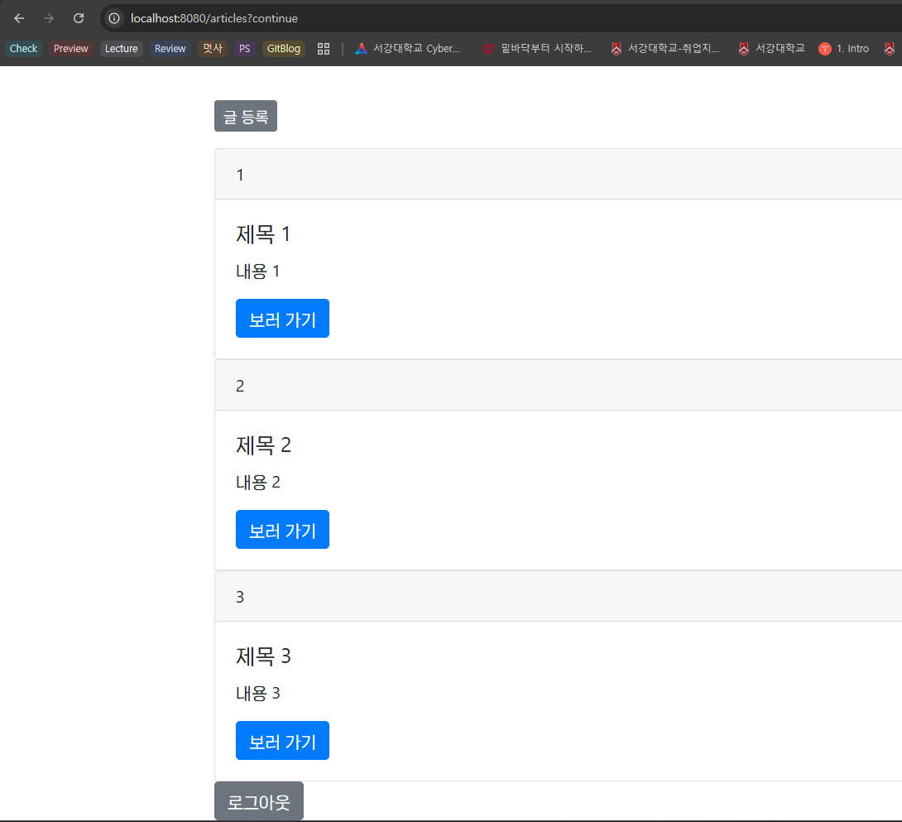
    
    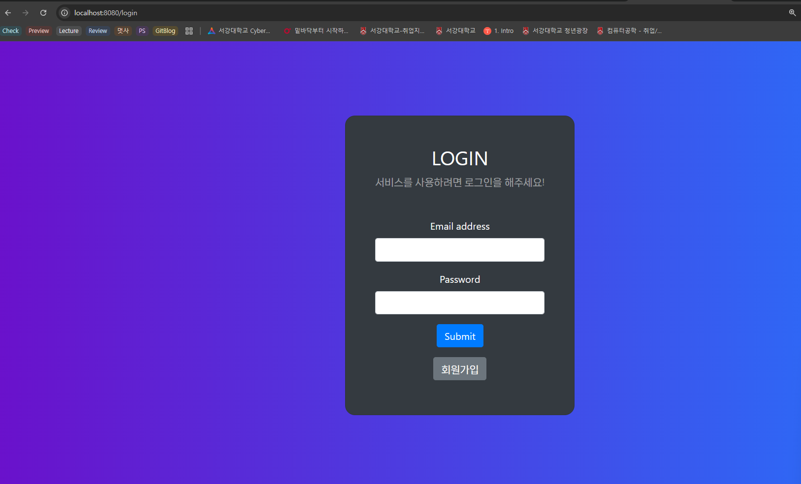
    
    - 다시 로그인 페이지로 이동!

---

- 자주 사용하는 특수 문자
    
    ∞ ⊂ ⊃ ∪ ∩ ∴ ∵ ⇒ ⇔ ⁿ ¹ ² ³ ⁴ · ↑ ↓ … × ₁ ₂ ₃ ₄ ∅
    ex) Example
