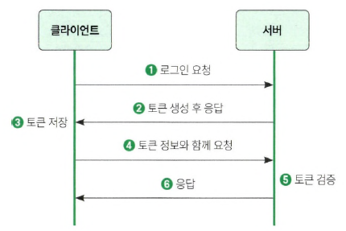
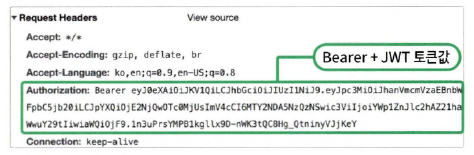
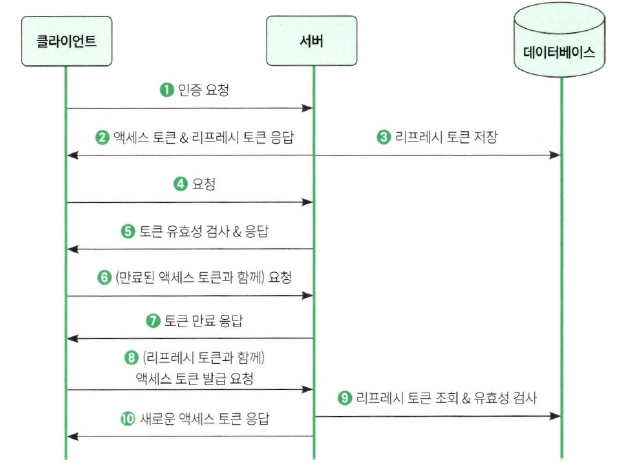
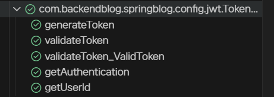
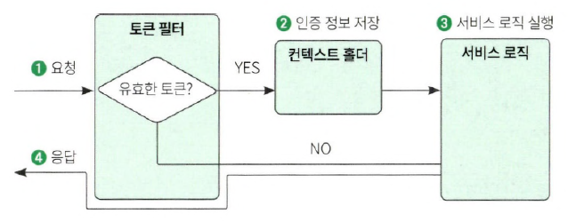
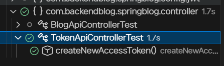

## ✦ 토큰 기반 인증

### ◆ 토큰 기반 인증이란?

- 대표적 사용자 [[인증]] 확인 방법
    - [[서버]] 기반 인증
        - 세션 기반 인증
    - 토큰 기반 인증
- [[Spring|스프링]] 시큐리티 → 세션 기반 인증 제공!
- 이번 장에서는 토큰 기반 인증으로 구현해보자!

### ◆ 토큰 전달 & 인증 과정

- 토큰 (token) : 요청 & 응답에 함께 보내 유효성 검증!
    - 발급 이후에는 정보 변경 불가 → HMAC (hash-based message authentication)



1. [[클라이언트]] → 아이디 & 비밀번호 서버에 전달하며 인증 요청
2. 서버 → 아이디 & 비밀번호 확인해 유효 사용자 검증. 유효한 사용자면 토큰 생성 & 응답
3. 클라이언트 → 서버에서 응답해준 토큰 저장. 
4. 클라이언트 → 인증 필요 [[API]] 사용시 토큰 함께 전송
5. 서버 → 토큰 유효성 검증. 유효하다면 클라이언트가 요청한 내용 처리

### ◆ 토큰 기반 인증 특징

- 무상태성 (stateless)
    - 인증 정보 담긴 토큰이 서버가 아닌 클라이언트 → 서버 저장 필요 X
    - 완전한 무상태로 효율적 검증 가능
- 확장성 (extendability)
    - 상태 관리 신경 필요 X → 서버 확장 용이
    - 토큰 기반 인증 이용 타 시스템 접근해 로그인 방식 확장 가능 (페이스북, 구글 로그인 등)
- [[무결성]] (integrity)
    - 토큰 발급 이후 정보 변경 불가 → 유효성 체크 가능

### ◆ JWT

- JWT ([[JSON]] Web Token) : 웹 전반에서 널리 쓰이는 토큰 표준
→ [[Java]] Spring Security 에서 사용!
- 인증 방법 : [[HTTP 요청]] 헤더 중 Authorization 키 값으로 **Bearer + JWT 토큰값** 넣어 보내기
    
    
    
    - `Bearer` : HTTP 인증 헤더의 **인증 방식 명시**하는 키워드
    → 토큰을 소지한 사람에게 접근 권한을 부여!
    - JWT → `.` 기준 헤더 (header) / 내용 (payload) / 서명 (signature) 구성
- 헤더 : 토큰 타입 & 해싱 [[알고리즘]] 지정 정보
    
    
    | 이름 | 설명 |
    | --- | --- |
    | typ | 토큰 타입 지정. `JWT` 문자열 입력 |
    | alg | 해싱 알고리즘 지정 |
    
    ```json
    {
    	"typ": "JWT",
    	"alg": "HS256"
    }
    ```
    
- 내용 : 토큰 관련 정보.
    - 각 내용 덩어리 → 클레임 (claim).
    - 클레임은 키값의 한 쌍으로 이루어짐.
    - 등록된 클레임 (registered claim) : 토큰에 대한 정보 저장
        
        
        | 이름 | 설명 |
        | --- | --- |
        | iss | 토큰 발급자 (issuer) |
        | sub | 토큰 제목 (subject) |
        | aud | 토큰 대상자 (audience) |
        | exp | 토큰의 만료 시간 (expiration). `NumericDate` 형식.
        항상 현 시간 이후로 설정 |
        | nbf | 토큰의 활성 날짜 (Not before). `NumericDate` 형식.
        이 시간 이전에는 토큰 활성화 X |
        | iat | 토큰 발급 시간 (issued at) |
        | jti | JWT 고유 식별자. 일회용 토큰에 사용 |
    - 공개 클레임 (public claim) : 공개되어도 상관없는 클레임. 보통 URI
    - 비공개 클레임 (private claim) : 공개되면 안되는 클레임. 클라이언트 - 서버 간 통신에 사용
    
    ```json
    {
    	"iss": "ajufresh@gmail.com".   // 등록된 클레임
    	"iat": 1622370878,             // 등록된 클레임
    	"exp": 1622372678,             // 등록된 클레임
    	"https://shinsunyoung.com/jwt_claims/is_admin": true, // 공개 클레임
    	"email": "ajufresh@gmail.com", // 비공개 클레임
    	"hello": "안녕하세요!"          // 비공개 클레임
    }
    ```
    
- 서명 : 토큰 조작 / 변경되지 않았음 확인 용도
    - 헤더 인코딩 값 + 내용 인코딩 값 후 비밀키 사용해 해시값 생성

### ◆ 토큰 유효기간

- 토큰이 노출된다면?
    - 서버는 요청한 사람이 발급 받은 사람인지, 탈취한 사람인지 확인할 수 없다..
    - 그렇다면 유효기간을 짧게 설정하면? 
    ⇒ 사용자가 불편..
- 리프레시 토큰을 이용하자!
    - 사용자 인증 용도 X
    - 액세스 토큰 만료 시 new 액세스 토큰 발급 위해 사용.
- 액세스 토큰 유효 기간 짧게, 리프레시 토큰 유효 기간 길게!



1. 클라이언트 → 서버에 인증 요청
2. 서버 → 클라이언트 전달 정보 바탕 인증 정보 유효 확인! 액세스 토큰 & 리프레시 토큰 만들어 클라이언트 전달. 
3. 클라이언트 & [[데이터베이스|DB]] → 리프레시 토큰 저장 
4. 클라이언트 → 인증 필요 API 호출 시 액세스 토큰과 함께 API 요청
5. 서버 → 액세스 토큰 유효성 검사. 유효 시 요청 정보 처리
6. 클라이언트 → 일정 시간 후 다시 액세스 토큰과 함께 API 요청 (이 시점에서 액세스 토큰은 만료됨!)
7. 서버 → 만료된 토큰이므로 만료되었다는 에러 전달!
8. 클라이언트 → 저장한 리프레시 토큰으로 new 액세스 토큰 발급 요청
9. 서버 → DB 에서 리프레시 토큰 조회 & 검사
10. 서버 → 유효한 리프레시 토큰이면 new 액세스 토큰 생성 & 응답
11. 다시 4 번으로 돌아가 클라이언트가 API 요청

## ✦ JWT 서비스 구현하기

- 의존성 & 토큰 제공자 추가
- 리프레이 토큰 도메인 & 토큰 필터 구현!

### ◆ 의존성 추가하기

- `build.gradle` 에 의존성 추가

```json
dependencies {
	...
	implementation 'io.jsonwebtoken:jjwt-api:0.11.5' // 자바 JWT 라이브러리
	implementation 'javax.xml.bind:jaxb-api:2.3.1'   // XML 문서와 Java 객체 간 매핑 자동화
}
```

### ◆ 토큰 제공자 추가하기

- `jwt` 사용해 JWT 생성 & 유효성 검증 [[클래스]] 추가

1단계

`application.yml` 에 JWT 토큰 만들기 위한 issuer, secret_key 설정

```yaml
jwt:
  issuer: kby7576@sogang.ac.kr
  secret_key: springblog
```

2단계

config/jwt [[패키지]]에 `JwtProperties` 클래스 만들기

- `issuer` / `secret_key`  값들을 [[변수]]로 접근하는데 사용

```java
import lombok.Getter;
import lombok.Setter;
import org.springframework.boot.context.properties.ConfigurationProperties;
import org.springframework.stereotype.Component;

@Setter
@Getter
@Component
@ConfigurationProperties(prefix = "jwt") // 자바 클래스에 프로퍼티값 가져와 사용
public class JwtProperties {
    private String issuer; // 발급자
    private String secret_key; // 비밀키
}
```

3단계

config/jwt 패키지에 `TokenProvider` 클래스 작성

- 토큰 생성 & 유효성 검사 & 토큰에서 필요 정보 가져오기

```java
@RequiredArgsConstructor
@Service
public class TokenProvider {

    private final JwtProperties jwtProperties;

    public String generateToken(User user, Duration expiredAt) {
        Date now = new Date();
        return makeToken(new Date(now.getTime() + expiredAt.toMillis()), user);
    }

    // 1. JWT 토큰 생성 메소드
    private String makeToken(Date expiredAt, User user) {
        Date now = new Date();

        return Jwts.builder()
                .setHeaderParam(Header.TYPE, Header.JWT_TYPE) // 헤더 typ : JWT
                .setIssuer(jwtProperties.getIssuer()) // 발급자
                .setIssuedAt(now) // 내용 iat : 현재 시간
                .setExpiration(expiredAt) // 내용 exp : expiry 멤버 변수값
                .setSubject(user.getEmail()) // 내용 sub : 유저 이메일
                .claim("id", user.getId()) // 클레임 id : 유저 아이디
                // 서명 : 비밀값과 함께 해시값을 HS256 방식으로 암호화
                .signWith(SignatureAlgorithm.HS256, jwtProperties.getSecret_key())
                .compact();
    }
```

- `makeToken(Date expiredAt, User user)`
    - 토큰 생성.
    - set [[메소드]]로 여러 값을 지정

```java
    // 2. JWT 토큰 유효성 검증 메소드
    public boolean validateToken(String token) {
        try {
            Jwts.parser()
                    .setSigningKey(jwtProperties.getSecret_key()) // 비밀값으로 복호회
                    .parseClaimsJws(token);

            return true;
        } catch (Exception e) { // 복호화 과정에서 에러 시 유효하지 않은 토큰
            return false;
        }
    }
```

- `validateToken(String token)`
    - 토큰 유효성 검사
    - 비밀값으로 토큰 복호화 → 에러 있으면 `false` / 없으면 `true` 반환

```java
    // 3. 토큰 기반으로 인증 정보 가져오는 메소드
    public Authentication getAuthentication(String token) {
        Claims claims = getClaims(token);
        Set<SimpleGrantedAuthority> authorities = Collections.singleton(new SimpleGrantedAuthority("ROLE_USER"));

        return new UsernamePasswordAuthenticationToken(new org.springframework.security.core.userdetails.User(claims.getSubject(), "", authorities), token, authorities);
    }
```

- `getAuthentication(String token)`
    - 토큰을 받아 인증 정보 반환
    - 복호화 한 값으로 `getClaims()`  호출해 정보 생성
    - `getClaims()`
        
        ```java
            // 5. 토큰 기반으로 클레임 가져오는 메소드
            private Claims getClaims(String token) {
                return Jwts.parser() // 클레임 조화
                        .setSigningKey(jwtProperties.getSecret_key())
                        .parseClaimsJws(token)
                        .getBody();
            }
        ```
        

```java
    // 4. 토큰 기반으로 유저 ID를 가져오는 메소드
    public Long getUserId(String token) {
        Claims claims = getClaims(token);
        return claims.get("id", Long.class);
    }
```

- `getUserId(String token)`
    - 토큰 기반으로 사용자 ID 가져옴
    - 비밀값으로 복호화 → `getClaims()` 호출해 id 키로 저장된 값 반환
- 전체 코드
    
    ```java
    @RequiredArgsConstructor
    @Service
    public class TokenProvider {
    
        private final JwtProperties jwtProperties;
    
        public String generateToken(User user, Duration expiredAt) {
            Date now = new Date();
            return makeToken(new Date(now.getTime() + expiredAt.toMillis()), user);
        }
    
        // 1. JWT 토큰 생성 메소드
        private String makeToken(Date expiredAt, User user) {
            Date now = new Date();
    
            return Jwts.builder()
                    .setHeaderParam(Header.TYPE, Header.JWT_TYPE) // 헤더 typ : JWT
                    .setIssuer(jwtProperties.getIssuer()) // 발급자
                    .setIssuedAt(now) // 내용 iat : 현재 시간
                    .setExpiration(expiredAt) // 내용 exp : expiry 멤버 변수값
                    .setSubject(user.getEmail()) // 내용 sub : 유저 이메일
                    .claim("id", user.getId()) // 클레임 id : 유저 아이디
                    // 서명 : 비밀값과 함께 해시값을 HS256 방식으로 암호화
                    .signWith(SignatureAlgorithm.HS256, jwtProperties.getSecret_key())
                    .compact();
        }
        
        // 2. JWT 토큰 유효성 검증 메소드
        public boolean validateToken(String token) {
            try {
                Jwts.parser()
                        .setSigningKey(jwtProperties.getSecret_key()) // 비밀값으로 복호회
                        .parseClaimsJws(token);
    
                return true;
            } catch (Exception e) { // 복호화 과정에서 에러 시 유효하지 않은 토큰
                return false;
            }
        }
    
        // 3. 토큰 기반으로 인증 정보 가져오는 메소드
        public Authentication getAuthentication(String token) {
            Claims claims = getClaims(token);
            Set<SimpleGrantedAuthority> authorities = Collections.singleton(new SimpleGrantedAuthority("ROLE_USER"));
    
            return new UsernamePasswordAuthenticationToken(new org.springframework.security.core.userdetails.User(claims.getSubject(), "", authorities), token, authorities);
        }
    
        // 4. 토큰 기반으로 유저 ID를 가져오는 메소드
        public Long getUserId(String token) {
            Claims claims = getClaims(token);
            return claims.get("id", Long.class);
        }
    
        // 5. 토큰 기반으로 클레임 가져오는 메소드
        private Claims getClaims(String token) {
            return Jwts.parser() // 클레임 조화
                    .setSigningKey(jwtProperties.getSecret_key())
                    .parseClaimsJws(token)
                    .getBody();
        }
    }
    
    ```

4단계

테스트 코드 작성!

test/…/config/jwt 패키지에 `JwtFactory.java` 파일 생성

- JWT 토큰 서비스 테스트용 mock 객체

```java
@Getter
public class JwtFactory {
    private String subject = "test@email.com";
    private Date issuedAt = new Date();
    private Date expiredAt = new Date(new Date().getTime() + Duration.ofDays(14).toMillis());
    private Map<String, Object> claims = new HashMap<>();

    // 빌더 패턴을 사용해 설정이 필요한 데이터만 선택 설정
    @Builder
    public JwtFactory(String subject, Date issuedAt, Date expiredAt, Map<String, Object> claims) {
        this.subject = subject != null ? subject : this.subject;
        this.issuedAt = issuedAt != null ? issuedAt : this.issuedAt;
        this.expiredAt = expiredAt != null ? expiredAt : this.expiredAt;
        this.claims = claims != null ? claims : this.claims;
    }

    public static JwtFactory withDefaultValues() {
        return JwtFactory.builder().build();
    }

    // jwt 라이브러리 사용해 JWT 토큰 생성
    public String createToken(JwtProperties jwtProperties) {
        return Jwts.builder()
                .setSubject(subject)
                .setHeaderParam(Header.TYPE, Header.JWT_TYPE)
                .setIssuer(jwtProperties.getIssuer())
                .setIssuedAt(issuedAt)
                .setExpiration(expiredAt)
                .addClaims(claims)
                .signWith(SignatureAlgorithm.HS256, jwtProperties.getSecret_key())
                .compact();
    }

}

```

5단계

test/…/config/jwt 패키지에 `TokenProviderTest` 파일 만들기

- `TokenProvider` 클래스 테스트 클래스

```java
    // 1. generateToken() 검증 테스트
    @DisplayName("generateToken() : 유저 정보와 만료 기간을 전달해 토큰을 만들 수 있다.")
    @Test
    void generateToken() {
        // given
        User testUser = userRepository.save(User.builder()
                .email("user@gmail.com")
                .password("test")
                .build());
        // when
        String token = tokenProvider.generateToken(testUser, Duration.ofDays(14));
        // then
        Long userId = Jwts.parser()
                .setSigningKey(jwtProperties.getSecret_key())
                .parseClaimsJws(token)
                .getBody()
                .get("id", Long.class);

        assertThat(userId).isEqualTo(testUser.getId());   
    }
```

- `generateToken()` 테스트
    
    토큰을 생성하는 메서드를 테스트
    
    | 구분 | 내용 |
    | --- | --- |
    | given | 토큰에 유저 정보를 추가하기 위한 테스트 유저를 만듭니다. |
    | when | 토큰 제공자의 generateToken() 메서드를 호출해 토큰을 만듭니다. |
    | then | jjwt 라이브러리를 사용해 토큰을 복호화합니다. 토큰을 만들 때 클레임으로 넣어둔 id값이 given절에서 만든 유저 ID와 동일한지 확인합니다. |

```java
    // 2. validateToken() 검증 테스트
    @DisplayName("validateToken() : 만료된 토큰인 때에 유효성 검증에 실패한다.")
    @Test
    void validateToken() {
        // given
        String token = JwtFactory.builder()
                .expiredAt(new Date(new Date().getTime() - Duration.ofDays(7).toMillis())) // 만료된 토큰
                .build()
                .createToken(jwtProperties);
        // when
        boolean result = tokenProvider.validateToken(token);
        // then
        assertThat(result).isFalse();
    }

    @DisplayName("validateToken() : 유효한 토큰인 때에 유효성 검증에 성공한다.")
    @Test
    void validateToken_ValidToken() {
        // given
        String token = JwtFactory.withDefaultValues()
                .createToken(jwtProperties);
        // when
        boolean result = tokenProvider.validateToken(token);
        // then
        assertThat(result).isTrue();
    }
```

- `validToken()` 테스트
    
    토큰이 유효한 토큰인지 검증
    
    - `validToken_invalidToken()` : 검증 실패 확인
    
    | 구분 | 내용 |
    | --- | --- |
    | given | jjwt 라이브러리를 사용해 토큰을 생성합니다. 이때 만료 시간은 1970년 1월 1일부터 현재 시간을 밀리초 단위로 치환한 값(`new Date().getTime()`)에 1000을 빼, 이미 만료된 토큰으로 생성합니다. |
    | when | 토큰 제공자의 validToken() 메서드를 호출해 유효한 토큰인지 검증한 뒤 결괏값을 반환받습니다. |
    | then | 반환값이 false(유효한 토큰이 아님)인 것을 확인합니다. |
    - `validToken_validToken()`  : 검증 성공 확인
    
    | 구분 | 내용 |
    | --- | --- |
    | given | jjwt 라이브러리를 사용해 토큰을 생성합니다. 만료 시간은 현재 시간으로부터 14일 뒤로, 만료되지 않은 토큰으로 생성합니다. |
    | when | 토큰 제공자의 validToken() 메서드를 호출해 유효한 토큰인지 검증한 뒤 결괏값을 반환받습니다. |
    | then | 반환값이 true(유효한 토큰임)인 것을 확인합니다. |

```java
    // 3. getAuthentication() 검증 테스트
    @DisplayName("getAuthentication() : 토큰 기반으로 인증 정보를 가져올 수 있다.")
    @Test
    void getAuthentication() {
        // given
        String userEmail = "user@email.com";
        String token = JwtFactory.builder()
                .subject(userEmail)
                .build()
                .createToken(jwtProperties);
        // when
        Authentication authentication = tokenProvider.getAuthentication(token);
        // then
        assertThat(((UserDetails) authentication.getPrincipal()).getUsername()).isEqualTo(userEmail);
    }
```

- `getAuthentication()` 테스트
    
    토큰을 전달받아 인증 정보를 담은 객체 Authentication을 반환하는 메소드 테스트
    
    | 구분 | 내용 |
    | --- | --- |
    | given | jjwt 라이브러리를 사용해 토큰을 생성합니다. 이때 토큰의 제목(subject)은 "[user@email.com](mailto:user@email.com)"이라는 값을 사용합니다. |
    | when | 토큰 제공자의 getAuthentication() 메서드를 호출해 인증 객체를 반환받습니다. |
    | then | 반환받은 인증 객체의 유저 이름을 가져와 given절에서 설정한 subject값인 "[user@email.com](mailto:user@email.com)"과 같은지 확인합니다. |

```java
    // 4. getUserId() 검증 테스트
    @DisplayName("getUserId() : 토큰 기반으로 유저 ID를 가져올 수 있다.")
    @Test
    void getUserId() {
        // given
        Long userId = 1L;
        String token = JwtFactory.builder()
                .claims(Map.of("id", userId))
                .build()
                .createToken(jwtProperties);
        // when
        Long resultUserId = tokenProvider.getUserId(token);
        // then
        assertThat(resultUserId).isEqualTo(userId);
    }
```

- `getUserId()` 테스트
    
    토큰 기반으로 유저 ID를 가져오는 메소드 테스트. 
    
    | 구분 | 내용 |
    | --- | --- |
    | given | jjwt 라이브러리를 사용해 토큰을 생성합니다. 이때 클레임을 추가합니다. 키는 "id", 값은 1이라는 유저 ID입니다. |
    | when | 토큰 제공자의 getUserId() 메서드를 호출해 유저 ID를 반환받습니다. |
    | then | 반환받은 유저 ID가 given절에서 설정한 유저 ID값인 1과 같은지 확인합니다. |
- 전체 코드
    
    ```java
    @SpringBootTest
    class TokenProviderTest {
        @Autowired
        private TokenProvider tokenProvider;
        @Autowired
        private JwtProperties jwtProperties;
        @Autowired
        private UserRepository userRepository;
    
        // 1. generateToken() 검증 테스트
        @DisplayName("generateToken() : 유저 정보와 만료 기간을 전달해 토큰을 만들 수 있다.")
        @Test
        void generateToken() {
            // given
            User testUser = userRepository.save(User.builder()
                    .email("user@gmail.com")
                    .password("test")
                    .build());
            // when
            String token = tokenProvider.generateToken(testUser, Duration.ofDays(14));
            // then
            Long userId = Jwts.parser()
                    .setSigningKey(jwtProperties.getSecret_key())
                    .parseClaimsJws(token)
                    .getBody()
                    .get("id", Long.class);
    
            assertThat(userId).isEqualTo(testUser.getId());   
        }
        
        // 2. validateToken() 검증 테스트
        @DisplayName("validateToken() : 만료된 토큰인 때에 유효성 검증에 실패한다.")
        @Test
        void validateToken() {
            // given
            String token = JwtFactory.builder()
                    .expiredAt(new Date(new Date().getTime() - Duration.ofDays(7).toMillis())) // 만료된 토큰
                    .build()
                    .createToken(jwtProperties);
            // when
            boolean result = tokenProvider.validateToken(token);
            // then
            assertThat(result).isFalse();
        }
    
        @DisplayName("validateToken() : 유효한 토큰인 때에 유효성 검증에 성공한다.")
        @Test
        void validateToken_ValidToken() {
            // given
            String token = JwtFactory.withDefaultValues()
                    .createToken(jwtProperties);
            // when
            boolean result = tokenProvider.validateToken(token);
            // then
            assertThat(result).isTrue();
        }
    
        // 3. getAuthentication() 검증 테스트
        @DisplayName("getAuthentication() : 토큰 기반으로 인증 정보를 가져올 수 있다.")
        @Test
        void getAuthentication() {
            // given
            String userEmail = "user@email.com";
            String token = JwtFactory.builder()
                    .subject(userEmail)
                    .build()
                    .createToken(jwtProperties);
            // when
            Authentication authentication = tokenProvider.getAuthentication(token);
            // then
            assertThat(((UserDetails) authentication.getPrincipal()).getUsername()).isEqualTo(userEmail);
        }
    
        // 4. getUserId() 검증 테스트
        @DisplayName("getUserId() : 토큰 기반으로 유저 ID를 가져올 수 있다.")
        @Test
        void getUserId() {
            // given
            Long userId = 1L;
            String token = JwtFactory.builder()
                    .claims(Map.of("id", userId))
                    .build()
                    .createToken(jwtProperties);
            // when
            Long resultUserId = tokenProvider.getUserId(token);
            // then
            assertThat(resultUserId).isEqualTo(userId);
        }
    }
    
    ```
    
- 실행하면?
    
    
    
    - 안된다면 `secret_key` 를 바꿔보도록 하자..
		

### ◆ 리프레시 토큰 도메인 구현하기

- 리프레시 토큰 → DB 에 저장
    - Entity & Repository 추가해야 함!
    
    | 컬럼명 | 자료형 | null 허용 | 키 | 설명 |
    | --- | --- | --- | --- | --- |
    | `id`  | BIGINT | N | 기본키 | 일련번호, 기본키 |
    | `user_id` | BIGINT | N |  | 유저 ID |
    | `refresh_token` | VARCHAR(255) | N |  | 토큰값 |

1단계

domain 패키지에 `RefreshToken` 클래스 추가

```java
@NoArgsConstructor(access = AccessLevel.PROTECTED)
@Entity
@Getter
public class RefreshToken {

    @Id
    @GeneratedValue(strategy = GenerationType.IDENTITY)
    @Column(name = "id", updatable = false)
    private Long id;

    @Column(name = "user_id", nullable = false, unique = true)
    private Long userId;

    @Column(name = "refresh_token", nullable = false)
    private String refreshToken;

    public RefreshToken(Long userId, String refreshToken) {
        this.userId = userId;
        this.refreshToken = refreshToken;
    }

    public RefreshToken update(String newRefreshToken) {
        this.refreshToken = newRefreshToken;
        return this;
    }
}
```

2단계

repository 패키지에 `RefreshTokenRepository` [[인터페이스]] 작성

```java
public interface RefreshTokenRepository extends JpaRepository<RefreshToken, Long> {
    Optional<RefreshToken> findByUserId(Long userId);
    Optional<RefreshToken> findByRefreshToken(String refreshToken);
}
```
		

### ◆ 토큰 필터 구현하기

- 필터 : 각종 요청 처리 전후에 URL 패턴에 맞는 모든 요청 처리
    - 요청이 오면 헤더 값 비교 → 토큰 확인
    - 유효 토큰 O → 시큐리티 컨텍스트 홀더 (security context holder) 에 인증 정보 저장
    - 시큐리티 컨텍스트 (security context) : 인증 객체 저장 보관소
        - 스레드 로컬 (thread local) 에 저장 
        → 코드 아무 곳에서 참조 가능, 독립적 사용 가능
    
    
    

config 패키지에 `TokenAuthenticationFilter` 클래스 생성

- 액세스 토큰 값이 담긴 `Authorization` 헤더값 가져온 후 토큰이 유효하면 인증 정보 설정

```java
@RequiredArgsConstructor
public class TokenAuthenticationFilter extends OncePerRequestFilter {
    private final TokenProvider tokenProvider;
    private static final String HEADER_AUTHORIZATION = "Authorization";
    private static final String TOKEN_PREFIX = "Bearer "; 

    @Override
    protected void doFilterInternal(
            HttpServletRequest request,
            HttpServletResponse response,
            FilterChain filterChain) throws ServletException, IOException {

        // 요청 헤더의 Authorization 키의 값 조회
        String authorizationHeader = request.getHeader(HEADER_AUTHORIZATION);
        // 가져온 값에서 접두사 제거
        String token = getAccessToken(authorizationHeader);
        // 가져온 토큰 유효 확인, 유효 시 인증 정보 설정
        if (tokenProvider.validateToken(token)) {
            Authentication authentication = tokenProvider.getAuthentication(token);
            SecurityContextHolder.getContext().setAuthentication(authentication);
        }

        filterChain.doFilter(request, response);
    }

    private String getAccessToken(String authorizationHeader) {
        if (authorizationHeader != null && authorizationHeader.startsWith(TOKEN_PREFIX)) {
            return authorizationHeader.substring(TOKEN_PREFIX.length());
        }
        return null;
    }
}
```

- 요청 헤더에서 키가 `Authorization` 인 [[필드]] 가져오기!
- prefix 인 `Bearer` 제거한 값으로 유효 확인
    - 유효 → 시큐리티 컨택스트에 인증 정보 설정

## ✦ 토큰 API 구현하기

- 리프레시 토큰 전달받아 검증
    - 유효 리프레시 토큰 → new 액세스 토큰 생성

### ◆ 토큰 서비스 추가하기

1단계

`UserService.java` 에서 `findById()` 메소드 구현

- 전달 받은 유저 ID 로 유저 검색 & 전달

```java
@RequiredArgsConstructor
@Service
public class UserService {
    private final UserRepository userRepository;
    private final PasswordEncoder passwordEncoder;

    ...

    public User findById(Long userId) {
        return userRepository.findById(userId)
                .orElseThrow(() -> new IllegalArgumentException("Unexpected user"));
    }
}
```

2단계

service 패키지에 `RefreshTokenService` 클래스 생성

- 전달받은 리프레시 토큰으로 DB에 있는지 검색해 전달

```java
@RequiredArgsConstructor
@Service
public class RefreshTokenService {
    private final RefreshTokenRepository refreshTokenRepository;

    public RefreshToken findByRefreshToken(String refreshToken) {
        return refreshTokenRepository.findByRefreshToken(refreshToken)
                .orElseThrow(() -> new IllegalArgumentException("Unexpected token"));
    }
}
```

3단계

토큰 서비스 클래스 생성

service 클래스에 `TokenService` 클래스 생성

- `createNewAccessToken()` : 전달받은 리프레시 토큰으로 토큰 유효성 검사 진행

```java
@RequiredArgsConstructor
@Service
public class TokenService {
    private final RefreshTokenService refreshTokenService;
    private final UserService userService;
    private final TokenProvider tokenProvider;

    public String createAccessToken(String refreshToken) {
        // 토큰 유효성 검사에 실패하면 예외 발생
        if (!tokenProvider.validateToken(refreshToken)) {
            throw new IllegalArgumentException("Unexpected token");
        }

        Long userId = refreshTokenService.findByRefreshToken(refreshToken).getUserId();
        User user = userService.findById(userId);

        return tokenProvider.generateToken(user, Duration.ofHours(2));
    }
}
```
		

### ◆ 컨트롤러 추가하기

- 실제로 토큰을 발급받는 API

1단계

dto 클래스에 `CreateAccessTokenRequest` , `CreateAccessTokenResponse` 클래스 만들기

- `CreateAccessTokenRequest`  : 토큰 생성 요청

```java
@Getter
@Setter
public class CreateAccessTokenRequest {
    private String refreshToken;
}

```

- `CreateAccessTokenResponse` : 토큰 생성 응답

```java
@AllArgsConstructor
@Getter
public class CreateAccessTokenResponse {
    private String accessToken;
}
```

2단계

controller 패키지에 `TokenApiController` 클래스

- 실제 요청 받고 처리
- /api/token 에 `POST` 요청 오면 리프레시 토큰 기반 new 액세스 토큰 만들기

```java
@RequiredArgsConstructor
@RestController
public class TokenApiController {
    private final TokenService tokenService;

    @PostMapping("/api/token")
    public ResponseEntity<CreateAccessTokenResponse> createAccessToken(@RequestBody CreateAccessTokenRequest request) {
        String newAccessToken = tokenService.createAccessToken(request.getRefreshToken());

        return ResponseEntity.status(HttpStatus.CREATED)

    }
}
```

3단계

테스트 코드 작성!

test/…/controller 패키지에 `TokenApiControllerTest` 만들기

- `createNewAccessToken()` 메소드 테스트 코드 작성

| Given | 테스트 유저 생성 & jjwt 라이브러리 이용해 리프레시 토큰 생성 후 DB 저장.
토큰 생성 API 요청 봅ㄴ문에 리프레시 토큰 포함해 요청 객체 생성 |
| --- | --- |
| When | 토큰 추가 API 에 요청 보냄. 
요청 타입 : JSON (given 절에서 만든 객체 포함) |
| Then | 응답 코드 201 Created 확인 & 응답으로 온 액세스 토큰 null 여부 확인 |
- 전체 코드
    
    ```java
    @SpringBootTest
    @AutoConfigureMockMvc
    class TokenApiControllerTest {
        @Autowired
        private MockMvc mockMvc;
        @Autowired
        protected ObjectMapper objectMapper;
        @Autowired
        private WebApplicationContext context;
        @Autowired
        JwtProperties jwtProperties;
        @Autowired
        UserRepository userRepository;
        @Autowired
        RefreshTokenRepository refreshTokenRepository;
    
        @BeforeEach
        public void mockMvcSetUp() {
            this.mockMvc = MockMvcBuilders.webAppContextSetup(context).build();
            refreshTokenRepository.deleteAll();
            userRepository.deleteAll();
        }
    
        @DisplayName("createNewAccessToken: 새로운 액세스 토큰을 발급한다.")
        @Test
        public void createNewAccessToken() throws Exception {
            // given
            final String url = "/api/token";
    
            User testUser = userRepository.save(User.builder()
                .email("user@gmail.com")
                .password("test")
                .build());
    
            String refreshToken = JwtFactory.builder()
                .claims(Map.of("id", testUser.getId()))
                .build()
                .createToken(jwtProperties);
    
            refreshTokenRepository.save(new RefreshToken(testUser.getId(), refreshToken));
    
            CreateAccessTokenRequest request = new CreateAccessTokenRequest();
            request.setRefreshToken(refreshToken);
            final String requestBody = objectMapper.writeValueAsString(request);
    
            // when
            ResultActions resultActions = mockMvc.perform(post(url)
                .contentType(MediaType.APPLICATION_JSON_VALUE)
                .content(requestBody));
    
            // then
            resultActions
                .andExpect(status().isCreated())
                .andExpect(jsonPath("$.accessToken").isNotEmpty());
        }
    }
    ```
    
- 결과
    
    
		

---

- 자주 사용하는 특수 문자
    
    ∞ ⊂ ⊃ ∪ ∩ ∴ ∵ ⇒ ⇔ ⁿ ¹ ² ³ ⁴ · ↑ ↓ … × ₁ ₂ ₃ ₄ ∅
    ex) Example
