## ✦ OAuth

### ◆ OAuth란?

- 제 3의 서비스에 계정 관리를 맡기는 방식
- ex) 네이버 로그인, 카카오 로그인, 구글 로그인 등
- 인증 서버에서 토큰 발급 → 리소스 서버에 리소스 오너의 정보 요청 & 응답

#### 용어 정리

- 리소스 오너 (resource owner) : 인증 서버에 자신의 정보를 사용하도록 허가하는 주체
→ 서비스 이용 사용자
- 리소스 서버 (resource server) : 리소스 오너의 정보를 가짐. 리소스 오너 정보 보호 주체
→ 네이버, 구글, 페이스북 등
    - 인증 서버 (authorization server) : 클라이언트에게 리소스 오너의 정보에 접근할 수 있는 토큰 발급 역할 애플리케이션
- 클라이언트 애플리케이션 (client application) : 인증 서버에게 인증 받고, 리소스 오너의 리소스 사용
→ 만들고 있는 서비스

#### 리소스 오너 정보 취득 방법

1. 권한 부여 코드 승인 타입 (authorization code grant type) 
    - OAuth 2.0 에서 가장 잘 알려진 인증 방법
    - 클라이언트가 리소스 접근 시 사용
    - 권한 접근 가능한 코드 & 리소스 오너에 대해 액세스 토큰 발급
2. 암시적 승인 타입 (implicit grant type)
    - 주로 서버가 없는 JS 웹 애플리케이션 클라이언트에서 사용
    - 클라이언트 요청 → 리소스 오너의 인증 과정
    - 권한 코드 교환 등의 인증 과정 X, 액세스 토큰 발급
3. 리소스 소유자 암호 자격증명 승인 타입 (resource owner password credentials)
    - 클라이언트 패스워드 이용해 액세스 토큰 대한 사용자 자격 증명 교환
4. 클라이언트 자격증명 승인 타입 (client credentials grant)
    - 클라이언트가 컨텍스트 외부에서 액세스 토큰 얻어 특정 리소스에 접근 요청 시 사용

### ◆ 권한 부여 코드 승인 타입

- 인증 순서
    
    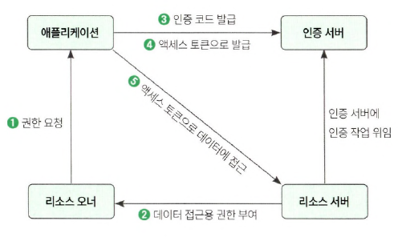
    
- 권한 요청
    - 클라이언트 (스프링 부트 서버) → 권한 서버 (카카오, 구글)에 요청 보내기
    - 클라이언트 ID, 리다이렉트 URI, 응답 타입을 파라미터로 설정해 전송
    
    ```xml
    GET spring-authorization-server.example/authorize?
    	client_id=66a36b4c2&
    	redirect_uri=http://localhost:8080/myapp&
    	response_type=code&
    	scope=profile
    ```
    
    - `client_id` : 인증 서버가 클라이언트 (스프링 부트 서버)에 할당한 고유 식별자. OAuth 서비스 등록시 서비스에서 생성
    - `redirect_uri` : 로그인 성공 시 이동해야하는 URI
    - `response_type` : 클라이언트가 제공받길 원하는 응답 타입 (인증 코드 → code 값 포함)
    - `scope` : 제공받고자 하는 리소스 오너의 정보 목록
- 데이터 접근용 권한 부여
    - 인증 서버에 첫 요청 전송 → 사용자에게 보이는 페이지를 로그인 페이지로 변경 & 데이터 접근 동의 얻음
    - 최초 1회 진행 → 이후에는 로그인만 진행
    - 로그인 성공 → 권한 부여 서버가 인증 및 권한 부여 수신
- 인증 코드 제공
    - 사용자가 로그인 성공 → 파라미터로 보낸 `redirect_uri` 로 리다이렉션 & 인증 코드 제공
    
    ```xml
    GET http://localhost:8080/myapp?code=a1s2f3mcj2
    ```
    
- 액세스 토큰 응답
    - 인증 코드 → 액세스 토큰으로 교환
        - 액세스 토큰 : 로그인 세션 대한 보안 자격 증명 식별 코드
    - 보통 /token `POST` 요청
    
    ```json
    POST spring-authorization-server.example.com/token
    {
    	"client_id": "66336b4c2",
    	"client_secret": "aabblldd44",
    	"redirect_uri": "http://localhost:8080/myapp",
    	"grant_type": "authorization_code",
    	"code": "alb2c3d465f6g7h8"
    }
    ```
    
    - `client_secret` : OAuth 서비스 등록 시 제공받는 비밀키
    - `grant_type` : 권한 유형 확인시 사용 (authorization_code 로 설정)
        - 권한 서버 → 요청 값 기반 유효 정보 확인 후 액세스 토큰으로 응답
            
            ```json
            {
            "access_token": "aasdffb",
            "token_type": "Bearer",
            "expires.in": 3600,
            "scope": "openid profile",
            ... 생략 ...
            }
            ```
            
- 액세스 토큰으로 API 응답 & 반환
    - 권한 서버에서 제공받은 액세스 토큰으로 리소스 오너 (사용자) 의 정보 가져올 수 있음
    - 정보 필요 시마다 API 호출 → 리소스 서버가 유효성 검사 후 응답
    
    ```json
    GET spring-authorization-resource-server.example.com/userinfo
    Header: Authorization: Bearer aasdffb
    ```
    

### ◆ 쿠키

- 웹사이트의 서버에서 사용자의 로컬 환경에 저장하는 작은 데이터
    - 키 & 값 구성
    - 만료 기간, 도메인 등
- HTTP 요청으로 특정 키에 값 추가 가능
    
    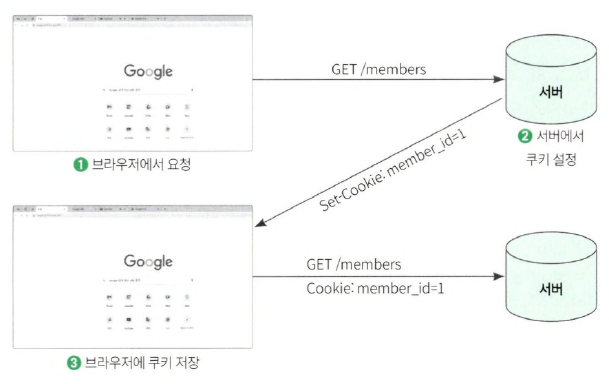
    
    1. 클라이언트가 정보 요청
    2. 서버가 정보를 값으로 넣은 쿠키 생성 & HTTP 헤더와 돌려보냄
    3. 클라이언트는 로컬에 쿠키 저장
    4. 사이트 재방문 시 쿠키와 함께 서버에 요청

## ✦ 토큰 발급 받기

1단계

[](https://console.cloud.google.com/welcome/new)

위 사이트 접속

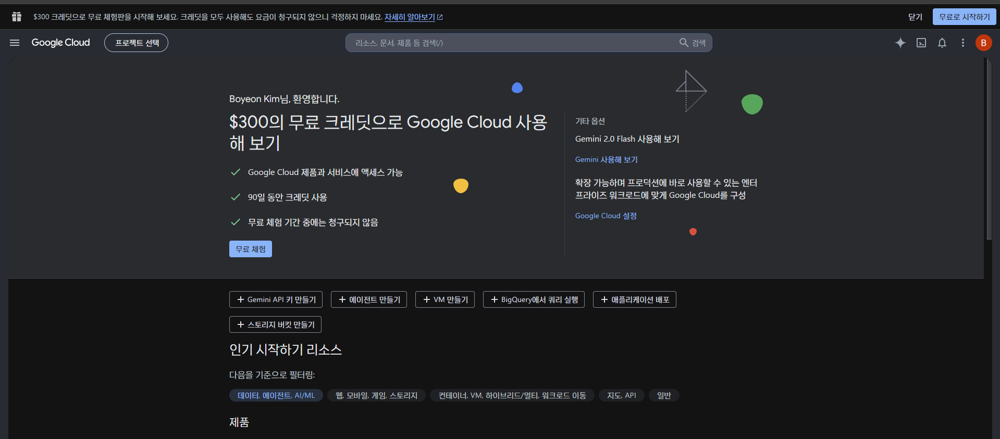

오른쪽 위의 [**프로젝트 선택]** 버튼 누르기

2단계

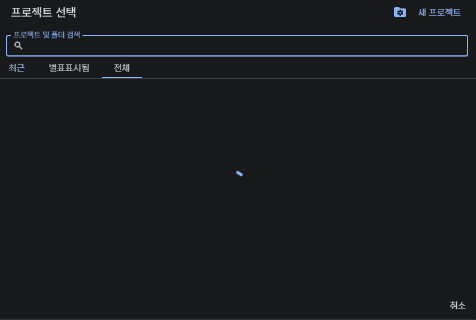

[새 프로젝트] 버튼 누르고

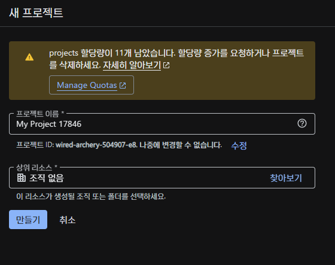

아무 이름이나 짓고 [만들기] 누르기

3단계

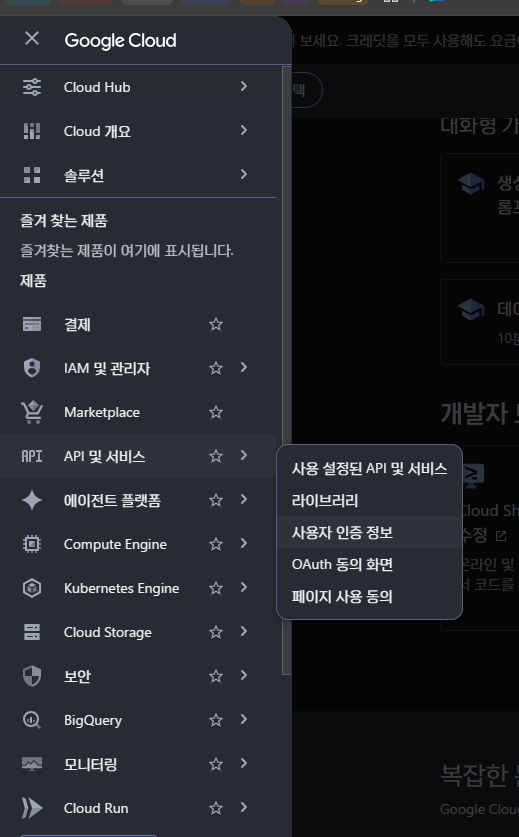

왼쪽 메뉴에서 [API 및 서비스] > [사용자 인증 정보] 이동

4단계

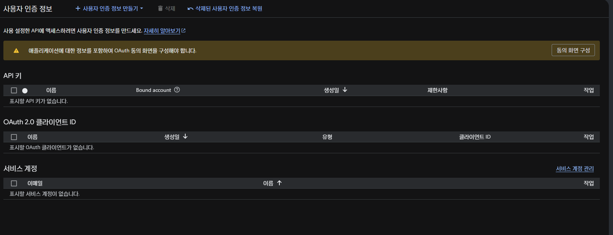

오른쪽의 [동의 화면 구성] 누르기

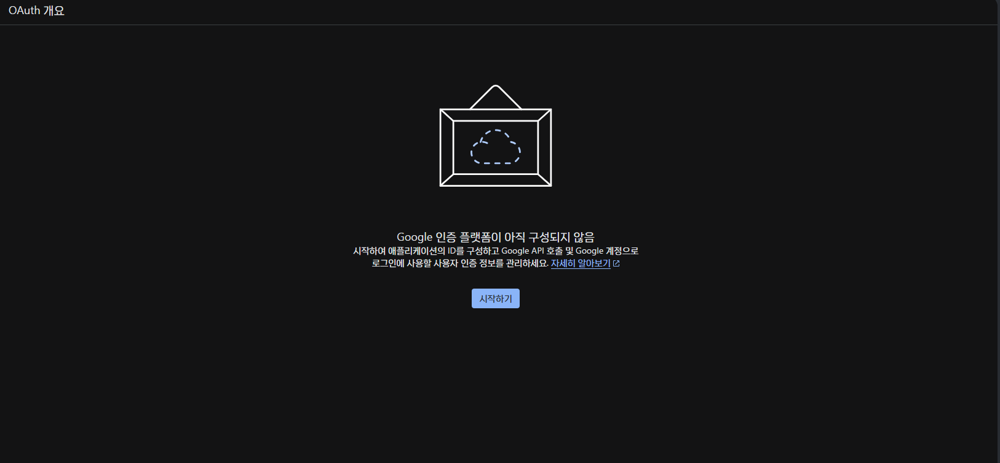

시작하기!

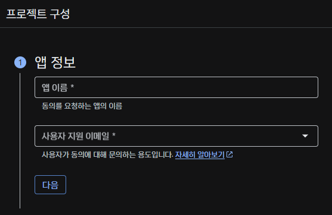

앱 이름 & 이메일 입력 → [다음]

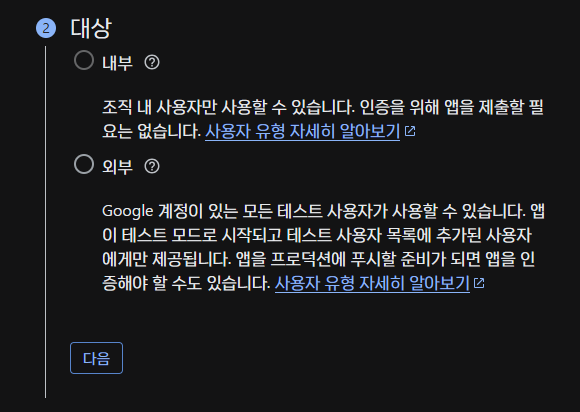

대상 → [외부] 선택

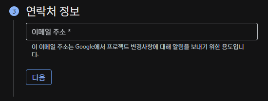

연락처 정보에는 이메일 주소 입력

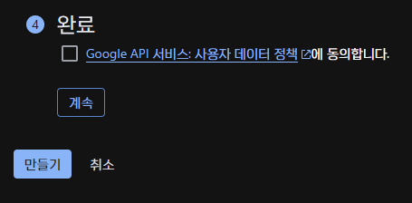

체크 → 계속 → 만들기

5단계

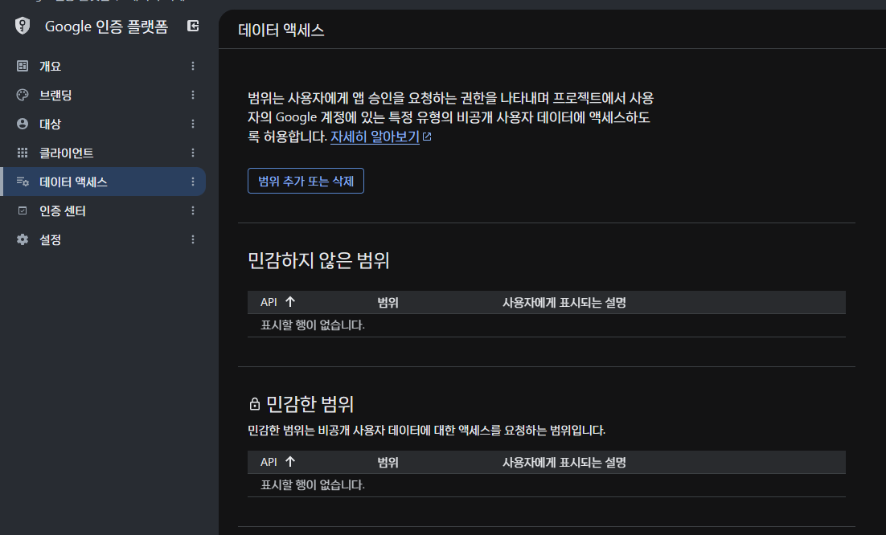

왼쪽 메뉴에서 [데이터 액세스] 이동 → [범위 추가 또는 삭제] 클릭

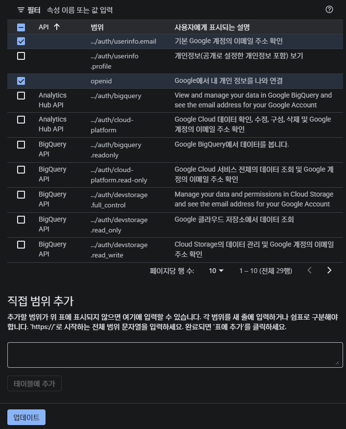

이메일 주소랑 openid 선택하고 [업데이트] 누르기

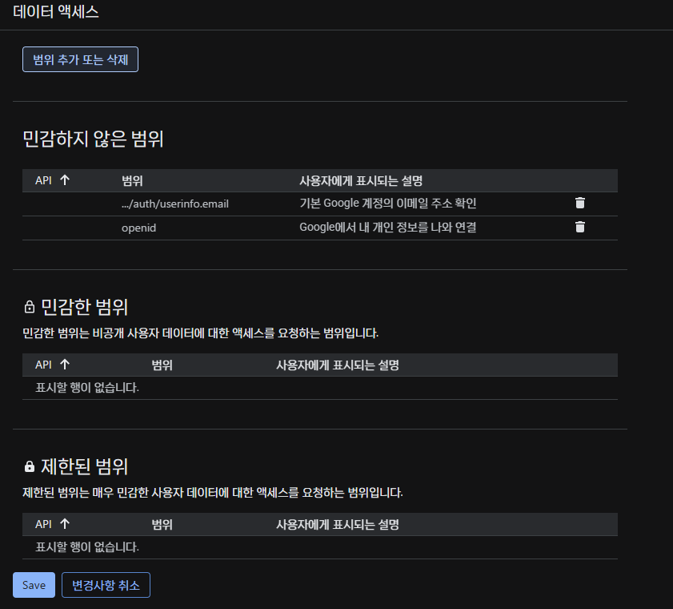

마지막으로 [Save] 버튼 누르기!

6단계

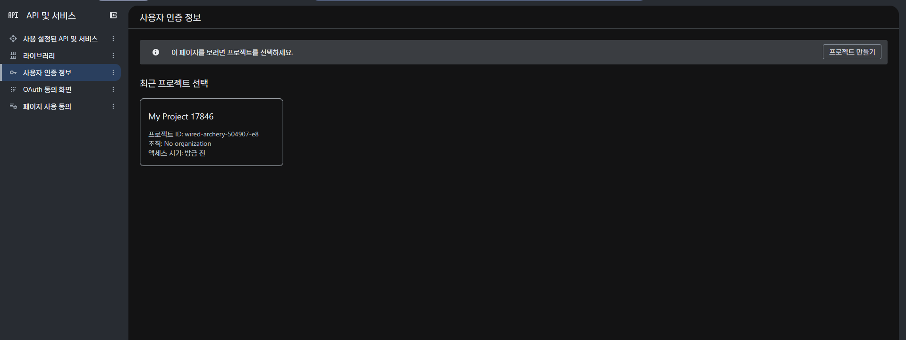

방금 만든 프로젝트 선택

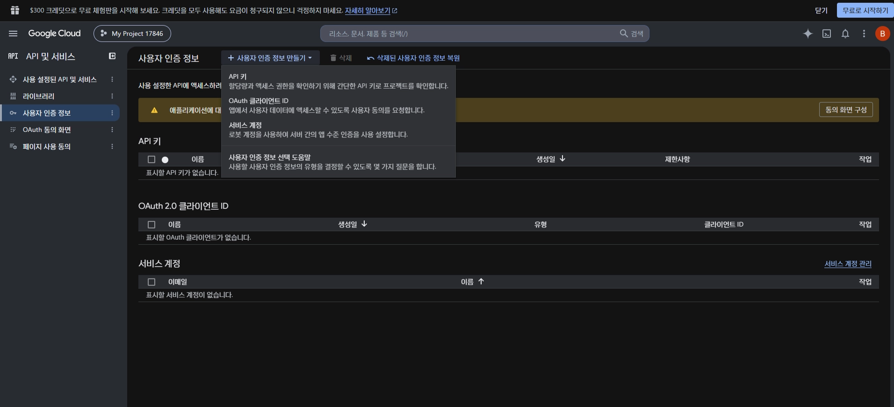

왼쪽 위에 있는 [+ 사용자 인증 정보 만들기] > [OAuth 클라이언트 ID] 선택

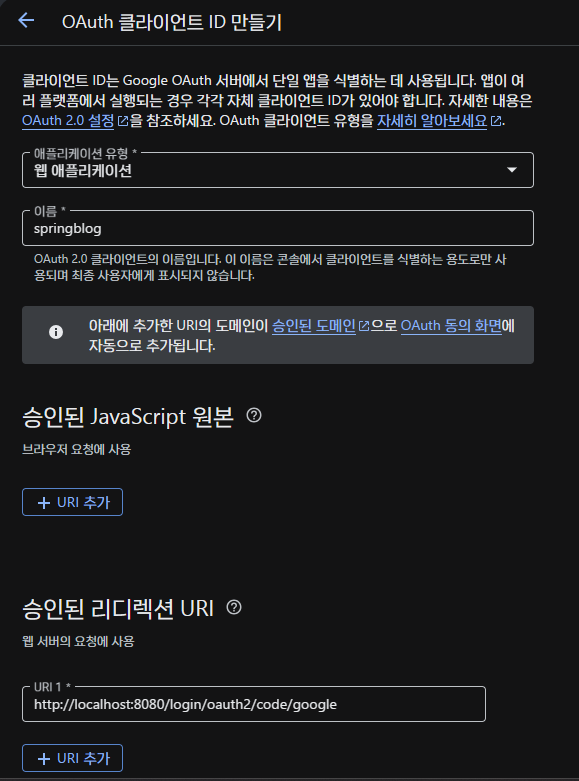

애플리케이션 유형 → 웹 애플리케이션

URI → [http://localhost:8080/login/oauth2/code/google](http://localhost:8080/login/oauth2/code/google) 설정 후

[만들기] 버튼 누르기

그후에 나오는 클라이언트 ID & 보안 비밀번호 JSON 다운 받아놓기


7단계

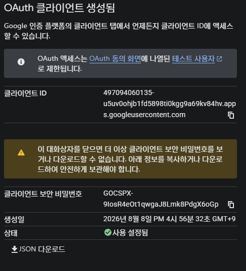

클라이언트 ID & 보안 비밀번호를 `application.yml` 파일에 추가하기

```yaml
  security:
    oauth2:
      client:
        registration:
          google:
            client-id: 
<GOOGLE_CLIENT_ID>
            client-secret: <GOOGLE_CLIENT_SECRET>
            scope:
              - openid
              - email
```

→ 이런식으로 ..

`.gitignore` 에 `application.yml` 추가해서 깃에 업로드 안되도록 하기!!
		

## ✦ 스프링 시큐리티로 OAuth2 를 구현하고 적용하기

### ◆ 의존성 추가하기

- `build.gradle` 에 의존성 추가하기

### ◆ 쿠키 관리 클래스 구현하기

- util 패키지를 새로 만들고 `CookieUtil.java` 파일 생성

```java
package com.backendblog.springblog.util;

import java.util.Base64;

import org.springframework.util.SerializationUtils;

import jakarta.servlet.http.Cookie;
import jakarta.servlet.http.HttpServletRequest;
import jakarta.servlet.http.HttpServletResponse;

public class CookieUtil {
    // 요청값 (이름, 값, 만료 기간) 바탕으로 쿠키 추가
    public static void addCookie(HttpServletResponse response, String name, String value, int maxAge) {
        Cookie cookie = new Cookie(name, value);
        cookie.setPath("/");
        cookie.setMaxAge(maxAge);
        response.addCookie(cookie);
    }

    // 쿠키의 이름을 입력받아 쿠키 삭제
    public static void deleteCookie(HttpServletRequest request, HttpServletResponse response, String name) {
        Cookie[] cookies = request.getCookies();
        if (cookies == null) {
            return;
        }

        for (Cookie cookie : cookies) {
            if (name.equals(cookie.getName())) {
                cookie.setValue("");
                cookie.setPath("/");
                cookie.setMaxAge(0);
                response.addCookie(cookie);
            }
        }
    }

    // 객체를 직렬화해 쿠키의 값으로 변환
    public static String serialize(Object obj) {
        return Base64.getUrlEncoder()
            .encodeToString(SerializationUtils.serialize(obj));
    }

    // 쿠키를 역직렬화해 객체로 변환
    public static <T> T deserialize(Cookie cookie, Class<T> cls) {
        return cls.cast(
            SerializationUtils.deserialize(
                Base64.getUrlDecoder().decode(cookie.getValue())
            )
        );
    }
}
```

- `addCookie` : 요청값 (이름, 값, 만료 기간) 바탕으로 HTTP 응답에 쿠키 추가
- `deleteCookie` : 쿠키 이름 입력받아 삭제.
    - 실제 삭제 X, 파라미터로 넘어온 키의 쿠키 빈 값으로 바꾸고 만료 시간 0 설정
    → 재생성 되자마자 만료 처리
- `serialize` : 객체 직렬화 → 쿠키에 들어갈 값으로 변환
- `deserialize` : 쿠키 역직렬화 → 객체로 변환

### ◆ OAuth2 서비스 구현하기

- 사용자 정보 조회
    
    → users 테이블에 사용자 정보 있다면 리소스 서버에서 제공해주는 이름 업데이트
    
    → users 테이블에 사용자 정보 없다면 새 사용자 생성해 DB 에 저장
    

1단계

domain 패키지의 `User.java` 파일에 사용자 이름 추가

```java

@Table(name = "users")
@NoArgsConstructor(access = AccessLevel.PROTECTED)
@Getter
@Entity
public class User implements UserDetails { // UserDetails 를 상속받아 인증 객체로 사용

    @Id
    @GeneratedValue(strategy = GenerationType.IDENTITY)
    @Column(name = "id", updatable = false)
    private Long id;

    @Column(name = "email", nullable = false, unique = true)
    private String email;

    @Column(name = "password")
    private String password;

    // 사용자 이름 추가
    @Column(name = "nickname", unique = true)
    private String nickname;
	 
	  ... 생략 
	  
    // 사용자 이름 변경
    public User update(String nickname) {
        this.nickname = nickname;
        
        return this;
    }
}
```

- 사용자 이름 : `nickname` 추가

2단계

config 패키지 안에 oauth 패키지 만들고 `OAuth2UserCustomService.java` 만들기

- `loadUser()` : 리소스 서버에서 보내주는 사용자 정보 불러오기 → 사용자 조회
    - 부모 클래스 제공. OAuth 서비스 제공 정보 기반 유저 객체 생성
- `saveOrUpdate()` :
    - 정보 있음 → 업데이트
    - 정보 없음 → 테이블에 데이터 추가

```java
package com.backendblog.springblog.config.oauth;

import java.util.Map;

import org.springframework.security.oauth2.client.userinfo.DefaultOAuth2UserService;
import org.springframework.security.oauth2.client.userinfo.OAuth2UserRequest;
import org.springframework.security.oauth2.core.OAuth2AuthenticationException;
import org.springframework.security.oauth2.core.user.OAuth2User;
import org.springframework.stereotype.Service;

import com.backendblog.springblog.domain.User;
import com.backendblog.springblog.repository.UserRepository;

import lombok.RequiredArgsConstructor;

@RequiredArgsConstructor
@Service
public class OAuth2UserCustomService extends DefaultOAuth2UserService {
    private final UserRepository userRepository;

    @Override
    public OAuth2User loadUser(OAuth2UserRequest userRequest) throws OAuth2AuthenticationException {
        // 요청을 바탕으로 유저 정보를 담은 객체 반환
        OAuth2User user = super.loadUser(userRequest);
        saveOrUpdate(user);
        return user;
    }

    // 유저가 있으면 업데이트, 없으면 유저 생성
    private User saveOrUpdate(OAuth2User oAuth2User) {
        Map<String, Object> attributes = oAuth2User.getAttributes();
        String email = (String) attributes.get("email");
        String name = (String) attributes.get("name");
        User user = userRepository.findByEmail(email)
            .map(entity -> entity.update(name))
            .orElse(User.builder()
                .email(email)
                .nickname(name)
                .build());
        return userRepository.save(user);
    }
}

```
		

### ◆ OAuth2 설정 파일 장석하기

1단계

- 기존 `WebSecurityConfig.java` 파일 주석 처리
- config 패키지에 `WebOAuthSecurityConfig.java` 클래스 생성

```java
@RequiredArgsConstructor
@Configuration
public class WebOAuthSecurityConfig {
    
    private final OAuth2UserCustomService oAuth2UserCustomService;
    private final TokenProvider tokenProvider;
    private final RefreshTokenRepository refreshTokenRepository;
    private final UserService userService;

    @Bean
    public WebSecurityCustomizer configure() { // 스프링 시큐리티 기능 비활성화
        return (web) -> web.ignoring()
            .requestMatchers(toH2Console())
            .requestMatchers(
                "/img/**",
                "/css/**",
                "/js/**"
            );
    }

    // 1. 토큰 방식으로 인증하기에 기존 사용 폼 로그인, 세션 비활성화
    @Bean
    public SecurityFilterChain filterChain(HttpSecurity http) throws Exception {
        return http
            .csrf(AbstractHttpConfigurer::disable)
            .httpBasic(AbstractHttpConfigurer::disable)
            .formLogin(AbstractHttpConfigurer::disable)
            .logout(AbstractHttpConfigurer::disable)
            .sessionManagement(management -> management.sessionCreationPolicy(
                SessionCreationPolicy.STATELESS
            ))
            // 2. 헤더를 확인할 커스텀 필터 추가
            .addFilterBefore(tokenAuthenticationFilter(), UsernamePasswordAuthenticationFilter.class)
            // 3. 토큰 재발근 URL 은 인증 없이 접근 가능하도록 설정. 나머지 API URL 은 인증 필요
            .authorizeHttpRequests(auth -> auth
                .requestMatchers("/api/token").permitAll()
                .requestMatchers("/api/**").authenticated()
                .anyRequest().permitAll())
            .oauth2Login(oauth2 -> oauth2
                .loginPage("/login")
                // 4. Authorization 요청 관련 상태 저장
                .authorizationEndpoint(authorizationEndpoint ->
                    authorizationEndpoint.authorizationRequestRepository(
                        oAuth2AuthorizationRequestBasedOnCookieRepository()
                    ))
                .userInfoEndpoint(userInfoEndpoint ->
                    userInfoEndpoint.userService(oAuth2UserCustomService))
                // 5. 인증 성공 시 실행할 핸들러
                .successHandler(oAuth2SuccessHandler())
            )
            // 6. /api 로 시작하는 url 인 경우 401 상태 코드를 반환하도록 예외 처리
            .exceptionHandling(ex -> ex
                .defaultAuthenticationEntryPointFor(
                    new HttpStatusEntryPoint(HttpStatus.UNAUTHORIZED),
                    request -> request.getRequestURI().startsWith("/api")
                )
            )
            .build();
    }

    @Bean
    public OAuth2SuccessHandler oAuth2SuccessHandler() {
        return new OAuth2SuccessHandler(tokenProvider,
            refreshTokenRepository,
            oAuth2AuthorizationRequestBasedOnCookieRepository(),
            userService
    );
}

    @Bean
    public TokenAuthenticationFilter tokenAuthenticationFilter() {
        return new TokenAuthenticationFilter(tokenProvider);
    }

    @Bean
    public OAuth2AuthorizationRequestBasedOnCookieRepository oAuth2AuthorizationRequestBasedOnCookieRepository() {
        return new OAuth2AuthorizationRequestBasedOnCookieRepository();
    }

    @Bean
    public PasswordEncoder passwordEncoder() {
        return new CustomPasswordEncoder();
    }
}
```

1. `filterChain()`  메소드
    - 토큰 방식 인증 → 기존 폼 로그인 & 세션 기능 비활성화
2. `addFilterBefore()` 헤더값 확인용 커스텀 필터 추가
    - 헤더값 확인용 커스텀 필터 추가
    - 9장에서 구현한 `TokenAuthenticationFilter` 클래스
3. `authorizeRequests()` 메소드 URL 인증 설정
    - 토큰 재발급 URL → 인증 없이 접근
    - 나머지 API → 인증 필요 설정
4. 
5.  `oauth2Login()` 메소드 이후 체인 메소드 수정
6. `exceptionHandling()`  메소드 예외 처리 설정
    - /api 로 시작하는 url → 401 반환

2단계

config/oauth 패키지에 `OAuth2AuthorizationRequestBasedOnCookieRepository.java`  클래스 생성

- 인증 요청 관련 상태 저장소

```java
public class OAuth2AuthorizationRequestBasedOnCookieRepository 
    implements AuthorizationRequestRepository<OAuth2AuthorizationRequest> {

    public final static String OAUTH2_AUTHORIZATION_REQUEST_COOKIE_NAME = "oauth2_auth_request";
    private final static int COOKIE_EXPIRE_SECONDS = 18000;

    @Override
    public OAuth2AuthorizationRequest loadAuthorizationRequest(HttpServletRequest request) {
        Cookie cookie = WebUtils.getCookie(request, OAUTH2_AUTHORIZATION_REQUEST_COOKIE_NAME);
        return CookieUtil.deserialize(cookie, OAuth2AuthorizationRequest.class);
    }

    @Override
    public void saveAuthorizationRequest(OAuth2AuthorizationRequest authorizationRequest,
        HttpServletRequest request, HttpServletResponse response) {
            if (authorizationRequest == null) {
                removeAuthorizationRequestCookies(request, response);
                return; 
            }
            CookieUtil.addCookie(response, OAUTH2_AUTHORIZATION_REQUEST_COOKIE_NAME,
                CookieUtil.serialize(authorizationRequest), COOKIE_EXPIRE_SECONDS);
        }

    @Override
    public OAuth2AuthorizationRequest removeAuthorizationRequest(HttpServletRequest request,
        HttpServletResponse response) {
            return this.loadAuthorizationRequest(request);
        }

    public void removeAuthorizationRequestCookies(HttpServletRequest request, HttpServletResponse response) {
        CookieUtil.deleteCookie(request, response, OAUTH2_AUTHORIZATION_REQUEST_COOKIE_NAME);
    }
}

```

3단계

service 패키지의 `UserService.java` 수정

- 인증 성공 시 실행할 핸들러

```java
@RequiredArgsConstructor
@Service
public class UserService {
    private final UserRepository userRepository;
    // private final PasswordEncoder passwordEncoder;

    public Long save(AddUserRequest dto) {
        BCryptPasswordEncoder encoder = new BCryptPasswordEncoder();
        return userRepository.save(User.builder()
                .email(dto.getEmail())
                // 패스워드 암호화
                .password(encoder.encode(dto.getPassword()))
                .build()).getId();
    }

    public User findById(Long userId) {
        return userRepository.findById(userId)
                .orElseThrow(() -> new IllegalArgumentException("Unexpected user"));
    }

    // 메소드 추가
    public User findByEmail(String email) {
        return userRepository.findByEmail(email)
                .orElseThrow(() -> new IllegalArgumentException("Unexpected user"));
    }
}

```

- `findByEmail()` : 이메일 입력 → users 테이블에서 유저 찾음. 없으면 예외 발생

4단계

config/oauth 패키지에 `OAuth2SuccessHandler.java` 클래스 생성

```java
@RequiredArgsConstructor
@Component
public class OAuth2SuccessHandler extends SimpleUrlAuthenticationSuccessHandler {
    public static final String REFRESH_TOKEN_COOKIE_NAME = "refresh_token";
    public static final Duration REFRESH_TOKEN_DURATION = Duration.ofDays(14);
    public static final Duration ACCESS_TOKEN_DURATION = Duration.ofDays(1);
    public static final String REDIRECT_PATH = "/articles";

    private final TokenProvider tokenProvider;
    private final RefreshTokenRepository refreshTokenRepository;
    private final OAuth2AuthorizationRequestBasedOnCookieRepository authorizationRequestRepository;
    private final UserService userService;

    @Override
    public void onAuthenticationSuccess(HttpServletRequest request,
            HttpServletResponse response, Authentication authentication) 
        throws IOException {
            OAuth2User oAuth2User = (OAuth2User) authentication.getPrincipal();
            User user = userService.findByEmail((String) oAuth2User.getAttributes().get("email"));

            // 1. 리프레시 토큰 생성 -> 저장 -> 쿠키에 저장
            String refreshToken = tokenProvider.generateToken(user, REFRESH_TOKEN_DURATION);
            saveRefreshToken(user.getId(), refreshToken);
            addRefreshTokenToCookie(request, response, refreshToken);

            // 2. 액세스 토큰 생성 -> 패스에 액세스 토큰 추가
            String accessToken = tokenProvider.generateToken(user, ACCESS_TOKEN_DURATION);
            String targetUrl = getTargetUrl(accessToken);
            // 3. 인증 관련 설정값, 쿠키 제거
            clearAuthenticationAttributes(request, response);
            // 4. 리다이렉트
            getRedirectStrategy().sendRedirect(request, response, targetUrl);
        }
    
    // 생성된 리프레시 토큰을 전달받아 DB에 저장
    private void saveRefreshToken(Long userId, String newRefreshToken) {
        RefreshToken refreshToken = refreshTokenRepository.findByUserId(userId)
            .map(entity -> entity.update(newRefreshToken))
            .orElse(new RefreshToken(userId, newRefreshToken));

        refreshTokenRepository.save(refreshToken);
    }

    // 생성된 리프레시 토큰을 쿠키에 저장
    private void addRefreshTokenToCookie(HttpServletRequest request,
        HttpServletResponse response, String refreshToken) {
            int cookieMaxAge = (int) REFRESH_TOKEN_DURATION.getSeconds();
            CookieUtil.deleteCookie(request, response, REFRESH_TOKEN_COOKIE_NAME);
            CookieUtil.addCookie(response, REFRESH_TOKEN_COOKIE_NAME, refreshToken, cookieMaxAge);
        }

    // 인증 관련 설정값, 쿠키 제거
    private void clearAuthenticationAttributes(HttpServletRequest request, HttpServletResponse response) {
        super.clearAuthenticationAttributes(request);
        authorizationRequestRepository.removeAuthorizationRequestCookies(request, response);
    }

    // 액세스 토큰을 패스에 추가
    private String getTargetUrl(String token) {
        return UriComponentsBuilder.fromUriString(REDIRECT_PATH)
            .queryParam("token", token)
            .build()
            .toUriString();
    }
}

```

1. 리프레시 토큰 생성, 저장, 쿠키에 저장
    - 토큰 제공자 사용해 리프레시 토큰 생성 → `saveRefreshToken()` 메소드 호출해 DB에 유저 아이디와 함께 저장
    - 이후 만료시 재발급 요청하도록 `addRefreshTokenToCookie()` 메소드 호출해 리프레시 토큰 저장
2. 액세스 토큰 생성, 패스에 액세스 토큰 추가
    - 토큰 제공자 사용해 액세스 토큰 생성
    - 쿠키에서 리다이렉트 경로 담긴 값 가져와 쿼리 파라미터에 액세스 토큰 추가
3. 인증 관련 설정값, 쿠키 제거
    - 세션 & 쿠키에 임시 저장한 인증 관련 데이터 제거
4. 리다이렉트
    - 과정 2에서 만든 URL 로 리다이렉트
		

### ◆ 글에 글쓴이 추가하기

1단계

domain 패키지의 `Article.java` 파일에 author 변수 추가

```java
@EntityListeners(AuditingEntityListener.class) 
@Entity // 엔티티로 지정
@Getter
@NoArgsConstructor
public class Article {
    @Id  // id 필드를 기본키로 지정
    @GeneratedValue(strategy = GenerationType.IDENTITY)  // 기본키를 자동으로 +1
    @Column(name = "id", updatable = false)
    private Long id;

    @Column(name = "title", nullable = false) // 'title' 이라는 not null 컬럼과 매핑
    private String title;

    @Column(name = "content", nullable = false) 
    private String content;

    @Column(name = "author", nullable = false)
    private String author;
    
    @CreatedDate // 엔티티가 생성되어 저장될 때 시간이 자동 저장
    @Column(name = "created_at")
    private LocalDateTime createdAt;

    @LastModifiedDate // 조회한 Entity의 값을 변경할 때 시간이 자동 저장
    @Column(name = "updated_at")
    private LocalDateTime updatedAt;

    @Column(name = "image_url")
    private String imageUrl;

    @Builder // 빌더 패턴으로 객체 생성
    public Article(String title, String content, String imageUrl, String author) {
        this.title = title;
        this.content = content;
        this.imageUrl = imageUrl;
        this.author = author;
    }

    public void update(String title, String content, String imageUrl) {
        this.title = title;
        this.content = content;
        this.imageUrl = imageUrl;
    }
}

```

2단계

dto 패키지의 `AddArticleRequest.java` 에서 `toEntity()` 메소드 수정 

```java
    public Article toEntity(String author) {
        return Article.builder()
                .title(title)
                .content(content)
                .imageUrl(imageUrl)
                .author(author)
                .build();
    }
```

3단계

service 패키지의 `Blogservice.java` 에서 `save()` 메소드 수정

```java
    // 블로그 글 추가 메소드
    public Article save(AddArticleRequest request, String userName) {
        return blogRepository.save(request.toEntity(userName));
    }
```

4단계

controller 패키지의 `BlogApiController.java` 에서 `addArticle()` 메소드 수정

```java
    // HTTP 메소드가 POST 일때 전달받은 URL과 동일하면 메소드로 매칭
    @PostMapping("/api/articles")
    // @RequestBody : HTTP 요청 Body에 담긴 JSON 데이터를 Java 객체로 변환
    public ResponseEntity<Article> addArticle(@RequestBody AddArticleRequest request,
        Principal principal
    ) {
        Article savedArticle = blogService.save(request, principal.getName());

        // 요청한 자원이 성공적으로 생성되었으며 저장된 블로그 글 정보를 응답 객체에 담아 전송
        return ResponseEntity.status(HttpStatus.CREATED)
                .body(savedArticle);
    }
```

5단계

dto 패키지의 `ArticleViewResponse.java` 파일 수정. `author` 필드 추가

```java
public class ArticleViewResponse {
    
    private Long id;
    private String title;
    private String content;
    private LocalDateTime createdAt;
    private String imageUrl;
    private String author;

    public ArticleViewResponse(Article article) {
        this.id = article.getId();
        this.title = article.getTitle();
        this.content = article.getContent();
        this.imageUrl = article.getImageUrl();
        this.createdAt = article.getCreatedAt();
        this.author = article.getAuthor();
    }
}
```

6단계

- `import.sql` 파일에 `author` 컬럼 추가

```sql
INSERT INTO article (title, content, author, image_url, created_at, updated_at) VALUES ('제목 1', '내용 1', 'user1', NULL, NOW(), NOW());
INSERT INTO article (title, content, author, image_url, created_at, updated_at) VALUES ('제목 2', '내용 2', 'user2', NULL, NOW(), NOW());
INSERT INTO article (title, content, author, image_url, created_at, updated_at) VALUES ('제목 3', '내용 3', 'user3', NULL, NOW(), NOW());
```

7단계

`article.html` 파일에서 `author` 정보 가져오도록 코드 수정

```java
            <div class="text-muted fst-italic mb-2" th:text="|Posted on ${#temporals.format(article.createdAt, 'yyyy-MM-dd')} By ${article.author}|"></div>
```
		

### ◆ OAuth 뷰 구성하기

1단계

controller 패키지의 `UserViewController.java` 에서 `login()` 메소드 수정

```java
@Controller
public class UserViewController {
    @GetMapping("/login")
    public String login() {
        return "oauthLogin"; 
    }
```

2단계

로그인 화면에 사용할 이미지 다운

[Google 계정으로 로그인 브랜드 가이드라인  |  Google Identity  |  Google for Developers](https://developers.google.com/identity/branding-guidelines?hl=ko)

요 홈페이지에서 

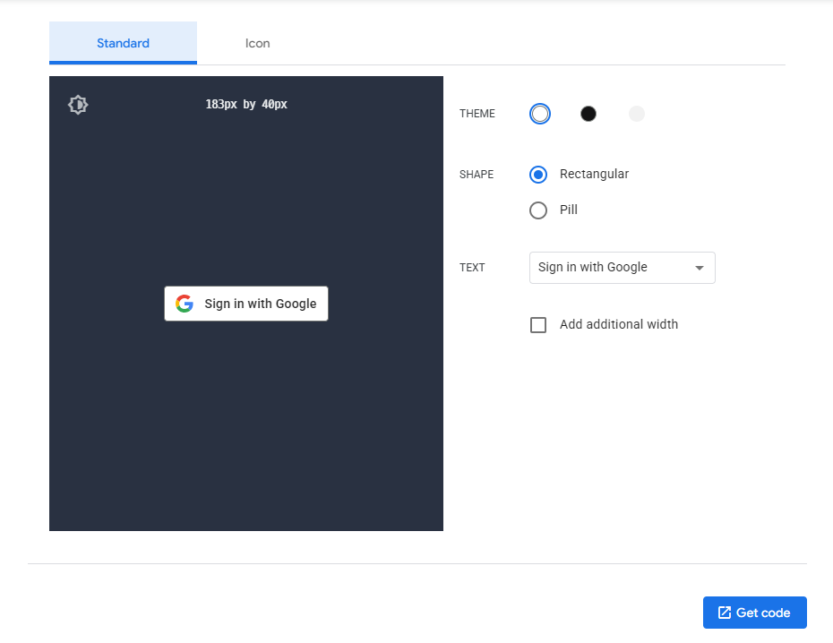

요 이미지 [Get code] 누르기

```html
<button class="gsi-material-button">
  <div class="gsi-material-button-state"></div>
  <div class="gsi-material-button-content-wrapper">
    <div class="gsi-material-button-icon">
      <svg version="1.1" xmlns="http://www.w3.org/2000/svg" viewBox="0 0 48 48" xmlns:xlink="http://www.w3.org/1999/xlink" style="display: block;">
        <path fill="#EA4335" d="M24 9.5c3.54 0 6.71 1.22 9.21 3.6l6.85-6.85C35.9 2.38 30.47 0 24 0 14.62 0 6.51 5.38 2.56 13.22l7.98 6.19C12.43 13.72 17.74 9.5 24 9.5z"></path>
        <path fill="#4285F4" d="M46.98 24.55c0-1.57-.15-3.09-.38-4.55H24v9.02h12.94c-.58 2.96-2.26 5.48-4.78 7.18l7.73 6c4.51-4.18 7.09-10.36 7.09-17.65z"></path>
        <path fill="#FBBC05" d="M10.53 28.59c-.48-1.45-.76-2.99-.76-4.59s.27-3.14.76-4.59l-7.98-6.19C.92 16.46 0 20.12 0 24c0 3.88.92 7.54 2.56 10.78l7.97-6.19z"></path>
        <path fill="#34A853" d="M24 48c6.48 0 11.93-2.13 15.89-5.81l-7.73-6c-2.15 1.45-4.92 2.3-8.16 2.3-6.26 0-11.57-4.22-13.47-9.91l-7.98 6.19C6.51 42.62 14.62 48 24 48z"></path>
        <path fill="none" d="M0 0h48v48H0z"></path>
      </svg>
    </div>
    <span class="gsi-material-button-contents">Sign in with Google</span>
    <span style="display: none;">Sign in with Google</span>
  </div>
</button>
```

3단계

templates 디렉터리에 `oauthLogin.html` 파일 생성 후

```html
<button class="gsi-material-button">
  <div class="gsi-material-button-state"></div>
  <div class="gsi-material-button-content-wrapper">
    <div class="gsi-material-button-icon">
      <svg version="1.1" xmlns="http://www.w3.org/2000/svg" viewBox="0 0 48 48" xmlns:xlink="http://www.w3.org/1999/xlink" style="display: block;">
        <path fill="#EA4335" d="M24 9.5c3.54 0 6.71 1.22 9.21 3.6l6.85-6.85C35.9 2.38 30.47 0 24 0 14.62 0 6.51 5.38 2.56 13.22l7.98 6.19C12.43 13.72 17.74 9.5 24 9.5z"></path>
        <path fill="#4285F4" d="M46.98 24.55c0-1.57-.15-3.09-.38-4.55H24v9.02h12.94c-.58 2.96-2.26 5.48-4.78 7.18l7.73 6c4.51-4.18 7.09-10.36 7.09-17.65z"></path>
        <path fill="#FBBC05" d="M10.53 28.59c-.48-1.45-.76-2.99-.76-4.59s.27-3.14.76-4.59l-7.98-6.19C.92 16.46 0 20.12 0 24c0 3.88.92 7.54 2.56 10.78l7.97-6.19z"></path>
        <path fill="#34A853" d="M24 48c6.48 0 11.93-2.13 15.89-5.81l-7.73-6c-2.15 1.45-4.92 2.3-8.16 2.3-6.26 0-11.57-4.22-13.47-9.91l-7.98 6.19C6.51 42.62 14.62 48 24 48z"></path>
        <path fill="none" d="M0 0h48v48H0z"></path>
      </svg>
    </div>
    <span class="gsi-material-button-contents">Sign in with Google</span>
    <span style="display: none;">Sign in with Google</span>
  </div>
</button>
```

이 코드 붙여넣기

4단계

HTML 이랑 연결할 JS 파일 만들기

/resource/static/js 디렉터리에 `token.js` 파일 만들기

```jsx
const token = searchParam('token')

if (token) {
  localStorage.setItem("access_token", token)
}

const searchParam = (key) => new URLSearchParams(window.location.search).get(key);
```

5단계

`articleList.html` 파일 수정

```html
<!DOCTYPE html>
<html lang="en" xmlns:th="http://www.thymeleaf.org">
<head>
  <meta charset="UTF-8">
  <meta name="viewport" content="width=device-width, initial-scale=1.0">
  <title>블로그 글 목록</title>
  <link rel="stylesheet" href="https://stackpath.bootstrapcdn.com/bootstrap/4.5.2/css/bootstrap.min.css">
  <!-- js 파일 추가 -->
  <script src="/js/articleList.js"></script>
  <script src="/js/token.js"></script>
```

6단계

`article.js` 파일 수정 (생성, 삭제, 수정 기능)

```jsx
// 생성 기능
const createButton = document.getElementById('create-btn');

if (createButton) {
  // 등록 버튼을 클릭하면 /api/articles 로 요청을 보냄
  createButton.addEventListener('click', event => {
    body = JSON.stringify({
      title: document.getElementById('title').value,
      imgUrl: document.getElementById('image-url').value,
      content: document.getElementById('content').value,
    })
    const success = () => {
      alert('등록 완료되었습니다.');
      location.replace('/articles');
    }
    const fail = () => {
      alert('등록 실패했습니다.');
      location.replace('/articles');
    }

    httpRequest('POST', '/api/articles', body, success, fail)
  });
}

// 쿠키를 가져오는 함수
const getCookey = (key) => {
  var result = null;
  var cookie = document.cookie.split(';');
  cookie.some((item) => {
    item = item.replace(' ', '');

    var dic = item.split('=');

    if (key === dic[0]) {
      result = dic[1];
      return true;
    }
  });
  return result;
}

// HTTP 요청을 보내는 함수
const httpRequest = (method, url, body, success, fail) => {
  fetch(url, {
    method: method,
    headers: {
      // 로컬 스토리지에서 액세스 토큰 값을 가져와 헤더에 추가
      Authorization: `Bearer ${localStorage.getItem('access_token')}`,
      'Content-Type': 'application/json',
    },
    body: body,
  }).then((response) => {
    if (response.status === 401 && refreshToken) {
      fetch("/api/token", {
        method: "POST",
        headers: {
          Authorization: `Bearer ${localStorage.getItem('access_token')}`,
          "Content-Type": "application/json"
        },
      })
      .then((res) => {
        if (res.ok) {
          return res.json();
        }
      })
      .then((result) => {
        // 재발급이 성공하면 로컬 스토리지 값을 새로운 액세스 토큰으로 교체
        localStorage.setItem("access_token", result.accessToken);
        httpRequest(method, url, body, success, fail);
      })
      .catch((error) => fail());
    } else {
      return fail();
    }
  })
};
```

```jsx
// 삭제 기능
const deleteButton = document.getElementById('delete-btn');

if (deleteButton) {
  deleteButton.addEventListener('click', event => {
    let id = document.getElementById('article-id').value;
    const success = () => {
      alert('삭제가 완료되었습니다.');
      location.replace('/articles');
    };

    const fail = () => {
      alert('삭제 실패했습니다.');
      location.replace('/articles');
    };

    httpRequest('DELETE', `/api/articles/${id}`, null, success, fail)
  });
}

// 수정 기능
const modifyButton = document.getElementById('modify-btn');

if(modifyButton) {
  modifyButton.addEventListener('click', event => {
    let params = new URLSearchParams(location.search);
    let id = params.get('id');

    const body = JSON.stringify({
      title: document.getElementById('title').value,
      imageUrl: document.getElementById('image-url').value,
      content: document.getElementById('content').value,
    });

    const success = () => {
      alert('수정 완료되었습니다.');
      location.replace(`/articles/${id}`);
    };

    const fail = () => {
      alert('수정 실패했습니다.');
      location.replace(`/articles/${id}`);
    };

    httpRequest('PUT', `/api/articles/${id}`, body, success, fail)
  });
}
```

탭 7

`article.js` 파일 수정 (로그아웃 기능)

```jsx
// 로그아웃 기능
const logoutButton = document.getElementById('logout-btn');

if (logoutButton) {
  logoutButton.addEventListener('click', event => {
    const success = () => {
      // 로컬 스토리지에 저장된 액세스 토큰 삭제
      localStorage.removeItem('access_token');

      // 쿠키에 저장된 리프레시 토큰 삭제
      deleteCookie('refresh_token');
      location.replace('/login');
    };

    const fail = () => {
      alert('로그아웃 실패했습니다.');
    };

    httpRequest('POST', '/api/logout', null, success, fail)
  });
}
```
		

### ◆ 글 수정, 삭제, 글쓴이 확인 로직 추가하기

- service 패키지의 `BlogService.java` 파일 수정

```java
    public void delete(long id) {
        Article article = blogRepository.findById(id)
                .orElseThrow(() -> new IllegalArgumentException("not found: " + id));

        authorizeArticleAuthor(article);
        blogRepository.delete(article);
    }

    @Transactional
    public Article update(long id, UpdateArticleRequest request) {
        Article article = blogRepository.findById(id)
                .orElseThrow(() -> new IllegalArgumentException("not found: " + id));

        authorizeArticleAuthor(article);
        article.update(request.getTitle(), request.getContent(), request.getImageUrl());
        
        return article;
    }
    
    // 게시글을 작성한 유저인지 확인
    private static void authorizeArticleAuthor(Article article) {
        String userName = SecurityContextHolder.getContext().getAuthentication().getName();
        if (!article.getAuthor().equals(userName)) {
            throw new IllegalArgumentException("not authorized");
        }
    }
}
```

## ✦ OAuth2 실행 테스트하기

탭 1

탭 2

탭 3
		

## ✦ 테스트 코드 실패 해결하고 코드 수정하기

---

- 자주 사용하는 특수 문자
    
    ∞ ⊂ ⊃ ∪ ∩ ∴ ∵ ⇒ ⇔ ⁿ ¹ ² ³ ⁴ · ↑ ↓ … × ₁ ₂ ₃ ₄ ∅
    ex) Example
