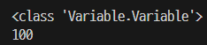
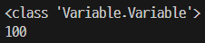

- 목표 : `Function` [[클래스]]를 구현해보자!

## ✦ 함수란

- [[함수]] : 어떤 [[변수]]로부터 다른 변수로의 대응 관계를 정한 것
    - $y = f(x) = x^2$
    
    ```mermaid
    graph LR
      x(($$x$$)) --> $$f$$--> y(($$y$$))
    ```
    
- [[계산 그래프]] (Computational graph) : 원 & 사각형 모양의 노드를 화살표로 연결해 계산 과정 표현
    - 변수 ○ / 함수 □ 로 표시
    - 방향이 있는 edge 이용 그래프

## ✦ Function 클래스 구현

- 앞서 구현한 `Variable` 인스턴스를 변수로 다룰 수 있는 함수를 `Function` 클래스로 구현하자!
- `Function` 클래스 특징
    - `Variable` 인스턴스 입력 → `Variable` 인스턴스 출력
    - `Variable` 인스턴스의 실제 데이터는 인스턴스 변수인 `data` 안에 존재
- [[Python]] → $y = x^2$ 함수 구현!
    
    ```python
    from Variable import Variable
    
    class Function:
        def __call__(self, input):
            x = input.data  # 데이터를 꺼낸다.
            y = x ** 2      # 실제 계산
            output = Variable(y)  # Variable 형태로 되돌린다.
    
            return output
    ```
    
    - 인수 : `input` 을 `Variable` 인스턴스라고 가정.
        - 실제 데이터는 `input.data` 에 존재!
    - 데이터를 꺼내 원하는 계산을 하고, 결과를 다시 `Variable` 상자에 담기.
    - `__call__` [[메소드]]
        - `f = Function()` 형태로 변수에 대입하고
        `f(...)` 형태로 메소드 호출 가능

## ✦ Function 클래스 이용

- 실제 이용해보자!

```python
x = Variable(np.array(10))
f = Function()
y = f(x)

print(type(y))  # 객체의 클래스 출력
print(y.data)
```



- 이런 식으로 `Variable` 과 `Function` 연결 가능!
- 근데 앞으로 여러 함수를 사용할 것,,
    - `Function` 클래스를 기반 클래스로 두고, 모든 함수가 공통적으로 제공하는 기능만 담기!
- 모든 DeZero 함수가 충족해야할 것
    - `Function` 클래스는 모든 함수에 공통되는 기능 구현
    - 구체적인 함수는 `Function` 클래스를 상속한 클래스에서 구현!
- 수정 ver. 코드
    
    ```python
    class Function:
        def __call__(self, input):
            x = input.data  # 데이터를 꺼낸다.
            y = self.forward(x) # 구체적인 계산은 forward 메소드에서 수행
            output = Variable(y) 
            return output
    
        def forward(self, x):
            raise NotImplementedError()  # 상속받은 클래스에서 구현하도록 강제
    ```
    
    - `__call__` : `Variable` 에서 데이서 찾기 + 계산 결과를 `Variable` 에서 포장하기
    - 구체적 계산은 `forward` 메소드 호출해 수행!
        - `forward` 메소드는 하위 클래스에서 구현
- `Function` 클래스를 상속할 클래스 `Square` 만들고 처리해보기!
    
    ```python
    class Square(Function):
        def forward(self, x):
            return x ** 2
    
    x = Variable(np.array(10))
    f = Square()
    y = f(x)
    print(type(y))
    print(y.data)
    ```
    
    
    

→ `Variable` & `Function` 클래스 기초 완성!

---

- 자주 사용하는 특수 문자
    
    ∞ ⊂ ⊃ ∪ ∩ ∴ ∵ ⇒ ⇔ ⁿ ¹ ² ³ ⁴ · ↑ ↓ … × ₁ ₂ ₃ ₄ ∅
    ex) Example
