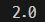
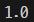

- `Variable` 클래스를 구현해보자!

## ✦ 변수란

- 일종의 상자 (box)
    - 변수와 데이터는 별개
    - 변수 안에는 데이터가 들어감 (대입 or 할등)
    - 변수를 참조하면 데이터를 알 수 있음

## ✦ Variable 클래스 구현

- DeZero 에서 사용하는 변수 → `Variable` 클래스로 구현

```python
class Variable:
    def __init__(self, data):
        self.data = data
```

- 일종의 상자 역할
    
    ```python
    import numpy as np
    
    data = np.array(1.0)
    x = Variable(data)
    print(x.data)
    ```
    
    
    
    - `x` → 데이터 자체 X, 데이터 담은 상자!
- 머신러닝 → 기본 데이터 구조가 다차원 배열
    - `Variable` 클래스 → 넘파이의 다차원 배열만 취급 (`ndarray` 인스턴스)
    
    ```python
    x.data = np.array(2.0)
    print(x.data)
    ```
    
    
    
    - 새로운 데이터 대입 가능!

## ✦ 넘파이의 다차원 배열

- 다차원 배열 : 숫자 등의 원소가 일정하게 모인 데이터 구조
    - 원소 순서의 방향 → 차원 (dimension) / 축 (axiz)
    - 0차원 배열 → 스칼라 (scalar)
    - 1차원 배열 → 벡터 (vector)
    - 2차원 배열 → 행렬 (matrix)
    - n차원 배열 → 텐서 (tensor)
- `ndim` : 다차원 배열의 차원 수

---

- 자주 사용하는 특수 문자
    
    ∞ ⊂ ⊃ ∪ ∩ ∴ ∵ ⇒ ⇔ ⁿ ¹ ² ³ ⁴ · ↑ ↓ … × ₁ ₂ ₃ ₄ ∅
    ex) Example
