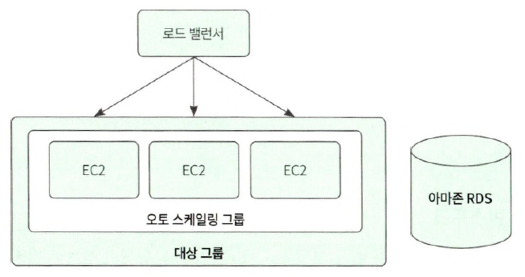
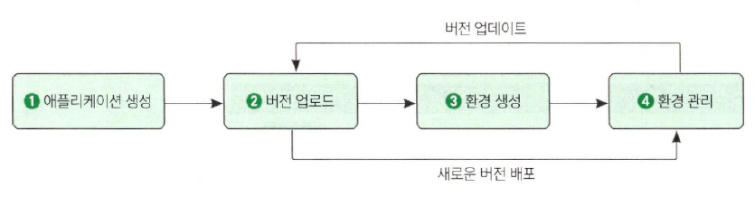
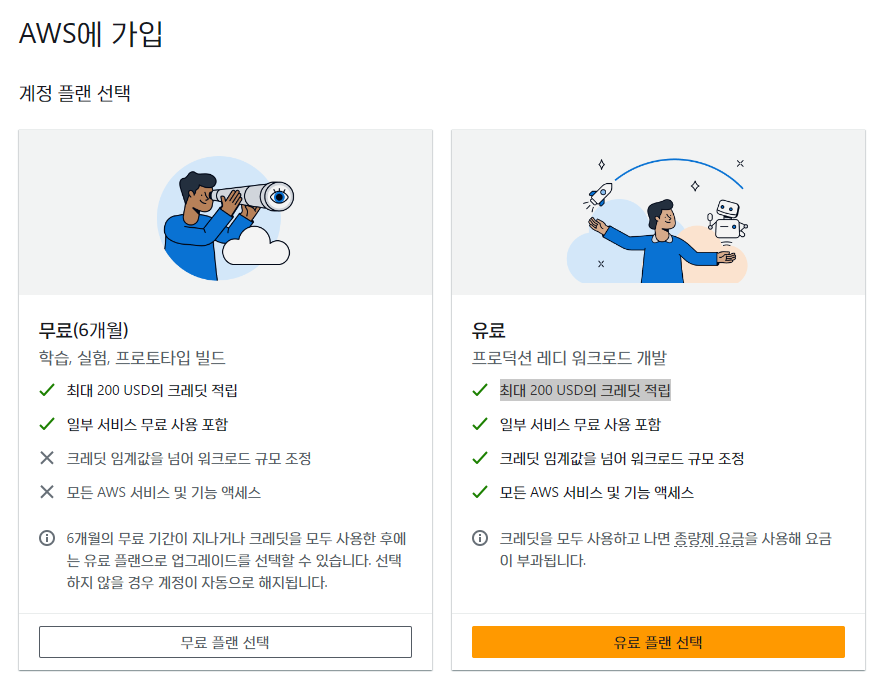
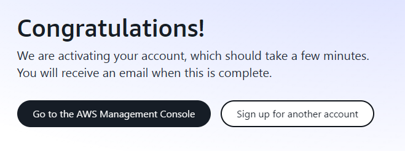

## ✦ AWS

### ◆ AWS란?

- 지금까지 로컬에서 스프링 부트 서버 실행. 
→ 로컬. 다른 곳에선 접속 불가능
- 배포 : 실제 서버에 스프링 부트 서버를 올려 실행!
    - 서버용 PC 를 구매
    - AWS 와 같은 클라우드 컴퓨팅 서비스 이용
- AWS : 컴퓨팅 서비스, 네트워크 서비스, DB 서비스, 스토리지 서비스 등 다양한 서비스 제공

### ◆ AWS 서비스로 우리의 서비스 배포하기

- 우리가 사용할 서비스
    
    
    
    - EC2 : AWS 에서 제공하는 원격 서버
    - 오토 스케일링 그룹 : 사용자 요청 따라 EC2 증가 / 감소
        - 로드 밸런서 : 요청 분산
        - 대상 그룹 : 요청 분산 대상 그룹
    - RDS : AWS 에서 제공하는 원격 DB

### ◆ 설정이 간편한 일래스틱 빈스토크

- 일레스틱 빈스토크 : 위에서 언급한 서비스를 한 번에 설정!
    - 일종의 밀키트
    - 서버 업로드용 코드 → 서버 올리기 & 로드 밸런싱, 오토 스케일링, 모니터링, 배포 등 처리 가능
    - 추가 요금 X, 필요한 AWS 리소스만 요금 지불
- 사용 과정
    
    
    
    1. 애플리케이션 생성
    2. 애플리케이션 소드를 번들 형태로 버전을 일래스톡 빈스토크에 업로드
    3. 일래스틱 빈스토크가 자동 환경 실행 & 코드 실행 필요한 AWS 리소스 생성 & 구성 
    4. 환경 실행 후 → 환경 관리 & 버전 업데이터 & 새 앱 버전 배포 가능

## ✦ AWS 계정 생성하기

1단계

https://signin.aws.amazon.com/signup?request_type=register

이 사이트에서 계정 생성!

- 1년 동안 프리티어 자격, 그 이후는 유료..

2단계

- 무료 플랜 선택!

탭 3

이것저것 입력하고 설정하면 완료!
		

## ✦ 일래스틱 빈스토크로 서버 구축하기

---

- 자주 사용하는 특수 문자
    
    ∞ ⊂ ⊃ ∪ ∩ ∴ ∵ ⇒ ⇔ ⁿ ¹ ² ³ ⁴ · ↑ ↓ … × ₁ ₂ ₃ ₄ ∅
    ex) Example
