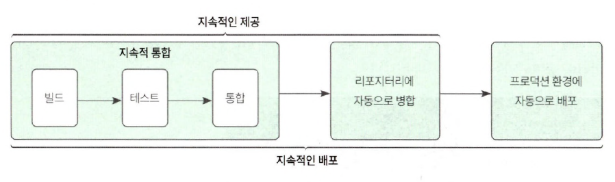

## ✦ CI/CD

- 서비스 배포 & 운용 중에 코드를 변경해야 한다면?
    - 코드 수정 → 테스트 → 빌드 → [[AWS]] 에서 새로 배포,,
- 프로젝트 규모가 커지면 이런 작업들이 힘듬!!
    
    → CI/CD : 빌드 ~ 배포까지의 과정 자동화 + 모니터링 
    

### ◆ 지속적 통합,  CI

- [[CI|지속적 통합]] CI (Continuous Integration)
    - 개발자를 위해 빌드 & [[테스트 자동화]]
    - 변경 사항 자동 테스트 → 애플리케이션에 문제 없다는 것 보장
    - 코드 정기적 빌드 & 테스트 → 동시 작업 충돌 방지 & 모니터링 가능
- 코드 변경 사항이 코드 저장소에 업로드되면 CI 시작! 문제 생기면 실패

### ◆ 지속적 제공 & 지속적 배포, CD

- 지속적 제공 CD (Continuous Delivery)
    - 애플리케이션에 적용한 코드의 빌드 & 테스트 성공적 
    → 깃허브에 자동 업로드
- [[CD|지속적 배포]] CD (Continuous Deployment)
    - 지속적 제공에서 Merge 한 코드를 AWS 같은 배포 환경으로 전송
    - 릴리즈 (Release)
    
    
    

## ✦ 깃허브 액션 사용하기

- 깃허브는 다들 써보셨으니 패스..
- 깃허브 액션 (Github Actions) : 레포에 특정 이벤트 발생하면 특정 작업 or 주기적으로 특정 작업 반복
    - ex) 백준 문제 풀면 자동으로 블로그에 올리기
    - ex) 30분 마다 노션 [[데이터베이스]] 검사해 새로운 글이 있으면 블로그에 올리기

### ◆ 깃허브 레포지터리 생성하고 코드 푸시하기

→ 이 부분은 다들 아시죠?

레포 만들고 주소 따서

```bash
git init
git remote add origin "주소"

git add .
git commit -m "project init"

git branch -M main
git push origin main
```

### ◆ 깃허브 액션 스크립트 작성하기, CI

1단계

프로젝트에 .github/workflows/ci.yml 파일 생성 

```yaml
# 1. 워크플로의 이름 지정
name: CI

# 2. 워크플로가 시작될 조건
on:
  push:
    branches: [ main ]

jobs:
  build:
    runs-on: ubuntu-latest # 3. 실행 환경 지정

    # 4. 실행 스텝 지정
    steps:
      - uses: actions/checkout@v6

      - uses: actions/setup-java@v5
        with:
          distribution: 'corretto'
          java-version: '25'
```

1. 워크플로 이름 지정
2. 워크플로 시작 트리거 조건 지정
3. 리눅스, 윈도우 같은 실행 환경 지정
4. 실행 스텝 그룹화.
    1. `uses` : 지정한 레포 확인하고 코드에 대한 작업 실행 가능
    2. `name` : 스텝 이름 지정
    3. `run` : 실행할 명령어 입력

2단계

푸시 전 민감한 값 바꾸기!

`client-id`, `client-secert`, `secret_key` 같은 값을 임의 값으로 바꾸기!

3단계

깃에 커밋 & 푸시해 CI 실행되는 것 확인

```bash
git add .
git commit -m "CI 추가"
git push origin main
```
		

### ◆ 깃허브 액션 스크립트 작성하기, CD

1단계

아까 만든 `ci.yml` 를 `cicd.yml` 로 바꾸고 코드 변경

```yaml
name: CI/CD # 1. 깃허브 액션 이름 변경

on:
  push:

jobs:
  build:
    runs-on: ubuntu-latest

    steps:
      - uses: actions/checkout@v6

      - uses: actions/setup-java@v5
        with:
          distribution: 'corretto'
          java-version: '25'
      
      - name: Grant execute permission for gradlew
        run: chmod +x gradlew
      
      # 현재 시간 가져오기
      - name: Get current time
        uses: josStorer/get-current-time@v2.0.2
        id: current-time
        with:
          format: 'YYYY-MM-DDTHH-mm-ss'
          utcOffset: '+09:00'

      # 배포용 패키지 경로 저장
      - name: Set artifact
        run: echo "artifact=$(ls ./build/libs)" >> $GITHUB_ENV

      # 빈스토크 배포
      - name: Beanstalk Deploy
        uses: einaregilsson/beanstalk-deploy@v20
        with:
          aws_access_key: ${{ secrets.AWS_ACCESS_KEY_ID }}
          aws_secret_key: ${{ secrets.AWS_SECRET_ACCESS_KEY }}
          application_name: springboot-developer
          environment_name: Springboot-developer-env
          version_label: github-actions-${{ steps.current-time.outputs.formattedTime }}
          region: 'ap-northeast-2'
          deployment_package: ./build/libs/${{ env.artifact }}
```

2단계

AWS 접속해서 [[IAM]] 서비스 > 사용자 > 사용자 생성 > github-action 추가

권한 설정 > 직접 정책 연결 > AdministratorAccess-AWSElasticBeanstalk

보안 자격 증명 > 액세스 키 만들기 > 서드 파티 서비스 > 설명 태그 값 : github-action 으로 만들기

액세스 키는 한 번만 확인 가능! 

[.csv 파일 다운로드] 눌러 보관

3단계

깃 레포에서 Settings > Secrets and variables > Action > New repository secrets 에 새로운 비밀 키 각각 등록 (AWS_ACESS_KEY_ID, AWS_SECRET_ACCESS_KEY)
		

---

- 자주 사용하는 특수 문자
    
    ∞ ⊂ ⊃ ∪ ∩ ∴ ∵ ⇒ ⇔ ⁿ ¹ ² ³ ⁴ · ↑ ↓ … × ₁ ₂ ₃ ₄ ∅
    ex) Example
