## ✦ RNN 의 문제점

- [[순환 신경망|RNN]] → 시계열 데이터의 장기 의존 관계 학습 难
→ [[BPTT]] 에서 [[기울기]] 소실 or 기울기 폭발 발생!
- 차근차근 설명,,

### ◆ RNN 복습

- [[RNN 계층]] → 순환 경로 존재
    
    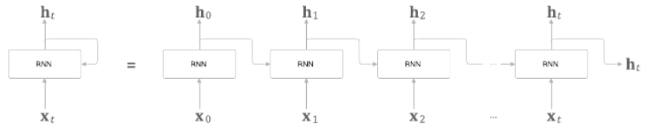
    
    ← 펼치기 전                /      → 펼친 후
    
    - 입력 : 시계열 데이터 $\mathbf{x}_t$
    - 출력 : RNN 계층 [[은닉 상태]] $\mathbf{h}_t$
        - 과거 정보 저장
        - 다음 입력에 사용
- [[계산 그래프]]
    
    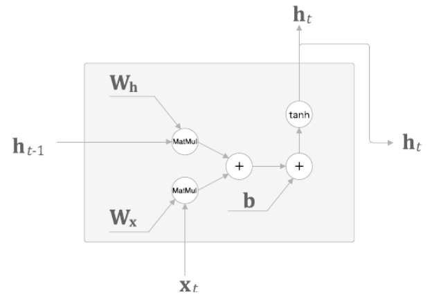
    
    - 행렬 곱 → 합 → [[활성화 함수]] tanh

### ◆ 기울기 소실 또는 기울기 폭발

- [[언어 모델]] : 주어진 단어 기초로 다음 출현할 단어 예측
- ex) Tom was watching TV in his room. Mary came into the room. Mary said hi to ___ .
    - ___ 에는 Tom 이 들어가야 함. 그러기 위해선 앞쪽 두 문장의 정보를 모두 기억해야 함.
    - 학습 → BPTT 로 수행.
        - 정답이 Tom 이라고 주어진 시점으로부터 과거 방향으로 기울기 전달
        
        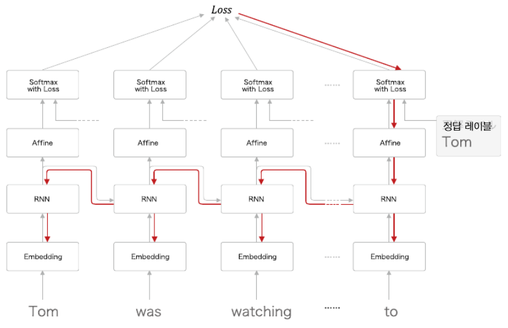
        
    - RNN 계층에서 기울기를 전달.. 그런데 이 전달이 제대로 이뤄지지 않음!
        - 지금 이 계층에서는 기울기 소실 or 기울기 폭발..

### ◆ 기울기 소실과 기울기 폭발의 원인

- 왜 전달이 제대로 이뤄지지 않을까??
- RNN 계층에서의 시간 방향 기울기 전파
    
    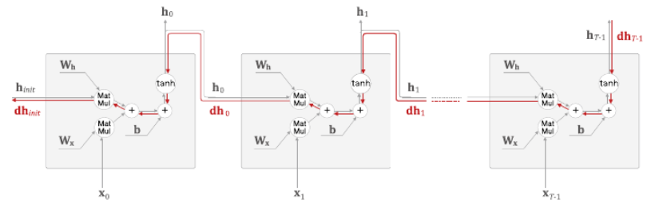
    
    - [[역전파]]로 전해지는 기울기 : $\tanh$ → + → MatMul 연산 통과. 기울기를 어떻게 변형시키는가?
        - + 는 그대로 흘려보냄..
        - $\tanh$
            - $y = \tanh(x)$ 미분 → $\frac{\partial y}{\partial x} = 1 - y^2$
            
            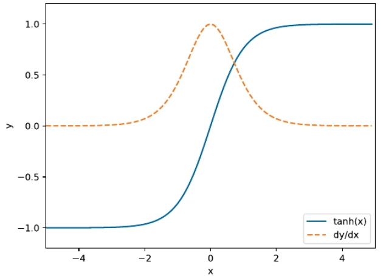
            
            원본 / 미분 그래프
            
            → 역전파에서는 기울기가 $\tanh$ 노드를 지날 때마다 작아짐!!
            
            - 개선 방안?
                - 원래 RNN 에서 활성화 [[함수]]로 $\tanh$ 사용..
                - 근데 [[ReLU 함수|ReLU]] 로 바꾸면 기울기 소실 줄일 수 있음! $\max(0, x)$
        - MatMul
            
            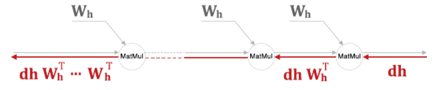
            
            - 상류로부터 $\mathbf{dh}$ 가 흘러온다고 가정하면, $\mathbf{dhW_h}^T$ 라는 행렬 곱으로 기울기 계산!
            - 매번 똑같은 가중치인 $\mathbf{W_h}$ 사용
            - 실제로 코드를 통해 봐보자!
                
                ```python
                import numpy as np
                import matplotlib.pyplot as plt
                
                N = 2   # 미니배치 크기
                H = 3   # 은닉 상태 벡터의 차원 수
                T = 20  # 시계열 데이터의 길이
                
                dh = np.ones((N, H))  # 1 배열로 초기화
                np.random.seed(3)  # 재현 가능하도록 난수의 시드 고정
                Wh = np.random.randn(H, H)  # 은닉 상태 가중치
                
                norm_list = [] # 각 단계에서 dh L2 Norm 계산해서 추가
                for t in range(T):
                    dh = np.matmul(dh, Wh.T)
                    norm = np.sqrt(np.sum(dh**2)) / N
                    norm_list.append(norm)
                ```
                
                - L2 Norm
                    
                    $$
                    \| \mathbf{W} \|_2 = \sqrt{w_1^2 + w_2^2 + \cdots + w_n^2} = \sqrt{\sum_{i=1}^{n} w_i^2}
                    $$
                    
                - 그래프로 그리면?
                    
                    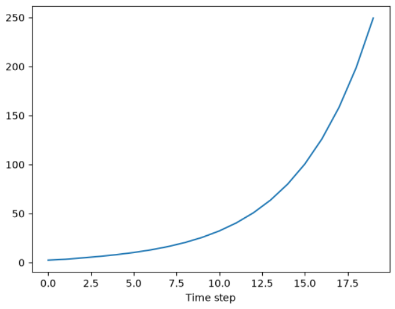
                    
                    기울기가 지수적으로 증가한다!!
                    
                    - 기울기 폭발 (exploding gradients) 발생!
            - 초깃값을 바꾸면?
                
                ```python
                dh = np.ones((N, H))  
                np.random.seed(3)  # 재현 가능하도록 난수의 시드 고정
                Wh = np.random.randn(H, H) * 0.5  # 은닉 상태 가중치
                ```
                
                - 그래프로 그리면?
                    
                    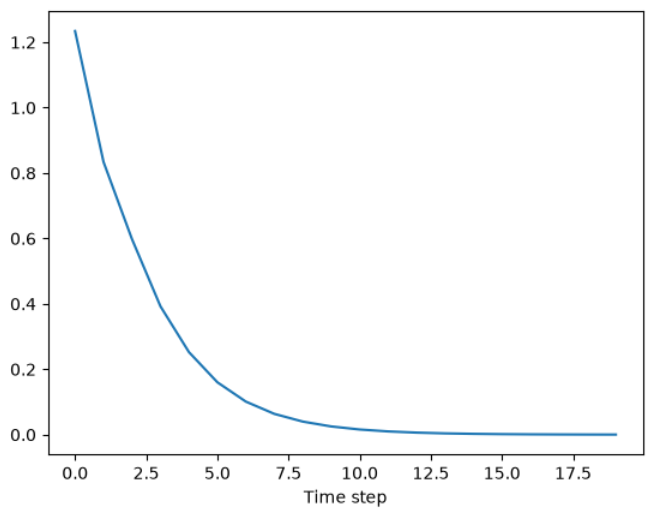
                    
                    반대로 기울기가 지수적으로 감소한다!!
                    
                    - 기울기 소실 (vanishing gradients) 발생
        - 행렬 $\mathbf{Wh}$ 를 반복해서 곱해서 나타남
            - 스칼라면 1 기준 / 행렬이면 eigenvalue 1 기준으로 지수적으로 커지거나 작아짐!!

### ◆ 기울기 폭발 대책

- 기울기 폭발 해결책 → 기울기 클리핑 (gradients clipping)
    
    $$
    \begin{align}&\text{if } \| \hat{\mathbf{g}} \| \geq \textit{threshold}: \\&\qquad \hat{\mathbf{g}} = \frac{\textit{threshold}}{\| \hat{\mathbf{g}} \|} \hat{\mathbf{g}}\end{align}
    $$
    
    - $\hat{\mathbf{g}}$ : [[신경망]]에서 사용되는 모든 매개변수에 대한 기울기(의 합)
    - $thershold$ : 문턱값
    - $\hat{\mathbf{g}}$ 의 L2 Norm 이 문턱값을 초과하면 (2) 번 식과 같이 기울기 수정!
- 단순해 보이지만 잘 작동한다~
- [[Python]]
    
    ```python
    import numpy as np
    
    dW1 = np.random.randn(3, 3) * 10
    dW2 = np.random.randn(3, 3) * 10
    grads = [dW1, dW2]
    max_norm = 5.0
    
    def clip_grads(grads, max_norm):
        total_norm = 0
        for grad in grads:
            total_norm += np.sum(grad ** 2)
        total_norm = np.sqrt(total_norm)
    
        rate = max_norm / (total_norm + 1e-6)
        if rate < 1:
            for grad in grads:
                grad *= rate
    ```
    

## ✦ 기울기 소실과 LSTM

- 기울기 소실 해결하려면 RNN 계층을 근본부터 고쳐야 함..
→ 게이트가 추가된 RNN!
    - LSTM → 이거 위주로 살펴볼 것!
    - GRU

### ◆ LSTM의 인터페이스

- 계산 그래프를 단순화 해보자~~
    
    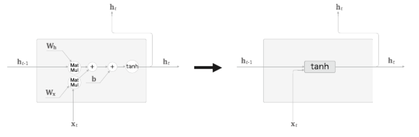
    
    - 행렬 곱 & 합은 생략,, tanh 안에 다 포함!
- RNN vs. LSTM
    
    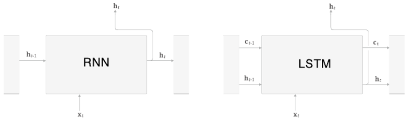
    
    - 둘의 차이점 → $\mathbf{c}$ 라는 경로!
    - $\mathbf{c}$ : (기억) 셀 (memory cell)
        - LSTM 전용 기억 메커니즘
        - 데이터를 LSTM 계층 내에서만 주고 받음. 다른 계층으로 출력 X
        - 은닉 상태 $\mathbf{h}$ → 위쪽으로 출력 O

### ◆ LSTM 계층 조립하기

- 기억 셀 $\mathbf{c}_t$ : ~ t 까지의 LSTM 기억이 저장되어 있음
    - 이 기억을 바탕으로 외부 & 다음 LSTM 에 은닉 상태 $\mathbf{h}_t$ 출력
        
        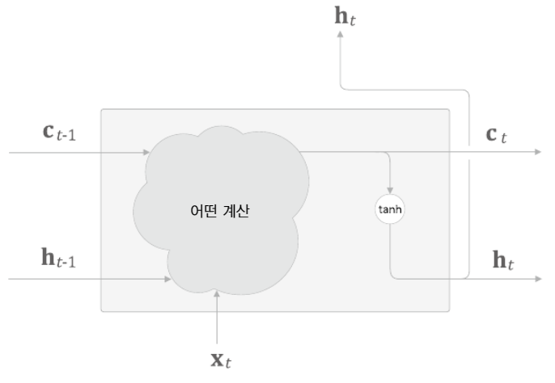
        
    - 출력하는 $\mathbf{h}_t$ 는 기억 셀의 값을 $\tanh$ 함수로 변환한 값!
- 현재의 기억 셀 $\mathbf{c}_t$ = ($\mathbf{c}_{t-1}, \mathbf{h}_{t-1}, \mathbf{x}_t)$ 로부터 <u>어떤 계산</u> 수행해 구함!
    - 이렇게 생성된 $\mathbf{c}_t$ 로 은닉 상태 $\mathbf{h}_t$ 계산!

### ◆ output 게이트

- 게이트 (gate) : 데이터의 으름 제어
    - 열기 / 닫기 / 어느 정도 열지 설정 가능
        
        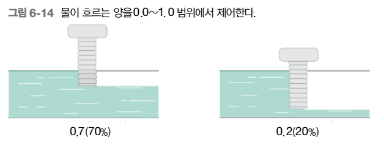
        
    - 얼마나 열지는 데이터로부터 자동으로 학습!
    - 시그모이드 (Sigmoid) 함수 사용
- $\mathbf{h}_t$ = $\tanh (\mathbf{c}_t)$
    - $\mathbf{c}_t$ 원소가 다음 시각의 은닉 상태에 얼마나 중요한가?
    - output 게이트 : 다음 은닉 상태의 출력을 담당!
- 몇 % 만 흘려보낼까? → 입력 $\mathbf{x}_t$ & 이전 상태 $\mathbf{h}_{t-1}$ 로부터 구함!
    - $\sigma()$ → [[시그모이드 함수]]
    
    $$
    \mathbf{o} = \sigma(\mathbf{x}_t \mathbf{W_t^{(0)}} + \mathbf{h}_{t-1} \mathbf{W_h^{(0)} + \mathbf{b^{(0)}}})
    $$
    
    - 입력이랑 은닉 상태에 [[가중치]] $\mathbf{W}$ 붙어있음
    - 결국 가중치 곱하고 [[편향]] 더한 값을 시그모이드 함수에 넣은 것!
    
    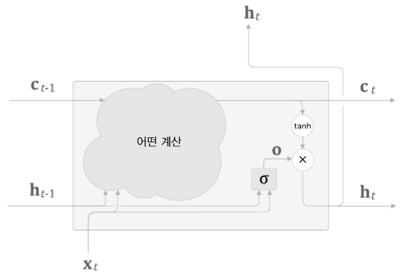
    
    위 계산을 $\sigma$ 로 표시~~
    
    - $\mathbf{h}_t$ 는 $\mathbf{o}$ 와 $\tanh()$ 의 원소별 곱!
        
        $$
        \mathbf{h}_t = \mathbf{o} \odot \tanh(\mathbf{c}_t)
        $$
        
        - $\odot$ : 원소별 곱. 아다마르곱 (Hadamard product)
- 함수별 출력
    - Sigmoid : 0.0 ~ 1.0 → 데이터를 얼마나 통과?
    - tanh : -1.0 ~ 1.0 → 정보가 얼마나 중요?

### ◆ forget 게이트

- 기억 셀이 무엇을 잊을지 지시하는 게이트
    - $\mathbf{c}_{t-1}$ 의 기억 중에서 불필요한 기억을 잊게함
        
        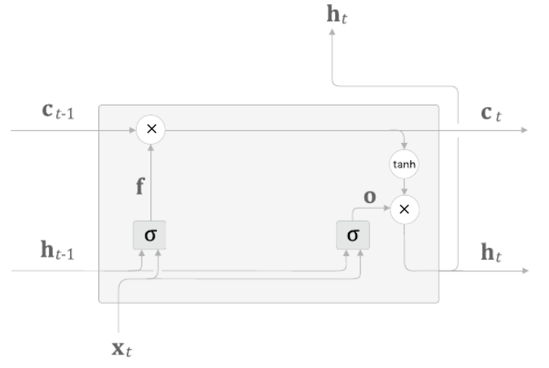
        
        $$
        \mathbf{f} = \sigma(\mathbf{x}_t \mathbf{W}_x^{(f)} + \mathbf{h}_{t-1} \mathbf{W}_h^{(f)} + \mathbf{b}^{(f)})
        $$
        
    - 이렇게 나온 $\mathbf{f}$ 랑 이전 기억 셀인 $\mathbf{c}_{t-1}$ 이랑 원소 곱해서 $\mathbf{c}_t$ 구하기!
        
        $$
        \mathbf{c}_t = \mathbf{f} \odot \mathbf{c}_{t-1}
        $$
        

### ◆ 새로운 기억 셀

- forget 게이트는 잊는 거 밖에 못함! 새로 기억해야 할 정보를 기억 셀에 추가해야 함~~
- tanh 노드 추가하기!
    
    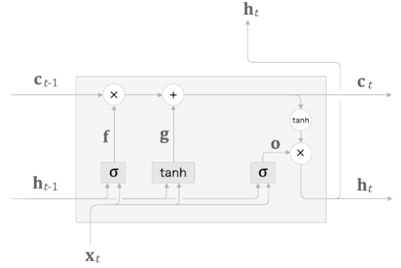
    
    - 이 tanh 노드는 게이트 X
    - 새로운 정보를 기억 셀에 추가 목적!
    
    $$
    \mathbf{g} = \tanh(\mathbf{x}_t \mathbf{W}_x^{(g)} + \mathbf{h}_{t-1} \mathbf{W}_h^{(g)} + \mathbf{b}^{(g)})
    $$
    
    - 새로운 기억 = $\mathbf{g} + \mathbf{c}_{t-1}$

### ◆ input 게이트

- $\mathbf{g}$ 의 각 원소가 새로 추가되는 정보로써 얼마나 중요?
    - 새 정보를 적절히 선택하기!
    - 가중된 정보 추가시키기!
    
    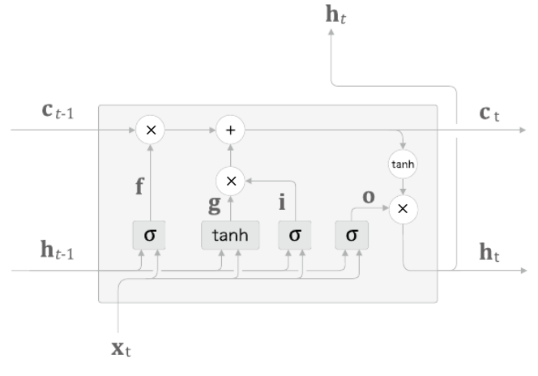
    
    $$
    \mathbf{i} = \sigma(\mathbf{x}_t \mathbf{W}_x^{(i)} + \mathbf{h}_{t-1} \mathbf{W}_h^{(i)} + \mathbf{b}^{(i)})
    $$
    
    - 결과적으로 $\mathbf{i} \times \mathbf{g}$ 의 원소별 곱 결과를 기억 셀에 추가!

### ◆ LSTM의 기울기 흐름

- 이게 어떤 원리로 기울기 소실을 없앰?
    
    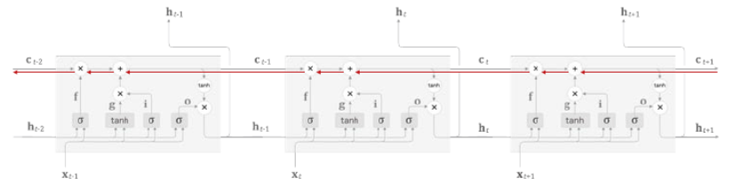
    
    - 기억 셀 $\mathbf{c}$ 의 역전파를 보자!
        - +, × 노드만 지남
            - + 는 그대로 지나가므로 기울기 변화 X
            - × 는 행렬 곱 X, 아마다르 곱 O → 곱셈의 효과가 누적되지 않아 기울기 소실 거의 X
        - × 노드 계산은 forget 게이트가 제어!
            - 잊어야 한다.. → 기울기 작아짐
            - 잊으면 안된다! → 기울기 그대로

## ✦ LSTM 구현

### ◆ LSTM 구현

- 지금까지 수식 정리!
    
    $$
    \begin{align}\mathbf{f} &= \sigma(\mathbf{x}_t \mathbf{W}_x^{(f)} + \mathbf{h}_{t-1} \mathbf{W}_h^{(f)} + \mathbf{b}^{(f)}) \\\mathbf{g} &= \tanh(\mathbf{x}_t \mathbf{W}_x^{(g)} + \mathbf{h}_{t-1} \mathbf{W}_h^{(g)} + \mathbf{b}^{(g)}) \\\mathbf{i} &= \sigma(\mathbf{x}_t \mathbf{W}_x^{(i)} + \mathbf{h}_{t-1} \mathbf{W}_h^{(i)} + \mathbf{b}^{(i)}) \\\mathbf{o} &= \sigma(\mathbf{x}_t \mathbf{W}_x^{(o)} + \mathbf{h}_{t-1} \mathbf{W}_h^{(o)} + \mathbf{b}^{(o)}) \\[10pt]\mathbf{c}_t &= \mathbf{f} \odot \mathbf{c}_{t-1} + \mathbf{g} \odot \mathbf{i} \\[10pt]\mathbf{h}_t &= \mathbf{o} \odot \tanh(\mathbf{c}_t)\end{align}
    $$
    
    - 최초의 한 단계 처리하는 LSTM → T 단계 한 번에 처리하는 Time LSTM [[클래스]] 구현!
    - 가중치를 곱하고 편향을 거하기 → 아핀 변환 (Affine transformation) 
    → 하나의 식으로 정리해 계산 가능!
    
    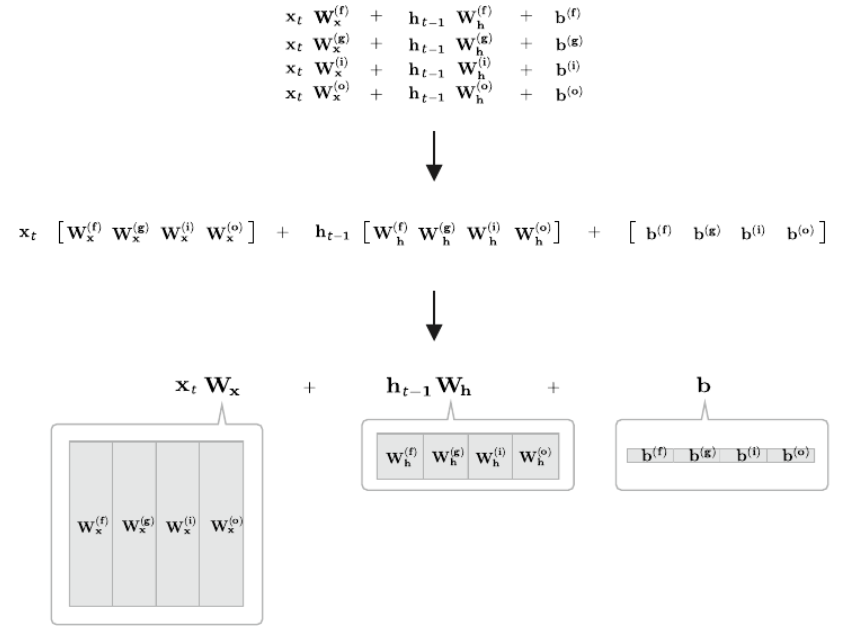
    
    - 한 번에 정리하면 계산 속도 ↑, 소스 코드 간결!
    
    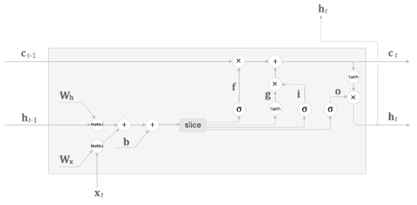
    
    계산 그래프로 나타내기
    
    - slice : 아핀 변환의 결과(행렬)를 균등하게 4등분 함.

#### LSTM 초기화

```python
class LSTM:
    def __init__(self, Wx, Wh, b):
        self.params = [Wx, Wh, b]
        self.grads = [np.zeros_like(Wx), np.zeros_like(Wh), np.zeros_like(b)]
        self.cache = None
```

- 인수 : 가중치 매개변수 (`Wx`, `Wh`) & 편향 (`b`) → `params` 에 할당
- 인수 형태로 기울기 (`grads`) 초기화
- `cache` : [[순전파]] 때 중간 결과 보관 → 역전파 계산에 사용

#### LSTM 순전파

```python
    def forward(self, x, h_prev, c_prev):
        Wx, Wh, b = self.params
        N, H = h_prev.shape

        A = np.dot(x, Wx) + np.dot(h_prev, Wh) + b

        # slice
        f = A[:, :H]
        g = A[:, H:2*H]
        i = A[:, 2*H:3*H]
        o = A[:, 3*H:]

        f = sigmoid(f)
        g = np.tanh(g)
        i = sigmoid(i)
        o = sigmoid(o)

        c_next = f * c_prev + g * i
        h_next = o * np.tanh(c_next)

        self.cache = (x, h_prev, c_prev, i, f, g, o, c_next)
        return h_next, c_next
```

- 인수 : 입력 `x`, 이전 시각 은닉 상태 `h_prev`, 이전 시각 기억 셀 `c_prev`
- 먼저 아핀 변환!
    
    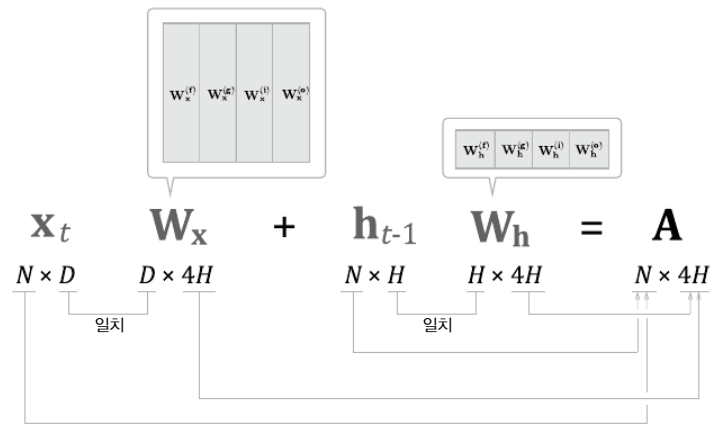
    
    아핀 변환 시 형상 (편향 생략)
    
    - $N$ : [[미니배치 학습|미니배치]] 수 / $D$ : 입력 데이터 ($x$) 차원 수 / $H$ : 기억 셀 ($c$) & 은닉 상태 ($h$) 차원 수
- 데이터 꺼낼 때 `slice` 이용해 꺼내기 → 연산 노드에 분배하기

#### LSTM 역전파

- 코드
    
    ```python
        def backward(self, dh_next, dc_next):
            Wx, Wh, b = self.params
            x, h_prev, c_prev, i, f, g, o, c_next = self.cache
    
            tanh_c_next = np.tanh(c_next)
    
            ds = dc_next + (dh_next * o) * (1 - tanh_c_next ** 2)
    
            dc_prev = ds * f
    
            di = ds * g
            df = ds * c_prev
            do = dh_next * tanh_c_next
            dg = ds * i
    
            di *= i * (1 - i)
            df *= f * (1 - f)
            do *= o * (1 - o)
            dg *= (1 - g ** 2)
    
            dA = np.hstack((df, dg, di, do))
    
            dWh = np.dot(h_prev.T, dA)
            dWx = np.dot(x.T, dA)
            db = dA.sum(axis=0)
    
            self.grads[0][...] = dWx
            self.grads[1][...] = dWh
            self.grads[2][...] = db
    
            dx = np.dot(dA, Wx.T)
            dh_prev = np.dot(dA, Wh.T)
    
            return dx, dh_prev, dc_prev
    ```
    
- slice 노드
    
    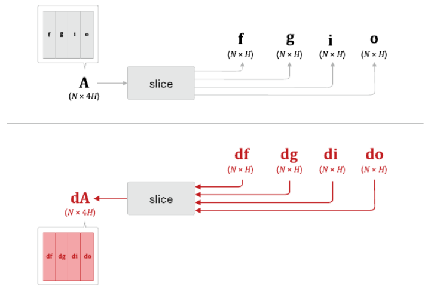
    
    - 순전파에선 4개 행렬로 나누기!
    - 역전파에선 4 행렬을 하나로 합치기!
        
        ```python
                di *= i * (1 - i)
                df *= f * (1 - f)
                do *= o * (1 - o)
                dg *= (1 - g ** 2)
        
                dA = np.hstack((df, dg, di, do)) # 주어진 배열을 가로로 연결
        ```
        

### ◆ Time LSTM 구현

- T개분의 시계열 데이터 한 번에 처리하는 계층!
    - 전체 그림 : T개의 LSTM 계층으로 구성
    
    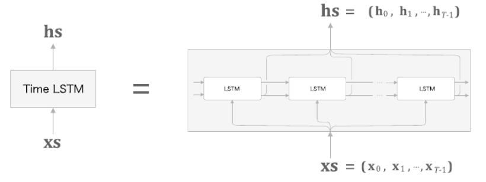
    
- RNN 에선 학습 시 [[Truncated BPTT]] 수행!
    - 순전파는 쭉 이어서! 역전파는 적당히 끊기.
    → 은닉 상태 & 기억 셀을 인스턴스 [[변수]]로 유지!
    
    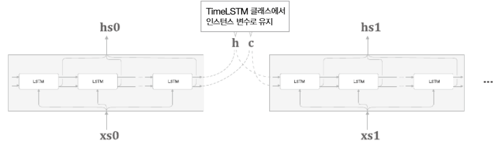
    
- Python : [[Time RNN 계층|TimeRNN]] 클래스와 흡사!
    - `stateful` 로 상태 유지할지 지정
    
    ```python
    class TimeLSTM:
        def __init__(self, Wx, Wh, b, stateful=False):
            self.params = [Wx, Wh, b]
            self.grads = [np.zeros_like(Wx), np.zeros_like(Wh), np.zeros_like(b)]
            self.layers = None
    
            self.h, self.c = None, None
            self.dh = None
            self.stateful = stateful
    
        def forward(self, xs):
            Wx, Wh, b = self.params
            N, T, D = xs.shape
            H = Wh.shape[0]
    
            self.layers = []
            hs = np.empty((N, T, H), dtype='f')
    
            if not self.stateful or self.h is None:
                self.h = np.zeros((N, H), dtype='f')
            if not self.stateful or self.c is None:
                self.c = np.zeros((N, H), dtype='f')
    
            for t in range(T):
                layer = LSTM(*self.params)
                self.h, self.c = layer.forward(xs[:, t, :], self.h, self.c)
                hs[:, t, :] = self.h
    
                self.layers.append(layer)
    
            return hs
    
        def backward(self, dhs):
            Wx, Wh, b = self.params
            N, T, H = dhs.shape
            D = Wx.shape[0]
    
            dxs = np.empty((N, T, D), dtype='f')
            dh, dc = 0, 0
    
            grads = [0, 0, 0]
            for t in reversed(range(T)):
                layer = self.layers[t]
                dx, dh, dc = layer.backward(dhs[:, t, :] + dh, dc)
                dxs[:, t, :] = dx
                for i, grad in enumerate(layer.grads):
                    grads[i] += grad
    
            for i, grad in enumerate(grads):
                self.grads[i][...] = grad
            self.dh = dh
            return dxs
    
        def set_state(self, h, c=None):
            self.h, self.c = h, c
    
        def reset_state(self):
            self.h, self.c = None, None
    ```
    

## ✦ LSTM을 사용한 언어 모델

- 앞 장에서 Time RNN → Time LSTM 으로 바꾸기!
    
    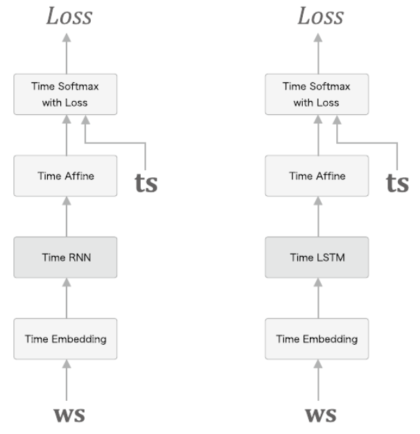
    

### ◆ RNNLM 클래스 구현하기

- LSTM 계층을 사용하는 Rnnlm 클래스

```python
import sys
sys.path.append('..')
from common.time_layers import *
import pickle

class Rnnlm:
    def __init__(self, vocab_size=10000, wordvec_size=100, hidden_size=100):
        V, D, H = vocab_size, wordvec_size, hidden_size
        rn = np.random.randn

        # 가중치 초기화
        embed_W = (rn(V, D) / 100).astype('f')
        lstm_Wx = (rn(D, 4 * H) / np.sqrt(D)).astype('f')
        lstm_Wh = (rn(H, 4 * H) / np.sqrt(H)).astype('f')
        lstm_b = np.zeros(4 * H).astype('f')
        affine_W = (rn(H, V) / np.sqrt(H)).astype('f')
        affine_b = np.zeros(V).astype('f')

        # 계층 생성
        self.layers = [
            TimeEmbedding(embed_W),
            TimeLSTM(lstm_Wx, lstm_Wh, lstm_b, stateful=True),
            TimeAffine(affine_W, affine_b)
        ]
        self.loss_layer = TimeSoftmaxWithLoss()
        self.rnn_layers = self.layers[1]

        # 모든 가중치와 기울기를 리스트에 모은다.
        self.params, self.grads = [], []
        for layer in self.layers:
            self.params += layer.params
            self.grads += layer.grads

    def predict(self, xs):
        for layer in self.layers:
            xs = layer.forward(xs)
        return xs

    def forward(self, xs, ts):
        score = self.predict(xs)
        loss = self.loss_layer.forward(score, ts)
        return loss

    def backward(self, dout=1):
        dout = self.loss_layer.backward(dout)
        for layer in reversed(self.layers):
            dout = layer.backward(dout)
        return dout

    def reset_state(self):
        self.rnn_layers.reset_state()

    def save_params(self, file_name="Rnnlm.pkl"):
        with open(file_name, 'wb') as f:
            pickle.dump(self.params, f)

    def load_params(self, file_name="Rnnlm.pkl"):
        with open(file_name, 'rb') as f:
            self.params = pickle.load(f)
```

- `predict()` : Softmax 계층 직전까지 처리 → 7장에서 사용
- `load_params()` : 매개변수 읽기
- `save_params()` : 매개변수 쓰기

### ◆ RNNLM 클래스 학습하기

- 전 장과는 달리 [[PTB 데이터셋]] 전체 이용!

---

- 자주 사용하는 특수 문자
    
    ∞ ⊂ ⊃ ∪ ∩ ∴ ∵ ⇒ ⇔ ⁿ ¹ ² ³ ⁴ · ↑ ↓ … × ₁ ₂ ₃ ₄ ∅
    ex) Example
