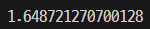

- 목표 : 여러 함수를 구현하고 조합해 계산하도록 해보자!

## ✦ Exp 함수 구현

- $y = e^x$ 함수 구현
    - $e$ : 자연로그의 밑 (base of the natural logarithm), 오일러의 수 (Euler’s number)
    2.718 ….
- Python
    
    ```python
    class Exp(Function):
        def forward(self, x):
            return np.exp(x)
    ```
    
    - `Function` 클래스 상속 & `forward` 에서 원하는 계산 구현!
    - 메소드 내용이 $e^x$ 식을 의미!

## ✦ 함수 연결

- 실제로 사용해보기!
    - 함수들을 연이어 사용할 수 있음!
    - $y = (e^{{x}^2})^2$
    
    ```python
    A = Square()
    B = Exp()
    C = Square()
    
    x = Variable(np.array(0.5))
    a = A(x)
    b = B(a)
    y = C(b)
    print(y.data)
    ```
    
    
    
    결과!
    
    - 세 함수를 연이어 적용 했음!
    
    ```mermaid
    graph LR
      x((x)) --> A --> a((a)) --> B --> b((b)) --> C --> y((y))
    ```
    
    - 왜 계산 그래프로 표현할까? 
    → 각 변수에 대한 미분을 효율적으로 계산 가능!
    - 변수 별 미분 계산 → 역전파

→ 다음 단계부터는 역전파 구현하도록 확장해보자!

---

- 자주 사용하는 특수 문자
    
    ∞ ⊂ ⊃ ∪ ∩ ∴ ∵ ⇒ ⇔ ⁿ ¹ ² ³ ⁴ · ↑ ↓ … × ₁ ₂ ₃ ₄ ∅
    ex) Example
