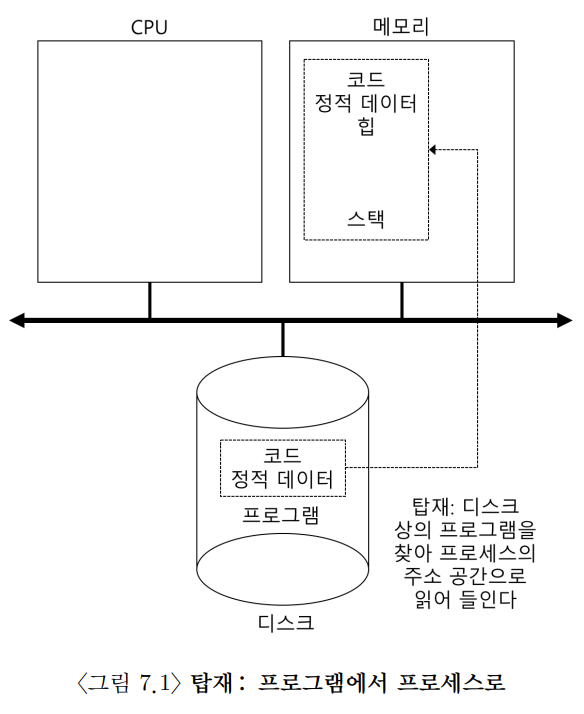
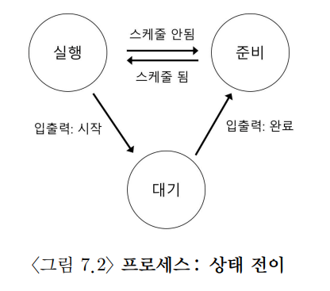
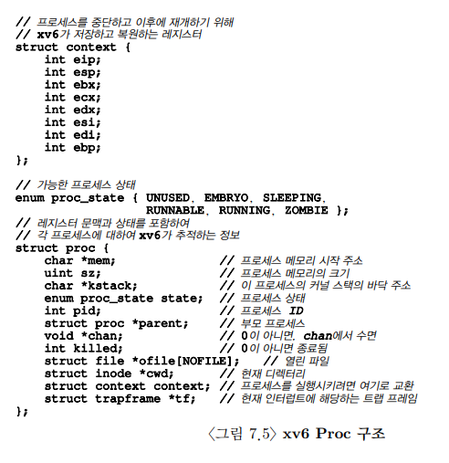

## ✦ 프로세스의 개념

- 프로세스 (process) 가 먼데?
    - 실행 중인 프로그램!
- 프로그램 자체는 그냥 데이터 묶음 → 실행이 되어야 작동..
    - 누가 작동 시킴? 운영체제!
- 우리는 여러 프로그램을 동시에 작동 → 근데 CPU 는 하나거나 적음!
    - OS 가 CPU 신경 안쓰고 프로그램 실행할 수 있게 해줌!
- CPU 가상화
    - 시분할 (time sharing)  → CPU 공유, 각 프로세스 성능은 낮아짐
    - 저수준 도구 : 메커니즘 (mechanism) - 필요한 기능을 구현하는 방법 or 규칙
        - ex) 문맥 교환 (context switch)
    - 고차원적 지능 : 정책 (policy) - 여러 프로세스 중에서 뭘 실행?
        - ex) 스케줄링 정책 (scheduling policy) - 과거 정보, 워크로드 관련 지식, 성능 측정 결과 이용

### ◆ 프로세스의 개념

- 운영체제 : 실행 중인 프로그램 → 프로세스 (process) 개념 제공
- 프로세스 = 실행 중인 프로그램
- (특정 순간의) 프로세스 → 실행되는 동안 접근했거나 영향을 받은 자원 목록 작성,, ← ??
- 프로그램 구성 요소 이해하려면 하드웨어 상태 (machine state) 이해해야 함.
- 하드웨어 구성 요소
    - 메모리 (address space)
    - 레지스터
        - PC (Program Counter) : 어떤 명령어가 실행 중?
        = IP (Instruction Pointer)
        - stack pointer (SP) : 함수 변수 스택 관리
        - frame pointer (FP) : 함수 리턴 주소 저장 스택
- 프로그램은 파일 목록 (persistent storage) 도 접근 → 입출력 정보

### ◆ 프로세스 API

- OS 가 제공해야하는 API!
- 생성 (Create) : 새로운 프로세스 만들기
- 제거 (Destroy) : 프로세스 제거하기.
    - 기본적으로 일 다하면 꺼지긴 하지만 필요 없는거 중단하는 API 도 필요함
- 대기 (Wait) : 프로세스 대기 시키기
- 각종 제어 (Miscellaneous Control) : 일시정지, 재개 등등
- 상태 (Status) : 프로세스 상태 정보 얻기 (실행 지속 시간, 프로세스 상태)

### ◆ 프로세스 생성 : 좀더 자세하게

- OS 가 실제로 프로그램을 어떻게 준비? 실행? 프로세스 어케 생성?

1. 코드랑 데이터를 메모리에 load 하기
    - 프로그램은 보통 disk 나 SSD 에 exe 로 존재
    - 모든 코드 & 데이터 X 필요할 때 필요한 부분만…
    → 나중에 페이징 (paging), 스와핑 (swapping) 할 때 자세히..
2. 메모리를 프로그램의 실행 시간 스택 (스택, run-time stack) 용으로 할당
    - 지역 변수, 함수 인자, 리턴 주소 저장용,,
    - 스택을 주어진 인자로 초기화 (`main()` 함수의 `argc` 랑 `argv` 로)
3. 힙 (heap) 을 위한 메모리 영역 할당
    - 동적 할당 (`malloc()`) 데이터 저장용
4. 입출력 관계된 초기화 작업 수행
    - `STDIN` , `STDOUT` , `STDERR` 파일 디스크럽터 (File Descriptor)
    → 나중에 영속성에서,,
- 1 ~ 4 까지 하면 프로그램 실행 준비 끝!
    - `main()` 서부터 프로그램 실행

### ◆ 프로세스 상태

- 프로세스는 어떤 상태 (State) 에 위치할 수 있는가?
    - 실행 (Running) : 명령어 실행 중
    - 준비 (Ready) : 실행 가능한데 OS 가 딴짓 중이라 대기 중
    - 대기 (Blocked) : 프로세스가 IO 나 이런거 기다리는 동안 프로세스 수행 중단된 상태. 다른 프로세스 실행 가능
    
    
    
- 준비 → 실행 상태를 OS 스케쥴링 정책 따라 이동

### ◆ 자료 구조

- 프로세스 리스트 (process list) : 준비 상태의 프로세스 저장
- 레지스터 문맥 (register context) : 프로세스 문맥 교환할 때 정보 저장용
    
    
    
    - `ZOMBIE` : 종료되었는데 메모리엔 남아있음
        - 부모가 자식 끝났나 확인할 때 사용

---

- 자주 사용하는 특수 문자
    
    ∞ ⊂ ⊃ ∪ ∩ ∴ ∵ ⇒ ⇔ ⁿ ¹ ² ³ ⁴ · ↑ ↓ … × ₁ ₂ ₃ ₄ ∅
    ex) Example
