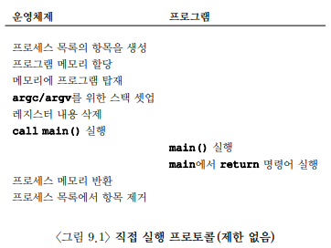
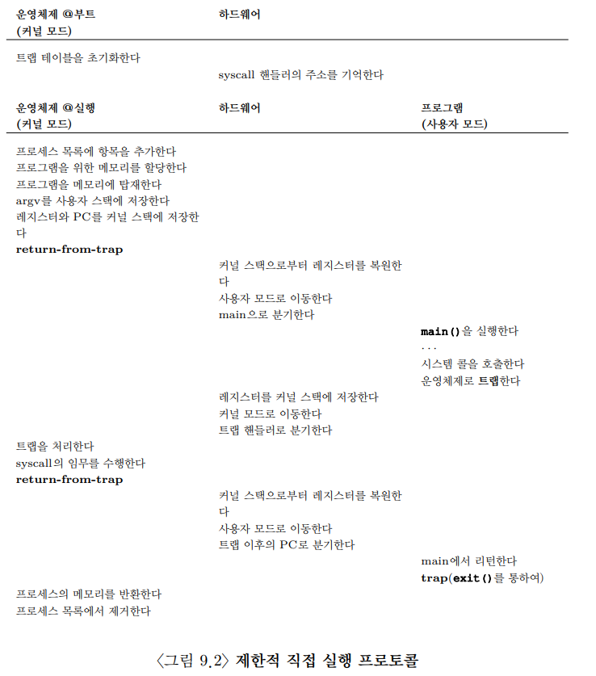
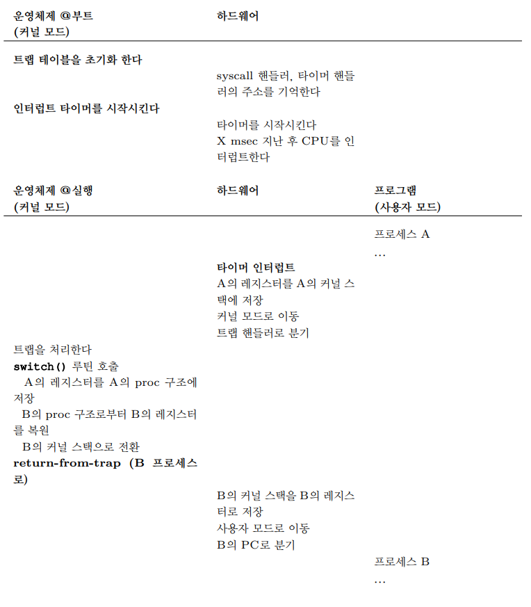
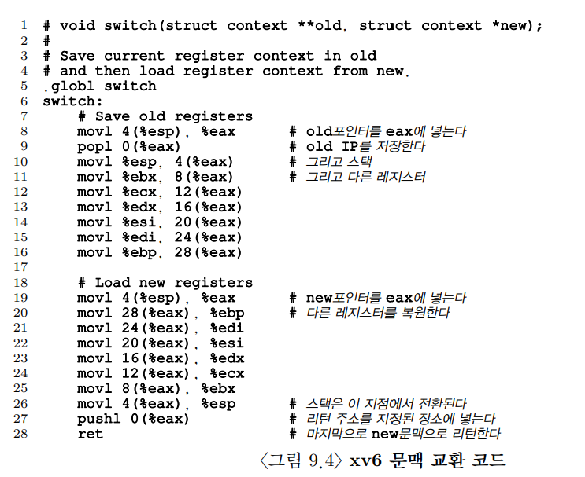

## ✦ 제한적 직접 실행 원리

- CPU 공유의 원리?
    
    → CPU 시간 나눠쓰기!
    
- 근데 문제가 있음..
    - 성능 저하 : 오버헤드를 최대한 낮게
    - 제어 문제 : 자꾸 프로세스 제어를 뺏어야 함~~

### ◆ 기본 원리 : 제한적 직접 실행

- 제한적 직접 실행 (Limited Direct Execution)
    - 직접 실행 : 프로그램을 CPU 상에서 걍 직접 실행
        - 근데 문제 있음
            1. [[운영체제|OS]] 가 원치않는 일 안한다는 보장 없음
            2. OS 가 시분할 (time sharing) 기법 어케 구현?
    
    
    

### ◆ 문제점 1: 제한된 연산

- 장점 :  빠르다!
    - 근데 디스크 입출력 or [[메모리]] 추가할당 연산은?
    - 뭔가 권한 문제가 생길 수 있음..
- 해결법! 사용자 모드 (user mode) / 커널 모드 (kernel mode) 를 나누자!
    - 사용자 모드에서 시스템 콜을 호출하면 커널 모드로 넘어가기
    - `trap` 명령어로 시스템 콜 실행해서 OS 가 특수 요청 처리 가능
    처리 완료하면 OS 가 `return-from-trap` 명령어 호출해서 다시 사용자 프로그램으로 리턴
    - 근데 `return-from-trap` 명령어 실행할 때 제대로 리턴할 수 있도록 레지스터를 잘 저장해야 함..
    → 커널 스택 (kernel stack) 에 저장
    - `trap` 에서 리턴할 때 어떤 코드부터 재시작? 
    → 트랩 테이블 (trap table) / 트랩 핸들러 (trap handler)
        - 트랩 테이블 : 예외 발생하면 어떤 코드 실행해야대?
        - 근데 하드웨어에 트랩 테이블 위치 알려주는것도 특권 명령어임
    
    
    
- 제한적 직접 실행 (Limited Direct Execution) → LDE
    1. (부팅 시) 커널은 트랩 테이블 초기화 & CPU 는 테이블 위치 기억 
    2. (프로세스 실행 시) `return-from-trap` 이용
        - 새로운 프로세스 위한 노드 할당해 프로세스 리스트에 삽입 & 메모리 할당
        - CPU 를 사용자 모드로 전환하고 프로세스 실행 시작
    - 트랩 걸면 OS 로 이동 → OS 가 시스템 콜 처리 → `return-from-trap` 으로 다시 프로세스 실행

### ◆ 문제점 2: 프로세스 간 전환

- 프로세스 간 전환을 할 수 있어야 함!
    - 그러려면 OS 가 다시 CPU 를 얻어야 함.. ← How??

#### 협조 방식: 시스템 콜 기다리기

- OS : 프로세스들아,, 시스템 콜 써줘잉..
    - 프로세스가 너무 CPU 많이 쓰면 주기적으로 CPU 포기할 거라고 믿음..
- 방법
    - `yield` 시스템 콜
    - 비정상적인 행위 (divide-by-zero) 하면 OS 로 trap

→ 근데 이 방식은 프로세스가 협조적이어야 함!

#### 비협조 방식: 운영체제가 전권을 행사

- 위 방식은 무한 루프에 빠지는 문제가 생기면 다시 부팅으로만 할 수 있음..
- OS : 다 꺼져 내가 집도한다
    - 타이머 인터럽트 (timer interrupt) 이용해서 몇 ms 마다 자동 인터럽트 발생
    - 인터럽트 발생하면 프로세스 중단 & 인터럽트 핸들러 (interrupt handler) 실행
    → OS 가 제어 얻고 원하는 일 실행 가능!
    - 하드웨어도 context switch 일어날 수 있으니까 실행중인 프로그램 상태 저장!

#### 문맥의 저장과 복원

- 협조던 비협조던 OS 가 제어권 획득한 후에, 다시 프로세스에 돌려줄 때 어떤 프로세스에 돌려줄 것인가? 
→ 스케쥴러 (scheduler) 의해서 결정
- OS : 다른 프로세스로 가자!
→ 문맥 교환 (context switch) 실행
    - 현재 실행 중 프로세스 레지스터 저장하고, 곧 실행될 프로세스 레지스터 값 복원
    - 그 후 다른 프로세스로 리턴해 실행 다시! (`return-from-trap`)
    
    
    
    - 타이머 인터럽트 발생하면 일단 레지스터 저장..
- xv6 실행 코드
    
    
    

### ◆ 병행성이 걱정

- OS 가 인터럽트 or 트랩 처리 중에 다른 인터럽트가 발생하면?!
→ 병행성 문제..
    - 해결법 : 인터럽트 처리중엔 다른 인터럽트 무시.. lock 기법

### ◆ 요약

- CPU 가상화 위한 저수준 기법 → 제한적 직접 실행!
    - CPU 에서 실행하고 싶은거 실행! 단, OS가 제한 가능하도록..
- OS 가 CPU 에 안전 장치 준비.
    - 트랩 핸들러 [[함수]], 인터럽트 타이머, 제한 모드에서만 프로세스 실행..
- 다음 주제 : 특정 시점에 어떤 프로세스를 실행?

---

- 자주 사용하는 특수 문자
    
    ∞ ⊂ ⊃ ∪ ∩ ∴ ∵ ⇒ ⇔ ⁿ ¹ ² ³ ⁴ · ↑ ↓ … × ₁ ₂ ₃ ₄ ∅
    ex) Example
