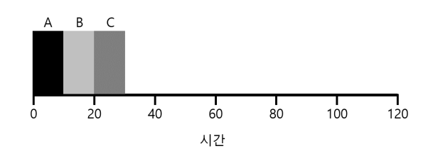
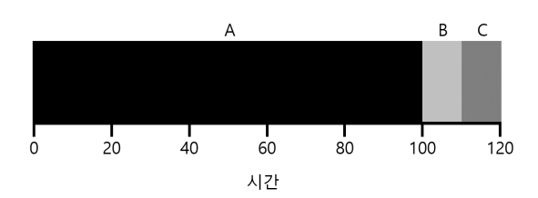
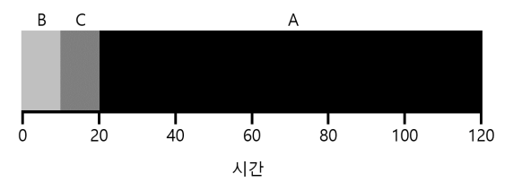
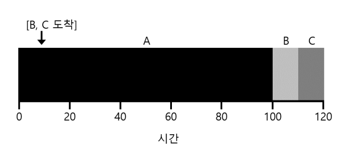
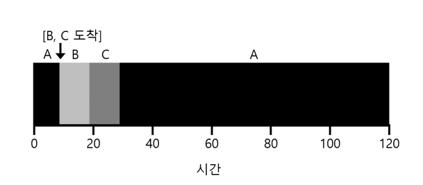
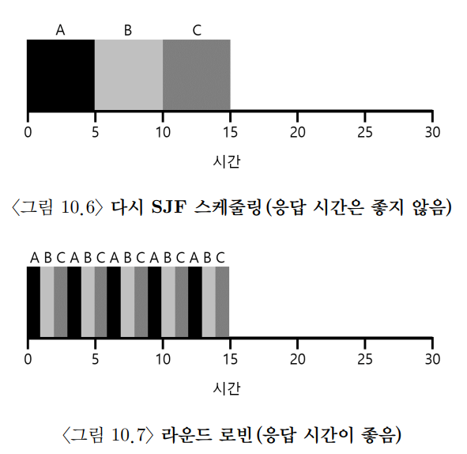
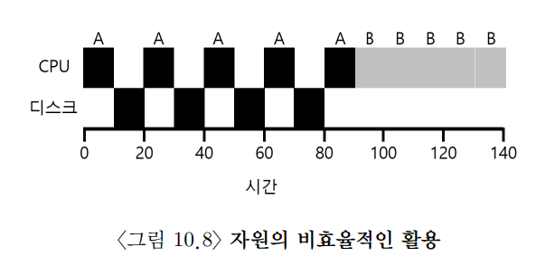
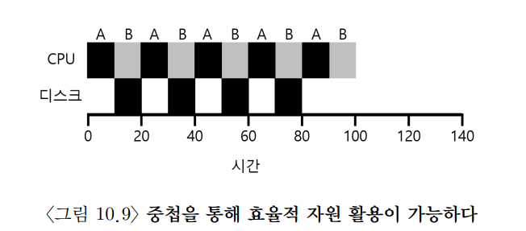

## ✦ 스케줄링: 개요

- 지금까지 배운 문맥 교환 → 저수준 기법!
- 이제 고수준 정책을 알아보자! = 원칙 (discipline)
    - 다양한 스케줄링 정책 (scheduling policy)

### ◆ 워크로드에 대한 가정

- 워크로드 (workload) : 일련의 프로세스들이 실행하는 상황
- 가정
    1. 모든 작업은 같은 시간 동안 실행된다.
    2. 모든 작업은 동시에 도착한다.
    3. 각 작업은 시작되면 완료될 때까지 실행된다.
    4. 모든 작업은 CPU 만 사용한다. (I/O 수행 X)
    5. 각 작업의 실행 시간은 사전에 알려져 있다.
    - 비현실적,,

### ◆ 스케줄링 평가 항목

- 스케줄링 평가 항목 (scheduling metric)
    - 반환 시간 (turnaround time)
        
        $$
        T_{turnaround} = T_{completion} - T_{arrival}
        $$
        
        - 모두 동시에 도착하므로 $T_{arrival} = 0$
        - 따라서 $T_{turnaround} = T_{completion}$
        - 얘는 성능 측면의 평가 기준
    - 공정성 (fairness)
- 성능과 공정성은 상충되는 목표!

### ◆ 선입선출

- 선입선출 (First In First Out, FIFO)
- 선도착선처리 (First Come First Served, FCFS)
- 장점 : 단순! 구현 쉬움!
- A, B, C 순서대로 10초 씩 실행
    
    
    
    - 평균 반환 시간 $\frac{(10+20+30)}{3} = 20$
- 1번 가정(모든 작업은 같은 시간 동안 실행된다.)을 완화하자!
    - 세 작업의 실행 시간이 다르다면?
    - A 가 100초, B & C 가 10초 동안 실행된다면?
    
    
    
    - A 가 너무 많은 시간이 걸려서 B, C 가 오래 기다려야 함..
    - 평균 반환 시간  $\frac{(100+110+120)}{3} = 110$
    - convoy effect : 짧은 시간 동안 자원을 사용할 프로세스들이 자원을 오랫동안 사용하는 프로세스의 종료를 기다리는 현상..

### ◆ 최단 작업 우선

- 최단 작업 우선 (Shortest Job First, SJF)
    - 가장 짧은 실행 시간 가진 작업을 먼저!
    
    
    
    - 오래 걸리는 걸 뒤로 미루자!
    - 평균 반환 시간 $\frac{(10+20+120)}{3} = 50$
    → 2배 이상 향상!
- 모든 작업이 동시에 도착하면 이게 최적 (optimal)
- 근데 아직 비현실적..
- 2번 가정 (모든 작업은 동시에 도착한다.) 을 완화하자!
    - 작업들은 임의의 시간에 도착 가능
    - B, C 가 늦게 도착하면?
    
    
    
    - 여전히 A 가 먼저 실행되므로 convoy 문제가 재발…
    - 평균 반환 시간 $\frac{(100+(110-10)+(120-10))}{3} = 103.33$
    - 이러면 어케 스케줄링 해야할가…

### ◆ 최소 잔여시간 우선

- 이걸 해결하려면 가정 3 (각 작업은 시작되면 완료될 때까지 실행된다.) 을 완화해야 함!
    - 중간에 작업을 멈추고, 금방 끝나는거 끝내놓고 A 끝내기
    - 선점형 스케줄러! (SJF 는 비선점형 스케줄러)
- 최단 잔여시간 우선 (Shortest Time-to-Completion First, STCF)
    - SJF + 선점 기능
    - 새로운 작업이 들어오면 잔여 실행 시간 계산하고 젤 적은 잔여 실행 시간 가진거 작업. (원래 하던건 중단)
    
    
    
    - A 를 중간에 끊고, B, C 를 먼저 끝내고 나머지 하기
    - 평균 반환 시간 $\frac{((120-0)+(20-10)+(30-10))}{3} = 50$
- 얘가 최적임!

### ◆ 새로운 평가 기준 : 응답 시간

- 시분할 컴퓨터가 등장하면서 응답 시간 (response time) 이라는 새로운 평가 기준 등장!
    - 작업이 도착할 때 ~ 처음 스케줄 될 때
    
    $$
    T_{response} = T_{firstrun} - T_{arrival}
    $$
    
    - 처음 실행되기까지 얼마나 기다려야 댐?
    
    
    
    - 이 경우, A 응답 시간 0 / B 응답 시간 0 / C 응답 시간 
    평균 3.33
        
        → 별로 좋은 건 아님..
        
- 그럼 뭐가 좋은건데!

### ◆ 라운드 로빈

- 라운드 로빈 (Round-Robin, RR) = 타임 슬라이싱
    - 일정 시간 실행하고 다음 작업 전환하기
    - 일정 시간 → 타임 슬라이스 (time slice) / 스케줄링 퀀텀 (scheduling quantum)
    
    
    
- 장점 : 응답 시간이 좋다!
    - SJF 평균 응답 시간 $\frac{(0+5+10)}{3} = 5$
    - RR 평균 응답 시간 $\frac{(0+1+2)}{3} = 1$
- 근데 이제 타임 슬라이스 길이가 중요!
    - 짧을 수록 응답 시간 감소
    - 근데 너무 짧게 하면 context switch 비용이 커짐!
    - 적당한 길이를 정해야함..
- 근데 RR 이 응답 시간은 좋지만 반환 시간 면에선 매우 안좋다..
    - 공정할 수록 반환 시간은 별로가 되는..
- 균형적으로 좋은 스케쥴링은 없을까!

### ◆ 입출력 연산의 고려

- 일단 가정 4 (모든 작업은 CPU 만 사용한다. (I/O 수행 X)) 를 완화하자!
    - 이제 프로그램들이 입출력 작업 수행
    - 입출력 작업 요구하면 CPU 사용 X 대기 상태!
    그동안 [[운영체제|OS]] 는 다른 작업 스케쥴!
- 입출력 완료 시 중단 됐던 걸 이어할 것인가 대신 하던걸 계속 할 것인가?
- ex) 두 가지 작업 A / B 둘다 50ms 걸림. A 는 10ms 마다 입출력.
    
    
    
    - A 한 후 에 B 하면 비효율적!
    
    
    
    - A 의 각 10ms 하위 작업을 독립적인 작업으로 다루기!
    - A 10ms vs B 50ms → A 승리!
        - A 기다리는 동안 B 작업하기
    - 이런 식으로 기다리는 동안 다른 거 해서 좀 더 빨리 끝내기 가능

### ◆ 만병통치약은 없다 (No More Oravle)

- 지금까진 OS 가 전체 실행 시간을 안다고 가정..
- 근데 사실 범용 운영체제에서 작업의 길이를 알 순 없음!
- 헉 그럼 지금까지 이야기한 걸 어케 구현??

→ 멀티 레벨 피드백 큐 (multi-level feedback [[queue]]) 

가까운 과거 이용해서 미래 예측하는 스케쥴러

---

- 자주 사용하는 특수 문자
    
    ∞ ⊂ ⊃ ∪ ∩ ∴ ∵ ⇒ ⇔ ⁿ ¹ ² ³ ⁴ · ↑ ↓ … × ₁ ₂ ₃ ₄ ∅
    ex) Example
