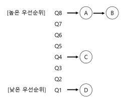
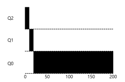
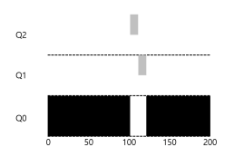
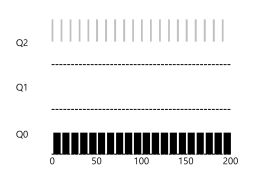
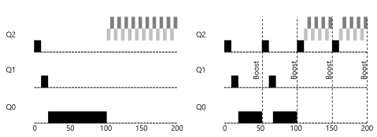
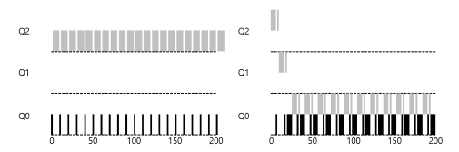
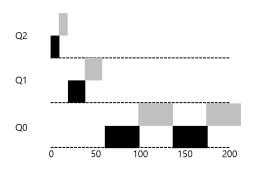

## ✦ 스케줄링: 멀티 레벨 피드백 큐

- 멀티 레벨 피드백 큐 (MLFQ, Multi-level Feedback [[queue|Queue]])
    1. 짧은 작업을 먼저 실행해 반환 시간 최적화
    2. 응답 시간 최적화

### ◆ MLFQ: 기본 규칙

- 여러 개의 큐로 구성. 각각 다른 우선 순위 (priority level) 배정
- 높은 우선순위 큐부터 선택
    - 각 작업의 특성 따라 동적으로 부여
    - ex) 대화형 프로세스에 우선 순위 높게
- 규칙
    1. Priority(A) > Priority(B) 이면, A가 실행된다
    2. Priority(A) = Priority(B) 이면, A와 B는 RR 방식으로 실행된다.
    
    
    
    - 그런데 이렇다면 낮은 우선순위는 아예 실행이 안될 수도 있음!

### ◆ 시도 1: 우선순위의 변경

- 몇 가지 규칙을 추가하자!
    1. 작업이 시스템에 진입하면, 가장 높은 우선순위, 즉 맨 위의 큐에 놓여진다.
    2. 규칙
        1. 주어진 타임 슬라이스를 모두 사용하면 우선순위는 낮아진다. 즉, 한 단계 아래 큐로 이동한다.
        2. 타임 슬라이스를 소진하기 전에 CPU를 양도하면 같은 우선순위를 유지한다.
- ex 1) 한 개의 긴 실행 시간을 가진 작업
    
    
    
    - 높은 순위에서 실행되다가 점점 낮은 순위로 이동해서 나중에는 Q0에 계속 머무름
- ex 2) 짧은 작업과 함께
    
    
    
    - 높은 우선 순위가 들어오면 중단 되었다가 실행.
    - 짧은 작업이 아님 → 긴 배치형 작업!
- ex 3) 입출력 작업에 대해서는 어떻게?
    
    
    
    - 키보드 입력은 Q2 에서 아주 짧은 시간 동안만 실행. 그 외에는 Q0에 있는거 실행
    - 대화형 작업을 빨리 실행!
- 현재 MLFQ 의 문제점
    1. 기아 상태 (starvation) 발생 가능
        - 너무 많은 대화형 작업 있으면 긴 실행 시간 가지면 진행 X
    2. 똑똑한 사용자는 자신에게 유리하게 동작하게 프로그램 작성 가능
        - 계속 입출력 요청해서 CPU 점유 높일 수 있음
    3. 프로그램의 특성이 변할 수 있음
        - 원래 CPU 위주 → 대화형 작업으로 바뀐다고 우선 순위 상승 X

### ◆ 시도 2: 우선순위 상향 조정

- 기아 문제를 어떻게 해결할까?
    - 주기적으로 모든 작업의 우선 순위를 상향 조정(boost) 해보자!
- 새로운 규칙
    1. 일정 기간 S가 지나면, 시스템의 모든 작업을 최상위 큐로 이동시킨다.
        - 프로세스는 굶지 않는다는 것을 보장!
        - CPU 위주 → 대화형 작업 바뀌면 우선 순위 상승 가능!
    
    
    
    - 단, S를 어떻게 설정할지 중요!
        - S 는 부두 [[상수]](voo-doo constants) : 적절한 값을 골라야..

### ◆ 시도 3: 더 나은 시간 측정

- 스케줄러를 자신에게 유리하게 동작시키는 것 막기!
    - 주범: 4a, 4b
        1. 주어진 타임 슬라이스를 모두 사용하면 우선순위는 낮아진다. 즉, 한 단계 아래 큐로 이동한다.
        2. 타임 슬라이스를 소진하기 전에 CPU를 양도하면 같은 우선순위를 유지한다.
- 해결책
    - MLFQ의 각 단계에서 CPU 총 사용 시간 측정!
    - 프로세스가 타임 슬라이스에서 해당하는 시간을 모두 소진하면 다음 우선순위 큐로 강등
    - 4a + 4b 합쳐서 한 규칙으로 재정의
    1. 주어진 단계에서 시간 할당량을 소진하면 (CPU를 몇 번 양도하였는지 상관없이), 우선순위는 낮아진다 (즉, 아래 단계의 큐로 이동한다)
    
    
    
    - 입출력 한다고 계속 높은 우선순위 X → 점점 내려가면서 공평하게 사용 + 조작 내성

### ◆ MLFQ 조정과 다른 쟁점들

- 큐가 몇 개나 있어야 함?
- 큐당 타임 슬라이스의 크기는?
- 우선순위 상향 조정 주기는?

→ 큐 별로 타임 슬라이스 변경 가능

- 우선 순위 높을 수록 타임 슬라이스 짧게!
- 낮은 우선순위는 CPU 중심의 오래 실행되는 작업 → 타임 슬라이스 길게

- 스케줄러의 다른 기능
    - 가장 높은 우선순위 → [[운영체제|OS]] 작업용 예약

### ◆ MLFQ: 요약

- 규칙
    1. 우선순위(A) > 우선순위 (B) 일 경우, A 실행
    2. 우선순위(A) = 우선순위 (B) 일 경우, A와 B는 RR 방식으로 실행
    3. 작업이 시스템에 들어가면 최상위 큐에 배치
    4. 작업이 지정된 단게에서 배정받은 시간 소진 시, 작업 우선순위 감소
    5. 일정 주기 S가 지난 후, 시스템의 모든 작업을 최상위 큐로 이동

---

- 자주 사용하는 특수 문자
    
    ∞ ⊂ ⊃ ∪ ∩ ∴ ∵ ⇒ ⇔ ⁿ ¹ ² ³ ⁴ · ↑ ↓ … × ₁ ₂ ₃ ₄ ∅
    ex) Example
