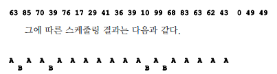
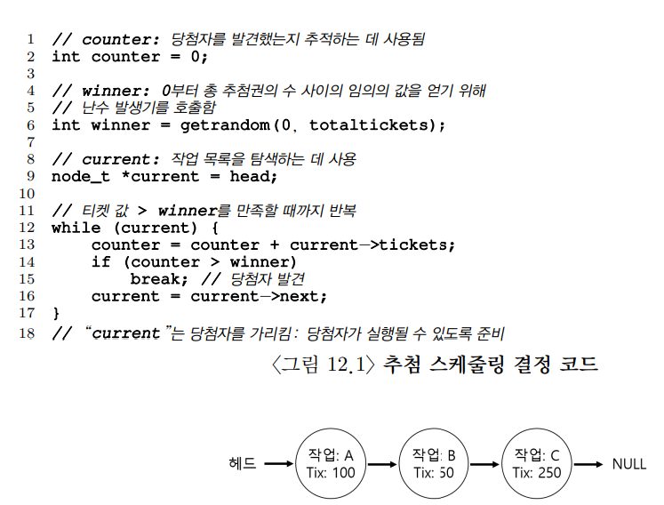
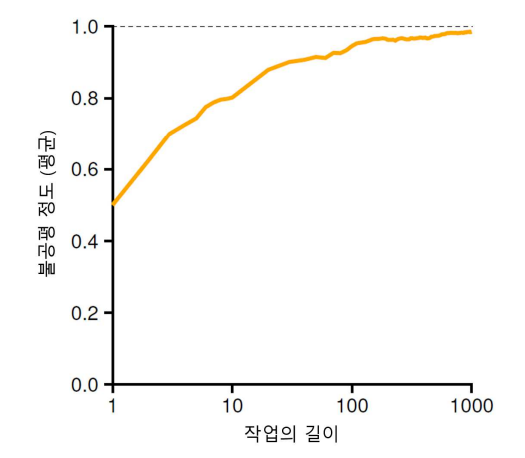
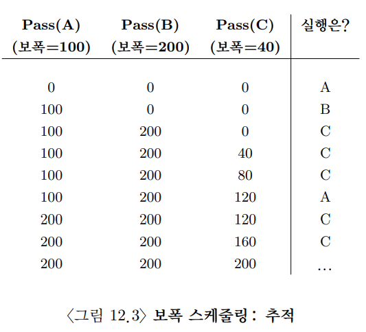

## ✦ 스케줄링: 비례 배분

- 비례 배분 (Proportional Share) 스케줄러, 공정 배분(Fair share) 스케줄러
- 반환 시간 / 응답 시간 최적화 대신 각 작업에 CPU 일정 비율 보장!
- 추첨 스케줄링 (lottery scheduling) : 다음 실행 프로세스 추첨!
    - 더 자주 수행되어야 하면 당첨 기회 많이

### ◆ 기본 개념: 추첨권이 당신의 몫을 나타낸다

- 추첨권 (티켓) = 프로세스가 받아야 할 자원의 몫
    - ex) A가 75장, B가 25장 → A에 75%, B에 25% 할당
- 타임 슬라이스 끝날때 마다 확률적으로 선택!
    
    
    
    - 원하는 비율이 정확히 나오지는 않지만, 장시간 실행될수록 원하는 비율 달성!

### ◆ 추첨 기법

- 추첨권 화폐 (ticket currency)
    - 사용자가 추첨권을 자신의 화폐 가치로 추첨권을 자유롭게 할당
    - 시스템은 자동적으로 화폐 가치 변환
    - ex) A, B 가 각각 100장 추첨권 있음
        - 근데 A, B 내부적으로는 다르게 변형 가능
        - A : 총 1000장 A1 500장, A2 500장
        - B : 총 10장, 10장 전부 할당
        - 이러면 전체 200장 기준으로 비율 계산해서 추첨 (25%, 25%, 50%)
- 추첨권 양도 (ticket transfer)
    - 프로세스가 일시적으로 추첨권을 다른 프로세스에게 넘김
    - [[클라이언트]]/[[서버]] 환경에서 주로 사용. (클라이언트 → 서버 양도)
- 추첨권 팽창 (ticket inflation)
    - 프로세스는 일시적으로 자신이 소유한 추첨권의 수 증감 가능
    - 프로세스들이 서로 신뢰할 때 유용

### ◆ 추첨

- 추첨 스케줄링 장점 : 구현 단순!
    - 난수 발생기, 프로세스 집합 자료구조, 추첨권 전체 개수만 필요,,

- 리스트 내림차순으로 정렬하면 당첨자 찾기 굿
    - 검색 횟수 최소화 보장

### ◆ 예제

- 각 프로세스는 100장의 추점권, 실행 시간 R
- 두 작업을 거의 동시에 종료 시키고 싶음
- 불공정 지표 (unfairness metric) U = $\frac{첫\ 번째\ 작업\ 종료\ 시간}{두\ 번째\ 작업\ 종료\ 시간}$
    - 거의 동시에 종료할 수록 1에 근접

- 충분히 긴 작업이어야 불공평 정도가 1에 가까워짐..

### ◆ 추첨권 배분 방식

- 작업들에게 추첨권을 몇 개씩 분배해야 함?
- 사용자가 가장 잘 알고 있다고 가정 → 해결책 X..

### ◆ 왜 결정론적 (Deterministic) 방법을 사용하지 않는가

- 무작위성으로 스케줄러를 단순하게 할 순 있지만, 정확한 비율 보장 불가능.
- 보폭 스케줄링 (stride scheduling) : 결정론적 공정 배분 스케줄러
    - 각 작업에 보폭 부여
        - 보폭 (stride) = 추첨권 수에 반비례
    - 프로세스 실행마다 pass 가는 값을 보폭만큼 증가시켜 CPU 사용정도 추적
    - 가장 작은 pass 값 가진 프로세스 실행
    
    
    
    - 문제점 : 중간에 새로운 작업이 도착하면? pass 값 몇 부터 시작?
    → 새 프로세스 추가 어려움
- 추첨 스케줄링에서는 새 프로세스 쉽게 추가 가능!

---

- 자주 사용하는 특수 문자
    
    ∞ ⊂ ⊃ ∪ ∩ ∴ ∵ ⇒ ⇔ ⁿ ¹ ² ³ ⁴ · ↑ ↓ … × ₁ ₂ ₃ ₄ ∅
    ex) Example
