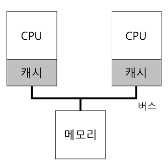

## ✦ 멀티프로세서 스케줄링 (고급)

- 멀티프로세서 스케줄링 (multiprocessor scheduling)
    - 병행성 주제 다루고 공부하기,,
- 멀티프로세서 (multiprocessor) = 멀티코어 (multicore)
    - 한 컴퓨터에 CPU 코어가 여러 개
- 응용 프로그램이 병렬 (parallel) 로 실행 → thread 이용
    - 더 빨리 실행 가능!
- 여러 CPU 에 작업을 어떻게 스케줄 해야 하는가?

### ◆ 배경 : 멀티 프로세서 구조

- 단일 CPU 하드웨어 & 멀티 CPU 하드웨어의 근본적 차이?
    - 다수의 프로세서 간 데이터 공유
    - 하드웨어 캐시의 사용 방식
- 단일 CPU 시스템 → 하드웨어 캐시 계층 존재
    - 캐시 : 메인 메모리에서 자주 사용되는 데이터 복사본 저장하는 작고 빠른 메모리
        - 시간 지역성 (temporal locality) / 공간 지역성 (spatial locality)
- 멀티 CPU 시스템 → 캐시 일관성 문제 (cache coherence) 발생
    - 프로세스 A, B 가 같은 데이터를 메모리에서 캐시에 저장. 각 프로세스마다 캐시에 저장하므로 문제 발생..!
    
    
    
- 해결책?
    - 하드웨어가 메모리 주서를 계속 감시. 여러 프로세스가 한 메모리에 갱신하면 항상 공유되도록
    - 버스 기반 시스템 → 버스 스누핑 (bus snooping)
        - 캐시 데이터에 대한 변경 발생 시, 무효화 (invalidate) or 갱신

### ◆ 동기화를 잊지 마시오

- 병행성에 대해 잘 알고 있다 가정..
- 동기화 기법 : 상호 배제 보장
    - 락-프리 (lock-free) 데이터 구조 → 교착상태 장 참고,,
- 두 thread 에서 연결 리스트 원소 삭제
→ 락 (lock) 사용 하기!
    - mutex 할당해서 해결
    - 근데 성능 측면에서 문제가 있음!

---

- 자주 사용하는 특수 문자
    
    ∞ ⊂ ⊃ ∪ ∩ ∴ ∵ ⇒ ⇔ ⁿ ¹ ² ³ ⁴ · ↑ ↓ … × ₁ ₂ ₃ ₄ ∅
    ex) Example
