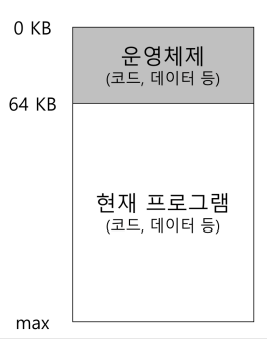
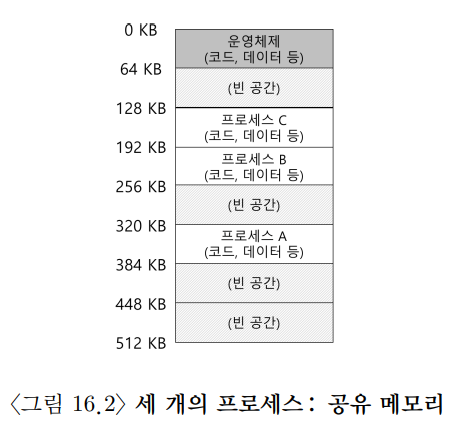
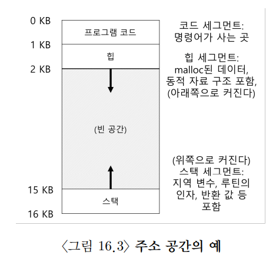

## ✦ 주소 공간의 개념

### ◆ 초기 시스템

- 컴퓨터의 물리 메모리
    
    
    
    이렇게 생겼다.
    
- OS = 메모리에 상주하는 루틴 (실제론 라이브러리) 의 집합
- 나머지는 메모리에 알아서,,

### ◆ 멀티프로그래밍과 시분할

- 멀티프로그래밍 : 여러 프로세스가 실행 준비 상태, OS 가 전환하며 실행
    - 어떤 프로세스가 IO 실행하면 CPU가 다른 프로세스로 전환
    → CPU 이용률 증가
    - 효율성의 개선 중요
- 시분할 (time-sharing) 개념 등장!
    - 대화식 이용 (interactivity) 개념 중시
    - 구현 방법 : 한 프로세스를 짧은 시간 동안 실행, 그 동안 모든 메모리 접근 가능, 그 후 중지하고 다른 프로세스 실행..
    - 문제 : 너무 느림, 메모리가 클 수록!
- 우리의 목표 : 프로세스를 메모리에 그대로 유지하면서 시분할 시스템 효율적으로!
    
    
    
    - 전체 물리 메모리에서 작은 부분 할당.
    - OS 는 여러 프로세스 중 한 개 실행, 다른 프로세스는 준비 큐에서 실행 기다림
    - 보호 (protection) 중요!

### ◆ 주소 공간

- OS 는 사용하기 쉬운 (easy to use) 메모리 개념을 만들어야 함!
- 주소 공간 (address space)!
    - 실행 프로그램의 모든 메모리 상태 보유
    - code (명령어), stack (함수 호출 체인 현 위치, 지역 변수, 함수 인자, 반환 값), heap (동적 할당 메모리, `malloc()`)
    
    
    
    - 주소 공간에 여러 쓰레드 있으면 동작 X..
- 운영체제가 실행 중인 프로그램에 제공하는 개념 (abstraction) 은?
    - OS 는 물리 메모리를 공유하는 다수의 프로세스에게 어떻게 프로세스 전용의 커다란 주소 공간이라는 개념을 제공할 수 있는가?
    
    → 메모리 가상화 (virtualizing memory) 
    
    - 물리 주소 대신 가상 주소를 제공!

### ◆ 목표

- 가상 메모리 시스템 (VM) 의 목표
    - 투명성 (transparency) : 실행 중인 프로그램이 가상 메모리의 존재를 인지하지 못하도록 구현.
    - 효율성 (efficiency) : 가상화가 시간과 공간 측면에서 효율적이도록 구현.
        - TLM 등의 하드웨어 지원 필요
    - 보호 (protection) : 프로세스 끼리, OS 도 보호
        - 프로세스가 탑재, 저장, 명령어 반입 실행 시 다른 프로세스나 OS 접근, 영향 X
        - 프로세스들을 서로 고립 (isolate)

---

- 자주 사용하는 특수 문자
    
    ∞ ⊂ ⊃ ∪ ∩ ∴ ∵ ⇒ ⇔ ⁿ ¹ ² ³ ⁴ · ↑ ↓ … × ₁ ₂ ₃ ₄ ∅
    ex) Example
