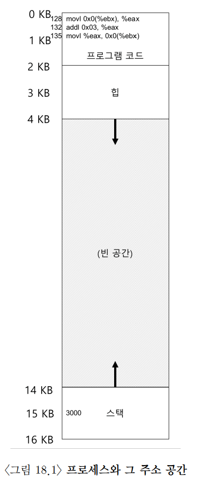
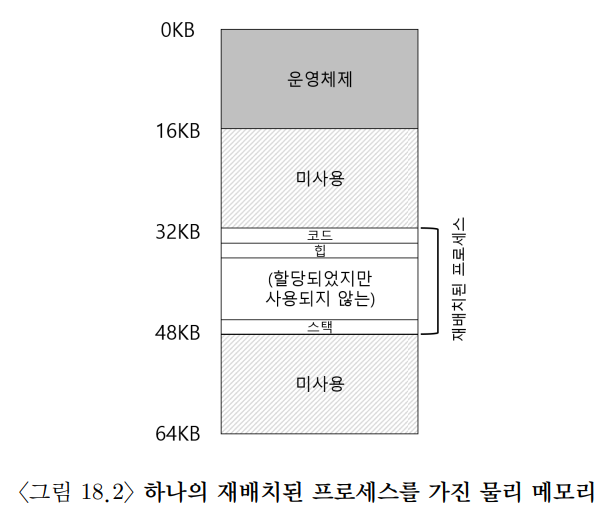
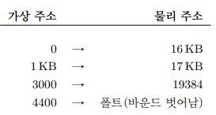
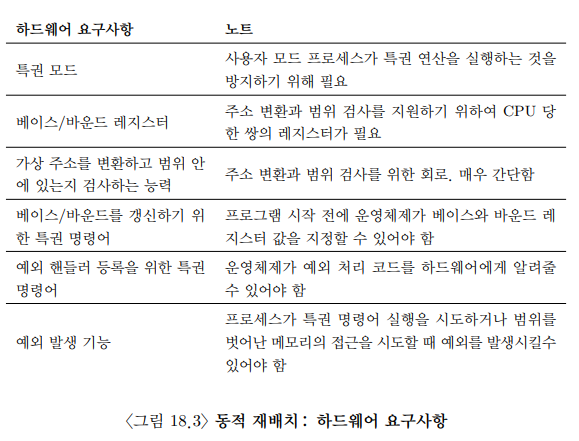
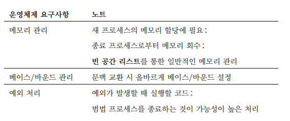
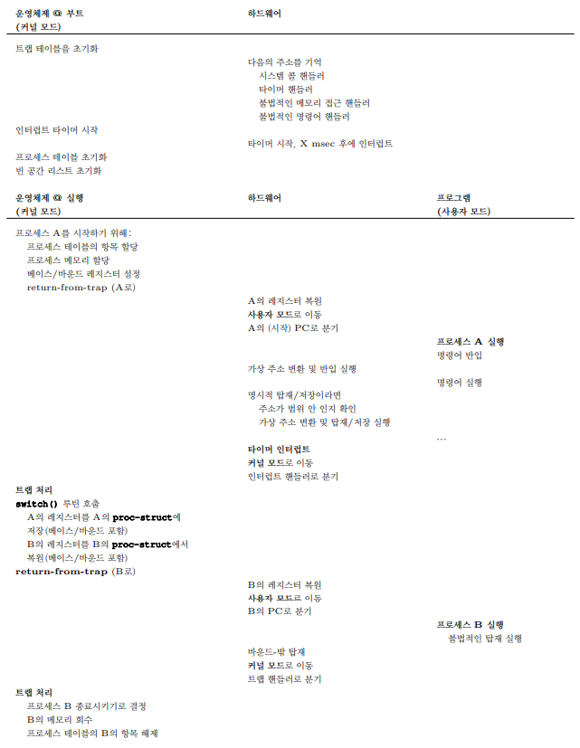

## ✦ 주소 변환의 원리

- CPU 가상화에서의 제한적 직접 실행 (LDE)
    - 프로세스가 시스템 콜 호출, 타이머 인터럽트 발생 같은 순간엔 OS 가 개입해 문제 막음.
    - OS 가 HW 를 직접 제어 → 효율성 & 제어
- 메모리 가상화에서도 비슷한 전략
    - 가상화 제공 + 효율성 + 제어 → HW 지원 활용!
        - 제어 : 프로그램이 자기 자신 외에는 메모리 접근 X 보장
    - register → TLB → 페이지 테이블 등등
    - 유연성 : 원하는 대로 주소 공간 사용, 프로그래밍하기 쉬운 시스템!
- 어떻게 효율적이고 유연하게 메모리를 가상화하는가?
    
    → 하드웨어-기반 주소 변환 (hardware-based address translation) 
    
    = 주소 변환 (address translation)
    
    - 가상 주소 → 물리 주소로 변환
    - 프로그램이 자신의 전용 메모리를 소유하고 있다는 환상.

### ◆ 가정

1. 사용자 주소 공간은 물리 메모리에 연속적으로 배치되어야 한다.
2. 주소 공간은 물리 메모리 크기보다 작다.
3. 각 주소 공간의 크기는 같다.

### ◆ 사례

- 주소 변환 구현에 어떤 것이 필요한가? 왜 필요한가?

```c
void func() {
	int x = 3000;
	x = x + 3;
}
```

```nasm
128: movl 0x0(\%ebx). \%eax ; 0+ebx 를 eax 에 저장
132: addl \$0x03. \%eax     ; eax 레지스터에 + 3
135: movl \%eax. 0x0(\%ebx) ; eax 를 메모리에 저장
```

- 실제 메모리 접근은?
    - 주소 128의 명령어 반입
    - 이 명령어 실행 (주소 15KB 에서 load)
    - 주소 132의 명령어를 반입
    - 이 명령어 실행 (메모리 참조 없음)
    - 주소 135의 명령어를 반입
    - 이 명령어 실행 (15KB 에 save)
- 프로그램 관점 주소 공간 : 0 ~ 16KB
    - OS 는 이 메모리를 다른 위치에 어떻게 재배치 하는가?
        
        
        
        
        
        - 32KB ~ 48KB 에 할당!

### ◆ 동적 (하드웨어-기반) 재배치

- 1950 년대 : 베이스와 바운드 (base and bound) = 동적 재배치 (dynamic relocation)
- 각 CPU 마다 2개의 HW register 필요.
    - 각각 베이스 (base) 레지스터, 바운드 (bound) 레지스터 (= 한계 (limit) 레지스터))
    - 아 두 레지스터 쌍 통해 원하는 위치에 주소 공간을 배치할 수 있도록 함.
- 베이스 레지스터 : OS 에 의해 결정된 물리 메모리 위치
    - 프로세스 주소 변환 `physical address = virtual address + base`
- 바운드는? 항상 16KB.
→ 메모리 참조가 합법적인지 검사 위함!

→ CPU 칩 안에 있는 하드웨어 구조. (메모리 관리 장치, MMU (Memory Management Unit))

- 바운드 레지스터 정의 방식
    1. 주소 공간의 크기를 저장 (16KB) → 이거로 가정
    → 가상 주소를 베이스 레지스터에 더하기 전 바운드 레지스터와 비교
    2. 주소 공간의 마지막 물리 주소 저장
    → 가상 주소에 먼저 베이스 레지스터를 더하고 바운드 안에 있는지 검사

#### 예제

- 주소 공간 크기 4KB → 물리 주소 16KB 에 탑재
    
    
    
    - 베이스 주소를 더하기만 하면 됨!

### ◆ 하드웨어 지원 : 요약

- 필요한 하드웨어 지원
    - 두 가지 CPU 모드
        - Kernel mode : 컴퓨터 전체 접근 권한
        - User mode : 응용 프로그램 실행
        - 프로세서 상태 워드 (processor status word) 통해 현재 실행 모드 나타냄
    - 베이스/바운드 레지스터 : MMU 일부
        - 범위 안에 있는지 검사
    - 베이스/바운드 레지스터 값 변경 → kernel 명령어
    - 불법적인 메모리 접근 시도 시 예외 발생 (exception handler)
    
    
    

### ◆ 운영체제 이슈

- 베이스 / 바운드 방식 가상 메모리 구현에서 OS 가 개입해야할 때
    1. 프로세스 생성 시 → 주소 공간이 저장될 메모리 공간 찾기
        - 주소 공간 특징 : 물리 메모리 크기보다 작음. 크기가 일정함 → 처리 가능!
        - 각 주소 공간을 슬롯의 배열로 보고 사용 여부 관리. (free list 자료 구조)
    2. 프로세스 종료 시 → 사용 중인 메모리 회수해서 다시 사용할 수 있게 정리
    3. 문맥 교환 시 → 베이스 & 바운드 쌍 저장 + 복원
        - 프로세스 구조체 (process structure) = 프로세스 제어 블럭 (PCB) 이용
        - 프로세스 주소 공간을 옮기고 싶을 땐?
            - 실행 중지 → 새 위치로 주소 공간 복사 → 베이스 레지스터 갱신
    4. 예외 핸들러 or 호출될 함수 제공할 때 
        - 예외 발생 시 조치 취하기. 불법 행위 하면 종료!
    
    
    
    
    
    - 제한적 직접 실행 (LDE) 방식 따름. 프로세스가 잘못된 행동하면 OS 가 개입!

### ◆ 요약

- 주소 변환 : OS 가 프로세스의 모든 메모리 접근 제어!
    - 단, 하드웨어 지원 필요.
- base-and-bound 가상화 : 효율적 + 보호 기능
- 동적 재배치 → 비효율적
    - 16KB 전체를 할당하는데 이걸 그만큼 다 쓰지 않음..
    → 내부 단편화 (internal fragmentation)
- 해결책? base-and-bound 일반화! ⇒ 세그멘테이션 (segmentation)

---

- 자주 사용하는 특수 문자
    
    ∞ ⊂ ⊃ ∪ ∩ ∴ ∵ ⇒ ⇔ ⁿ ¹ ² ³ ⁴ · ↑ ↓ … × ₁ ₂ ₃ ₄ ∅
    ex) Example
