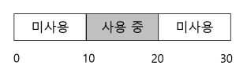

## ✦ 빈 공간 관리

- 빈 공간 관리!
    - Page 단위로 나누다 보면 안쓰는 빈 공간이 많음..
    - heap 은 `malloc()` / `free()` 로 사용자가 할당 → 그 과정에서 빈 공간 발생 가능!
        
        
        
        - 위 예시에서 15 byte 를 요청하면 실패.. → 해결책?

### ◆ 가정

- 가정 : `malloc()` → 요청한 byte 만큼 void 포인터 반환 / `free()` → 해당 포인터 해제
    - 힙 (heap) 에서 관리. 일반적으로 linked-list 로 사용
    - 외부 단편화에 초점!
- 가정 : 할당된 메모리는 `free()` 되기 전까지 다른 위치로 재배치 불가능.
    - 빈 공간 압축 사용 불가능

### ◆ 저수준 기법들

#### 분할과 병합

---

- 자주 사용하는 특수 문자
    
    ∞ ⊂ ⊃ ∪ ∩ ∴ ∵ ⇒ ⇔ ⁿ ¹ ² ³ ⁴ · ↑ ↓ … × ₁ ₂ ₃ ₄ ∅
    ex) Example
