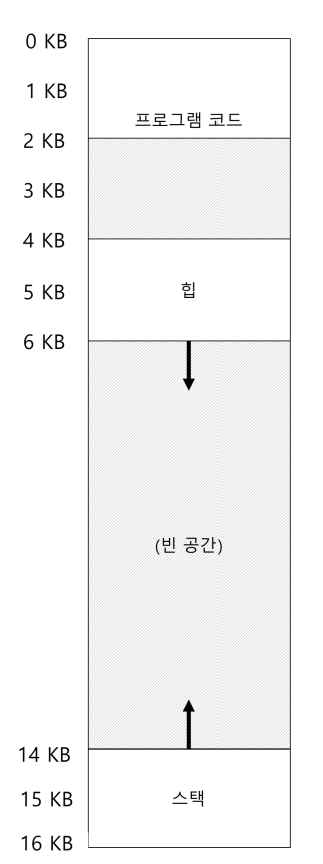
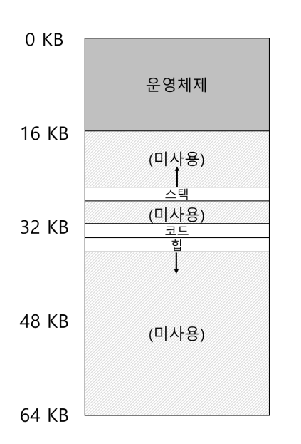
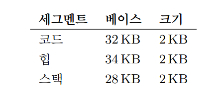
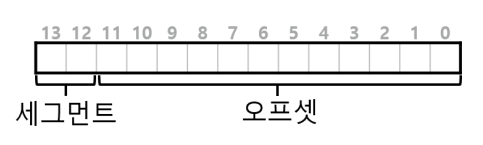
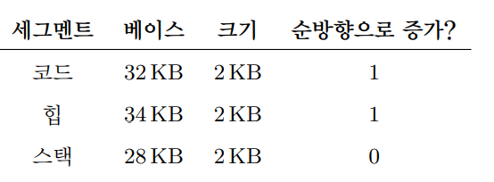
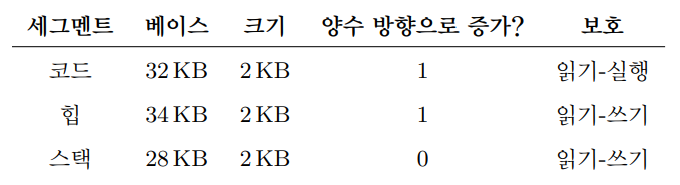
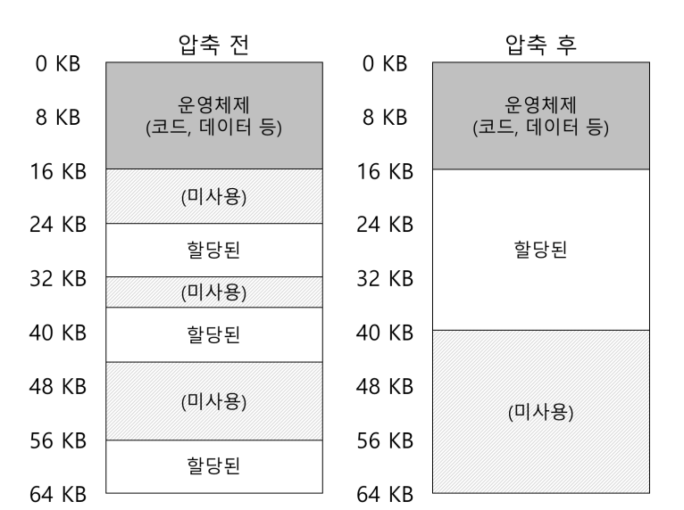

## ✦ 세그멘테이션

- 스택 & 힙 사이에 빈공간이 많음! 
→ 메모리 낭비가 심함..
→ 주소 공간 > 물리 메모리인 경우 실행 매우 어려움..
- 유연성 부족! 해결책은??



### ◆ 세그멘테이션 : 베이스/바운드 (base/bound) 의 일반화

- 세그멘테이션 (Segmentation)
    - MMU 안에 한 베이스/바운드 쌍 X
    - 주소 공간의 논리적 세그먼트 (segment) 마다 베이스/바운드 쌍 두기!
        - 세그먼트 : 특정 길이 가지는 연속적 주소 공간 (코드, 스택, 힙 세 종류)
        - 각 세그먼트를 물리 메모리의 다른 위치에 배치!
        
        
        
        - 사용되지 않은 영역이 많은 대형 주소 공간 → sparse address space
        
        
        
        - 각 공간마다 베이스/바운드 레지스터 필요
            - 각 베이스 레지스터 → 물리 주소에서의 시작 값 저장
            - 각 바운드 레지스터 → 세그먼트 크기 저장
        - 잘못된 주소를 접근하면? → segment fault!

### ◆ 세그먼트 종류의 파악

- 하드웨어가 가상 주소가 어떤 세그먼트를 참조하는지/세그먼트 안에서 오프셋은 얼마인지 확인하는 법?
- 가상 주소의 최상위 몇 비트를 기준으로 주소 공간을 여러 세그먼트로 나누기!
    
    
    
    - 시작이 00 → 코드 세그먼트
    시작이 01 → 힙 세그먼트
    시작이 10 → 스택 세그먼트
    - 하위 12비트는 세그먼트 내의 오프셋!
    - 오프셋 + 베이스 레지스터 값 → 최종 물리 주소
    - 바운드 검사 : 오프셋 < 바운드?
    
    ```c
    // 14 bit VA 중 상위 2 bit 얻어옴
    Segment = (VirtualAddress & SEG_NASK) >> SEG_SHIFT
    // Offsedt 얻어옴
    Offset = VirtualAddress & OFFSET_MASK
    if Offset >= Bounds[Segment])
    	RaiseException(PROTECTION_FAULT)
    else
    	PhysAddr = Base[Segment] + Offset
    	Register = AccessMemory(PhysAddr)
    ```
    
    - 최상위 2비트를 주소 공간 3개 나누는데 사용 → $\frac{1}{4}$ 는 사용 불가..
        - 일부 시스템은 코드 & 힙을 하나의 세그먼트에 저장!
- 묵시적 (implicit) 접근 방식
    - 주소가 어떻게 형성됐는지 관찰해 세그먼트 결정
        - 주소가 PC 에서 생성 → 코드 세그먼트!
        - 주소가 stakc or base pointer 기반 → 스택 세그먼트!
        - 나머지 주소 → 힙 세그먼트!

### ◆ 스택

- stack 은 다른거랑 반대 방향으로 확장! 큰 → 작은 주소로..
→ 다른 방식의 변환 필요
- 간단한 HW 추가로 필요
    - 어떤 방향으로 확장하는지 알려주는 bit..
        
        
        
    
    ex) 가상 주소 15KB 를 물리 주소 27KB 에 매핑!
    
    00 : 0 ~ 4 KB    코드
    01 : 4 ~ 8 KB    힙
    10 : 8 ~ 12 KB   (미사용)
    11 : 12 ~ 16 KB  스택
    
    - 가상 주소 : 11 1100 0000 0000
        - 맨앞 11로 세그먼트 지정.
        - 스택에서 1KB 를 쓴 상태!
        - 베이스 28KB 에서 (오프셋 3KB - 세그먼트 크기 4KB = -1KB) 더하기! ⇒ 실제로 매핑되는건 27KB!
    - 바운드 검사 : 음수 오프셋 절댓값 < 세그먼트 크기

### ◆ 공유 지원

- 메모리 절약 위해 주소 공간들 간 특정 메모리 세그먼트 공유
    - 특히 코드 공유!
    - 공유 위해 HW 에 protection bit 추가 필요..
        - 읽기/쓰기/실행 가능 여부 표시
        - 코드 세그먼트를 읽기 전용으로 설정 → 독립성 유지 + 공유 가능
        
        
        
    - 하드웨어 알고리즘 수정..
        - 가상 주소가 범위 내에 있는가? → 범위 외 접근 시 예외 발생
        - 특정 액세스가 허용되는가? → 이상 접근 시 예외 발생

### ◆ 소단위 대 대단위 세그멘테이션

- 지금까지는 코드를 세 부분 (코드, 힙, 스택) 으로 나눔
→ 대단위 (coarse-grained) : 비교적 큰 단위로 분할
- 소단위 (fine-grained) 세그멘테이션 : 작은 크기 공간으로 잘게 나누기
    - 세그먼트 테이블로 관리

### ◆ 운영체제의 지원

- 세그먼트 사용하면 스택-힙 사이 공간에 물리 메모리 할당 X → 더 많은 주소 공간 탑재 가능!
- 근데 새로운 문제들..
    1. context switch 할 때 세그먼트 레지스터 저장 & 복원 해야함
    2. 미사용 중인 물리 메모리 공간 관리
        - 중간 중간의 빈 공간.. → 사용하기 애매!
        ⇒ 외부 단편화 (external fragmentation)
        
        
        
        압축 전 상태가 외부 단편화 문제가 있는..
        
        - 해결책? → 기존 세그먼트 정리해서 물리 메모리 압축!
            - 현재 실행 중 프로세스 중단, 복사, 세그먼트 값 바꾸기 → 공간 확보..
            - 근데 비용이 많이 듬.
        - 또다른 해결책 : 빈 공간 관리 알고리즘 사용!
            - 최적 적합 (best-fit), 최악 적합 (worst-fit), 최초 적합 (first-fit), 버디 알고리즘 (buddy algorithm) 등등..
            - 좋은 알고리즘! → 외부 단편화 줄이기

---

- 자주 사용하는 특수 문자
    
    ∞ ⊂ ⊃ ∪ ∩ ∴ ∵ ⇒ ⇔ ⁿ ¹ ² ³ ⁴ · ↑ ↓ … × ₁ ₂ ₃ ₄ ∅
    ex) Example
