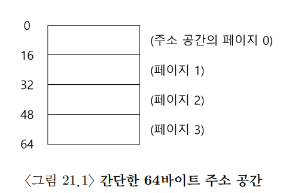
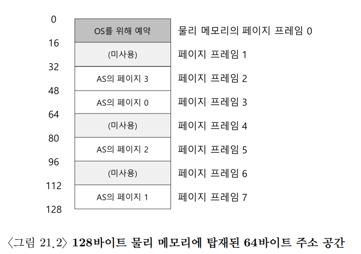
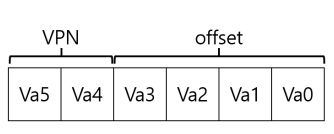
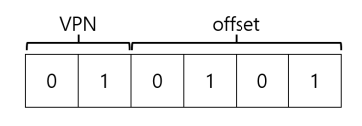
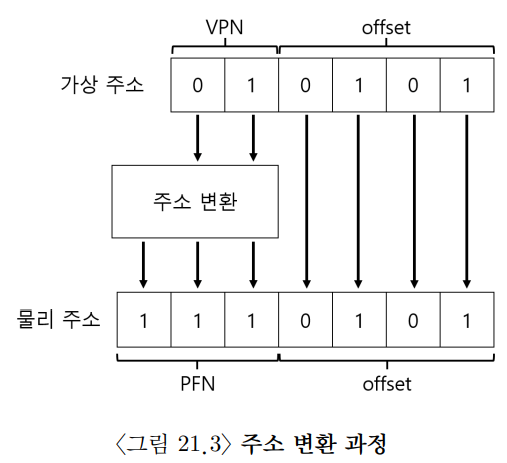
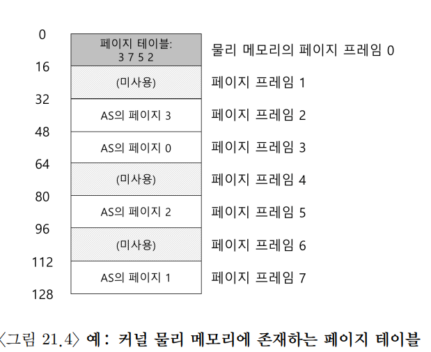
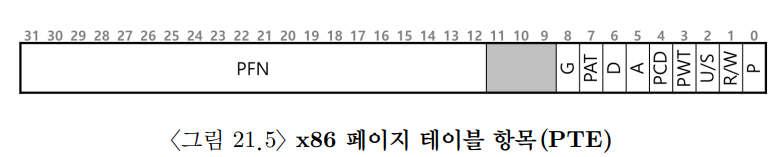
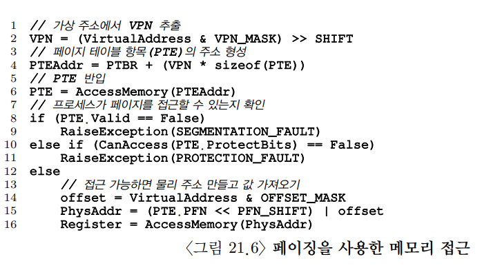
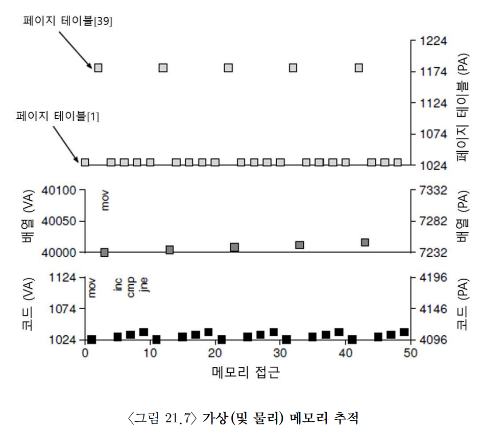
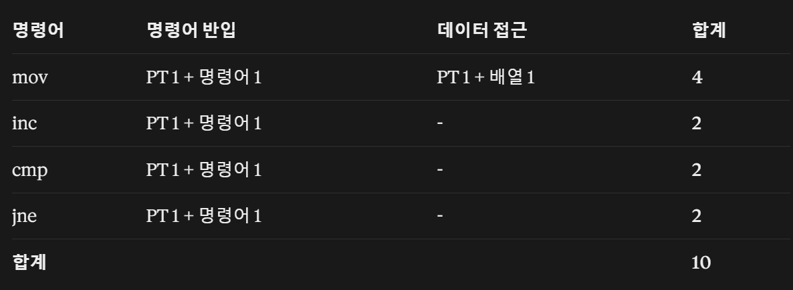

## ✦ 페이징: 개요

- [[운영체제|OS]] 가 공간 관리하는 방법
    1. 세그멘테이션 : 가변 크기의 조각들로 분할
    → 단편화 문제..
    2. 페이징 (Paging) : 동일 크기의 조각으로 분할
        - 페이지 (page) : 각각 고정 크기 단위
        - 물리 [[메모리]] = 페이지 프레임 (page frame) 이라고 불리는 고정 크기 슬롯의 [[배열]]!

### ◆ 간단한 예제 및 개요

- ex) 총 64 byte, 각 16 byte 인 페이지 0 ~ 4
    
    
    
- ex) 각 16 byte 의 8개의 페이지 프레임.
    
    
    
- 페이징의 장점
    - 유연성 : 효율적으로 주소 공간 개념 지원 가능
    - 빈 공간 관리 단순함 : 64 byte 배치 원함 → 빈 4개의 페이지 찾기!
        - OS 는 이를 위해 빈 공간 리스트 유지.
        - 페이지 테이블 (page table) :가상 페이지 주소 변환 정보 저장
            - 각 프로세스 마다 존재.
            - 새 프로세스의 가상 페이지는 다른 물리 페이지에 존재!
- 페이지 테이블에서 어떻게 변환이 일어나는가?
    1. 가상 주소 →가상 페이지 번호 (VPN, virtual page number)  & 페이지 내의 오프셋으로 분할
        - 총 [[비트]] 자리 수 중 분할해서 설정!
            
            
            
    2. 두 정보를 바탕으로 가상 페이지가 어느 물리 프레임에 저장되어 있는지 찾기
        - ex) `movl 21, %eax` → `010101`
            
            
            
            - 가상 페이지 1번의 5번째 [[바이트]]!
        - 물리 프레임 번호 (PFN, physical frame number)
        물리 페이지 번호 (PPN, physical page number)
    3. VPN → PFN 으로 교체해 가상 주소 변환
    4. 물리 메모리에 탑재 명령어 실행
        
        
        
        → 최종 물리주소 = `1110101`
        

### ◆ 페이지 테이블은 어디에 저장되는가

- 페이지 테이블은 커질 수 있음
    - 근데 만약 32 bit 주소 공간이면?
        - 대략 VPN 20 bit / offset 12 bit
        - 그러면 page 가 $2^{20}$ 개 있을 수 있음
        → 페이지 테이블 항목 (PTE, page table entry) 마다 4 byte 사용하면 테이블이 400MB 까지 커질 수 있음..
    - 큰 페이지 테이블을 MMU 유지 X → 메모리에 저장
        - 페이지 테이블은 OS 가 관리하는 물리 메모리에 상주.
        → 나중에는 [[가상 메모리]].. 디스크 스왑.. (근데 일단 무시)
        - 운영체제 메모리 영역에 페이지 테이블 존재!

### ◆ 페이지 테이블에는 실제 무엇이 있는가

- 페이지 테이블 : 가상 주소 - 물리 주소로 mapping 하는데 사용하는 자료 구조
    - 선형 페이지 테이블 (linear page table) : 가장 간단! 
    → 이거로 가정
    
    
    
- 각 PTE 에는 특정 역할 위한 bit 존재
    - Valid bit : 사용중인가?
        - invalid 부분에 접근 시 trap 발생
        - 할당되지 않은 주소 공간 표현. 메모리 절약
    - Protection bit : 읽을 수 있음? 쓸 수 있음?  실행될 수 있음?
        - 허용 안하는 방식으로 접근하면 trap 발생
    - Present bit : 이 페이지가 지금 어디에? (물리 메모리 / 디스크 / 스왑 아웃)
    → 스왑 때 자세히
    - Dirty bit : 메모리 반입 후 변경되었음?
    - Reference bit : 페이지가 접근되었음? 
    → 페이지 교체에 중요
    
    
    

### ◆ 페이징: 너무 느림

- 페이지 테이블이 너무 커져서 처리 속도가 느려질 수 있음…
- 왜 느린가?
    - 시스템은 프로세스의 PT 에서 PTE 를 가져오고, 변환을 수행하고, 물리 메모리에서 데이터 탑재.
    - 하나의 페이지 테이블 베이스 레지스터 (page table base register) 가 페이지 테이블 시작 물리 주소 저장 가정.
    - 하드웨어가 PTE 찾기
     `VPN = (VirtualAddress & VPN_MASK) >> SHIFT
     PTEAddr = PageTableBaseRegister + (VPN * sizeof(PTE)`
        - VPN_MASK → VPN bit 구별하기
        - SHIFT = offset bit 수
        
        `offset = VirtualAddress & OFFSET_MASK`
        `PhysAddr = (PFN << SHIFT) | offset`
        
    - 찾으면 메모리에서 데이터 가져와서 `eax` 레지스터에 넣기!
- 문제
    
    
    
    - 모든 메모리 참조에 대해 변환 정보 반입 위해 추가적으로 한 번 더 참조 해야함! 
    → 이걸 해결해야함..

### ◆ 메모리 트레이스

- 페이지 사용했을 때 발생하는 모든 메모리 접근을 알아보자!
- ex)
    
    ```c
    int array[1000];
    ...
    for (i = 0; i < 1000; i++)
    		array[i] = 0;
    ```
    
    - 실제 어셈블리에서 초기화는?
        
        ```nasm
        ; 1. 값 0 을 가상 메모리 주소로 옮김
        0x1024 movl $0x0, (%edi, %eax, 4)
        ; 2. eax 에 저장된 배열 인덱스 증가
        0x1028 incl %eax 
        ; 3. %eax 랑 1000 비교
        0x102c cmpl $0x03e8, %eax
        ; i < 1000 이면 루프로 둘아가기
        0x1030 jne 0x1024
        ```
        
- 어떤 메모리 접근이 일어나는가?
    - 가정) 
    가상 주소 공간 크기 = 64KB
    페이지 크기 = 1KB
    - 주요 페이지 테이블
        1. 코드 상주 가상 페이지 : VPN 1 → PFN 4
        2. 배열 자체 (int 4 × 1000) → 총 4000 byte. 4 page 사용
        VPN 39 → PFN 7
        VPN 40 → PFN 8
        VPN 41 → PFN 9
        VPN 42 → PFN 10
    - 프로그램 실행 시
        1. 명령어 위치 파악 → PT 접근
        2. 명령어 자체
        3. `mov` 명령어
            1. PT 접근 (배열 가상 주소 → 물리 메모리 주소 변환용)
            2. 배열 자체 접근
        
        
        
        
        

### ◆ 요약

- 페이징
    - 메모리를 고정 크기 단위로 나눔. 가상 주고 공간 드문 사용 허용
    - 제대로 구현 못하면 느림 & 메모리 낭비!!
    → 잘 구현해야한다!!

---

- 자주 사용하는 특수 문자
    
    ∞ ⊂ ⊃ ∪ ∩ ∴ ∵ ⇒ ⇔ ⁿ ¹ ² ³ ⁴ · ↑ ↓ … × ₁ ₂ ₃ ₄ ∅
    ex) Example
