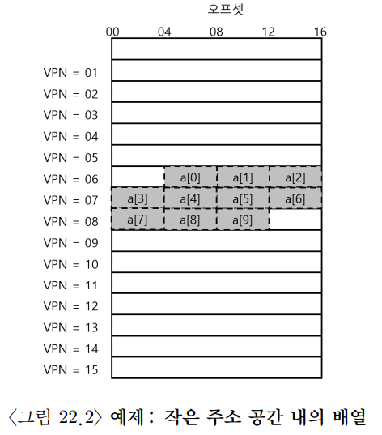
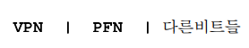
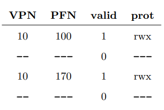
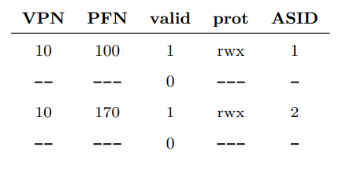
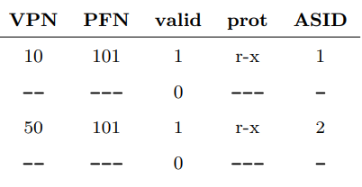
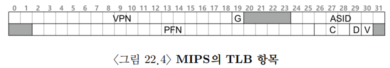

## ✦ 페이징: 더 빠른 변환 (TLB)

- 페이징 : 프로세스 주소 공간을 페이지 단위로 나누고 페이지 테이블에 매핑 정보 저장  → 큰 메모리 공간 필요.. 성능 저하 가능!
    - 어떻게 주소변환 속도를 늘릴까?
- TLB (translation-lookaside buffer) 이용!
    - MMU (memory-management unit) 의 일부.
    - 자주 참조되는 가상 주소 - 실주소 변환 정보 저장
    = 주소-변환 캐시 (address-translation cache)
    - 가상 메모리 참조시, 먼저 TLB 확인 → 있으면 변환 바로 수행!

### ◆ TLB 의 기본 알고리즘

- 주소 변환 → 선형 페이지 테이블 + TLB (HW 로 관리)

```c
// 1. 가상 주소에서 가상 페이지 번호 (VPN 추출)
VPN = (VirtualAddress & VPN_MASK) >> SHIFT
// 2. VPN 의 TLB 존재 여부 검사
(Success, TlbEntry) = TLB_Lookup(VPM)
if (Success == True) // -> 존재 시 TLB 히트!
	// 원하는 물리 주소 (PhysAddr) 구성 
	if (CanAccess(TlbEntry.ProtectBits) == True)
		Offset = VirtualAddress & OFFSET_MASK
		PhysAddr = (TlbEntry.PFN << SHIFT) | Offset
		AccessMemory(Phyaddr)
	else
		RaiseException(PROTECTION_FAULT)
else // -> 실패 시 TLB 미스
	// HW 가 변환 정보 찾기 위해 페이지 테이블 (PTE) 접근
	PTEAddr = PTBR + (VPN * sizeof(PTE))
	PTE = AccessMemory(PTEAddr)
	if (PTE.Valid == False) // 참조 유효 X
		RaiseException(SEGMENTATION_FAULT)
	else if (CanAccess(PTE.ProtectBits) == False) // 접근 유효 X
		RasieException(PROTECTION_FAULT)
	else // 참조, 접근 유효 O
		// 변환 정보를 TLB 에 저장 
		TLB_Insert(VPN. PTE.PFN, PTE.ProtectionBits)
		// 저장 완료 시 명령어 재실행!
		RetryInstruction() 
```

- 가정 : 주소 변환 정보가 대부분의 경우 캐시에 있다.
    - 미스가 있으면 페이징 비용이 커짐! 
    → 최대한 피해야..

### ◆ 예제: 배열 접근

- 각 페이지 16 byte, 총 16 페이지 존재.



- Miss → Hit → Hit / Miss → Hit → Hit → Hit / Miss → Hit → Hit
- TLB hit 비율 : 70%
    - 공간 지역성 (spatial locality) 로 성능 개선!
    - 페이지 크기가 클 수록 성능 더 개선!
    - 시간 지역성 (temporal locality) 측면에서도 히트율 좋아짐.
    ex) 루프 종료 후에도 배열 사용 시

### ◆ TLB 미스는 누가 처리할까

- 두 가지 방법
    - 하드웨어가 직접
        - CISC (complex instruction set computers)
            - ex) x86 CPU 의 멀티 레벨 페이지 테이블 (multi-level page table)
            1. 페이지 테이블에서 원하는 PTE 찾기
                - page-table base register 사용
            2. 필요한 변환 정보 추출하기
            3. TLB 갱신하기
            4. TLB 미스가 발생한 명령어 재실행 하기
    - OS
        - RISC (reduced instruction set computing)
            - 소프트웨어 관리 TLB (software-managed TLB)
            1. TLB 에서 주소 찾기 실패 → HW 예외 시그널 발생
            2. OS 가 시그널 받으면 명령어 실행 잠정 중지 + 커널 모드 변경
            3. TLB 미스 처리 트랩 핸들러 (trap handler) 실행
                - TLB 검색 & 변환 정보 찾기 & 갱신 후 리턴
            4. HW 가 해당 명령어 재실행
                - cf) 시스템 콜 호출은 다음 명령어 실행
                OS 가 PC 저장 시에 현재 or 다음 PC 값 저장
            - TLB 미스 무한 반복 주의!
                - TLB 미스 핸들러 접근 과정에서 TLB 미스 발생
                - How?
                    1. TLB 미스 핸들러 주소는 물리 주소로 표시
                    2. TLB 일부를 핸들러 코드 주소로 영구 할당
                    → 연결 (wired) 변환
        - 장점 : 유연성 & 단순함

### ◆ TLB 의 구성: 무엇이 있나?

- 일반적인 TLB 는 32 / 64 / 128 개의 entry 를 가짐
- Fully associative 방식으로 설계
    - 변환 정보는 TLB 내 어디든 위치 가능
    - 원하는 변환 정보 찾기 → TLB 전체에서 병렬적으로 수행
    
    
    
    - 각 항목마다 가상 페이지 번호 (VPN) & 물리 페이지 번호 (PFN) 존재
    - valid bit : 유효한 반환 정보 가지고 있음?
    - protection bit : 페이지가 어떻게 접근 가능? (읽기/쓰기/실행)
    - address-space identifier : 주소 공간 식별자 (주소가 어디?)
    - dirty bit : 수정 되었음?

### ◆ TLB 의 문제: 문맥 교환

- TLB 사용 하면 context switch 시 문제 발생..
    - TLB 변환 정보는 그걸 탑재한 프로세스에서만 유효!
    - TLB 정보는 어떡하지?
    
    
    
- 해결법
    1. Context switch 할 때 기존 TLB 내용 비우기
    → 모든 valid bit 0 으로 설정
        - 근데 context switch 가 많이 일어나면 성능 부담..
    2. ASID (address space identifier) 추가
        - PID 와 유사. 이 친구가 어떤 프로세스의 주소를 저장하고 있는지 저장
        - context switch 시 새로운 ASID 값을 정해진 레지스터에 탑재
        
        
        
- TLB 의 두 항목이 매우 유사하면?
    - exx) 두 프로세스가 한 페이지 공유
    - 공유 페이지 사용하면 메모리 부하 줄일 수 있음..
        
        
        

### ◆ 이슈: 교체 정책

- 캐시 교체 (cache replacement) 정채 ㄱ중요!
    - 새 항목 탑재 시 어떤 것을 교체 대상으로 선택?
    - 목표 : 미스율 줄이기 / 히트 비율 증가하기
- 방법
    1. LRU (Least-Recently-Used) : 가장 오래 전에 사용된 항목 교체. 
    총 페이지 n 개 일때, n+1 페이지 반복문 수행 시 최악의 TLB miss 발생..
    2. Random : 무작위로 교체. 간단 / 에외 피할 수 있음 but 잘못된 결정 내릴 수도..

### ◆ 실제 TLB

- MIPS R4000
    
    
    
    - 32bit, 4KB page 지원
    - VPN 19 bit → 전체 주소 공간의 반만 사용자 주소 공간으로 할당
    - PFN 24 bit → 64GB 물리 메모리 지원
    - G : global bit → 프로세스 간 공유되는 페이지 사용
    - ASID 8 bit : 어떤 프로세스 인지 저장
    → 256 개 이상이 동시에 실행되면?
    - C 3 bit : 일관성 비트 → 페이지가 HW 에 어떻게 캐시되어 있는가?
    - D (Dirty) 1 bit : 페이지가 갱신되면 세팅
    - V (Valid) : 항목에 유효한 변환 정보가 있는지?
    - page mask : 여러 개의 페이지 크기 지원할 때 사용 (그림엔 X)
- TLB 는 32 / 64 개 항목 구성
    - 대부분 사용자 process
    - 몇 개는 OS 예약
    - TLB 갱신 명령어 → 특별한 실행권한 필요
        - `TLBP` : 정보 존재 탐색
        - `TLBR` : TLB 항목 내용 → 레지스터
        - `TLBWI` : 특정 TLB 교체
        - `TLBWR` : 임의 TLV 항목 교체

### ◆ 요약

- TLB : CPU 안의 주소 변환 전용 캐시
    - 근데 짧은 시간 동안 접근하는 페이지가 TLB entry 수보다 많으면 항상 TLB 미스 발생..
    → TLB coverage 를 벗어남
    - 해결법 : 더 큰 페이지 크기 지원 → DBMS 에서 사용
- CPU 파이프라인에서 TLB 접근 → 병목 가능
    - 물리적으로 인덱스된 캐시 (physically-indexed cache)
        - 주소 변환이 캐시 접근 전에 이루어져야.. → 느려질 수 있음
    - 해결법 : 가상 주소로 캐시 접근 (virtually indexed cache)

---

- 자주 사용하는 특수 문자
    
    ∞ ⊂ ⊃ ∪ ∩ ∴ ∵ ⇒ ⇔ ⁿ ¹ ² ³ ⁴ · ↑ ↓ … × ₁ ₂ ₃ ₄ ∅
    ex) Example
