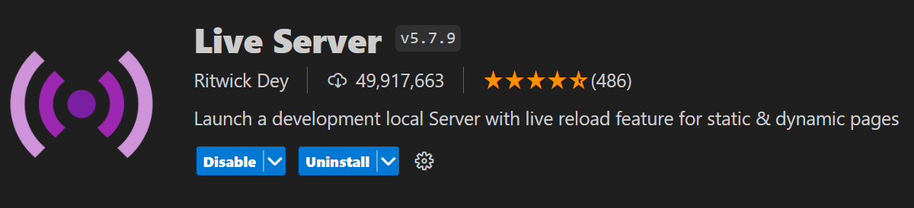
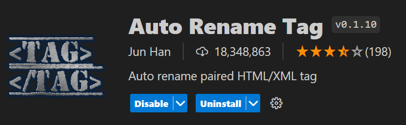
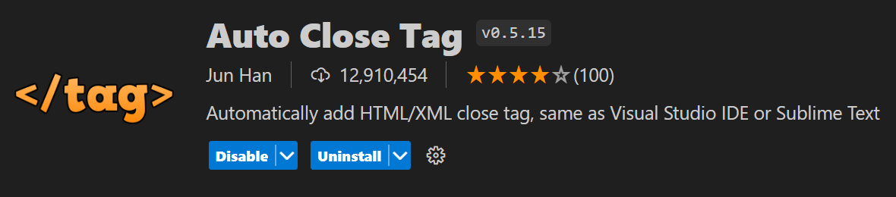
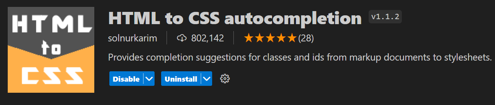
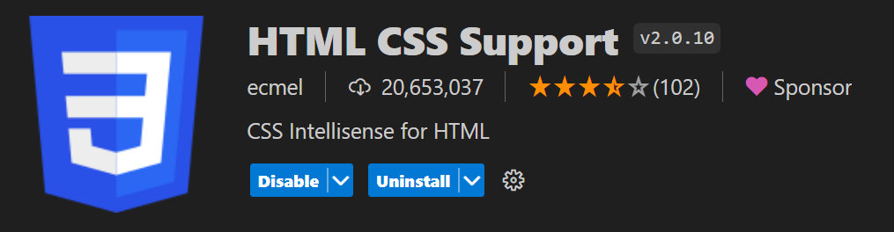
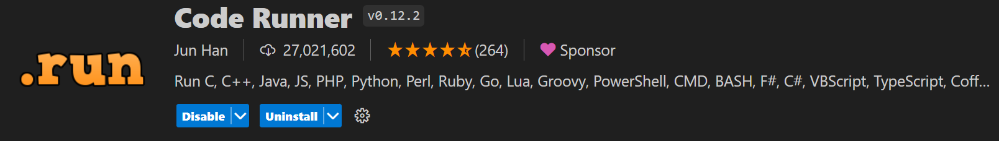

#### 개발 환경 : VSCode 

다운 링크 ↓

[https://code.visualstudio.com/](https://code.visualstudio.com/ "다운 링크")

[Visual Studio Code - Code Editing. Redefined](https://code.visualstudio.com/)

 

#### VS Extension 다운

1\. Live Server (Ritwick Dey)

가상 서버 통해 HTML 문서 실시간 확인 가능

 

2\. Auto Rename Tag (Jun Han)

시작 태그 or 종료 태그 수정시 다른 쪽 자동 수정

 

3\. Auto Close Tag (Jun Han)

시작 태그 작성시 종료 태그 자동 생성

 

4\. HTML to CSS autocompletion (solnurkarim)

HTML에서 class 속성으로 작성한 값을 CSS에서 자동 완성

 

5\. HTML CSS Support (ecmel)

CSS에서 작성한 class 나 id 선택자 값을 HTML의 id 와 class 로 적을 때 자동 완성

 

6\. Code Runner (Jun Han)

JavaScript 코드 실행을 VSCode 내부에서 할 수 있게 함

 
