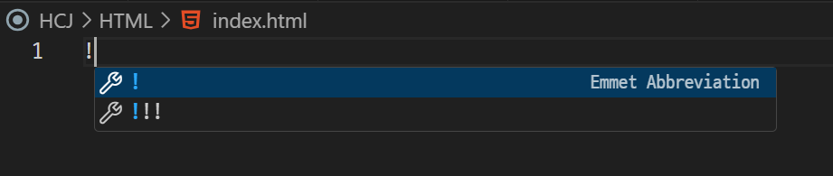
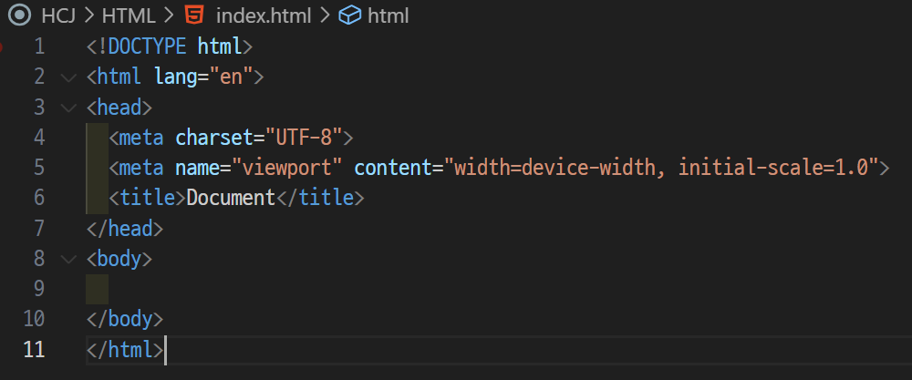

 

#### 기본 HTML 문서 만들기 

기본 파일명 : index.html



VSCode 에서 기본 파일 생성 후 "!"를 입력하면



위와 같은 코드가 자동으로 생성된다.

 

---

#### HTML 의 기본 요소

1\) 태그 : HTML 문법의 가장 작은 단위

<span style="background-color: #666666; color: #ffffff;">형식 : <태그명></span>

1. 콘텐츠 O 문법 : **시작 태그**

   <span style="color: #f89009;">

   <>

   </span>

   \+ **콘텐츠** + **종료 태그**

   <span style="color: #f89009;">

   \</>

   </span>

   → 모두 합쳐 **요소**

```html
<title>My First Web Page!</title>
```

   2. 콘텐츠 X 문법 : **시작 태그**만 사용 

```html
<br>
```

 

2\) 속성 : 태그의 의미, 기능 보충. 반드시 코드와 함께 사용

<span style="background-color: #666666; color: #ffffff;">형식 : <태그명 <span style="color: #ffc1c8;">속성명=<span style="color: #99cefa;">"속성값"  <span style="background-color: #666666; color: #ffc1c8;">속성명</span>=<span style="color: #99cefa;">"속성값, 속성값"</span></span></span>></span>

→ 속성이 여러 개 있을 시 띄어쓰기 O 쉼표 X / 속성값이 여러 개 있을 시 쉼표 O

 

3\) 주석 : 코드 메모, 설명. 실행 결과에는 표시 X

<span style="background-color: #666666; color: #ffffff;">형식 : <span style="color: #9feec3;">\<!-- 주석 내용 --></span></span>

---

#### HTML 의 기본 구조

1\) DTD(Document Type Defination) : 문서형 정의. 항상 HTML 문서 처음에 필요

```html
<!DOCTYPE html>
```

 

2\) html 태그 : HTML 문서의 시작과 끝 표시

   1. head : 문서의 메타데이터(metadata) 정의 영역. 직접 노출 X 

 

       - meta 태그에 기본으로 들어가야할 것

- charset 정의 → UTF-8
- 렌더링 엔진 최신 지정
- 기기 화면 너비에 맞추기 위한 태그 

   2. title : 문서의 제목 지정. 필수. 문서마다 중복 X 

   3. body : 실질 노출 영역.

 

```html
<html lang="ko">
  <head>
    <meta charset="UTF-8">
    <meta http-equiv="X-UA-Compatible" content="ie=edge">
    <meta name="viewport" content="width=device-width, initial-scale=1.0">
    <title>Document</title>
  </head>
  <body>
    <!-- 실제 표시 내용 -->
  </body>
</html>
```

 

---

#### HTML 의 특징

1\) 블록 요소 : 사용할 때마다 줄 바꿈되는 태그 (ex. hn, p)

2\) 인라인 요소 : 공간이 부족할 때만 줄 바꿈되는 태그 (ex. span, a)

 

3\) 부모, 자식, 형제 관계

```html
<html lang="ko">
  <head>
    <meta charset="UTF-8">
    <meta http-equiv="X-UA-Compatible" content="ie=edge">
    <meta name="viewport" content="width=device-width, initial-scale=1.0">
    <title>Document</title>
  </head>
  <body>
    <!-- 실제 표시 내용 -->
  </body>
</html>
```

html : 부모

head & body : 자식 + 부모가 같으므로 서로 형제

 
