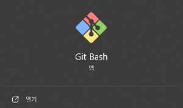

### 실습 환경 안내

1\) 터미널 : 윈도우에서 Git Bash.exe

2\) 프롬프트 : 터미널에서 명령을 대기하는 모드. 

'사용자 @호스트이름 : 작업중인디렉터리전체경로 $' / '현재 경로 + %'

3\) 기본 브랜치 : 깃허브에서의 메인 브랜치 명은 main이다.

 

#### 1. 깃허브 가입하기 

<https://github.com/>

[GitHub: Let’s build from here](https://github.com/)

 

#### 2. 깃 설치하기(윈도우)

<https://git-scm.com/download/win>

[Git - Downloading Package](https://git-scm.com/download/win)

 

 
