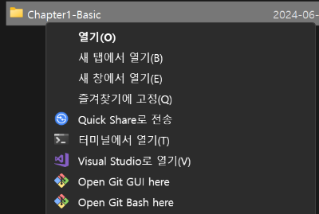

### 깃허브의 필요성

-  버전 관리 시스템 

Git 

1\) 이력 기록 및 추척

2\) 원격 저장소 및 공유

3\) 변경 이력 병합

 

GitHub

1\) 호스팅 서비스

2\) 공개 및 비공개 저장소

3\) 고급 기능 : 빌드 및 배포 자동화, 협업 프로젝트 등

 

GitHub 기능

1\) Repositories : 개인이 생성한 원격 저장소를 확인

2\) Projects : 해야하는 작업 정의, 우선순위 지정 및 관리

3\) Packages : 내가 만든 소스를 패키지로 만들고 관리하는 도구

 

---

### 첫 커밋 하기

1\) 지역 저장소에 커밋 생성하기

  - 원하는 위치에 루트 디렉터리 / 실습 디렉터리 생성

  - VSCode 에서 실습 디렉터리 열기

  - 디렉터리 우클릭 -> Git Bash Here 클릭

  - git init 입력해 깃 지역 저장소로 지정

  - git config user.name "사용자이름" 입력

  - git config user.email "이메일주소" 입력

    → GitHub 계정의 Username, Email과 동일해야 함

  - VSCode 에서 README.md 파일 생성 

더보기

.md 는 Markdown 형식의 파일을 의미한다. 보통 프로젝트 설명, 설치 방법 설명하는데 사용된다.

  - Git Bash 에서 git add README.md 를 입력해 커밋 파일로 등록한다.

  - Git Bash 에서 git commit 으로 커밋한다.

더보기

 git commit -m "커밋의 메세지를 작성한다"

  - Git Bash 에서 git log 로 커밋 결과를 확인 

 

2\) 원격 저장소에 커밋 등록하기

  - GitHub에서 New Repository 를 만든다.

  - 원격 저장소의 주소를 복사한다.

  - Git Bash 에서 git remote add origin "복사한 주소" 를 입력한다.

  - Git Bash 에서 git push origin main 을 입력해 커밋을 원격 저장소에 등록한다

더보기

origin : 원격 저장소 이름 

main : 원격 저장소 브랜치 이름 

 
