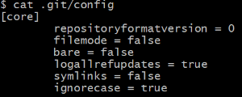
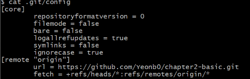
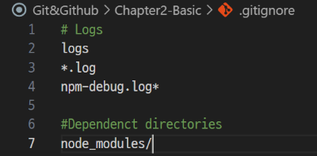
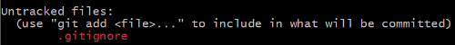
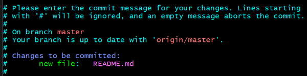
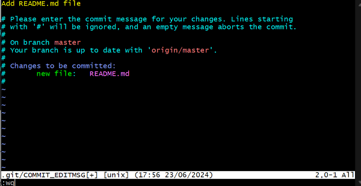
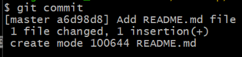
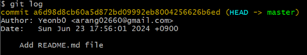
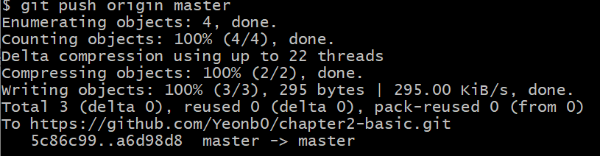

### 1. 지역 저장소 생성

1\) Git 지역 저장소 설정 

  - init 명령어로 설정 : 새로운 Git 지역 저장소로 설정

 

2\) .git : 해당 프로젝트를 Git 지역 저장소로 관리하는 정보가 있는 곳

    → cd .git 으로 이동 후 ls -l 명령어로 .git 폴더 안 확인 가능

  - init 취소 : .git 숨김 폴더 삭제. rm -rf .git 명령어로 삭제 가능

 

---

### 2. 환경 설정하기

1\) 사용자 등록

더보기

git config --global user.name "사용자 이름"

git config --global user.email "이메일 주소"

\--global 옵션을 사용해 모든 프로젝트에 동일한 사용자 정보 등록

 

2\) Git 설정 파일 확인

  - 위치 : .git 폴더 안의 config 파일. cat .git/config 명령어로 확인 가능

  - repositoryformatversion : Git 저장소의 형식 및 버전 식별 위한 내부 변수

  - filemode : 파일 모드의 변경 감지 여부 설정. (파일 시스템이 다를 때)

  - bare : Git 저장소가 코드를 변경하고 작업 용도가 아닌 작업 복사 용도일 시 true

  - logallrefupdates : 작업 내역 기록하는 reflog 활성화

  - ignorecase : 대소문자 구분 여부 (기본값 - true, 구분 X)

 

3\) Git 원격 저장소 설정

  - 새로운 저장소 생성 

  - git remote add origin {원격 저장소 주소} 명령어로 원격 저장소 주소를 Git 지역 저장소에 등록

  - 설정 파일에 remote "origin" 섹션이 추가 되어 있다

 

4\) .gitignore 파일 설정

  - 로그 파일, 빌드 결과 파일 등 수정할 일 없고, Git으로 관리할 필요가 없는 파일들 무시하게 만들기

  - VSCode 에서 지역 저장소에 .gitignore 파일 생성 

  - 로그 파일과 외부 패키지 관리 X 설정 (#는 주석 기호)

---

### 3. 파일 상태 확인하기

1\) Git 작업 트리

  a. 작업 디렉터리 : 실제 작업 중인 파일 존재 영역

  b. 스테이징 영역 : 작업 디렉터리에서 작업 중인 파일 중 Git이 추적하는 파일들을 식별하는 영역

  c. 지역 저장소 : 스테이징 영역에서 추적되는 파일이 Commit으로 등록되는 영역

 

작업 디렉터리 → 스테이징 영역 : git add

스테이징 영역 → 지역 저장소 : git commit

 

2\) 깃으로 파일 상태 확인

  - Untracked : 작업 디렉터리에서 새로 생성된 파일의 상태

  - Tracked : 한 번이라도 Tracked 상태가 되면 수정해도 계속 Tracked 이다

  - git status 명령어로 프로젝트 파일 상태 확인 가능

  - git add 파일 이름/폴더명

  - Modified / Unmodified : 한 번 스테이징 영역에 추가된 파일의 수정 여부에 따라 분류

  - Stage : Commit으로 기록할 수 있는 최종 상태 (Tracked / Unmodified 로 분류, 같은 의미)

  - Unstage : 스테이징 영역에 있지만, 파일에 변화가 있는 상태 (Commit으로 기록할 수 있는 상태 X)

 

프로젝트에서 새로운 파일 생성 →  작업 디렉터리의 Untracked 상태

git add 명령어 이용해 파일 등록  →  스테이징 영역의 Tracked / Unmodified 상태파일에 코드 한 줄 추가. 파일 내용 변경  →   스테이징 영역의 Tracked / Modified 상태git add 명령어 이용해 파일 재등록  →  스테이징 영역의 Tracked / Unmodified 상태

---

### 4. Commit 생성 후 Push 하기

1\) Commit 생성하기 

  - 명령어 : git commit 

  - #으로 시작하는 줄은 Commit 메세지에 반영되지 않는다.

  - On branch master : 현재 Commit 으로 기록하는 branch 가 master 이다.

  - Changes to be commited : README.md 파일이 Commit 에 추가되었다.

 

  - i 입력 → 입력 모드 전환 -- INSERT -- 표시 나타남

  - Add 파일명 파일 입력 → :wq 입력

  - Commit 에서 파일 1개 수정, 1줄 추가

 

2\) Commit 이해하기

  - git log 명령어로 작업 브랜치의 Commit 로그 확인 가능 

  - HEAD 포인터 : 현재 작업하는 브랜치의 최종 Commit 가르킴

더보기

git log - p : 파일 단위에서 변경 내용을 보여준다 ( = --patch)

git log -{숫자} : 최근 몇 개의 Commit을 보여줄지 지정 (p와 동시 사용가능)

git log --stat : 각 Commit의 통계 정보(어떤 파일 수정 | 몇 줄 추가 or 삭제) 표시

git log --pretty : Commit 로그 보여주는 형식 지정 가능

<table>
<tbody>
<tr>
<td>--pretty=oneline</td>
<td>각 Commit을 한 줄로 보여줌. 한 눈에 살펴볼 때 사용</td>
</tr>
<tr>
<td>--pretty=format:"%d %an %s"</td>
<td>나만의 출력 형식 지정. 옆 예시는 "짧은 Commit 해시, 저자 이름, Commit 요약" 순으로 표시</td>
</tr>
<tr>
<td>--pretty=oneline --graph</td>
<td>가시적으로 Commit 로그 흐름 파악 가능</td>
</tr>
</tbody>
</table>

 

<table>
<tbody>
<tr>
<td>%H</td>
<td>Commit 해시</td>
<td>%ae</td>
<td>저자 이메일</td>
</tr>
<tr>
<td>%h</td>
<td>짧은 Commit 해시</td>
<td>%ar</td>
<td>저자 상대적 시각</td>
</tr>
<tr>
<td>%T</td>
<td>트리 해시</td>
<td>%cn</td>
<td>커미터 이름</td>
</tr>
<tr>
<td>%t</td>
<td>짧은 트리 해시</td>
<td>%ce</td>
<td>커미터 이메일</td>
</tr>
<tr>
<td>%P</td>
<td>부모 해시</td>
<td>%cr</td>
<td>커미터 상대적 시각</td>
</tr>
<tr>
<td>%p</td>
<td>짧은 부모 해시</td>
<td>%s</td>
<td>Commit 요약</td>
</tr>
<tr>
<td>%an</td>
<td>저자 이름</td>
<td> </td>
<td> </td>
</tr>
</tbody>
</table>

 

3\) Commit 수정하기

  - git commit --amend 명령어로 마지막 Commit 에디터 화면 확인 가능

  - git commit --amend -m "수정 메세지" 명령어로 화면에서 Commit 메세지 수정

  - git commit --amend --no-edit 명령어로 에디터를 띄우지 않고 Commit 메시지 수정 X

 

4\) Commit Push 하기

  - 지역 저장소에 있는 Commit 을 원격 저장소에 등록하기 

  - git remot add origin {원격 저장소 주소} 로 원격 저장소 위치 입력

  - cat .git/config 명령어를 통해 URL 정보 확인 

  - git push {저장소} {브랜치} 명령어로 Commit 을 원격 저장소에 등록

 

---

 

### 5. 원격 저장소 복제하기

  - 이미 생성된 원격 저장소를 지역 저장소에 복제하여 사용

  - git clone "원격 저장소 주소" "새로운 저장소 이름" 명령어를 통해 복제
