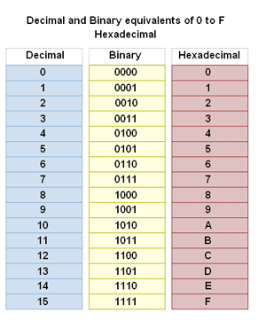

### 1. 컴퓨터의 데이터 표현 방식

  - 컴퓨터는 2진수 기반 표현 & 연산

  - 비트(bit) : 데이터의 최소 단위, 2진수 값 하나를 저장

  - 바이트(byte) : 비트를 8개 묶은 것

---

### 2. 정수와 실수의 표현 방식

  - 정수의 표현 방식 : 정수의 가장 왼쪽 존재 비트는 '부호 비트'(MSB)

  - 음의 정수를 표현할 때에는 2의 보수를 취해야 함.

 

  - 실수의 표현 방식 : 넓은 범위의 실수 표현 가능, but 오차 존재. 부동 소수점 오차!

---

### 3. 비트 연산자

<table>
<tbody>
<tr>
<td>&#x26;</td>
<td>비트 단위로 AND 연산</td>
<td>→</td>
</tr>
<tr>
<td>|</td>
<td>비트 단위로 OR 연산</td>
<td>→</td>
</tr>
<tr>
<td>^</td>
<td>비트 단위로 XOR 연산</td>
<td>→</td>
</tr>
<tr>
<td>~</td>
<td>단항 연산자, 피 연산자 모든 비트 반전</td>
<td>←</td>
</tr>
<tr>
<td>&#x3C;&#x3C;</td>
<td>피연산자의 비트열 왼쪽 이동</td>
<td>→</td>
</tr>
<tr>
<td>>></td>
<td>피연산자의 비트열 오른쪽 이동</td>
<td>→</td>
</tr>
</tbody>
</table>

 

  - & : 둘 다 1일 때 1 반환

  - | : 둘 다 0일 때 0 반환

  - ^ : 둘이 같으면 1, 다르면 1 반환

  - \~ : 0이면 1, 1이면 0 반환 (+ / - 도 반전된다)

  - num1 << num2 : num1의 비트열은 num2만큼 왼쪽 이동. 왼쪽으로 1칸씩 이동할 때마다 2 배

  - num1 >> num2 : num1의 비트열은 num2만큼 오른쪽 이동. 오른쪽으로 1칸씩 이동할 때마다 ½ 배

추가되는 비트는 0 / 삭제되는 비트는 버려짐

 

 
