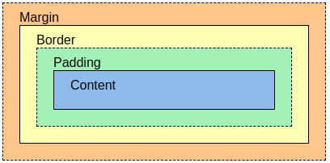
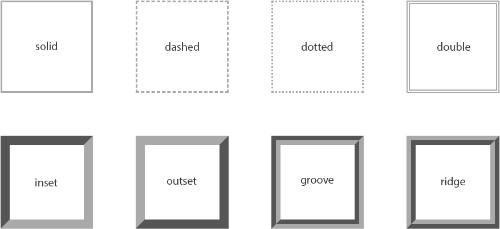

<table>
<tbody>
<tr>
<td>margin</td>
<td>요소의 외부 여백</td>
</tr>
<tr>
<td>border</td>
<td>요소의 테두리(경계선)</td>
</tr>
<tr>
<td>padding</td>
<td>요소의 내부 여백</td>
</tr>
<tr>
<td>content</td>
<td>요소의 내용</td>
</tr>
</tbody>
</table>

### 1. margin 영역

  - 요소의 외부 여백 담당

```css
margin-top: 크기;
margin-right: 크기;
margin-bottom: 크기;
margin-left: 크기;
```

margin: "상", "우", "하", "좌";  // 각각 상 오 하 왼 의미

margin: "상하", "좌우"; 

margin: "상하좌우";

 

  - margin 겹침 현상 : 인접한 margin 값이면 둘 중 더 큰 값으로 통일

---

### 2. border 영역

  - 요소의 테두리(경계선) 담당

```css
border: <border-width> <border-stlye> <color>
```

  1) border-width : 테두리 굵기 지정

  2) border-style : 테두리 모양 지정

<table>
<tbody>
<tr>
<td>none</td>
<td>테두리를 그리지 않음</td>
</tr>
<tr>
<td>hidden</td>
<td>테두리를 화면에서 감춤</td>
</tr>
<tr>
<td>solid</td>
<td>테두리를 실선으로 그림</td>
</tr>
<tr>
<td>double</td>
<td>테두리를 이중 실선으로 그림</td>
</tr>
<tr>
<td>dotted</td>
<td>테두리를 점선으로 그림</td>
</tr>
<tr>
<td>dashed</td>
<td>테두리를 긴 점선으로 그림</td>
</tr>
<tr>
<td>groove</td>
<td>테두리가 파인 것처럼 그림</td>
</tr>
<tr>
<td>ridge</td>
<td>테두리가 튀어나온 것처럼 그림</td>
</tr>
<tr>
<td>inset</td>
<td>테두리를 요소가 파인 것처럼 그림</td>
</tr>
<tr>
<td>outset</td>
<td>테두리를 요소가 튀어나온 것처럼 그림</td>
</tr>
</tbody>
</table>



---

### 3. padding 영역

  - 요소의 내부 여백 담당

```css
padding-top: 크기;
padding-right: 크기;
padding-bottom: 크기;
padding-left: 크기;
```

padding: "상", "우", "하", "좌";  // 각각 상 오 하 왼 의미

padding: "상하", "좌우"; 

padding: "상하좌우";

---

### 4. content 영역

  - 시작 태그와 종료 태그 사이에 사용된 콘텐츠 소속 영역

 

  1) width : content 영역의 너비

  2) height : content 영역의 높이 

  3) box-sizing 

<table>
<tbody>
<tr>
<td>content-box</td>
<td>width, height 속성 적용 범위를 content 영역으로 제한</td>
</tr>
<tr>
<td>border-box</td>
<td>width, height 속성 적용 범위를 border 영역으로 제한</td>
</tr>
</tbody>
</table>

---

### 5. 박스 모델의 성격

1\) 블록 성격 : hn, p, div 등 태그 사용시 항상 가로 한 줄을 다 차지하는 것. 사용시 줄 바꿈 이루어짐

2\) 인라인 성격 : a, span, strong 등 요소의 너비가 콘텐츠 크기 만큼 차지하는 것. 공간 남아있을 시 한 줄에 배치

3\) 인라인 블록 성격 : img 등 요소의 너비가 콘텐츠 크기 만큼 차지하지만, 그 외의 성격은 블록 성격을 가지는 복합적 성격

 

  - 블록 & 인라인 블록 : width, height, margin, padding 속성 전부 적용

  - 인라인 : width, height 속성 적용 X, padding, margin 오른쪽, 왼쪽 방향만 적용.

  - display 속성 : 박스 모델의 성격 변경 가능. block, inline, inline-block
