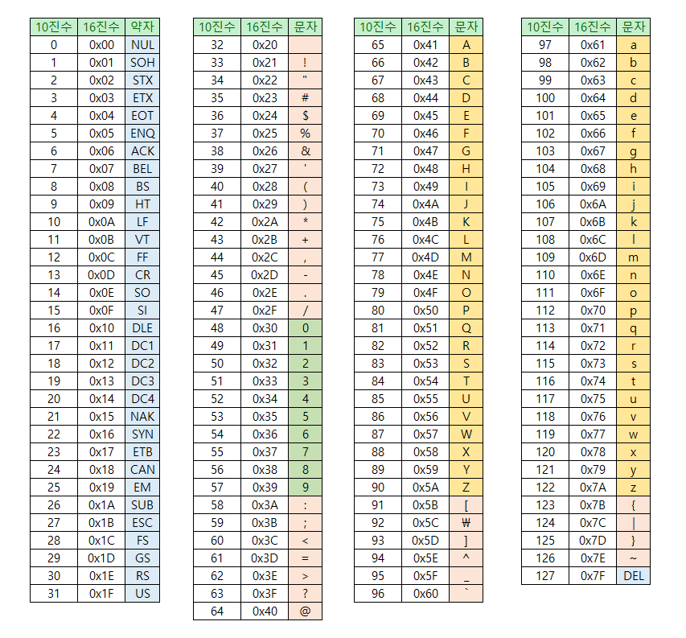

### 1. 기본 자료형

<table>
<tbody>
<tr>
<td rowspan="5">정수형</td>
<td>char</td>
<td>1 byte</td>
</tr>
<tr>
<td>short</td>
<td>2 byte</td>
</tr>
<tr>
<td>int</td>
<td>4 byte</td>
</tr>
<tr>
<td>long</td>
<td>4 byte</td>
</tr>
<tr>
<td>long long</td>
<td>8 byte</td>
</tr>
<tr>
<td rowspan="3">실수형</td>
<td>float </td>
<td>4 byte</td>
</tr>
<tr>
<td>double</td>
<td>8 byte</td>
</tr>
<tr>
<td>long double</td>
<td>8 byte 이상</td>
</tr>
</tbody>
</table>

 

  - sizeof() : 연산자. 자료형의 크기 확인 가능 (함수 X)

  - 일반적으로 컴퓨터는 int, 로 형변환해서 연산

  - 정수의 일반 자료형 : int

  - 실수의 일반 자료형 : double

  - unsigned : 0과 양의 정수만 표현. 맨앞 부호도 숫자로 사용, 표현 숫자 두 배

  - double : scanf할때는 %lf, printf할때는 %f

<table>
<tbody>
<tr>
<td>unsigned char</td>
<td>1 byte</td>
</tr>
<tr>
<td>unsigned short</td>
<td>2 byte</td>
</tr>
<tr>
<td>unsigned int</td>
<td>4 byte</td>
</tr>
<tr>
<td>unsigned long</td>
<td>4 byte</td>
</tr>
<tr>
<td>unsigned long long</td>
<td>8 byte</td>
</tr>
</tbody>
</table>

---

### 2. 문자 표현 방식

  - 아스키(ASCII) 코드 값과 연결

  - 문자는 **작은 따옴표**로 감싸서 표현

  - 정수는 출력법에 따라 문자로도, 숫자로도 가능

---

### 3. 상수에 대한 이해

1\) 리터럴(literal) 상수 : 할당된 메모리 공간에 이름이 없는 상수

ex) int num = 30 + 40;    → 30, 40은 리터럴 상수

  - int형으로 표현 가능한 정수형 상수는 int 형으로 저장 (ex. char, short)

  - double형으로 표현 가능한 실수형 상수는 double형으로 저장

  - 접미사 사용 : 초기화할 때 int, double 데이터를 다른 곳에 저장할 때 사용

<table>
<tbody>
<tr>
<td>u, U</td>
<td>unsigned int </td>
<td>unsigned int n = 1025u;</td>
</tr>
<tr>
<td>l, L</td>
<td>long</td>
<td>long n = 2467L;</td>
</tr>
<tr>
<td>ul, UL</td>
<td>unsigned long </td>
<td>unsigned long n = 3456UL;</td>
</tr>
<tr>
<td>ll, LL</td>
<td>long long</td>
<td>long long n = 5678LL;</td>
</tr>
<tr>
<td>ull, ULL</td>
<td>unsigned long long </td>
<td>unsigned long long n = 9876ULL;</td>
</tr>
<tr>
<td>f, F</td>
<td>float</td>
<td>float f = 3.15F;</td>
</tr>
<tr>
<td>l, L</td>
<td>long double</td>
<td>long double f = 5.671L;</td>
</tr>
</tbody>
</table>

 

2\) 심볼릭(symbolic) 상수 : 이름을 지니는 상수. 

  - 변수 앞 const 선언. 값 변경 불가

  - const 붙인 변수는 모두 대문자. 선언과 동시에 초기화 해야함.

---

### 4. 자료형의 변환

1\) 자동 형 변환(묵시적 형 변환) : 대입 연산의 전달 과정에서 발생

  - 정수 → 실수 : 데이터 손실 X, but 오차 존재(실수이기 때문에)

  - 실수 → 정수 : 소수점 이하의 값 버려짐

  - 바이트 큰 정수 → 바이트 작은 정수 : 상위 바이트 소멸. 부호 바뀔 가능성 O

 

  - 정수의 승격 : 계산 시 int 로 바뀌어 계산

  - 피연산자 자료형 불일치 : int → long → long long → float → double → long double

    → 데이터 손실 최소화하는 방향으로

 

2\) 명시적 형 변환 : 형 변환 연산자 이용, (자료형)
