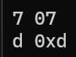

### 1. printf 함수 : 문자열 출력

  - 큰 따옴표 " " 사용.

  - 문자열 내에서 큰 따옴 표 표시할 때 /" 사용

  - 특수 문자 종류

<table>
<tbody>
<tr>
<td>\a</td>
<td>경고음</td>
</tr>
<tr>
<td>\b</td>
<td>백스페이스</td>
</tr>
<tr>
<td>\f</td>
<td>폼 피드(프린터 출력시 사용)</td>
</tr>
<tr>
<td>\n</td>
<td>개 행(new line)</td>
</tr>
<tr>
<td>\r</td>
<td>캐리지 리턴(프린터 출력시 사용)</td>
</tr>
<tr>
<td>\t</td>
<td>수평 탭</td>
</tr>
<tr>
<td>\v</td>
<td>수직 탭</td>
</tr>
<tr>
<td>\'</td>
<td>작은 따옴표 출력</td>
</tr>
<tr>
<td>\"</td>
<td>큰 따옴표 출력</td>
</tr>
<tr>
<td>\?</td>
<td>물음표 출력</td>
</tr>
<tr>
<td>\\</td>
<td>역슬래쉬 출력</td>
</tr>
</tbody>
</table>

 

  - 서식 문자 종류

<table>
<tbody>
<tr>
<td>%d</td>
<td>char, short, int</td>
<td>부호 있는 10진수 정수</td>
</tr>
<tr>
<td>%ld</td>
<td>long</td>
<td>부호 있는 10진수 정수</td>
</tr>
<tr>
<td>%lld</td>
<td>long long</td>
<td>부호 있는 10진수 정수</td>
</tr>
<tr>
<td>%u</td>
<td>unsigned int</td>
<td>부호 없는 10진수 정수</td>
</tr>
<tr>
<td>%o</td>
<td>unsigned int </td>
<td>부호 없는 8진수 정수</td>
</tr>
<tr>
<td>%x, %X</td>
<td>unsigned int </td>
<td>부호 없는 16진수 정수</td>
</tr>
<tr>
<td>%f</td>
<td>float, double</td>
<td>10진수 방식의 부동소수점 실수</td>
</tr>
<tr>
<td>%lf</td>
<td>long double</td>
<td>10진수 방식의 부동소수점 실수</td>
</tr>
<tr>
<td>%e, %E</td>
<td>float, double</td>
<td>e, 또는 E 방식의 부동소수점 실수</td>
</tr>
<tr>
<td>%g, %G</td>
<td>float, double</td>
<td>값에 따라 %f, %e사이에서 선택</td>
</tr>
<tr>
<td>%c</td>
<td>char, short, int</td>
<td>값에 대응하는 문자</td>
</tr>
<tr>
<td>%s</td>
<td>char * </td>
<td>문자열</td>
</tr>
<tr>
<td>%p</td>
<td>void *</td>
<td>포인터 주소 값</td>
</tr>
</tbody>
</table>

 

  - 음의 정수 출력시 반드시 %d 사용

  - 8진수, 16진수 답게 출력 원할시, %#o, %#x 사용

  - e : 지수 형태의 표기법 1.0e-20 은 1 X 10^-20 

  - g : 소수점 자리가 늘어나면 e, 적으면 f 형식 사용

  - 필드폭 지정 

<table>
<tbody>
<tr>
<td>%8d</td>
<td>8칸 확보, 오른쪽 정렬</td>
</tr>
<tr>
<td>%-8d</td>
<td>8칸 확보, 왼쪽 정렬</td>
</tr>
</tbody>
</table>

---

### 2. scanf 함수 : 문자열 입력

<table>
<tbody>
<tr>
<td>%d</td>
<td>10진수 정수의 형태로 데이터 입력</td>
</tr>
<tr>
<td>%o</td>
<td>8진수 양의 정수 형태로 데이터 입력</td>
</tr>
<tr>
<td>%x</td>
<td>16진수 양의 정수 형태로 데이터 입력</td>
</tr>
<tr>
<td>%f</td>
<td>float 형 데이터 입력</td>
</tr>
<tr>
<td>%lf</td>
<td>double 형 데이터 입력</td>
</tr>
<tr>
<td>%Lf</td>
<td>long double 형 데이터 입력</td>
</tr>
<tr>
<td>%s</td>
<td>문자열 형 데이터 입력</td>
</tr>
</tbody>
</table>

 

  - 실수 입력 과정에서 e 표기법 사용 가능

<table>
<tbody>
<tr>
<td>자료형</td>
<td>입력시</td>
<td>출력시</td>
</tr>
<tr>
<td>float</td>
<td>%f</td>
<td>%f</td>
</tr>
<tr>
<td>double</td>
<td>%lf</td>
<td>%f</td>
</tr>
<tr>
<td>long double</td>
<td>%Lf</td>
<td>%Lf</td>
</tr>
</tbody>
</table>

 
