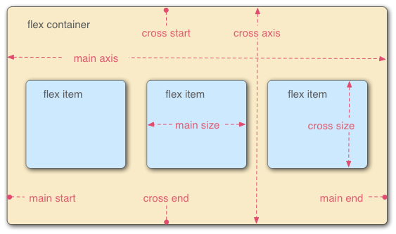

### 1. 구성 요소



1\) 주축(main axis) : 진행 방향과 수평한 축 (x축)

2\) 교차축(cross axis) : 진행 방향과 수직인 축 (y축)

3\) 플렉스 컨테이너(flex container) : display 속성 값으로 flex, inline-flex 적용된 요소

4\) 플렉스 아이템(flex item) : 플렉스 컨테이너와 자식 관계인 요소들

---

###  2. 기본 속성

1\) display : display 속성을 flex / inline-flex로 지정해야 플렉스 박스 레이아웃이 된다.

  - flex: 적용된 요소 다음 요소가 항상 줄 바꿈

  - inline-flex: 다음 요소가 주변에 배치

  - display 속성 지정 요소는 flex container / 지정 요소의 자식 요소는 flex item

  - 특징: flex item이 수평으로 배치. 원래 박스 성격은 무시

 

2\) flex-direction : 레이아웃의 주축 방향 결정

<table>
<tbody>
<tr>
<td>row</td>
<td>왼쪽에서 오른쪽으로 → , 기본값</td>
</tr>
<tr>
<td>row-reverse</td>
<td>오른쪽에서 왼쪽으로 ←</td>
</tr>
<tr>
<td>column</td>
<td>위쪽에서 아래쪽으로 ↓</td>
</tr>
<tr>
<td>column-reverse</td>
<td>아래쪽에서 위쪽으로 ↑</td>
</tr>
</tbody>
</table>

 

3\) flex-wrap : flex item이 컨테이너 영역을 벗어날때 처리 방법

<table>
<tbody>
<tr>
<td>nowrap</td>
<td>컨테이너 벗어나도 무시, 기본값</td>
</tr>
<tr>
<td>wrap</td>
<td>컨테이너를 벗어나면 줄바꿈</td>
</tr>
<tr>
<td>wrap-reverse</td>
<td>컨테이너를 벗어나면 wrap의 역 방향으로 줄바꿈</td>
</tr>
</tbody>
</table>

  

4\) flex-flow : direction, wrap 속성 한번에 사용

```css
flex-flow: column nowrap;
```

  - flex-flow: \<direction> \<wrap>;

---

### 3. 정렬 속성

1\) justify-content : 주축 방향 정렬시 사용

<table>
<tbody>
<tr>
<td>flex-start</td>
<td>주축 방향의 시작을 기준으로 정렬</td>
</tr>
<tr>
<td>flex-end</td>
<td>주축 방향의 끝을 기준으로 정렬</td>
</tr>
<tr>
<td>center</td>
<td>주축 방향의 중앙에 정렬</td>
</tr>
<tr>
<td>space-between</td>
<td>flex item 사이의 간격이 균일하도록 정렬</td>
</tr>
<tr>
<td>space-around</td>
<td>flex item의 둘레가 균일하도록 정렬</td>
</tr>
<tr>
<td>space-evenly</td>
<td>flex item 사이와 양끝의 간격이 균일하도록 정렬</td>
</tr>
</tbody>
</table>

 

2\) align-items : 교차축 방향 정렬시 사용

<table>
<tbody>
<tr>
<td>strech</td>
<td>교차축 방향으로 flex item의 너비나 높이가 늘어남 (기본)</td>
</tr>
<tr>
<td>flex-start</td>
<td>교차축 방향의 시작을 기준으로 정렬</td>
</tr>
<tr>
<td>flex-end</td>
<td>교차축 방향의 끝을 기준으로 정렬</td>
</tr>
<tr>
<td>center</td>
<td>교차축 방향의 중앙을 기준으로 정렬</td>
</tr>
<tr>
<td>baseline</td>
<td>flex item의 baseline을 기준으로 정렬</td>
</tr>
</tbody>
</table>

 

3\) align-content : flex item이 flex-wrap 속성 때문에 2줄 이상이 됐을 때만 사용

4\) align-self : flex item을 각각 정렬하고 싶을 때 사용
