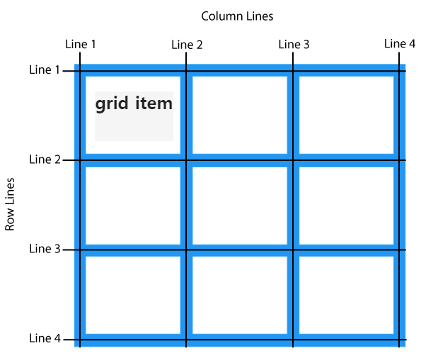
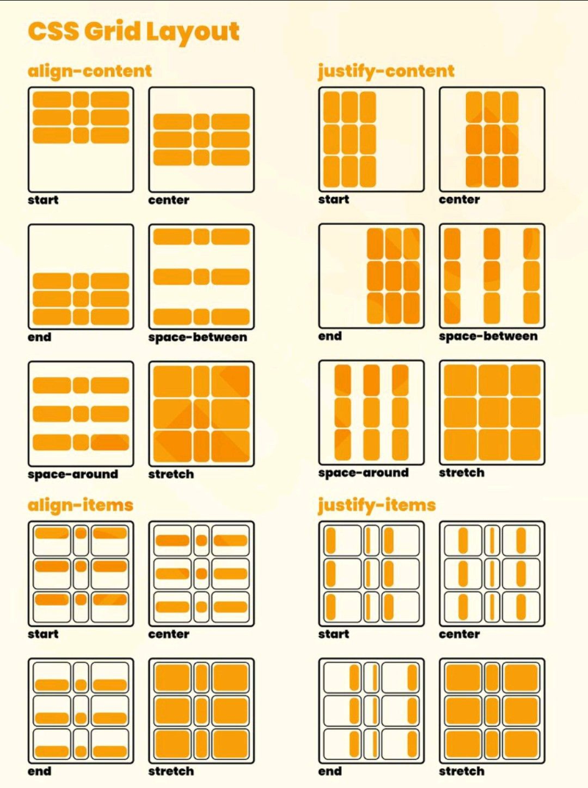
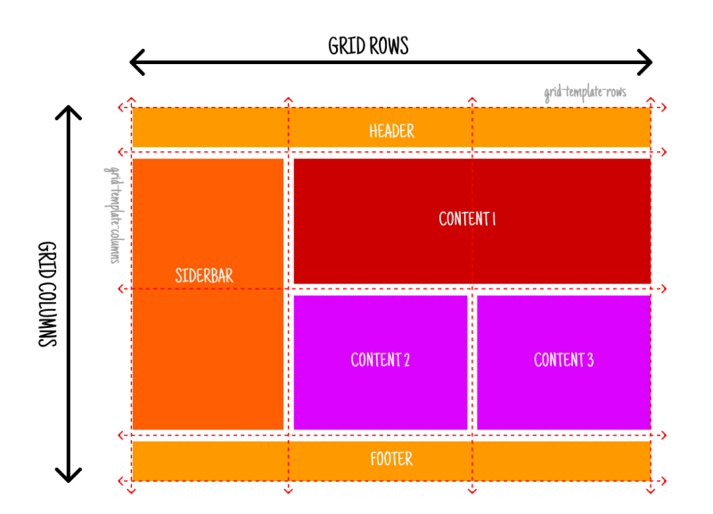
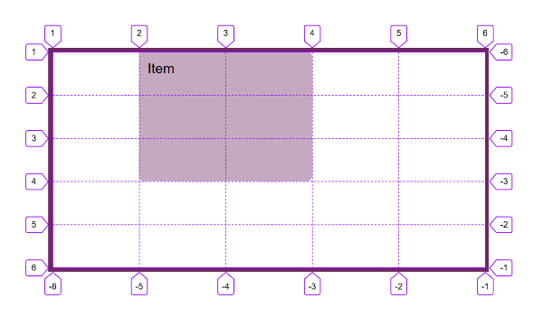

### 1. 구성 요소



1\) 행(row) : 가로 줄

2\) 열(column) : 세로 줄

3\) 그리드 셀(grid cell) : 행과 열이 만나 이루어지는 하나의 공간

4\) 그리드 갭(grid gap) : 그리드 셀과 그리드 셀 사이의 간격

5\) 그리드 아이템(grid item) : 그리드 셀 안에서 표현되는 컨텐츠

6\) 그리드 라인(grid line) : 그리드 행과 열을 그리는 선

7\) 그리드 넘버(grid number) : 그리드 라인에 붙는 번호

8\) 그리드 컨테이너(grid container) : 최상위 부모 요소

---

### 2. 기본 속성

1\) display : display 속성을 grid / inline-grid 로 지정해야 그리드 레이아웃이 된다.

  - flex : 적용된 다음 요소가 항상 줄 바꿈

  - inline-flex : 다음 요소가 주변에 배치

  - display 속성 지정 요소는 grid container / 지정 요소의 자식 요소는 grid item

 

2\) grid-template-columns/rows

  - 행과 열을 생성

```css
grid{
  grid-template-columns: 100px 100px 50px;
  grid-template-rows: 200px 200px auto;
}
```

  - 3X3 그리드 생성 

  - auto 값 지정시 행과 열의 크기를 그리드 컨테이너에 맞춰 자동 지정 

  - repeat(n, 100px); // 100px짜리를 n 개 만듬

  - minmax(min, max); // 열 or 행 크기의 최솟값과 최댓값 가정

 

3\) row-gap / column-gap 

  - 그리드 셀들 사이의 간격 지정

```css
.grid-container{
  row-gap: 10px;  // 세로 간격
  column-gap: 20px;  // 가로 간격
}
```

---

### 3. 정렬 속성



1\) align-items : 그리드 아이템을 그리드 셀의 세로 방향으로 정렬

<table>
<tbody>
<tr>
<td>strech</td>
<td>그리드 셀을 꽉 채우도록 배치</td>
</tr>
<tr>
<td>start</td>
<td>그리드 셀의 맨 위에 배치</td>
</tr>
<tr>
<td>center</td>
<td>그리드 셀의 세로 방향 중간에 배치</td>
</tr>
<tr>
<td>end</td>
<td>그리드 셀의 맨 아래에 배치</td>
</tr>
</tbody>
</table>

  - 각 item의 정렬 설정 : align-self

 

2\) justify-items : 그리드 아이템을 그리드 셀의 가로 방향으로 정렬

<table>
<tbody>
<tr>
<td>strech</td>
<td>그리드 셀을 꽉 채우도록 배치</td>
</tr>
<tr>
<td>start</td>
<td>그리드 셀의 맨 위에 배치</td>
</tr>
<tr>
<td>center</td>
<td>그리드 셀의 가로 방향 중간에 배치</td>
</tr>
<tr>
<td>end</td>
<td>그리드 셀 맨 아래에 배치</td>
</tr>
</tbody>
</table>

  - 각 item의 정렬 설정 : justify-self

 

3\) place-items / place-self

  - align, justify 한번에 사용 가능

  - place-item: \<align-items> \<justify-items>;

---

### 4. 배치 속성

1\) grid-template-areas : 그리드 레이아웃의 행과 열을 이름으로 지정 가능 



```css
.grid-container{
      display:grid;
      grid-template-areas: 
      "header header header"
      "sidebar content1 content1"
      "sidebar content2 content3"
      "footer footer footer";
    }
```

  - 속성으로 이름 지은 후 grid-area속성을 통해 이름을 grid item에 배치 가능

```css
  #header{
      grid-area:header;
  }
  #sidebar{
      grid-area:sidebar;
  }
  #content1{
      grid-area:content1;
  }
  #content2{
      grid-area:content2;
  }
  #content3{
      grid-area:content3;
  }
  #footer{
      grid-area:footer;
  }
```

 

2\) grid-column/row-start/end



  - 그리드 라인 고유 넘버 이용해 위치 표시

```css
    .grid-item:nth-child(1){
      grid-column-start:1;
      grid-column-end:3;
    }
    .grid-item:nth-child(2){
      grid-column-start:3;
      grid-column-end:4;
    }
    .grid-item:nth-child(3){
      grid-row-start:2;
      grid-row-end:4;
      background-color:orange;
    }
    .grid-item:nth-child(4){
      grid-column-start:2;
      grid-column-end:4;
      grid-row-start:2;
      grid-row-end:4;
      background-color:blue;
    }
```

 

3\) grid-column / grid-row : start & end 한번에 사용 

```css
.grid{
  grid-column: 1/3;    /* start 1 & end 3 */
  grid-row: 3/span5;    /* start 3 & end 8 */
}
```

 
