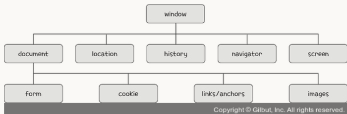
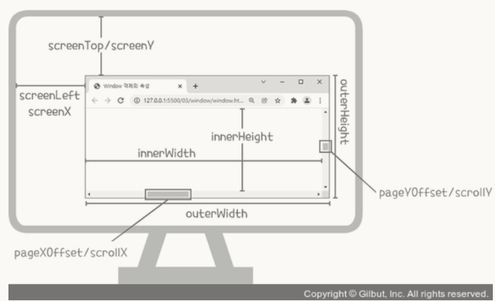

### 1. 표준 내장 객체 

  - 자바스크립트 기본 내장 [[객체]]

#### 1) String 객체 : 문자열을 다룸

<table>
<tbody>
<tr>
<td>속성</td>
<td>length</td>
<td>문자열의 길이 반환</td>
</tr>
<tr>
<td rowspan="7">메서드</td>
<td>includes()</td>
<td>전달되는 인자(문자열)가 포함되어 있으면 true, 아니면 false</td>
</tr>
<tr>
<td>replace()</td>
<td>전달되는 인자와 일치하는 한 부분을 찾아 다른 데이터로 변경한 새 문자열 반환</td>
</tr>
<tr>
<td>replaceAll()</td>
<td>전달되는 인자와 일치하는 모든 부분을 찾아 다른 데이터로 변경한 새 문자열 반환</td>
</tr>
<tr>
<td>split()</td>
<td>전달되는 인자를 기준으로 문자열을 분리한 후 새 배열로 반환</td>
</tr>
<tr>
<td>toUpperCase()</td>
<td>문자열을 대문자로 변경해 반환</td>
</tr>
<tr>
<td>trim()</td>
<td>문자열의 앞뒤 공백 제거해 반환</td>
</tr>
<tr>
<td>indexOf()</td>
<td>전달 인자와 일치하는 첫 번째 문자의 인덱스 반환 (못 찾을시 -1 반환)</td>
</tr>
</tbody>
</table>

 

```javascript
const pw = "1245577";
if(pw.length < 4){
  cosole.log("비밀번호는 4자리 이상이어야 합니다");
}

const email = "test!naver.com";
if(email.includes("@") === false){
  console.log("올바른 이메일 형식이 아닙니다");
}

if(email.indexOf("@") === -1){
  console.log("올바른 이메일 형식이 아닙니다");
}
```

 

#### 2) Array 객체 : 배열을 다룸

<table>
<tbody>
<tr>
<td>속성</td>
<td>length</td>
<td>배열의 요소 개수 반환</td>
</tr>
<tr>
<td rowspan="6">파괴적 메서드</td>
<td>push()</td>
<td>배열의 맨 뒤에 전달된 값 추가</td>
</tr>
<tr>
<td>pop()</td>
<td>배열의 맨 뒤에서 값 추출</td>
</tr>
<tr>
<td>unshift()</td>
<td>배열의 맨 앞에 전달된 값 추가</td>
</tr>
<tr>
<td>shift()</td>
<td>배열의 맨 앞에서 값 추출</td>
</tr>
<tr>
<td>sort()</td>
<td>배열의 요소 정렬</td>
</tr>
<tr>
<td>reverse()</td>
<td>배열의 요소 역순 정렬</td>
</tr>
<tr>
<td rowspan="6">비파괴적 메서드</td>
<td>forEach()</td>
<td>배열의 요소 순회하며 콜백(callback) 함수 호출, like 반복문</td>
</tr>
<tr>
<td>filter()</td>
<td>배열의 요소 순회하며 콜백 함수에서 true 반환하는 요소만 추출, 새 배열 반환</td>
</tr>
<tr>
<td>find()</td>
<td>주어진 값 만족하는 첫 번째 값 반환</td>
</tr>
<tr>
<td>findIndex()</td>
<td>주어진 값 만족하는 첫 번째 값의 인덱스 반환</td>
</tr>
<tr>
<td>includes()</td>
<td>배열에 인자 포함 되어 있으면 true, 아니면 false</td>
</tr>
<tr>
<td>join()</td>
<td>배열의 모든 요소를 주어진 구분 자로 합침</td>
</tr>
</tbody>
</table>

 

#### 3) Date 객체 : 날짜와 시간을 다룸

  - [[인스턴스]] 만들기 : Date 객체 호출해 데이터 생성

```javascript
const date = new Date();  // Fri Jul 05 2024 12:56:33 GMT+0900 (한국 표준시)
```

 

  - 직접 정보 전달해 생성하는 방법 

```javascript
const date1 = new Date(2022, 11, 25); // 월 전달시 실제보다 -1 해야함

const date2 = new Date("2022-12-25"); // 그대로 전달 ok
const date3 = new Date("2022/12/25/18:30:50");
```

 

<table>
<tbody>
<tr>
<td>getFullYear()</td>
<td>연도를 4자리 숫자로 표시</td>
</tr>
<tr>
<td>getMonth()</td>
<td>월을 0부터 11까지의 숫자로 표시 </td>
</tr>
<tr>
<td>getDate()</td>
<td>일을 1부터 31까지의 숫자로 표시</td>
</tr>
<tr>
<td>getDay()</td>
<td>요일을 0부터 6까지의 숫자로 표시 (일요일 0, 토요일 6)</td>
</tr>
<tr>
<td>getTime()</td>
<td>1970년 1월 1일 12:00 이후의 시간을 밀리초 단위로 표시</td>
</tr>
<tr>
<td>getHours()</td>
<td>시를 0부터 23까지의 숫자로 표시</td>
</tr>
<tr>
<td>getMinutes()</td>
<td>분을 0부터 59까지의 숫자로 표시</td>
</tr>
<tr>
<td>getSeconds()</td>
<td>초를 0부터 59까지의 숫자로 표시</td>
</tr>
<tr>
<td>getMilliseconds()</td>
<td>밀리초를 0부터 999까지의 숫자로 표시</td>
</tr>
</tbody>
</table>

 

```javascript
const date = new Date(2022,11,25);

const dateFormat = `${date.getFullYear()}-${date.getMonth()+1}-${date.getDate()`};
// 2022-12-25
```

 

  - 날짜 간격 계산 : getTime() 메서드 이용

```javascript
const date1 = new Date("2022-12-23");
const date2 = new Date("2022-12-25");

const dateDiff = date2.getTime() - date1.getTime();
const interval = dateDiff / (24*60*60*1000);
console.log(`두 날짜의 차이는 ${interval}일 입니다`);
```

 

#### 4) Math 객체 : 수학 연산을 다룸

<table>
<tbody>
<tr>
<td>Math.floor()</td>
<td>주어진 숫자를 내려서 반환</td>
</tr>
<tr>
<td>Math.ceil()</td>
<td>주어진 숫자를 올려서 반환</td>
</tr>
<tr>
<td>Math.round()</td>
<td>주어진 숫자를 반올림해서 반환</td>
</tr>
<tr>
<td>Math.random()</td>
<td>0이상 1미만의 난수 반환</td>
</tr>
</tbody>
</table>

 

```javascript
function getMaxRandom(max){
  return Math.floor(Math.random()*20 max) + 1;
}

const maxRandom = getRandom(20);  // 0 이상 20 이하의 무작위 정수
```

```javascript
function getMinMaxRandom(min, max){
  return Math.floor(Math.random() * (max-min)) + 1 + min;
}

const maxRandom = getMinMaxRandom(10, 20);  // 10 이상 20 이하의 무작위 정수
```

---

### 2. 브라우저 객체 모델

 - [[웹 브라우저]]에서 제공하는 객체



<table>
<tbody>
<tr>
<td>window</td>
<td>웹 브라우저 최상위 관리 객체</td>
</tr>
<tr>
<td>document</td>
<td>HTML 문서 정보</td>
</tr>
<tr>
<td>location</td>
<td>현 페이지 URL 정보</td>
</tr>
<tr>
<td>history</td>
<td>방문 기록 정보</td>
</tr>
<tr>
<td>navigator</td>
<td>웹 브라우저의 정보</td>
</tr>
<tr>
<td>screen</td>
<td>웹 브라우저의 화면 정보</td>
</tr>
</tbody>
</table>

 

#### 1) window 객체의 속성

<table>
<tbody>
<tr>
<td> innerWidth</td>
<td>웹 브라우저 화면의 너비, px 단위</td>
</tr>
<tr>
<td>innerHeight</td>
<td>웹 브라우저 화면의 높이, px 단위</td>
</tr>
<tr>
<td>outerWidth</td>
<td>웹 브라우저 창의 너비, px 단위</td>
</tr>
<tr>
<td>outerHeight</td>
<td>웹 브라우저 창의 높이, px 단위</td>
</tr>
<tr>
<td>screenTop/screenY</td>
<td>웹 브라우저 위쪽 면과 모니터 간격, px 단위</td>
</tr>
<tr>
<td>screenLeft/screenX</td>
<td>웹 브라우저 왼쪽 면과 모니터 간격, px 단위</td>
</tr>
<tr>
<td>pageXOffset/scrollX</td>
<td>웹 브라우저 수평 스크롤 위치, px 단위</td>
</tr>
<tr>
<td>pageYOffset/scrollY</td>
<td>웹 브라우저 수직 스크롤 위치, px 단위</td>
</tr>
</tbody>
</table>



 

#### 2) window 객체의 메서드

<table>
<tbody>
<tr>
<td>alert()</td>
<td>알림창 표시</td>
</tr>
<tr>
<td>confirm()</td>
<td>확인창 표시</td>
</tr>
<tr>
<td>prompt()</td>
<td>입력창 표시</td>
</tr>
<tr>
<td>open()</td>
<td>새로운 웹 브라우저 창 열기</td>
</tr>
<tr>
<td>close()</td>
<td>웹 브라우저 창 닫기</td>
</tr>
<tr>
<td>setTimeout()</td>
<td>일정 시간(ms) 뒤에 콜백 함수 한 번만 실행</td>
</tr>
<tr>
<td>setInterval()</td>
<td>일정 시간(ms)마다 콜백 함수 반복적 실행</td>
</tr>
<tr>
<td>clearInterval()</td>
<td>setInterval() 메서드로 반복 실행되는 함수 중지</td>
</tr>
<tr>
<td>scrollTo()</td>
<td>웹 브라우저의 스크롤을 특정 위치만큼 이동</td>
</tr>
<tr>
<td>scrollBy()</td>
<td>웹 브라우저의 스크롤을 현재 위치에서 상대적 위치로 이동</td>
</tr>
</tbody>
</table>

 

```javascript
window.open(경로, 이름, 속성);
```

<table>
<tbody>
<tr>
<td>width</td>
<td>웹 브라우저의 너비, px 단위</td>
</tr>
<tr>
<td>height</td>
<td>웹 브라우저의 높이, px 단위</td>
</tr>
<tr>
<td>left</td>
<td>웹 브라우저 왼쪽에서의 위치, px 단위</td>
</tr>
<tr>
<td>top</td>
<td>웹 브라우저 위쪽에서의 위치, px 단위</td>
</tr>
</tbody>
</table>

  - 사용 가능한 속성

 

```javascript
window.scrollTo({top:4000, behavior:'smooth'});
// 위에서 4000px 위치로, 부드럽게

window.scrollBy({top:600, behavior:'smooth'});
// 위로 600px 이동, 부드럽게
```
