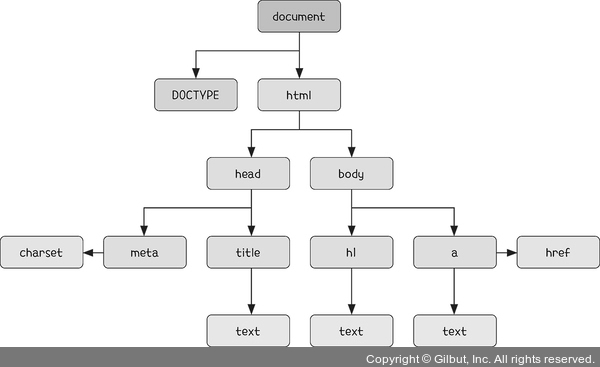

### 1. 문서 객체 모델

#### 1) 정의

  - 문서 객체 모델(DOM) : 웹 브라우저에 표시되는 HTML 문서 구조를 객체화한 모델 구조

    → DOM 트리



  - document 객체 하위에 HTML 태그 요소, 속성, 텍스트, 주석  →  각각 노드라고 부름

  - 가장 꼭대기 노드 : 루트 노드 (HTML), document는 노드가 아니라 객체.

  - 노드끼리 부모, 자식, 형제 관계 형성

 

#### 2) 노드 타입

<table>
<tbody>
<tr>
<td>문서 노드 (Node.DOCUMENT_NODE)</td>
<td>최상위 document 객체의 노드 타입</td>
</tr>
<tr>
<td>요소 노드 (Node.ELEMENT_NODE)</td>
<td>h1, p 태그와 같은 요소의 노드 타입</td>
</tr>
<tr>
<td>속성 노드 (Node.ATTRIBUTE_NODE)</td>
<td>href, src와 같은 속성의 노드 타입</td>
</tr>
<tr>
<td>텍스트 노드 (Node.TEXT_NODE) </td>
<td>텍스트에 해당하는 노드 타입</td>
</tr>
<tr>
<td>주석 노드 (Node.COMMENT_NODE)</td>
<td>주석에 해당하는 노드타입</td>
</tr>
</tbody>
</table>

  - CSS와 관련 있는 노드 타입은 없음.

---

### 2. 노드 선택하기

#### 1) 속성으로 노드 선택하기

<table>
<tbody>
<tr>
<td rowspan="6">모든 노드 탐색</td>
<td>parentNode</td>
<td>부모 노드 반환</td>
</tr>
<tr>
<td>childNodes</td>
<td>모든 자식 노드 반환</td>
</tr>
<tr>
<td>firstChild</td>
<td>첫 번째 자식 노드 반환</td>
</tr>
<tr>
<td>lastChild</td>
<td>마지막 자식 노드 반환</td>
</tr>
<tr>
<td>previousSibling</td>
<td>이전 형제 노드 반환</td>
</tr>
<tr>
<td>nextSibling</td>
<td>다음 형제 노드 반환</td>
</tr>
<tr>
<td rowspan="6">요소 노드 탐색</td>
<td>parentElement</td>
<td>부모 요소 노드 반환</td>
</tr>
<tr>
<td>childeren</td>
<td>자식 요소 노드 반환</td>
</tr>
<tr>
<td>firstElementChild</td>
<td>첫 번째 자식 요소 노드 반환</td>
</tr>
<tr>
<td>lastElementChild</td>
<td>마지막 자식 요소 노드 반환</td>
</tr>
<tr>
<td>previousElementSibling</td>
<td>이전 요소 노드 반환</td>
</tr>
<tr>
<td>nextElementSibling</td>
<td>다음 요소 노드 반환</td>
</tr>
</tbody>
</table>

  - 연속으로 사용 가능

 

#### 2) 메서드로 노드 선택

  - get 메서드 : 속성값과 태그명 사용

<table>
<tbody>
<tr>
<td>getElementById(&#x3C;id 속성값>)</td>
<td>id 속성값과 일치하는 요소 노드를 1개만 선택</td>
</tr>
<tr>
<td>getElementByClassName(&#x3C;class 속성값>)</td>
<td>class 속성값과 일치하는 요소 노드를 모두 선택</td>
</tr>
<tr>
<td>getElementByTagName(&#x3C;태그명>)</td>
<td>태그명과 일치하는 요소 노드를 모두 선택</td>
</tr>
</tbody>
</table>

 

  - 해당하면 요소 노드가 여러개일 경우  →   지정 객체 유사 배열. 인덱스로 접근 가능

 

  - query 메서드 : CSS 선택자 사용

<table>
<tbody>
<tr>
<td>querySelector(&#x3C;CSS 선택자>)</td>
<td>CSS 선택자에 해당하는 노드 1개 선택</td>
</tr>
<tr>
<td>querySelectorAll(&#x3C;CSS 선택자>)</td>
<td>CSS 선택자에 해당하는 노드 모두 선택</td>
</tr>
</tbody>
</table>

  - get 메서드 보다 범용성이 좋음

---

### 3. 노드 조작하기

#### 1) 콘텐츠 조작하기

<table>
<tbody>
<tr>
<td>textContent</td>
<td>요소 노드의 모든 텍스트에 접근</td>
</tr>
<tr>
<td>innerText</td>
<td>요소 노드의 텍스트 중 웹 브라우저에 표시되는 텍스트에만 접근</td>
</tr>
<tr>
<td>innerHTML</td>
<td>요소 노드의 텍스트 중 HTML 태그를 포함한 텍스트에만 접근</td>
</tr>
</tbody>
</table>

```html
<p id="title">Hello, <span style="display:none;">Javascript!</span></p>
```

```javascript
document.getElementById("title").textContent; // Hello, Javascript!
document.getElementById("title").innerText; // Hello,
document.getElementById("title").innerHTML; // Hello, <span stlyle="display:none;"Javascript!</span>
```

  - 속성에 값 할당하면 노드의 콘텐츠 변경 가능

 

#### 2) 스타일 조작하기

```javascript
<노드>.style.<css 속성명> = <속성값>;
```

```html
<p id="text">text</p>
<script>
  const pEl = doucument.querySelecot("p");  // 노드 선택하기
  pEl.style.color = "red";
  pEl.style.fontSize = "20px";
</script>
```

 

  - 속성명에 대시(-)있을 경우 카멜 표기법으로 작성

 

#### 3) 클래스 속성 조작하기

```html
<노드>.classList.add("class 속성값");  // 추가
<노드>.classList.remove("class 속성값");  // 삭제
<노드>.classList.toggle("class 속성값");  // 추가와 삭제 반복
```

 

#### 4) 데이터 속성 조작하기

  - data-\* 속성 : 사용자 정의 속성

```html
<button data-cnt="10">가방 구매</button>
  <button data-cnt="0">신발 구매</button>
  <script>
    const buttonEls = document.querySelectorAll("button");
    buttonEls.forEach((el) => {
      console.log(el.dataset);
      console.log(el.dataset.cnt);
      el.dataset.cnt = 50;
    })
  </script>
```

 

#### 5) 메서드로 속성 조작하기

<table>
<tbody>
<tr>
<td>&#x3C;노드>.getAttribute("속성명");</td>
<td>속성값을 가져옴</td>
</tr>
<tr>
<td>&#x3C;노드>.setAttribute("속성명", "속성값);</td>
<td>속성값을 설정</td>
</tr>
<tr>
<td>&#x3C;노드>.removeAttribute("속성명");</td>
<td>속성을 삭제</td>
</tr>
</tbody>
</table>

  - 모든 속성의 상위 메서드

 

classList 속성에서 속성값 추가 or 삭제 → 기존 요소의 속성값 보존

Attribute 메서드로 속성값 추가 or 삭제 → 기존 class 속성값 보존 X

---

### 4. 노드 추가 / 삭제

#### 1) 노드 추가하기

 - DOM 트리에 새로운 노드 생성 → 생성 노드를 기존 DOM 트리 노드와 연결

<table>
<tbody>
<tr>
<td rowspan="3">노드 생성</td>
<td>createElement()</td>
<td>요소 노드 생성</td>
</tr>
<tr>
<td>createTextNode()</td>
<td>텍스트 노드를 생성</td>
</tr>
<tr>
<td>createAttribute()</td>
<td>속성 노드를 생성</td>
</tr>
<tr>
<td rowspan="2">노드 연결</td>
<td>&#x3C;기준 노드>.appendchild(&#x3C;자식 노드>)</td>
<td>기준 노드에 자식 노드 연결</td>
</tr>
<tr>
<td>&#x3C;기준 노드>.setAttributeNode(&#x3C;속성노드>)</td>
<td>기준 노드에 속성 노드 연결</td>
</tr>
</tbody>
</table>

```html
<script>
    // 요소 노드 생성하기
    const aEl = document.createElement("a"); 
    document.body.appendChild(aEl);

    // 텍스트 노드 추가하기
    const txtEl = document.createTextNode("길벗");
    document.querySelector("a").appendChild(txtEl);

    // href 속성 추가하기
    const hrefAttr = document.createAttribute("href");
    hrefAttr.value = 'https://www.gilbut.co.kr';
    document.querySelector("a").setAttributeNode(hrefAttr);

  </script>
```

 

#### 2) 노드 삭제하기

```javascript
<부모 노드>.removeChild.(<자식 노드>)
```

  - 부모 노드에 연결된 자식 노드 삭제

```html
  <p>text 1</p>
  <a href="https://www.gilbut.co.kr">길벗</a>
  <a href="https://www.sucoding.kr">수코딩</a>
  <script>
    const childNodes = document.body.childNodes; 
    childNodes.forEach((node)=>{
      if(node.nodeName === "A") 
        node.parentNode.removeChild(node);
    })
  </script>
  <!-- a 태그에 해당하는 요소 노드 모두 삭제 -->
```

 
