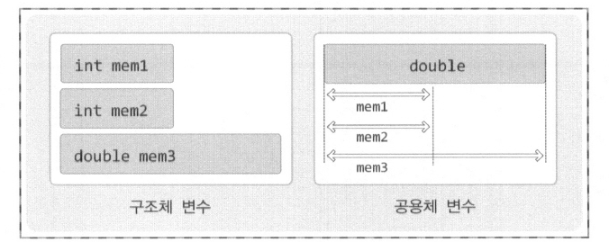

#### 1. 구조체 

  - 하나 이상의 [[변수]]([[Pointer|포인터]], [[배열]] 포함)을 묶어서 새로운 자료형을 정의하는 도구

```cpp
struct point {  // point라는 이름의 구조체 정의
  int xpos;     // point 구조체의 멤버 xpos
  int ypos; 	// point 구조체의 멤버 ypos
};
```

```cpp
struct person{
  char name[20];
  char phoneNum[20];
  int age;
};
```

  - 선언 마지막에 세미콜론(;) 필요

  - 접근 방식 : 변수 이름.멤버 이름

```cpp
pos.xpos = 20;
man.name = "Steve";
```

 

  - typedef : struct 선언 생략 위해 사용

```cpp
typedef struct point{  // point 생략 가능
 int xpos;
 int ypos;
} Point;  // 변수 선언시 Point 사용

int main(){
  Point pos1;  // 변수 선언
```

 

  - 변수 초기화 시에는 데이터 단순 나열.

```cpp
Person man={"이승기", "010-1212-0111", 21};  // 초기화
```

 

  - 초기화 X 하고 문자열 저장 위해선 strcpy 사용

```cpp
Person man;
strcpy(man.name, "이승기");
strcpy(man.phoneNum, "010-1212-1212");
```

---

#### 2. 구조체의 배열과 포인터

  - [[구조체 배열]]

```cpp
Person man[3] = {  // Person 구조체 X 3
  {"이승기", "010-1111-1111", 21},  // 첫 번째 요소 초기화
  {"정지영", "010-2222-2222", 22},  // 두 번째 요소 초기화
  {"김사용", "010-3333-3333", 33},  // 세 번째 요소 초기화
}
```

 

  - 구조체 포인터

```cpp
Point pos = {11, 12};  // xpos, ypos 를 각각 11, 12로 초기화
Point *pptr = &pos;    // 포인터 변수 pptr이 구조체 변수 pos 를 가리킴

(*pptr).xpos=10;  // pptr이 가리키는 구조체 변수의 멤버 xpos에 10 저장
pptr->xpos=10;    // 위 선언과 동일한 문장

pptr->ypos += 2;  pptr이 가리키는 구조체 변수의 멤버 ypos의 값 2 증가'
```

 

  - type 구조체 변수의 멤버로 type형 포인터 변수 가능

```cpp
typedef struct{
  int xpos;
  int ypos;
  struct point *ptr;  // 구조체 point의 포인터 변수 선언
} Point;
```

 

  - 구조체 변수의 주소 값 = 첫 번째 멤버의 주소 값

---

#### 3. 공용체 



  - 공용체 : union 으로 선언

  - 공용체의 멤버들이 [[메모리]] 공간 공유

```cpp
struct mem1(){
  int mem1;
  int mem2;
  double mem3;
};   // 총 16 할당

union mem2(){
  int mem1;
  int mem2;
  double mem3;
};   // 총 8 할당(double 만큼만)
```

---

#### 4. 열거형

  - 열거형 : enum 으로 선언

```cpp
typedef enum syllable{
  Do=1, Re=2, Mi=3, Fa=4, So=5, La=6, Ti=7;
} Syllable;

// 상수로 정의해 저장
```

  - 이름있는 [[상수]]의 정의를 통한 의미 부여

  - 자료형 이름 생략 형태로 열거 정의 가능

```cpp
enum {Do=1, Re=2, Mi=3, Fa=4, So=5, La=6, Ti=7};
```

 
