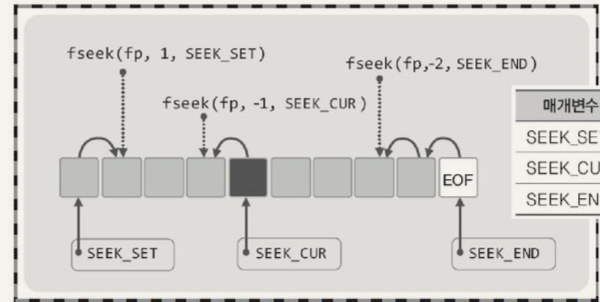
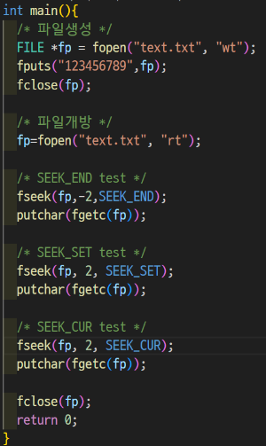
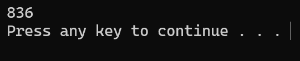

#### 1. 파일의 스트림과 입출력

  - fopen 통해 파일과의 스트림 형성

  - fclose 통해 파일과의 스트림 해제

```cpp
int main(){
  FILE *fp = fopen("data.txt", "wt");
  
  fclose(fp);
```

  - 스트림의 종류

<table>
<tbody>
<tr>
<td>모드(mode)</td>
<td>스트림 성격</td>
<td>파일 없을 시</td>
</tr>
<tr>
<td>r</td>
<td>읽기 가능</td>
<td>에러</td>
</tr>
<tr>
<td>w</td>
<td>쓰기 가능</td>
<td>생성</td>
</tr>
<tr>
<td>a</td>
<td>파일의 끝에 덧붙여 쓰기 가능</td>
<td>생성</td>
</tr>
<tr>
<td>r+</td>
<td>읽기/쓰기 가능</td>
<td>에러</td>
</tr>
<tr>
<td>w+</td>
<td>읽기/쓰기 가능</td>
<td>생성</td>
</tr>
<tr>
<td>a+</td>
<td>읽기/덧붙여 쓰기 가능</td>
<td>생성</td>
</tr>
</tbody>
</table>

 

  - 스트림을 종료하지 않고 버퍼만 비우고 싶을 때에는 fflush 함수 호출

---

#### 2. 텍스트와 바이너리

  - 텍스트 파일(t) : 사람이 인식할 수 있는 문자를 담고 있는 파일

  - 바이너리 파일(b) : 컴퓨터가 인식할 수 있는 데이터를 담고 있는 파일

 

  - 개행

<table>
<tbody>
<tr>
<td>C언어 </td>
<td>\n</td>
</tr>
<tr>
<td>MS-DOS(Windows)의 파일 내 개행</td>
<td>\r\n</td>
</tr>
<tr>
<td>Mac의 파일 내 개행 </td>
<td>\r</td>
</tr>
<tr>
<td>Unix 계열의 파일 내 개행</td>
<td>\n</td>
</tr>
</tbody>
</table>

 

  - 파일을 텍스트 모드(t)로 개방하면 개행 형태 변환 자동으로 이루어짐

---

#### 3. 파일 입출력 함수

  - 문자열이 파일에 저장될 때 널 문자 저장 X. 대신 개행을 기준으로 문자열 구분

 

  - feof(파일명) : 더 이상 읽어 들일 데이터가 없으면 0이 아닌값 반환

```cpp
if(feof(src)!=0)
  puts("파일복사 완료!");
else
  puts("파일복사 실패");
```

 

  - 바이너리 데이터의 입출력

```cpp
int buf[12];
fread((void*)buf, sizeof(int), 12, fp);  // fp는 파일 구조체 포인터

// sizeof(int) 크기의 데이터 12개를 fp로부터 읽어 들여서 배열 buf에 저장하라!

fwrite((void*)buf, sizeof(int), 7, des)

// sizeof(int) 크기의 데이터 7개를 buf로부터 읽어 들여서 파일 des에 저장하라!
```

  - 구조체 변수 인식 가능  

 

  - 서식에 따른 데이터 입출력 : fprintf, fscanf

```cpp
char name[10] = "홍길동";  // 텍스트 데이터
char sex = 'M';  // 텍스트 데이터
int age = 24;  // 바이너리 데이터

fprintf(fp, "%s %c %d", name, sex, age);  // fp는 FILE 구조체 포인터

fscanf(fp, "%s %c %d", name, &sex, &age);
```

  - fprintf : 문자열이 fp 파일에 저장

  - fscanf : 문자열을 fp 파일에서 읽어들임. 파일 끝 도달 or 오류 발생 시 EOF 반환

---

#### 4. 파일 위치 지시자

  - 파일 위치 지시자 : 파일의 위치 정보를 저장하고 있는 멤버

  - fseek : 파일 위치 지시자 이동. 파일의 중간 or 마지막 부터 데이터 읽기/쓰기

 

```cpp
int fseek(FILE * stream, long offset, int wherefrom);
```

<table>
<tbody>
<tr>
<td>SEEK_SET(0)</td>
<td>파일 맨 앞에서부터 이동 시작</td>
</tr>
<tr>
<td>SEEK_CUR(1)</td>
<td>현재 위치부터 이동 시작</td>
</tr>
<tr>
<td>SEEK_END(2)</td>
<td>파일 맨 끝에서부터 이동 시작</td>
</tr>
</tbody>
</table>

  - offset은 양, 음의 정수 both 가능. 음의 정수면 파일 시작을 향해 이동



 



 

  - ftell : 현재의 파일 위치 지시자 정보 확인

```cpp
long ftell(FILE * stream);
```

  - 첫 번째 바이트 0 반환, 세 번째 바이트 2 반환.
